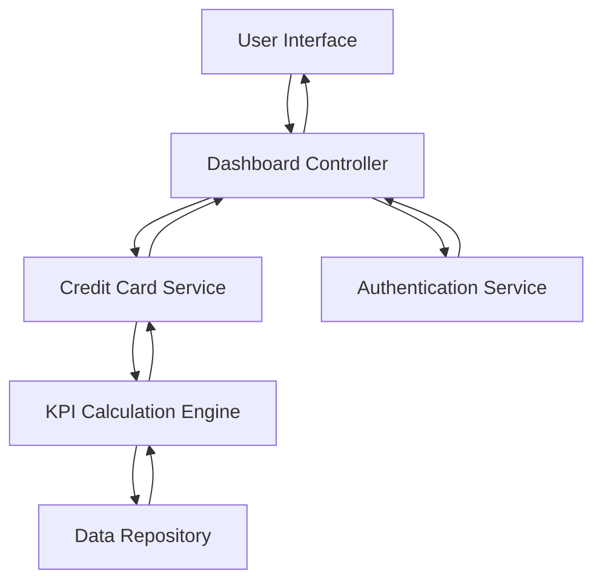

#### 1. High-Level Design

- **Summary**: This epic delivers a consolidated dashboard that displays key performance indicators (KPIs) for a user's credit card portfolio, including Monthly Spend, Total Credit Limit, Available Credit, and Outstanding Amount. The dashboard provides a multi-card view enabling users to monitor their overall credit card financial health from a single responsive interface.

- **Component Flow**:

- **Integration Points**: 
  - Credit card data source or mock data service (provides card details and transaction data)
  - User authentication service (validates user identity and retrieves user-specific card information)

- **Key Assumptions**: 
  - KPI calculations are performed server-side based on aggregated transaction data; data is assumed to be pre-validated for accuracy.
  - Dashboard refresh is triggered on page load and can be manually refreshed; real-time push updates are not implemented in initial version.

- **NFR Highlights**: Dashboard must load within 2 seconds; system must support real-time calculation of KPIs; interface must be responsive across desktop, tablet, and mobile devices; data refresh rate should be near real-time or configurable.

#### 2. Validation Report

- **Requirements Coverage**: The design covers all stated requirements including KPI display (Monthly Spend, Total Credit Limit, Available Credit, Outstanding Amount), multi-card portfolio view, responsive layout, and integration with authentication and data services. The component flow ensures proper separation of concerns with dedicated services for authentication, data retrieval, and KPI calculation. The 2-second load time requirement is addressed through efficient data aggregation and caching strategies in the KPI Calculation Engine.