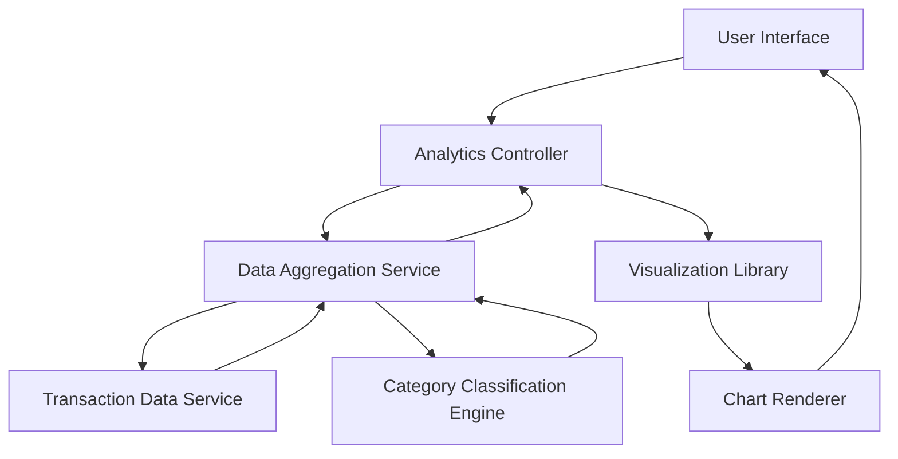

#### 1. High-Level Design

- **Summary**: This epic delivers interactive data visualizations and analytics that enable users to understand spending patterns across categories and time periods. The solution provides monthly spend trends, card-wise spend analysis, and category-wise breakdowns across nine predefined categories (Food & Dining, Fuel, Shopping, Travel, Entertainment, Utilities, Healthcare, Education, Miscellaneous), empowering users to make data-driven financial decisions.

- **Component Flow**:

- **Integration Points**: 
  - Transaction data service (provides raw transaction data for aggregation and analysis)
  - Charting and visualization library such as Chart.js or D3.js (renders interactive charts and graphs)
  - Category classification engine or service (classifies transactions into predefined spending categories)

- **Key Assumptions**: 
  - Transactions are pre-classified into categories by the classification engine; manual re-categorization is not supported in initial version.
  - Historical data is retained for 12 months; older data may be archived and requires separate retrieval process.

- **NFR Highlights**: Charts and visualizations must render within 3 seconds; system must support dynamic data aggregation for trend analysis; analytics must handle historical data for at least 12 months; visualizations must be interactive and responsive across all device sizes.

#### 2. Validation Report

- **Requirements Coverage**: The design comprehensively covers all requirements including monthly spend trends, card-wise analysis, category-wise breakdown across all nine specified categories, interactive visualizations, and responsive interface. The architecture provides clear separation between data aggregation, category classification, and visualization rendering. The 3-second rendering requirement is achievable through optimized data aggregation and efficient chart rendering. The design supports 12-month historical data analysis and ensures responsive, interactive visualizations across all device types through the use of modern charting libraries.