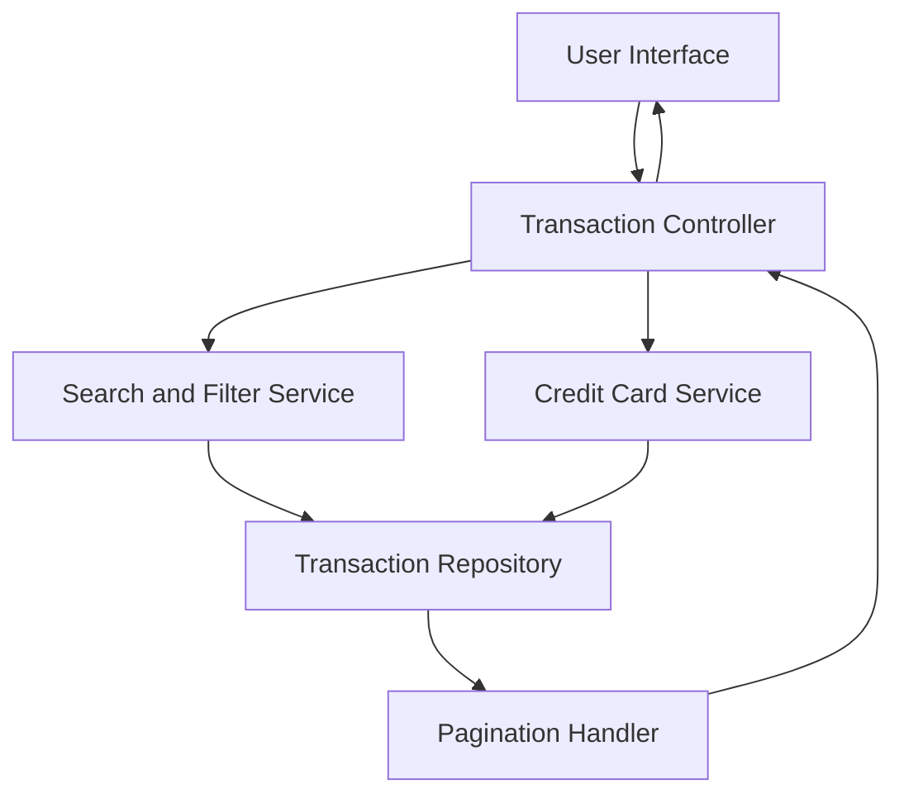

#### 1. High-Level Design

- **Summary**: This epic provides a comprehensive transaction management interface allowing users to view, filter, and search credit card transactions across all their cards. The interface supports detailed transaction history with pagination, multi-card transaction aggregation, and advanced filtering capabilities to help users track spending and identify patterns.

- **Component Flow**:

- **Integration Points**: 
  - Transaction data service or repository (provides transaction records with filtering and pagination support)
  - Credit card service (retrieves card-specific transaction data and card metadata)
  - Date and currency formatting libraries (ensures consistent display of transaction dates and amounts)

- **Key Assumptions**: 
  - Transactions are stored in a structured format with indexed fields for efficient filtering and search (e.g., date, amount, category, merchant).
  - Pagination defaults to 50 transactions per page; users can adjust page size within system-defined limits.

- **NFR Highlights**: Transaction list must support pagination for large datasets; search and filter operations must complete within 1 second; system must handle at least 10,000 transactions per user; transaction data must be displayed accurately with proper date and amount formatting.

#### 2. Validation Report

- **Requirements Coverage**: The design addresses all core requirements including transaction listing, multi-card support, filtering and search capabilities, transaction detail view, and responsive interface. The architecture separates concerns with dedicated services for search/filter operations and pagination handling. Performance requirements (1-second search/filter, 10,000 transaction capacity) are supported through indexed data structures and efficient query optimization in the Transaction Repository. The design ensures accurate data display through integration with formatting libraries.