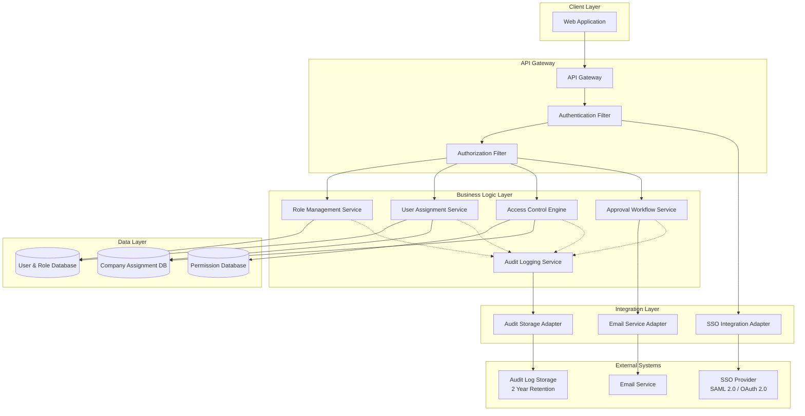
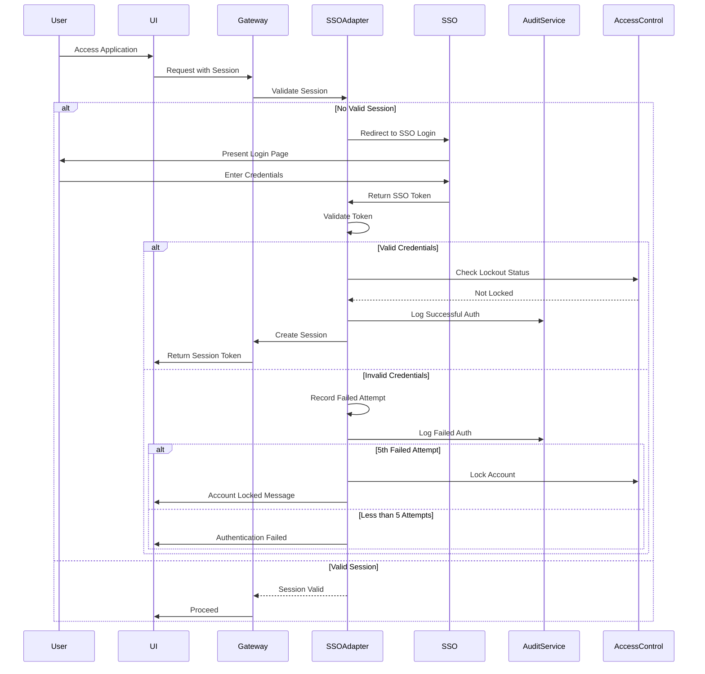
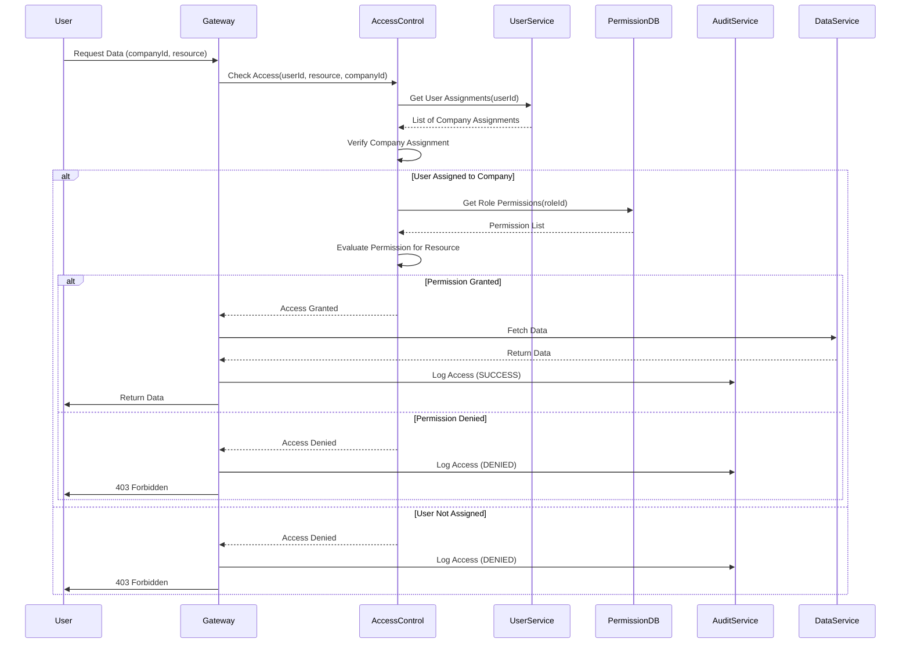
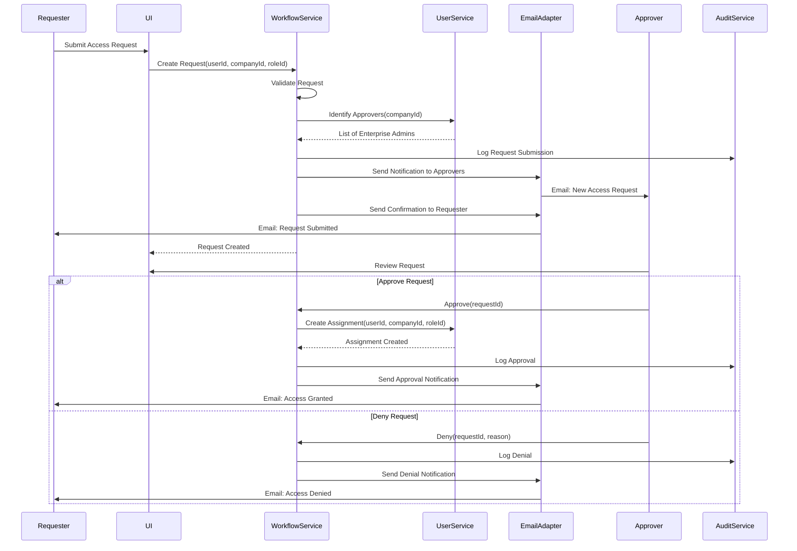
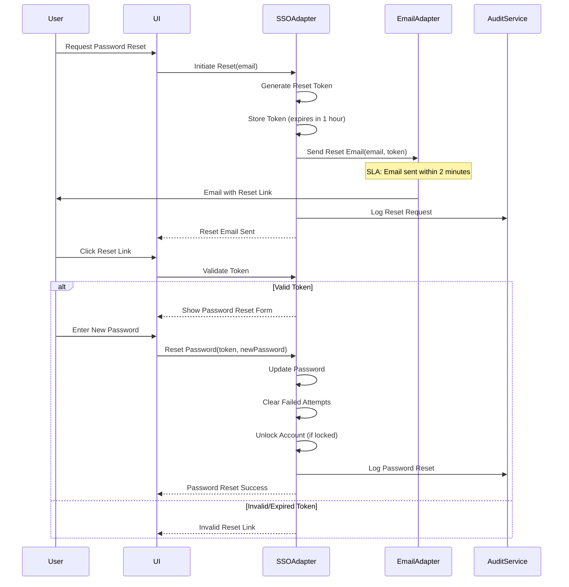

# High-Level Design Document

## Epic: DAVPEFEATURETESTING1-Role-Based Access Control and Security Management

**Project Key:** QE  
**Epic Type:** Epic  
**Label:** DAVPEFEATURETESTING1

---

## 1. Epic Overview

### 1.1 Summary
Implement comprehensive role-based access control (RBAC) system enabling Enterprise Admins to securely manage user permissions, restrict data visibility by portfolio company, and maintain audit logs of all access activities. This ensures that sensitive portfolio data is protected and users only access information appropriate to their role and assigned companies.

### 1.2 User Value
Protects sensitive portfolio company data through granular access controls, ensures compliance with security policies, and gives Enterprise Admins complete visibility and control over who can access what data, reducing security risks and meeting regulatory requirements.

### 1.3 Business Context
This epic addresses the critical need for secure access management in a portfolio management environment where multiple stakeholders require different levels of access to sensitive company data. The system must ensure data confidentiality, integrity, and compliance with regulatory requirements while maintaining operational efficiency.

---

## 2. Requirements

### 2.1 Functional Requirements

#### FR-001: Role Definition and Management
- System shall support the following predefined roles:
  - Enterprise Admin
  - Operating Partner
  - Deal Partner
  - General Partner
- Enterprise Admins shall be able to view and manage role definitions
- Each role shall have associated permissions and access levels

#### FR-002: User-to-Company Assignment
- Enterprise Admins shall be able to assign users to specific portfolio companies
- Users shall be able to be assigned to multiple companies
- User assignments shall determine data visibility scope

#### FR-003: Granular Access Control
- System shall enforce access control by company
- System shall enforce access control by data type
- Access permissions shall be role-based
- Users shall only access data for assigned companies

#### FR-004: Audit Logging
- System shall log all user authentication activities
- System shall log all data access activities with:
  - User ID
  - Timestamp
  - Resource accessed
  - Action performed
- Audit logs shall be immutable

#### FR-005: SSO Integration
- System shall integrate with existing SSO provider
- Authentication shall be delegated to SSO system
- System shall support SAML 2.0 or OAuth 2.0 protocols

#### FR-006: User Lockout and Recovery
- System shall lock user accounts after 5 failed login attempts
- System shall provide password reset functionality
- Password reset emails shall be sent to registered email addresses

#### FR-007: Permission Inheritance and Delegation
- System shall support permission inheritance models
- System shall allow authorized users to delegate permissions
- Delegation shall be auditable and traceable

#### FR-008: Access Request and Approval Workflows
- Users shall be able to request additional access
- Enterprise Admins shall be able to approve or deny access requests
- Access request status shall be tracked and notified

### 2.2 Non-Functional Requirements

#### NFR-001: SSO Integration Compliance
**Requirement:** All authentication must integrate with existing SSO solutions  
**Target:** 100% of authentication flows through SSO  
**Validation:** Integration testing with SSO provider  
**Status:** Design phase - integration architecture defined

#### NFR-002: Audit Logging Coverage
**Requirement:** All data access must be logged with user ID, timestamp, and resource accessed  
**Target:** 100% of data access operations logged  
**Validation:** Audit log completeness testing  
**Status:** Design phase - logging framework to be implemented

#### NFR-003: Audit Log Retention
**Requirement:** Audit logs must be retained for minimum 2 years  
**Target:** 2+ years retention with archival strategy  
**Validation:** Storage configuration and retention policy verification  
**Status:** Design phase - retention policy to be configured

#### NFR-004: Account Lockout Security
**Requirement:** Failed login attempts must trigger account lockout after 5 attempts  
**Target:** Lockout triggered on 5th failed attempt within configured time window  
**Validation:** Security testing and penetration testing  
**Status:** Design phase - lockout mechanism to be implemented

#### NFR-005: Password Reset Performance
**Requirement:** Password reset emails must be sent within 2 minutes  
**Target:** ≤ 2 minutes from request to email delivery  
**Validation:** Performance testing of email notification system  
**Status:** Design phase - email service integration required

#### NFR-006: Concurrent User Capacity
**Requirement:** System must support 1,000 concurrent authenticated users  
**Target:** 1,000+ concurrent users without performance degradation  
**Validation:** Load testing with 1,000+ concurrent sessions  
**Status:** Design phase - scalability architecture defined

---

## 3. Architecture Overview

### 3.1 High-Level Architecture

The RBAC system follows a layered architecture pattern with clear separation of concerns:

- **Presentation Layer:** User interface for role management, user assignment, and access requests
- **API Gateway Layer:** Entry point for all requests with authentication and authorization checks
- **Business Logic Layer:** Core RBAC engine, permission evaluation, and workflow management
- **Integration Layer:** SSO integration, email service, and audit log storage
- **Data Layer:** User roles, permissions, assignments, and audit logs

### 3.2 Architecture Diagram



### 3.3 Technology Stack Assumptions

**Note:** Specific technology choices are not defined in the epic. The following are architectural assumptions that should be validated:

- **Backend Framework:** Assumed modern application framework (e.g., Spring Boot, .NET Core, Node.js)
- **Database:** Assumed relational database for transactional consistency
- **SSO Protocol:** SAML 2.0 or OAuth 2.0 as specified
- **Audit Storage:** Assumed dedicated audit log storage system with retention capabilities
- **Email Service:** Assumed SMTP or cloud-based email service

---

## 4. Component Design

### 4.1 Role Management Service

**Responsibilities:**
- Manage role definitions (Enterprise Admin, Operating Partner, Deal Partner, General Partner)
- Define permissions associated with each role
- Provide role query and validation capabilities

**Key Operations:**
- `getRoleDefinitions()`: Retrieve all role definitions
- `getRolePermissions(roleId)`: Get permissions for a specific role
- `validateRole(roleId)`: Validate role existence and status

**Data Model:**
```
Role:
  - roleId: UUID
  - roleName: String
  - description: String
  - permissions: List<Permission>
  - createdAt: Timestamp
  - updatedAt: Timestamp

Permission:
  - permissionId: UUID
  - resource: String
  - action: String (READ, WRITE, DELETE, ADMIN)
  - scope: String (COMPANY, GLOBAL)
```

### 4.2 User Assignment Service

**Responsibilities:**
- Assign users to portfolio companies
- Manage user-role associations
- Handle multi-company assignments

**Key Operations:**
- `assignUserToCompany(userId, companyId, roleId)`: Create user-company assignment
- `removeUserFromCompany(userId, companyId)`: Remove assignment
- `getUserAssignments(userId)`: Get all assignments for a user
- `getCompanyUsers(companyId)`: Get all users assigned to a company

**Data Model:**
```
UserAssignment:
  - assignmentId: UUID
  - userId: UUID
  - companyId: UUID
  - roleId: UUID
  - assignedBy: UUID
  - assignedAt: Timestamp
  - expiresAt: Timestamp (optional)
```

### 4.3 Access Control Engine

**Responsibilities:**
- Evaluate access permissions in real-time
- Enforce company-level data isolation
- Apply role-based permission checks

**Key Operations:**
- `checkAccess(userId, resource, action, companyId)`: Boolean access check
- `getAccessibleCompanies(userId)`: List companies user can access
- `getAccessibleResources(userId, companyId)`: List resources user can access
- `evaluatePermission(userId, permission)`: Evaluate specific permission

**Access Control Logic:**
```
Access Granted IF:
  1. User is authenticated via SSO
  2. User has active assignment to the company
  3. User's role includes required permission
  4. Resource belongs to assigned company OR user has global scope
  5. Account is not locked
```

### 4.4 Audit Logging Service

**Responsibilities:**
- Capture all authentication events
- Log all data access operations
- Ensure immutability and retention compliance

**Key Operations:**
- `logAuthenticationEvent(userId, eventType, success, metadata)`: Log auth event
- `logDataAccess(userId, resource, action, companyId, result)`: Log data access
- `logPermissionChange(adminId, targetUserId, change)`: Log permission modifications
- `queryAuditLogs(filters, dateRange)`: Query audit logs

**Audit Log Schema:**
```
AuditLog:
  - logId: UUID
  - timestamp: Timestamp (ISO 8601)
  - userId: UUID
  - eventType: String (AUTH, ACCESS, PERMISSION_CHANGE)
  - resource: String
  - action: String
  - companyId: UUID (optional)
  - result: String (SUCCESS, FAILURE, DENIED)
  - ipAddress: String
  - userAgent: String
  - metadata: JSON
```

### 4.5 Approval Workflow Service

**Responsibilities:**
- Manage access request submissions
- Route requests to appropriate approvers
- Track approval status and history
- Trigger notifications

**Key Operations:**
- `submitAccessRequest(userId, companyId, roleId, justification)`: Create request
- `approveRequest(requestId, approverId)`: Approve access request
- `denyRequest(requestId, approverId, reason)`: Deny access request
- `getRequestStatus(requestId)`: Get request status
- `getPendingRequests(approverId)`: Get requests pending approval

**Workflow States:**
```
AccessRequest:
  - requestId: UUID
  - requesterId: UUID
  - companyId: UUID
  - roleId: UUID
  - justification: String
  - status: PENDING | APPROVED | DENIED | EXPIRED
  - submittedAt: Timestamp
  - reviewedBy: UUID (optional)
  - reviewedAt: Timestamp (optional)
  - reviewNotes: String (optional)
```

### 4.6 SSO Integration Adapter

**Responsibilities:**
- Handle SSO authentication flows
- Validate SSO tokens/assertions
- Manage session lifecycle
- Implement account lockout logic

**Key Operations:**
- `authenticateUser(ssoToken)`: Validate SSO token and create session
- `validateSession(sessionId)`: Verify active session
- `logout(sessionId)`: Terminate session
- `recordFailedAttempt(userId)`: Track failed login attempts
- `checkLockoutStatus(userId)`: Check if account is locked

**Lockout Mechanism:**
```
FailedLoginAttempt:
  - userId: UUID
  - attemptTimestamp: Timestamp
  - ipAddress: String
  
Lockout Logic:
  - Track failed attempts within rolling 30-minute window
  - Lock account after 5 failed attempts
  - Lockout duration: 30 minutes (configurable)
  - Clear failed attempts on successful login
```

### 4.7 Email Service Adapter

**Responsibilities:**
- Send password reset emails
- Send access request notifications
- Send approval/denial notifications
- Ensure delivery within SLA (2 minutes)

**Key Operations:**
- `sendPasswordResetEmail(userId, resetToken)`: Send reset email
- `sendAccessRequestNotification(requestId, approverId)`: Notify approver
- `sendAccessDecisionNotification(requestId, requesterId, decision)`: Notify requester

**Email Templates:**
- Password Reset
- Access Request Submitted (to requester)
- Access Request Pending (to approver)
- Access Request Approved (to requester)
- Access Request Denied (to requester)

---

## 5. Data Flow

### 5.1 User Authentication Flow



### 5.2 Data Access Authorization Flow



### 5.3 Access Request and Approval Flow



### 5.4 Password Reset Flow



---

## 6. APIs and Integrations

### 6.1 External Integrations

#### 6.1.1 SSO Provider Integration

**Protocol:** SAML 2.0 or OAuth 2.0  
**Purpose:** Delegate authentication to existing SSO solution  
**Direction:** Outbound from RBAC system to SSO provider

**SAML 2.0 Integration Points:**
- **SP-Initiated SSO:** RBAC system redirects to SSO IdP for authentication
- **Assertion Consumer Service (ACS):** Endpoint to receive SAML assertions
- **Single Logout (SLO):** Coordinate logout across systems

**OAuth 2.0 Integration Points:**
- **Authorization Endpoint:** Redirect users for authorization
- **Token Endpoint:** Exchange authorization code for access token
- **UserInfo Endpoint:** Retrieve user profile information

**Required Configuration:**
- SSO provider endpoint URLs
- Entity ID / Client ID
- X.509 certificate for SAML signature validation OR client secret for OAuth
- Attribute mapping (user ID, email, display name)

**Assumption:** SSO provider supports required protocol and provides necessary configuration details.

#### 6.1.2 Email Service Integration

**Protocol:** SMTP or REST API (cloud email service)  
**Purpose:** Send transactional emails for password reset and notifications  
**Direction:** Outbound from RBAC system to email service

**Email Types:**
- Password reset emails (SLA: 2 minutes)
- Access request notifications
- Access approval/denial notifications

**Required Configuration:**
- SMTP server details (host, port, credentials) OR API endpoint and credentials
- From address and display name
- Email templates

**Assumption:** Email service can deliver emails within 2-minute SLA under normal conditions.

#### 6.1.3 Audit Log Storage System

**Protocol:** REST API or database connection  
**Purpose:** Persist audit logs with 2-year retention  
**Direction:** Outbound from RBAC system to audit storage

**Requirements:**
- Write-once, read-many (immutable) storage
- Minimum 2-year retention policy
- Query capabilities for audit log retrieval
- High availability and durability

**Data Volume Estimation:**
- Assumption: 1,000 concurrent users, average 100 operations per user per day
- Daily audit log entries: ~100,000
- Annual audit log entries: ~36.5 million
- 2-year storage: ~73 million records

**Assumption:** Dedicated audit storage system exists or will be provisioned with appropriate retention policies.

#### 6.1.4 Identity Management System

**Protocol:** REST API or LDAP  
**Purpose:** User provisioning and profile synchronization  
**Direction:** Bidirectional (query user information, sync updates)

**Integration Points:**
- User profile retrieval (email, name, employee ID)
- User status verification (active, inactive, terminated)

**Note:** User provisioning automation from external HR systems is explicitly out of scope.

### 6.2 Internal APIs

#### 6.2.1 Role Management API

**Base Path:** `/api/v1/roles`

**Endpoints:**

```
GET /api/v1/roles
Description: Get all role definitions
Authorization: Enterprise Admin
Response: List of Role objects

GET /api/v1/roles/{roleId}
Description: Get specific role details
Authorization: Authenticated users
Response: Role object with permissions

GET /api/v1/roles/{roleId}/permissions
Description: Get permissions for a role
Authorization: Authenticated users
Response: List of Permission objects
```

#### 6.2.2 User Assignment API

**Base Path:** `/api/v1/assignments`

**Endpoints:**

```
POST /api/v1/assignments
Description: Assign user to company with role
Authorization: Enterprise Admin
Request Body:
  {
    "userId": "uuid",
    "companyId": "uuid",
    "roleId": "uuid"
  }
Response: UserAssignment object

DELETE /api/v1/assignments/{assignmentId}
Description: Remove user assignment
Authorization: Enterprise Admin
Response: 204 No Content

GET /api/v1/assignments/user/{userId}
Description: Get all assignments for a user
Authorization: Enterprise Admin or self
Response: List of UserAssignment objects

GET /api/v1/assignments/company/{companyId}
Description: Get all users assigned to a company
Authorization: Enterprise Admin
Response: List of UserAssignment objects
```

#### 6.2.3 Access Control API

**Base Path:** `/api/v1/access`

**Endpoints:**

```
POST /api/v1/access/check
Description: Check if user has access to resource
Authorization: System internal
Request Body:
  {
    "userId": "uuid",
    "resource": "string",
    "action": "string",
    "companyId": "uuid"
  }
Response: { "granted": boolean, "reason": "string" }

GET /api/v1/access/companies
Description: Get companies accessible to current user
Authorization: Authenticated users
Response: List of Company objects

GET /api/v1/access/resources/{companyId}
Description: Get resources accessible to current user for company
Authorization: Authenticated users
Response: List of accessible resource identifiers
```

#### 6.2.4 Audit Log API

**Base Path:** `/api/v1/audit`

**Endpoints:**

```
GET /api/v1/audit/logs
Description: Query audit logs
Authorization: Enterprise Admin
Query Parameters:
  - userId (optional)
  - eventType (optional)
  - startDate (required)
  - endDate (required)
  - companyId (optional)
  - limit (default: 100, max: 1000)
  - offset (default: 0)
Response: Paginated list of AuditLog objects

GET /api/v1/audit/logs/{logId}
Description: Get specific audit log entry
Authorization: Enterprise Admin
Response: AuditLog object
```

#### 6.2.5 Access Request API

**Base Path:** `/api/v1/access-requests`

**Endpoints:**

```
POST /api/v1/access-requests
Description: Submit access request
Authorization: Authenticated users
Request Body:
  {
    "companyId": "uuid",
    "roleId": "uuid",
    "justification": "string"
  }
Response: AccessRequest object

GET /api/v1/access-requests/{requestId}
Description: Get request status
Authorization: Requester or Enterprise Admin
Response: AccessRequest object

GET /api/v1/access-requests/pending
Description: Get pending requests for approval
Authorization: Enterprise Admin
Response: List of AccessRequest objects

POST /api/v1/access-requests/{requestId}/approve
Description: Approve access request
Authorization: Enterprise Admin
Request Body:
  {
    "notes": "string" (optional)
  }
Response: AccessRequest object (updated status)

POST /api/v1/access-requests/{requestId}/deny
Description: Deny access request
Authorization: Enterprise Admin
Request Body:
  {
    "reason": "string" (required)
  }
Response: AccessRequest object (updated status)
```

---

## 7. Security Considerations

### 7.1 Authentication Security

**SSO Integration:**
- All authentication delegated to enterprise SSO provider
- No local password storage (SSO handles credentials)
- Session tokens must be cryptographically secure (e.g., JWT with signature)
- Session timeout: Configurable (recommended 30 minutes of inactivity)

**Account Lockout:**
- Lockout after 5 failed login attempts within 30-minute window
- Lockout duration: 30 minutes (configurable)
- Lockout can be manually cleared by Enterprise Admin
- All lockout events logged in audit trail

**Password Reset Security:**
- Reset tokens must be cryptographically random (minimum 256 bits entropy)
- Reset tokens expire after 1 hour
- Reset tokens are single-use only
- Password reset clears failed login attempts and unlocks account

### 7.2 Authorization Security

**Principle of Least Privilege:**
- Users granted minimum permissions necessary for their role
- Default deny: Access denied unless explicitly granted
- Company-level data isolation enforced at all layers

**Permission Evaluation:**
- Permissions evaluated on every request (no caching of authorization decisions)
- Multi-layered checks: authentication → company assignment → role permissions
- Explicit deny overrides any grants

**Delegation Controls:**
- Permission delegation must be explicitly authorized
- Delegated permissions cannot exceed delegator's permissions
- All delegation actions audited

### 7.3 Data Protection

**Data Isolation:**
- Portfolio company data strictly isolated by company ID
- Database-level row-level security (RLS) recommended as defense-in-depth
- API responses filtered by user's accessible companies

**Audit Log Integrity:**
- Audit logs are immutable (write-once)
- Audit log tampering detection (e.g., cryptographic hashing)
- Audit logs stored in separate system from application data

**Sensitive Data Handling:**
- User credentials never stored (handled by SSO)
- Session tokens transmitted over HTTPS only
- Secure flag and HttpOnly flag set on session cookies

### 7.4 API Security

**Transport Security:**
- All API endpoints require HTTPS/TLS 1.2+
- Certificate validation enforced

**Authentication:**
- All API requests require valid session token or API key
- Token validation on every request

**Rate Limiting:**
- Implement rate limiting to prevent abuse
- Recommended limits:
  - Authentication endpoints: 10 requests per minute per IP
  - API endpoints: 100 requests per minute per user

**Input Validation:**
- All API inputs validated against schema
- SQL injection prevention through parameterized queries
- XSS prevention through output encoding

### 7.5 Compliance and Regulatory

**Audit Trail Requirements:**
- All authentication events logged
- All data access logged with user, timestamp, resource
- All permission changes logged
- Logs retained for minimum 2 years

**Data Retention:**
- Audit logs: Minimum 2 years, configurable for longer retention
- User data: Retained per organizational policy
- Deleted user data: Audit logs preserved, personal data anonymized

**Access Reviews:**
- Periodic access reviews recommended (quarterly)
- Enterprise Admins review user assignments and permissions
- Unused accounts flagged for deactivation

---

## 8. Scalability and Performance

### 8.1 Scalability Requirements

**Concurrent Users:**
- Target: 1,000 concurrent authenticated users (NFR-006)
- Design for horizontal scalability to support growth

**Scalability Strategy:**
- Stateless application tier for horizontal scaling
- Load balancing across multiple application instances
- Database connection pooling and optimization
- Caching strategy for frequently accessed data (roles, permissions)

### 8.2 Performance Targets

**Authentication Performance:**
- SSO redirect: < 500ms
- Token validation: < 100ms
- Session creation: < 200ms

**Authorization Performance:**
- Permission check: < 50ms (in-memory or cached)
- User assignment lookup: < 100ms

**API Response Times:**
- Read operations: < 200ms (95th percentile)
- Write operations: < 500ms (95th percentile)
- Audit log queries: < 2 seconds (95th percentile)

**Email Delivery:**
- Password reset emails: < 2 minutes (NFR-005)
- Notification emails: < 5 minutes

### 8.3 Caching Strategy

**Cache Candidates:**
- Role definitions (low change frequency)
- Permission mappings (low change frequency)
- User assignments (moderate change frequency)

**Cache Implementation:**
- Application-level cache (e.g., Redis, Memcached)
- Cache TTL: 5-15 minutes depending on data type
- Cache invalidation on data updates

**Cache Considerations:**
- Authorization decisions NOT cached (always evaluated fresh)
- Session data cached for performance
- Audit logs NOT cached

### 8.4 Database Optimization

**Indexing Strategy:**
- Index on userId for user assignment lookups
- Index on companyId for company-based queries
- Composite index on (userId, companyId) for access checks
- Index on timestamp for audit log queries

**Query Optimization:**
- Use prepared statements for all queries
- Implement query result pagination
- Optimize JOIN operations for complex queries

**Database Scaling:**
- Read replicas for audit log queries
- Connection pooling to manage concurrent connections
- Partitioning strategy for audit logs (e.g., by month/year)

### 8.5 Load Testing Requirements

**Test Scenarios:**
1. 1,000 concurrent users performing typical operations
2. Burst authentication load (e.g., start of business day)
3. Heavy audit log query load
4. Concurrent access request submissions and approvals

**Performance Metrics to Monitor:**
- Response time (average, 95th percentile, 99th percentile)
- Throughput (requests per second)
- Error rate
- Resource utilization (CPU, memory, database connections)

---

## 9. Availability and Reliability

### 9.1 Availability Requirements

**Target Availability:**
- Assumption: 99.9% uptime (not explicitly specified in epic)
- Translates to ~8.76 hours downtime per year

**High Availability Strategy:**
- Multi-instance deployment with load balancing
- Database replication (primary-replica setup)
- Redundant email service configuration
- Health checks and automatic failover

### 9.2 Disaster Recovery

**Backup Strategy:**
- Database backups: Daily full backup, hourly incremental
- Audit log backups: Continuous replication to secondary storage
- Configuration backups: Version-controlled infrastructure as code

**Recovery Time Objective (RTO):**
- Assumption: 4 hours (not specified in epic)

**Recovery Point Objective (RPO):**
- Assumption: 1 hour (not specified in epic)
- Audit logs: Near-zero RPO (continuous replication)

### 9.3 Monitoring and Alerting

**System Monitoring:**
- Application health checks (every 30 seconds)
- Database connection pool monitoring
- SSO integration availability
- Email service availability

**Performance Monitoring:**
- API response times
- Authentication success/failure rates
- Authorization check latency
- Audit log write throughput

**Security Monitoring:**
- Failed login attempt rates
- Account lockout events
- Unusual access patterns
- Permission change events

**Alerting Thresholds:**
- Critical: Service unavailable, authentication failure rate > 10%
- Warning: Response time > 1 second, error rate > 1%
- Info: Account lockout, permission changes

### 9.4 Error Handling

**Graceful Degradation:**
- If SSO unavailable: Display maintenance message, no fallback authentication
- If email service unavailable: Queue emails for retry, log failure
- If audit log storage unavailable: Buffer logs in memory, alert operations team

**Retry Logic:**
- Email delivery: Retry up to 3 times with exponential backoff
- Audit log writes: Retry up to 5 times, escalate if persistent failure
- SSO token validation: No retry (fail fast)

**User-Facing Errors:**
- Generic error messages to users (no sensitive details)
- Detailed errors logged for troubleshooting
- Correlation IDs for tracing requests across services

---

## 10. Assumptions

### 10.1 Technical Assumptions

1. **SSO Provider Availability:** Existing SSO provider supports SAML 2.0 or OAuth 2.0 and is available for integration
2. **Email Service Availability:** Email service can deliver emails within 2-minute SLA under normal conditions
3. **Audit Storage System:** Dedicated audit log storage system exists or will be provisioned with 2-year retention
4. **Network Connectivity:** Reliable network connectivity between RBAC system and external integrations
5. **Technology Stack:** Modern application framework and relational database will be used (specific choices TBD)
6. **HTTPS/TLS:** All communication secured with HTTPS/TLS 1.2 or higher
7. **Database Capabilities:** Database supports transactions, indexing, and row-level security features

### 10.2 Business Assumptions

1. **Role Definitions:** Four predefined roles (Enterprise Admin, Operating Partner, Deal Partner, General Partner) are sufficient for initial release
2. **Approval Authority:** Enterprise Admins are the sole approvers for access requests
3. **User Provisioning:** Users are provisioned through existing identity management system (automation out of scope)
4. **Company Data Model:** Portfolio companies are pre-existing entities in the system
5. **Access Review Process:** Manual periodic access reviews will be conducted by Enterprise Admins
6. **Concurrent User Load:** 1,000 concurrent users is sufficient capacity for foreseeable future
7. **Audit Log Usage:** Audit logs will be queried infrequently (primarily for compliance and incident investigation)

### 10.3 Operational Assumptions

1. **Support Team:** Operations team available to respond to alerts and incidents
2. **Backup Infrastructure:** Backup and disaster recovery infrastructure is available
3. **Monitoring Tools:** Application performance monitoring (APM) and logging infrastructure exists
4. **Deployment Environment:** Production environment supports multi-instance deployment and load balancing
5. **Security Team:** Security team available to conduct penetration testing and security reviews

---

## 11. Dependencies

### 11.1 External Dependencies

| Dependency | Type | Description | Impact if Unavailable | Mitigation |
|------------|------|-------------|----------------------|------------|
| SSO Provider (SAML 2.0 / OAuth 2.0) | Critical | Authentication service | Users cannot log in; system unusable | Display maintenance message; no workaround possible |
| Email Service | High | Transactional email delivery | Password resets and notifications delayed | Queue emails for retry; manual notification as fallback |
| Audit Log Storage System | Critical | Long-term audit log retention | Audit logs cannot be persisted; compliance risk | Buffer logs temporarily; alert operations team immediately |
| Identity Management System | Medium | User profile information | User profile data unavailable | Cache user profiles; graceful degradation |

### 11.2 Internal Dependencies

| Dependency | Type | Description | Impact if Unavailable | Mitigation |
|------------|------|-------------|----------------------|------------|
| User Database | Critical | User and role data | System cannot function | Database replication and failover |
| Permission Database | Critical | Permission definitions | Authorization cannot be performed | Database replication and failover |
| Company Assignment Database | Critical | User-company mappings | Access control cannot be enforced | Database replication and failover |
| Application Framework | Critical | Core application runtime | System cannot run | High availability deployment |

### 11.3 Integration Dependencies

**SSO Provider Integration:**
- Dependency on SSO provider configuration and metadata
- Dependency on SSO provider availability and performance
- Dependency on attribute mapping configuration

**Email Service Integration:**
- Dependency on email service API or SMTP server
- Dependency on email template configuration
- Dependency on sender reputation and deliverability

**Audit Storage Integration:**
- Dependency on audit storage API or database connection
- Dependency on retention policy configuration
- Dependency on storage capacity and performance

---

## 12. Risks and Mitigation

### 12.1 Technical Risks

| Risk | Probability | Impact | Mitigation Strategy |
|------|-------------|--------|--------------------|
| **SSO Integration Complexity** | Medium | High | Early proof-of-concept integration; engage SSO vendor support; allocate buffer time |
| **Performance Degradation at Scale** | Medium | High | Conduct load testing early; implement caching strategy; optimize database queries |
| **Audit Log Storage Capacity** | Low | Medium | Monitor storage usage; implement archival strategy; provision adequate storage |
| **Email Delivery SLA Miss** | Medium | Medium | Use reliable email service; implement retry logic; monitor delivery metrics |
| **Database Bottleneck** | Low | High | Implement read replicas; optimize queries; use connection pooling |
| **Session Management Complexity** | Low | Medium | Use proven session management library; implement comprehensive testing |

### 12.2 Security Risks

| Risk | Probability | Impact | Mitigation Strategy |
|------|-------------|--------|--------------------|
| **Privilege Escalation** | Low | Critical | Implement defense-in-depth; conduct security code review; penetration testing |
| **Data Leakage Across Companies** | Low | Critical | Enforce company-level isolation at all layers; implement row-level security; comprehensive testing |
| **Audit Log Tampering** | Low | High | Implement immutable storage; cryptographic integrity checks; separate audit system |
| **Session Hijacking** | Medium | High | Use secure session tokens (JWT); HTTPS only; short session timeout |
| **Brute Force Attacks** | Medium | Medium | Account lockout after 5 attempts; rate limiting; monitoring and alerting |
| **Insufficient Audit Logging** | Medium | Medium | Comprehensive logging requirements; automated testing of log coverage |

### 12.3 Operational Risks

| Risk | Probability | Impact | Mitigation Strategy |
|------|-------------|--------|--------------------|
| **SSO Provider Outage** | Low | Critical | No mitigation possible; communicate dependency to stakeholders; SLA with SSO provider |
| **Inadequate Monitoring** | Medium | Medium | Implement comprehensive monitoring; define alerting thresholds; regular review |
| **Insufficient Capacity Planning** | Low | Medium | Conduct load testing; monitor resource utilization; plan for growth |
| **Complex Access Request Workflows** | Medium | Low | Implement simple initial workflow; iterate based on user feedback |
| **Audit Log Query Performance** | Medium | Medium | Optimize queries; implement pagination; use read replicas |

### 12.4 Compliance Risks

| Risk | Probability | Impact | Mitigation Strategy |
|------|-------------|--------|--------------------|
| **Incomplete Audit Trail** | Low | High | Comprehensive logging requirements; automated testing; regular audits |
| **Audit Log Retention Failure** | Low | High | Implement retention policies; monitor storage; automated backups |
| **Unauthorized Access** | Low | Critical | Rigorous testing of access controls; security reviews; penetration testing |
| **Regulatory Non-Compliance** | Low | High | Engage compliance team; document controls; regular compliance audits |

### 12.5 Project Risks

| Risk | Probability | Impact | Mitigation Strategy |
|------|-------------|--------|--------------------|
| **Scope Creep** | Medium | Medium | Clear requirements documentation; change control process; stakeholder alignment |
| **Integration Delays** | Medium | High | Early integration proof-of-concept; parallel development where possible; buffer time |
| **Insufficient Testing** | Medium | High | Comprehensive test plan; automated testing; dedicated QA resources |
| **Unclear Requirements** | Low | Medium | Requirements validation sessions; prototyping; iterative feedback |

---

## 13. Out of Scope

The following items are explicitly excluded from this epic and should not be included in the implementation:

### 13.1 Authentication Features
- **Multi-Factor Authentication (MFA) Implementation:** MFA is the responsibility of the SSO provider
- **Custom Identity Provider Development:** System integrates with existing SSO provider only
- **Biometric Authentication:** Not supported; handled by SSO provider if available
- **Federated Identity Across Multiple Organizations:** Single organization scope only

### 13.2 User Provisioning
- **User Provisioning Automation from External HR Systems:** Manual user provisioning only
- **Automated User Onboarding Workflows:** Out of scope for this epic
- **User Lifecycle Management Automation:** Manual management by Enterprise Admins

### 13.3 Advanced Features
- **Custom Role Creation:** Only predefined roles supported in initial release
- **Fine-Grained Permission Customization:** Role permissions are predefined
- **Time-Based Access (Temporary Permissions):** Not supported in initial release
- **Conditional Access Policies:** Not supported in initial release
- **Self-Service Role Changes:** All role changes require Enterprise Admin approval

### 13.4 Reporting and Analytics
- **Advanced Audit Log Analytics:** Basic query capabilities only
- **Access Pattern Analysis:** Not included
- **Compliance Reporting Dashboards:** Manual report generation only
- **User Activity Dashboards:** Not included in initial release

### 13.5 Integration Features
- **Integration with External Compliance Systems:** Not included
- **Integration with SIEM Systems:** Manual export of audit logs if needed
- **Webhook Notifications:** Email notifications only

---

# Validation Report

## 1. Requirements Traceability Matrix

| Requirement ID | Requirement Description | Design Section | Implementation Status | Validation Method |
|----------------|------------------------|----------------|----------------------|-------------------|
| FR-001 | Role Definition and Management | 4.1 Role Management Service | Design Complete | Unit testing, integration testing |
| FR-002 | User-to-Company Assignment | 4.2 User Assignment Service | Design Complete | Unit testing, integration testing |
| FR-003 | Granular Access Control | 4.3 Access Control Engine | Design Complete | Security testing, integration testing |
| FR-004 | Audit Logging | 4.4 Audit Logging Service | Design Complete | Audit log verification, compliance testing |
| FR-005 | SSO Integration | 4.6 SSO Integration Adapter | Design Complete | Integration testing with SSO provider |
| FR-006 | User Lockout and Recovery | 4.6 SSO Integration Adapter, 4.7 Email Service Adapter | Design Complete | Security testing, functional testing |
| FR-007 | Permission Inheritance and Delegation | 4.1 Role Management Service, 4.3 Access Control Engine | Design Complete | Unit testing, integration testing |
| FR-008 | Access Request and Approval Workflows | 4.5 Approval Workflow Service | Design Complete | Workflow testing, integration testing |
| NFR-001 | SSO Integration Compliance | 3.2 Architecture Diagram, 4.6 SSO Integration Adapter | Design Complete | Integration testing, compliance verification |
| NFR-002 | Audit Logging Coverage | 4.4 Audit Logging Service, 5.1-5.4 Data Flows | Design Complete | Code coverage analysis, audit log verification |
| NFR-003 | Audit Log Retention | 6.1.3 Audit Log Storage System | Design Complete | Configuration verification, retention testing |
| NFR-004 | Account Lockout Security | 4.6 SSO Integration Adapter, 5.1 Authentication Flow | Design Complete | Security testing, penetration testing |
| NFR-005 | Password Reset Performance | 4.7 Email Service Adapter, 5.4 Password Reset Flow | Design Complete | Performance testing, SLA monitoring |
| NFR-006 | Concurrent User Capacity | 8.1 Scalability Requirements | Design Complete | Load testing with 1,000+ concurrent users |

## 2. Requirements Coverage Status

### 2.1 Functional Requirements Coverage

**Coverage: 100% (8/8 requirements addressed)**

- ✅ FR-001: Role Definition and Management - Fully designed in Role Management Service
- ✅ FR-002: User-to-Company Assignment - Fully designed in User Assignment Service
- ✅ FR-003: Granular Access Control - Fully designed in Access Control Engine
- ✅ FR-004: Audit Logging - Fully designed in Audit Logging Service
- ✅ FR-005: SSO Integration - Fully designed in SSO Integration Adapter
- ✅ FR-006: User Lockout and Recovery - Fully designed in SSO Integration Adapter and Email Service Adapter
- ✅ FR-007: Permission Inheritance and Delegation - Fully designed in Role Management Service and Access Control Engine
- ✅ FR-008: Access Request and Approval Workflows - Fully designed in Approval Workflow Service

### 2.2 Non-Functional Requirements Coverage

**Coverage: 100% (6/6 requirements addressed)**

- ✅ NFR-001: SSO Integration Compliance - Architecture includes SSO integration with SAML 2.0 / OAuth 2.0 support
- ✅ NFR-002: Audit Logging Coverage - Comprehensive audit logging designed for all authentication and data access events
- ✅ NFR-003: Audit Log Retention - 2-year retention requirement documented and designed
- ✅ NFR-004: Account Lockout Security - Lockout after 5 failed attempts designed in authentication flow
- ✅ NFR-005: Password Reset Performance - 2-minute SLA documented; email service integration designed
- ✅ NFR-006: Concurrent User Capacity - 1,000 concurrent users capacity designed with scalability strategy

## 3. Non-Functional Requirements Validation Targets

| NFR ID | Requirement | Target | Validation Method | Status |
|--------|-------------|--------|-------------------|--------|
| NFR-001 | SSO Integration | 100% authentication via SSO | Integration testing with SSO provider | Design phase - to be validated during implementation |
| NFR-002 | Audit Logging Coverage | 100% of data access logged | Automated audit log verification | Design phase - to be validated during implementation |
| NFR-003 | Audit Log Retention | 2+ years retention | Configuration verification, retention policy testing | Design phase - to be validated during implementation |
| NFR-004 | Account Lockout | Lockout on 5th failed attempt | Security testing, penetration testing | Design phase - to be validated during implementation |
| NFR-005 | Password Reset Performance | ≤ 2 minutes email delivery | Performance testing, SLA monitoring | Design phase - to be validated during implementation |
| NFR-006 | Concurrent User Capacity | 1,000+ concurrent users | Load testing with 1,000+ concurrent sessions | Design phase - to be validated during implementation |

## 4. Design Gaps and Assumptions

### 4.1 Identified Design Gaps

1. **Specific Technology Stack Not Defined**
   - **Gap:** Backend framework, database system, and caching technology not specified
   - **Impact:** Implementation teams need to make technology choices
   - **Recommendation:** Conduct technology selection workshop; document choices in technical specification

2. **SSO Provider Details Not Specified**
   - **Gap:** Specific SSO provider (e.g., Okta, Azure AD, Auth0) not identified
   - **Impact:** Integration approach may vary based on provider
   - **Recommendation:** Identify SSO provider early; obtain configuration details and test environment

3. **Email Service Provider Not Specified**
   - **Gap:** Email service (SMTP server or cloud service) not identified
   - **Impact:** Integration approach and SLA achievement may vary
   - **Recommendation:** Identify email service provider; validate 2-minute SLA capability

4. **Audit Storage System Not Defined**
   - **Gap:** Audit log storage solution not specified
   - **Impact:** Retention policy implementation approach unclear
   - **Recommendation:** Provision dedicated audit storage system; configure retention policies

5. **Availability Target Not Specified**
   - **Gap:** No explicit uptime SLA in requirements
   - **Impact:** High availability architecture assumptions may be over/under-engineered
   - **Recommendation:** Define availability SLA with stakeholders; adjust architecture accordingly

6. **Disaster Recovery Requirements Not Specified**
   - **Gap:** RTO and RPO not defined
   - **Impact:** Backup and recovery strategy assumptions may not meet expectations
   - **Recommendation:** Define RTO/RPO with stakeholders; design backup strategy accordingly

7. **Permission Inheritance Model Not Detailed**
   - **Gap:** Specific inheritance rules and delegation constraints not defined
   - **Impact:** Implementation may not meet user expectations
   - **Recommendation:** Define detailed permission inheritance rules; validate with stakeholders

8. **Access Request Approval Routing Not Specified**
   - **Gap:** How requests are routed to specific approvers not defined
   - **Impact:** Workflow implementation may not meet operational needs
   - **Recommendation:** Define approval routing rules (e.g., all Enterprise Admins, specific admins per company)

### 4.2 Critical Assumptions Requiring Validation

1. **SSO Provider Supports Required Protocols**
   - **Assumption:** Existing SSO provider supports SAML 2.0 or OAuth 2.0
   - **Risk if Invalid:** Cannot implement SSO integration as designed
   - **Validation:** Confirm SSO provider capabilities and obtain configuration details

2. **Email Service Can Meet 2-Minute SLA**
   - **Assumption:** Email service can deliver emails within 2 minutes under normal conditions
   - **Risk if Invalid:** NFR-005 cannot be met
   - **Validation:** Conduct email delivery performance testing

3. **Four Predefined Roles Are Sufficient**
   - **Assumption:** Enterprise Admin, Operating Partner, Deal Partner, General Partner roles cover all use cases
   - **Risk if Invalid:** Additional roles may be needed, requiring design changes
   - **Validation:** Validate role definitions with stakeholders and end users

4. **1,000 Concurrent Users Is Sufficient Capacity**
   - **Assumption:** 1,000 concurrent users meets current and near-term future needs
   - **Risk if Invalid:** System may be under-provisioned
   - **Validation:** Validate user growth projections with business stakeholders

5. **Audit Storage System Exists or Can Be Provisioned**
   - **Assumption:** Dedicated audit storage system with 2-year retention is available
   - **Risk if Invalid:** Audit log retention requirement cannot be met
   - **Validation:** Confirm audit storage availability or provision new system

## 5. Recommendations

### 5.1 Design Phase Recommendations

1. **Conduct SSO Integration Proof-of-Concept**
   - Validate SSO provider compatibility early
   - Test authentication flows and attribute mapping
   - Identify integration challenges before full implementation

2. **Define Detailed Permission Model**
   - Document specific permissions for each role
   - Define permission inheritance rules
   - Create permission matrix for validation

3. **Validate Email Service SLA**
   - Test email delivery performance
   - Establish monitoring and alerting for email SLA
   - Identify backup email service if needed

4. **Establish Technology Standards**
   - Select backend framework and database
   - Define coding standards and best practices
   - Set up development and testing environments

### 5.2 Implementation Phase Recommendations

1. **Implement Comprehensive Audit Logging Early**
   - Build audit logging framework first
   - Ensure all operations are logged from the start
   - Validate audit log coverage continuously

2. **Conduct Security Testing Throughout**
   - Perform security code reviews
   - Conduct penetration testing
   - Validate access control enforcement

3. **Implement Monitoring and Alerting**
   - Set up application performance monitoring
   - Configure alerting for critical events
   - Establish operational runbooks

4. **Conduct Load Testing Early and Often**
   - Test with 1,000+ concurrent users
   - Identify performance bottlenecks
   - Optimize before production deployment

### 5.3 Testing Phase Recommendations

1. **Comprehensive Integration Testing**
   - Test SSO integration thoroughly
   - Test email service integration
   - Test audit log storage integration

2. **Security Testing**
   - Penetration testing for privilege escalation
   - Data leakage testing across companies
   - Session management security testing

3. **Performance and Load Testing**
   - 1,000+ concurrent user load testing
   - Email delivery SLA testing
   - Audit log query performance testing

4. **Compliance Testing**
   - Audit log completeness verification
   - Retention policy validation
   - Access control enforcement validation

### 5.4 Deployment Phase Recommendations

1. **Phased Rollout**
   - Deploy to pilot user group first
   - Validate functionality and performance
   - Gradually expand to all users

2. **Monitoring and Support**
   - Establish 24/7 monitoring
   - Define escalation procedures
   - Prepare support team with training

3. **Documentation**
   - Create user documentation and training materials
   - Document operational procedures
   - Maintain architecture and design documentation

## 6. Validation Summary

### 6.1 Requirements Coverage
- **Functional Requirements:** 100% coverage (8/8 requirements designed)
- **Non-Functional Requirements:** 100% coverage (6/6 requirements designed)
- **Dependencies:** All 4 external dependencies identified and documented
- **Out of Scope Items:** 5 categories explicitly documented

### 6.2 Design Completeness
- **Architecture:** High-level architecture defined with component diagram
- **Component Design:** 7 major components designed with responsibilities and operations
- **Data Flows:** 4 critical flows documented with sequence diagrams
- **APIs:** Internal and external APIs documented
- **Security:** Comprehensive security considerations documented
- **Scalability:** Scalability strategy and performance targets defined

### 6.3 Readiness for Implementation

**Status: Design Complete - Ready for Technology Selection and Detailed Design**

**Prerequisites for Implementation:**
1. ✅ Requirements documented and validated
2. ✅ High-level architecture defined
3. ✅ Component design completed
4. ✅ Data flows documented
5. ⚠️ Technology stack to be selected
6. ⚠️ SSO provider details to be confirmed
7. ⚠️ Email service provider to be confirmed
8. ⚠️ Audit storage system to be provisioned

**Next Steps:**
1. Conduct technology selection workshop
2. Confirm SSO provider details and obtain test environment
3. Identify and validate email service provider
4. Provision audit storage system with retention policies
5. Create detailed technical specification
6. Develop implementation plan and timeline
7. Begin development with SSO integration proof-of-concept

---

## Document Control

**Document Version:** 1.0  
**Created Date:** 2024  
**Epic Key:** QE - DAVPEFEATURETESTING1-Role-Based Access Control and Security Management  
**Status:** Design Complete - Pending Technology Selection  

**Approval Status:** Pending Review

**Change History:**

| Version | Date | Author | Changes |
|---------|------|--------|----------|
| 1.0 | 2024 | HLD Generation Agent | Initial HLD document created from epic requirements |

---

**End of High-Level Design Document**