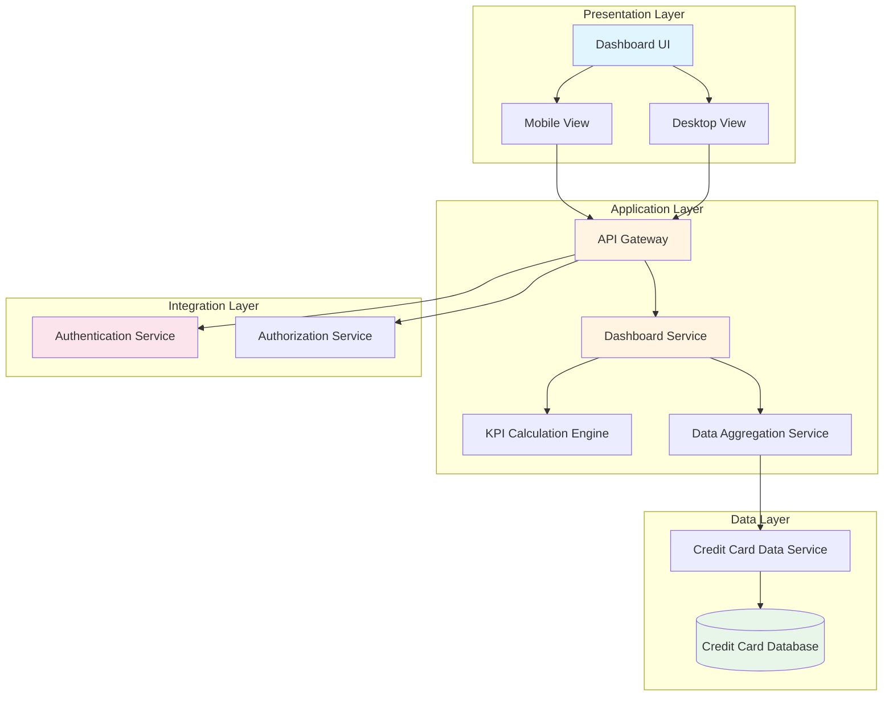
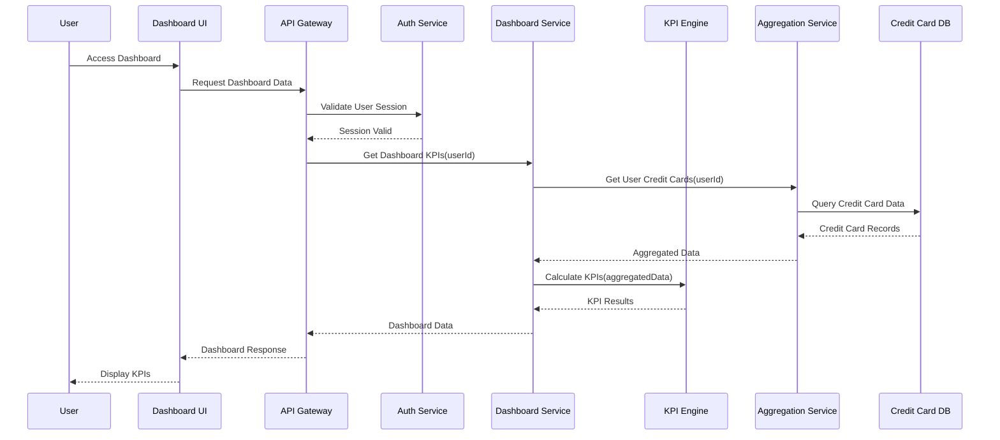
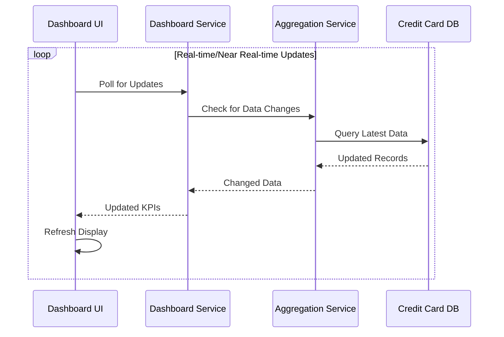

# High-Level Design Document

## Epic: DAVPETESTING001-Dashboard KPIs and Credit Card Overview

**Project Key:** QE  
**Epic Label:** DAVPETESTING001  
**Issue Type:** Epic  

---

## 1. Epic Overview

### 1.1 Summary
DAVPETESTING001-Dashboard KPIs and Credit Card Overview

### 1.2 Description
This epic delivers a consolidated dashboard that displays key performance indicators for all credit cards in a single interface. Users will be able to view critical metrics including monthly spend, total credit limit, available credit, and outstanding amount across all their credit cards. The dashboard provides an at-a-glance summary that enables users to monitor their credit card portfolio health and make informed financial decisions.

### 1.3 User Value
Users gain immediate visibility into their overall credit card financial position without needing to check multiple cards individually. This consolidated view saves time, reduces complexity, and helps users stay on top of their credit utilization and spending limits, ultimately supporting better financial management and decision-making.

---

## 2. Requirements

### 2.1 Functional Requirements

| Requirement ID | Description | Priority | Source |
|----------------|-------------|----------|--------|
| FR-001 | Display Dashboard KPIs including Monthly Spend | High | Epic Scope |
| FR-002 | Display Total Credit Limit across all credit cards | High | Epic Scope |
| FR-003 | Display Available Credit across all credit cards | High | Epic Scope |
| FR-004 | Display Outstanding Amount across all credit cards | High | Epic Scope |
| FR-005 | Provide multiple credit card management interface | High | Epic Scope |
| FR-006 | Provide consolidated credit card view | High | Epic Scope |
| FR-007 | Implement responsive layout for dashboard components | High | Epic Scope |

### 2.2 Non-Functional Requirements (NFRs)

| NFR ID | Category | Requirement | Target Metric | Source |
|--------|----------|-------------|---------------|--------|
| NFR-001 | Performance | Dashboard must load within 2 seconds | ≤ 2 seconds | Epic NFRs |
| NFR-002 | Usability | Support responsive design for desktop and mobile devices | All major screen sizes | Epic NFRs |
| NFR-003 | Performance | Display real-time or near-real-time data updates | Near real-time | Epic NFRs |
| NFR-004 | Scalability | Support concurrent viewing by multiple users | Concurrent users | Epic NFRs |

### 2.3 Dependencies

| Dependency ID | Description | Type | Status |
|---------------|-------------|------|--------|
| DEP-001 | Credit card data source (internal database or data service) | Data Source | Required |
| DEP-002 | User authentication and authorization service | Service | Required |

### 2.4 Out of Scope

The following items are explicitly excluded from this epic:

- Real bank integration
- Card payments
- Fund transfers
- Loans
- Payment gateway integration

---

## 3. Architecture Overview

### 3.1 High-Level Architecture

The solution follows a multi-tier architecture pattern with clear separation of concerns:

- **Presentation Layer:** Responsive web interface for dashboard visualization
- **Application Layer:** Business logic for KPI calculation and data aggregation
- **Data Layer:** Credit card data storage and retrieval
- **Integration Layer:** User authentication and authorization services

### 3.2 Architecture Diagram



### 3.3 Technology Stack Assumptions

**Note:** The following technology stack is assumed based on common industry practices. Actual technology choices should be validated with the development team.

- **Frontend:** Modern JavaScript framework (React/Angular/Vue.js) for responsive UI
- **Backend:** RESTful API services
- **Database:** Relational or NoSQL database for credit card data
- **Authentication:** OAuth 2.0 or similar standard

---

## 4. Component Design

### 4.1 Dashboard UI Component

**Responsibilities:**
- Render KPI widgets (Monthly Spend, Total Credit Limit, Available Credit, Outstanding Amount)
- Provide responsive layout for desktop and mobile devices
- Handle user interactions and navigation
- Display consolidated credit card view

**Key Features:**
- Responsive grid layout
- Real-time data refresh capability
- Visual indicators for credit utilization

### 4.2 Dashboard Service

**Responsibilities:**
- Orchestrate data retrieval from credit card data sources
- Coordinate KPI calculations
- Aggregate data across multiple credit cards
- Serve dashboard data to presentation layer

**Key Operations:**
- `getDashboardKPIs(userId): DashboardData`
- `getCreditCardSummary(userId): CreditCardSummary[]`
- `refreshDashboardData(userId): void`

### 4.3 KPI Calculation Engine

**Responsibilities:**
- Calculate Monthly Spend across all cards
- Calculate Total Credit Limit
- Calculate Available Credit
- Calculate Outstanding Amount
- Perform credit utilization ratio calculations

**Key Operations:**
- `calculateMonthlySpend(cards): decimal`
- `calculateTotalCreditLimit(cards): decimal`
- `calculateAvailableCredit(cards): decimal`
- `calculateOutstandingAmount(cards): decimal`

### 4.4 Data Aggregation Service

**Responsibilities:**
- Retrieve credit card data from data sources
- Aggregate data from multiple credit cards
- Cache frequently accessed data
- Handle data refresh operations

**Key Operations:**
- `getUserCreditCards(userId): CreditCard[]`
- `aggregateCreditCardData(userId): AggregatedData`

### 4.5 Authentication & Authorization Integration

**Responsibilities:**
- Validate user identity
- Verify user permissions to access credit card data
- Enforce security policies

**Key Operations:**
- `authenticateUser(credentials): AuthToken`
- `authorizeAccess(userId, resource): boolean`

---

## 5. Data Flow

### 5.1 Dashboard Load Sequence



### 5.2 Data Refresh Flow



### 5.3 Data Model

**Assumption:** The following data model is conceptual and should be validated against actual database schema.

#### Credit Card Entity
```
CreditCard {
  cardId: string
  userId: string
  cardNumber: string (masked)
  cardType: string
  creditLimit: decimal
  availableCredit: decimal
  outstandingAmount: decimal
  monthlySpend: decimal
  lastUpdated: timestamp
}
```

#### Dashboard KPI Response
```
DashboardData {
  userId: string
  totalMonthlySpend: decimal
  totalCreditLimit: decimal
  totalAvailableCredit: decimal
  totalOutstandingAmount: decimal
  creditUtilizationRatio: decimal
  cardCount: integer
  lastRefreshed: timestamp
}
```

---

## 6. APIs and Integrations

### 6.1 Dashboard API Endpoints

**Assumption:** RESTful API design. Actual API contracts should be defined in detailed design phase.

#### Get Dashboard KPIs
```
GET /api/v1/dashboard/kpis
Headers: Authorization: Bearer {token}
Response: 200 OK
{
  "totalMonthlySpend": 5000.00,
  "totalCreditLimit": 50000.00,
  "totalAvailableCredit": 35000.00,
  "totalOutstandingAmount": 15000.00,
  "creditUtilizationRatio": 30.0,
  "cardCount": 3,
  "lastRefreshed": "2024-01-15T10:30:00Z"
}
```

#### Get Credit Card Summary
```
GET /api/v1/dashboard/cards
Headers: Authorization: Bearer {token}
Response: 200 OK
{
  "cards": [
    {
      "cardId": "card-001",
      "cardType": "Visa",
      "maskedNumber": "****1234",
      "creditLimit": 20000.00,
      "availableCredit": 15000.00,
      "outstandingAmount": 5000.00,
      "monthlySpend": 2000.00
    }
  ]
}
```

### 6.2 Integration Requirements

#### Credit Card Data Source Integration
- **Type:** Internal database or data service (as specified in dependencies)
- **Protocol:** To be determined based on actual data source
- **Data Format:** JSON/XML (to be confirmed)
- **Frequency:** Real-time or near-real-time
- **Gap:** Specific data source endpoint and schema not provided

#### Authentication Service Integration
- **Type:** User authentication and authorization service (as specified in dependencies)
- **Protocol:** OAuth 2.0 / SAML / Custom (to be confirmed)
- **Operations:** User authentication, session validation, authorization checks
- **Gap:** Specific authentication mechanism not provided

---

## 7. Security Considerations

### 7.1 Authentication & Authorization
- All dashboard access must be authenticated through the user authentication service
- Users can only view their own credit card data
- Session management and token-based authentication required
- **Gap:** Specific authentication protocol and token management strategy not defined

### 7.2 Data Security
- Credit card numbers must be masked in all displays
- Sensitive financial data must be encrypted in transit (HTTPS/TLS)
- Sensitive data at rest encryption (to be confirmed with security team)
- **Assumption:** PCI-DSS compliance may be required depending on data handling

### 7.3 API Security
- API endpoints must validate authentication tokens
- Rate limiting to prevent abuse
- Input validation and sanitization
- CORS policies for web access

### 7.4 Privacy
- User data isolation - users can only access their own data
- Audit logging for data access (recommended)
- Compliance with data privacy regulations (GDPR, CCPA as applicable)

---

## 8. Scalability

### 8.1 Scalability Requirements
- **NFR-004:** System must support concurrent viewing by multiple users
- **Gap:** Specific concurrent user target not quantified

### 8.2 Scalability Strategy

**Assumptions for scalability design:**

#### Horizontal Scaling
- Dashboard Service and API Gateway should be stateless to enable horizontal scaling
- Load balancer to distribute traffic across multiple service instances
- **Assumption:** Cloud-based deployment with auto-scaling capabilities

#### Caching Strategy
- Implement caching for frequently accessed dashboard data
- Cache invalidation on data updates
- **Assumption:** Redis or similar caching technology
- Cache TTL to be determined based on real-time data requirements (NFR-003)

#### Database Optimization
- Indexed queries for credit card data retrieval
- Read replicas for dashboard queries to reduce load on primary database
- **Assumption:** Database supports replication

#### Performance Optimization
- Lazy loading for detailed credit card information
- Pagination for large credit card lists
- Optimized KPI calculation algorithms
- Asynchronous data aggregation where possible

---

## 9. Availability

### 9.1 Availability Requirements
- **NFR-001:** Dashboard must load within 2 seconds
- **NFR-003:** Display real-time or near-real-time data updates

### 9.2 Availability Strategy

**Assumptions for availability design:**

#### High Availability Architecture
- Multi-instance deployment of critical services
- Load balancing across service instances
- Health checks and automatic failover
- **Gap:** Specific SLA targets (uptime percentage) not defined

#### Monitoring & Alerting
- Real-time monitoring of dashboard load times
- Performance metrics tracking (response times, error rates)
- Alerting for performance degradation
- **Assumption:** APM (Application Performance Monitoring) tool integration

#### Resilience Patterns
- Circuit breaker pattern for external service calls
- Graceful degradation if data source is temporarily unavailable
- Retry mechanisms with exponential backoff
- Timeout configurations for all external calls

#### Data Freshness
- **NFR-003:** Near real-time data updates required
- **Gap:** Specific data freshness SLA not defined (e.g., data lag tolerance)
- **Assumption:** Polling or push-based mechanism for data updates

---

## 10. Assumptions

### 10.1 Technical Assumptions
1. Modern web browser support (Chrome, Firefox, Safari, Edge - latest 2 versions)
2. Users have stable internet connectivity
3. Credit card data source provides reliable and consistent data
4. Authentication service is highly available and performant
5. RESTful API architecture is acceptable
6. Cloud-based deployment infrastructure
7. Standard HTTPS/TLS encryption for data in transit

### 10.2 Business Assumptions
1. Users are authenticated and authorized before accessing the dashboard
2. Credit card data is already available in the internal database/data service
3. Monthly spend is calculated based on current calendar month
4. All monetary values are in a single currency (currency handling not specified)
5. Credit card data is updated regularly by upstream systems

### 10.3 Data Assumptions
1. Credit card data includes all required fields (credit limit, available credit, outstanding amount, monthly spend)
2. Data quality is maintained by source systems
3. Historical data is not required for this epic (current state only)
4. Credit card records are uniquely identifiable

### 10.4 Integration Assumptions
1. Authentication service provides standard token-based authentication
2. Credit card data service has adequate performance for dashboard requirements
3. No third-party external integrations required (as per out-of-scope items)

---

## 11. Dependencies

### 11.1 External Dependencies

| Dependency | Description | Impact | Mitigation |
|------------|-------------|--------|------------|
| Credit Card Data Source | Internal database or data service providing credit card information | Critical - Dashboard cannot function without data | Ensure data source SLA meets dashboard performance requirements; implement caching |
| Authentication Service | User authentication and authorization service | Critical - No access without authentication | Implement circuit breaker; provide clear error messages |

### 11.2 Internal Dependencies

| Dependency | Description | Impact |
|------------|-------------|--------|
| Database Schema | Credit card data schema must support required fields | High |
| API Infrastructure | API Gateway and routing infrastructure | High |
| Deployment Infrastructure | Cloud/server infrastructure for hosting services | High |

### 11.3 Dependency Gaps

1. **Credit Card Data Source Specification:** Detailed API contract, data schema, and performance characteristics not provided
2. **Authentication Service Specification:** Authentication protocol, token format, and integration details not provided
3. **Infrastructure Details:** Deployment environment, scaling capabilities, and infrastructure constraints not specified

---

## 12. Risks and Mitigation

### 12.1 Technical Risks

| Risk ID | Risk Description | Probability | Impact | Mitigation Strategy |
|---------|------------------|-------------|--------|---------------------|
| RISK-001 | Dashboard load time exceeds 2-second NFR | Medium | High | Implement aggressive caching; optimize queries; conduct performance testing early |
| RISK-002 | Credit card data source performance insufficient | Medium | High | Implement caching layer; establish SLA with data source team; implement read replicas |
| RISK-003 | Real-time data update requirement conflicts with performance | Medium | Medium | Define acceptable data freshness window; implement efficient polling/push mechanism |
| RISK-004 | Concurrent user load impacts performance | Low | Medium | Implement horizontal scaling; conduct load testing; implement rate limiting |
| RISK-005 | Authentication service latency impacts dashboard load time | Low | Medium | Implement token caching; optimize authentication flow |

### 12.2 Integration Risks

| Risk ID | Risk Description | Probability | Impact | Mitigation Strategy |
|---------|------------------|-------------|--------|---------------------|
| RISK-006 | Credit card data source unavailable or unreliable | Low | High | Implement circuit breaker; graceful degradation; clear error messaging |
| RISK-007 | Authentication service integration complexity | Low | Medium | Early integration testing; clear interface contracts |

### 12.3 Requirements Risks

| Risk ID | Risk Description | Probability | Impact | Mitigation Strategy |
|---------|------------------|-------------|--------|---------------------|
| RISK-008 | Ambiguous "near real-time" definition | High | Medium | Define specific data freshness SLA with stakeholders |
| RISK-009 | Concurrent user target not quantified | Medium | Medium | Define specific concurrent user targets; conduct capacity planning |
| RISK-010 | Missing detailed API contracts for integrations | High | High | Conduct design workshops with integration teams; document API contracts |

### 12.4 Design Gaps

1. **Data Freshness SLA:** "Real-time or near-real-time" is not quantified (acceptable lag time)
2. **Concurrent User Capacity:** No specific target for concurrent users
3. **Error Handling:** Error scenarios and user messaging not detailed
4. **Data Aggregation Logic:** Specific business rules for KPI calculations not provided
5. **Currency Handling:** Multi-currency support not addressed
6. **Time Zone Handling:** Time zone considerations for "monthly spend" not specified
7. **Availability SLA:** No uptime percentage target defined

---

## 13. Validation Report

### 13.1 Requirements Traceability Matrix

| Requirement ID | Requirement | Design Component | Validation Status | Notes |
|----------------|-------------|------------------|-------------------|-------|
| FR-001 | Display Monthly Spend KPI | Dashboard UI, KPI Engine | Covered | Component design includes monthly spend calculation |
| FR-002 | Display Total Credit Limit | Dashboard UI, KPI Engine | Covered | Component design includes credit limit aggregation |
| FR-003 | Display Available Credit | Dashboard UI, KPI Engine | Covered | Component design includes available credit calculation |
| FR-004 | Display Outstanding Amount | Dashboard UI, KPI Engine | Covered | Component design includes outstanding amount aggregation |
| FR-005 | Multiple credit card management interface | Dashboard UI, Dashboard Service | Covered | Architecture supports multiple card data retrieval |
| FR-006 | Consolidated credit card view | Dashboard UI, Aggregation Service | Covered | Data aggregation service consolidates card data |
| FR-007 | Responsive layout | Dashboard UI | Covered | Responsive design specified in component design |

### 13.2 NFR Validation Targets

| NFR ID | Requirement | Target | Design Approach | Validation Method | Status |
|--------|-------------|--------|-----------------|-------------------|--------|
| NFR-001 | Dashboard load time | ≤ 2 seconds | Caching, query optimization, lazy loading | Performance testing | Designed - Requires Validation |
| NFR-002 | Responsive design | Desktop & Mobile | Responsive UI framework, adaptive layouts | Cross-device testing | Designed - Requires Implementation |
| NFR-003 | Real-time data updates | Near real-time | Polling/push mechanism, cache invalidation | Data freshness monitoring | Designed - Gap: SLA not quantified |
| NFR-004 | Concurrent users | Multiple users | Horizontal scaling, stateless services | Load testing | Designed - Gap: Target not quantified |

### 13.3 Coverage Status

#### Functional Requirements Coverage: 100%
- All 7 functional requirements are addressed in the design
- Component responsibilities clearly mapped to requirements

#### Non-Functional Requirements Coverage: 75%
- All 4 NFRs are addressed in the design
- 2 NFRs have quantification gaps (NFR-003, NFR-004)

#### Dependencies Coverage: 100%
- Both dependencies identified and incorporated into design
- Integration points defined (with noted gaps in specifications)

#### Out-of-Scope Items: Confirmed
- All out-of-scope items explicitly documented and excluded from design

### 13.4 Design Gaps Summary

#### Critical Gaps
1. **Credit Card Data Source API Contract:** Detailed specification needed
2. **Authentication Service Integration Details:** Protocol and implementation details required
3. **Data Freshness SLA:** Quantified target for "near real-time" needed

#### High Priority Gaps
4. **Concurrent User Capacity Target:** Specific number required for capacity planning
5. **KPI Calculation Business Rules:** Detailed logic for monthly spend, credit calculations
6. **Error Handling Specifications:** User-facing error messages and recovery flows

#### Medium Priority Gaps
7. **Currency Handling:** Multi-currency support requirements
8. **Time Zone Handling:** Monthly spend calculation time zone logic
9. **Availability SLA:** Uptime percentage target
10. **Data Model Details:** Complete database schema

### 13.5 Recommendations

#### Immediate Actions
1. **Define Data Freshness SLA:** Quantify acceptable data lag (e.g., "data updated within 30 seconds")
2. **Specify Concurrent User Target:** Define expected concurrent users for capacity planning (e.g., "support 1,000 concurrent users")
3. **Document Integration Contracts:** Obtain detailed API specifications for credit card data source and authentication service
4. **Clarify KPI Calculation Rules:** Document business logic for monthly spend calculation (calendar month vs. rolling 30 days, time zone handling)

#### Design Phase Actions
5. **Conduct Performance Testing:** Validate 2-second load time requirement early in development
6. **Define Error Handling Strategy:** Document error scenarios and user messaging
7. **Create Detailed Data Model:** Document complete database schema with field definitions
8. **Security Review:** Conduct security assessment for PCI-DSS compliance requirements

#### Pre-Implementation Actions
9. **Capacity Planning:** Define infrastructure requirements based on concurrent user targets
10. **Integration Testing Plan:** Create test plan for authentication and data source integrations
11. **Monitoring Strategy:** Define metrics, dashboards, and alerts for production monitoring
12. **Currency and Localization:** Clarify currency handling and localization requirements

### 13.6 Assumptions Requiring Validation

The following assumptions should be validated with stakeholders before implementation:

1. RESTful API architecture is acceptable
2. Cloud-based deployment is available
3. Modern web browser support is sufficient (no legacy browser support)
4. Single currency handling is acceptable
5. Current calendar month is the correct period for "monthly spend"
6. Polling mechanism is acceptable for data updates (vs. push/websockets)
7. Standard OAuth 2.0 or similar authentication is used
8. No historical trend data required (current state only)

---

## 14. Conclusion

This High-Level Design document provides a comprehensive architecture for the Dashboard KPIs and Credit Card Overview epic. The design addresses all functional requirements and non-functional requirements specified in the epic, with clear component boundaries, data flows, and integration points.

### Key Strengths
- All functional requirements are fully covered in the design
- Scalable architecture with clear separation of concerns
- Security and privacy considerations addressed
- Responsive design for multiple device types

### Critical Next Steps
1. Resolve identified design gaps, particularly around data freshness SLA and concurrent user targets
2. Obtain detailed integration specifications for dependencies
3. Validate assumptions with stakeholders
4. Conduct detailed design phase to address medium-priority gaps
5. Plan performance and load testing to validate NFRs

### Design Confidence
- **Functional Design:** High confidence - all requirements mapped to components
- **Performance Design:** Medium confidence - requires validation through testing
- **Integration Design:** Medium confidence - pending detailed API contracts
- **Scalability Design:** Medium confidence - pending quantified targets

This HLD serves as a foundation for detailed design and implementation. All assumptions, gaps, and risks are explicitly documented to ensure transparency and enable informed decision-making in subsequent phases.

---

**Document Version:** 1.0  
**Date:** 2024  
**Status:** Draft for Review  
**Next Review:** Detailed Design Phase
