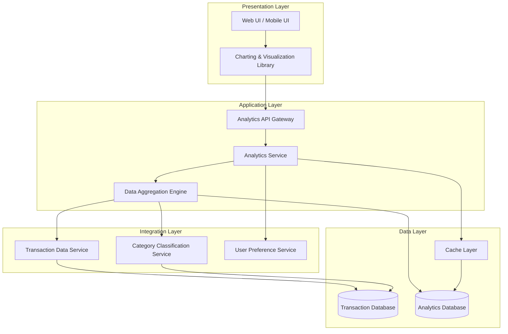
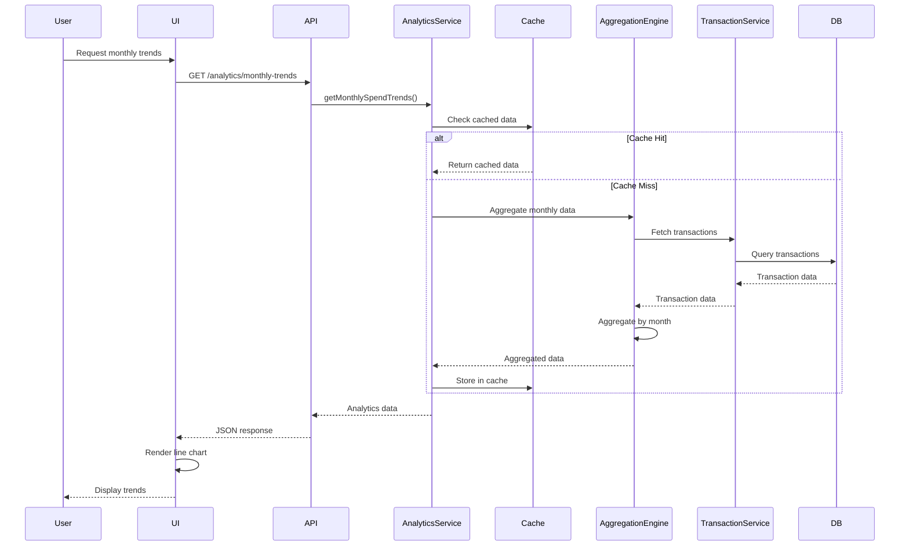
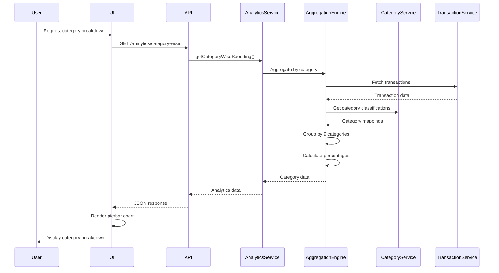

# High-Level Design Document

## Epic: DAVPETESTING001-Spending Analytics and Insights

**Project Key:** QE  
**Epic Type:** Epic  
**Labels:** DAVPETESTING001

---

## 1. Epic Overview

### 1.1 Purpose
This epic delivers comprehensive spending analytics through interactive visualizations that help users understand their spending patterns. Users can analyze monthly spend trends, view card-wise spend breakdowns, and explore category-wise spending across nine predefined categories (Food & Dining, Fuel, Shopping, Travel, Entertainment, Utilities, Healthcare, Education, and Miscellaneous). The analytics provide actionable insights into spending behavior and help users identify opportunities for financial optimization.

### 1.2 User Value
Users gain deep insights into their spending patterns through visual analytics, enabling them to:
- Identify spending trends
- Understand where their money goes
- Compare spending across different cards
- Make data-driven decisions to optimize their budget and reduce unnecessary expenses
- Understand their lifestyle spending and adjust behavior accordingly through category-wise breakdown

### 1.3 Business Context
This feature enables users to gain visibility into their financial behavior through data-driven insights, promoting financial awareness and enabling better spending decisions.

---

## 2. Requirements

### 2.1 Functional Requirements

| Requirement ID | Requirement Description | Priority | Source |
|----------------|-------------------------|----------|--------|
| FR-001 | Monthly spend trends visualization | High | Epic Scope |
| FR-002 | Card-wise spend analysis and comparison | High | Epic Scope |
| FR-003 | Category-wise spending breakdown across 9 predefined categories | High | Epic Scope |
| FR-004 | Interactive charts and graphs | High | Epic Scope |
| FR-005 | Spend pattern identification | Medium | Epic Scope |
| FR-006 | Time-based trend analysis | Medium | Epic Scope |
| FR-007 | Support for Food & Dining category | High | Epic Scope |
| FR-008 | Support for Fuel category | High | Epic Scope |
| FR-009 | Support for Shopping category | High | Epic Scope |
| FR-010 | Support for Travel category | High | Epic Scope |
| FR-011 | Support for Entertainment category | High | Epic Scope |
| FR-012 | Support for Utilities category | High | Epic Scope |
| FR-013 | Support for Healthcare category | High | Epic Scope |
| FR-014 | Support for Education category | High | Epic Scope |
| FR-015 | Support for Miscellaneous category | High | Epic Scope |

### 2.2 Non-Functional Requirements (NFRs)

| NFR ID | Requirement | Target | Measurement Criteria |
|--------|-------------|--------|----------------------|
| NFR-001 | Visualization Rendering Performance | ≤ 3 seconds | Time from data load to chart display |
| NFR-002 | Interactive Filtering Support | Required | Support drill-down and filter operations |
| NFR-003 | Responsive Design | Required | Charts adapt to different screen sizes |
| NFR-004 | Historical Data Support | 12 months | Support data aggregation for up to 12 months |
| NFR-005 | Calculation Accuracy | 100% | Accurate spending totals and percentages |

### 2.3 Out of Scope

The following items are explicitly **OUT OF SCOPE** for this epic:
- Real bank integration
- Predictive analytics or forecasting
- Budget creation or management
- Spending alerts or notifications
- Custom category creation
- Export of analytics reports

---

## 3. Architecture Overview

### 3.1 High-Level Architecture

The Spending Analytics and Insights feature follows a layered architecture pattern with clear separation between presentation, business logic, and data layers.



### 3.2 Architecture Principles
- **Separation of Concerns:** Clear boundaries between presentation, business logic, and data layers
- **Performance Optimization:** Caching layer to meet 3-second rendering requirement
- **Scalability:** Aggregation engine designed to handle up to 12 months of historical data
- **Responsiveness:** UI layer adapts to different screen sizes and devices

---

## 4. Component Design

### 4.1 Component Overview

| Component | Responsibility | Technology Assumption |
|-----------|----------------|----------------------|
| Web/Mobile UI | User interface for analytics visualization | React/Angular/Vue (Web), Native Mobile Frameworks |
| Charting Library | Render interactive charts and graphs | Chart.js, D3.js, or similar |
| Analytics API Gateway | API endpoint for analytics requests | REST/GraphQL API |
| Analytics Service | Business logic for analytics processing | Backend service (language TBD) |
| Data Aggregation Engine | Aggregate and process transaction data | Backend processing engine |
| Transaction Data Service | Provide transaction data | Existing service (dependency) |
| Category Classification Service | Classify transactions into categories | Existing service (dependency) |
| User Preference Service | Manage user preferences for date ranges | Existing service (dependency) |
| Cache Layer | Cache aggregated analytics data | Redis or similar |
| Analytics Database | Store pre-aggregated analytics data | SQL/NoSQL database |

### 4.2 Key Components Detail

#### 4.2.1 Analytics Service
**Responsibilities:**
- Process analytics requests from UI
- Coordinate data aggregation
- Apply business rules for spend pattern identification
- Manage caching strategy
- Return formatted data for visualization

**Key Operations:**
- `getMonthlySpendTrends(userId, startDate, endDate)`
- `getCardWiseSpending(userId, startDate, endDate)`
- `getCategoryWiseSpending(userId, startDate, endDate)`
- `getSpendPatterns(userId, startDate, endDate)`

#### 4.2.2 Data Aggregation Engine
**Responsibilities:**
- Aggregate transaction data by time period
- Calculate spending totals and percentages
- Group data by card and category
- Optimize queries for performance

**Key Operations:**
- `aggregateByMonth(transactions)`
- `aggregateByCard(transactions)`
- `aggregateByCategory(transactions)`
- `calculatePercentages(aggregatedData)`

#### 4.2.3 Charting & Visualization Component
**Responsibilities:**
- Render interactive charts and graphs
- Support drill-down and filtering
- Adapt to different screen sizes
- Provide smooth user interactions

**Supported Chart Types:**
- Line charts for monthly trends
- Bar charts for card-wise comparison
- Pie/Donut charts for category breakdown
- Stacked charts for combined views

---

## 5. Data Flow

### 5.1 Monthly Spend Trends Flow



### 5.2 Category-Wise Spending Flow



### 5.3 Data Model

**Analytics Request:**
```json
{
  "userId": "string",
  "startDate": "ISO8601 date",
  "endDate": "ISO8601 date",
  "analyticsType": "monthly|cardwise|categorywise",
  "filters": {
    "cardIds": ["string"],
    "categories": ["string"]
  }
}
```

**Monthly Trends Response:**
```json
{
  "userId": "string",
  "period": {
    "startDate": "ISO8601 date",
    "endDate": "ISO8601 date"
  },
  "monthlyData": [
    {
      "month": "YYYY-MM",
      "totalSpend": "number",
      "transactionCount": "number"
    }
  ]
}
```

**Category-Wise Response:**
```json
{
  "userId": "string",
  "period": {
    "startDate": "ISO8601 date",
    "endDate": "ISO8601 date"
  },
  "categories": [
    {
      "categoryName": "Food & Dining|Fuel|Shopping|Travel|Entertainment|Utilities|Healthcare|Education|Miscellaneous",
      "totalSpend": "number",
      "percentage": "number",
      "transactionCount": "number"
    }
  ]
}
```

**Card-Wise Response:**
```json
{
  "userId": "string",
  "period": {
    "startDate": "ISO8601 date",
    "endDate": "ISO8601 date"
  },
  "cardData": [
    {
      "cardId": "string",
      "cardName": "string",
      "totalSpend": "number",
      "percentage": "number",
      "transactionCount": "number"
    }
  ]
}
```

---

## 6. APIs and Integrations

### 6.1 External Dependencies

| Dependency | Purpose | Integration Type | Status |
|------------|---------|------------------|--------|
| Transaction Data Service | Provide transaction data | REST API | Dependency |
| Category Classification Service | Classify transactions into categories | REST API | Dependency |
| User Preference Service | Manage user date range preferences | REST API | Dependency |
| Charting Library | Render visualizations | JavaScript Library | To be selected |

### 6.2 API Endpoints (To Be Implemented)

#### 6.2.1 Get Monthly Spend Trends
```
GET /api/v1/analytics/monthly-trends

Query Parameters:
- userId: string (required)
- startDate: ISO8601 date (required)
- endDate: ISO8601 date (required)

Response: 200 OK
Content-Type: application/json
```

#### 6.2.2 Get Card-Wise Spending
```
GET /api/v1/analytics/cardwise-spending

Query Parameters:
- userId: string (required)
- startDate: ISO8601 date (required)
- endDate: ISO8601 date (required)

Response: 200 OK
Content-Type: application/json
```

#### 6.2.3 Get Category-Wise Spending
```
GET /api/v1/analytics/categorywise-spending

Query Parameters:
- userId: string (required)
- startDate: ISO8601 date (required)
- endDate: ISO8601 date (required)
- categories: string[] (optional)

Response: 200 OK
Content-Type: application/json
```

### 6.3 Integration Assumptions
- Transaction Data Service provides real-time or near-real-time transaction data
- Category Classification Service has pre-classified transactions into the 9 required categories
- User Preference Service stores and retrieves user-selected date ranges
- All dependent services have adequate performance to support 3-second rendering requirement

---

## 7. Security Considerations

### 7.1 Authentication & Authorization
- **Assumption:** User authentication is handled by existing authentication service
- **Requirement:** All API endpoints must validate user identity
- **Requirement:** Users can only access their own spending analytics data
- **Requirement:** Role-based access control (RBAC) should be implemented if applicable

### 7.2 Data Privacy
- **Requirement:** Financial data must be transmitted over HTTPS/TLS
- **Requirement:** Sensitive data should not be logged
- **Requirement:** Analytics data should be anonymized in logs and monitoring
- **Assumption:** Compliance with relevant data protection regulations (GDPR, CCPA, etc.)

### 7.3 Data Security
- **Requirement:** Implement input validation to prevent injection attacks
- **Requirement:** Apply rate limiting to prevent abuse
- **Requirement:** Encrypt sensitive data at rest in cache and database
- **Requirement:** Implement audit logging for data access

### 7.4 Security Gaps
- **Gap:** Specific authentication mechanism not defined in epic
- **Gap:** Data retention policy for analytics data not specified
- **Gap:** Encryption standards and key management approach not defined

---

## 8. Scalability

### 8.1 Scalability Requirements
- Support up to 12 months of historical data per user
- Handle concurrent requests from multiple users
- Scale to accommodate growing user base

### 8.2 Scalability Strategy

**Horizontal Scaling:**
- Analytics Service can be deployed across multiple instances
- Load balancer distributes requests across service instances
- Stateless service design enables easy scaling

**Data Optimization:**
- Pre-aggregate data for common queries
- Implement data partitioning by user and time period
- Use caching to reduce database load

**Performance Optimization:**
- Cache frequently accessed analytics data
- Implement pagination for large datasets
- Use asynchronous processing for heavy aggregations

### 8.3 Scalability Assumptions
- **Assumption:** Average user has transactions spanning 12 months or less
- **Assumption:** Transaction volume per user is within reasonable limits
- **Assumption:** Infrastructure supports horizontal scaling (cloud or containerized environment)

### 8.4 Scalability Gaps
- **Gap:** Specific user load targets not defined (concurrent users, requests per second)
- **Gap:** Transaction volume per user not specified
- **Gap:** Growth projections not provided

---

## 9. Availability

### 9.1 Availability Requirements
- **Target:** High availability for analytics service (specific SLA not defined)
- **Requirement:** Graceful degradation if dependent services are unavailable
- **Requirement:** Error handling and user-friendly error messages

### 9.2 Availability Strategy

**Service Redundancy:**
- Deploy multiple instances of Analytics Service
- Implement health checks and automatic failover
- Use load balancing for request distribution

**Fault Tolerance:**
- Implement circuit breakers for dependent service calls
- Provide fallback mechanisms (cached data, default views)
- Implement retry logic with exponential backoff

**Monitoring & Alerting:**
- Monitor service health and performance metrics
- Alert on service degradation or failures
- Track NFR compliance (3-second rendering time)

### 9.3 Availability Assumptions
- **Assumption:** Dependent services (Transaction Service, Category Service) have adequate availability
- **Assumption:** Infrastructure provides redundancy and failover capabilities
- **Assumption:** Database and cache layers have high availability configurations

### 9.4 Availability Gaps
- **Gap:** Specific SLA/uptime target not defined (e.g., 99.9% availability)
- **Gap:** Recovery Time Objective (RTO) not specified
- **Gap:** Recovery Point Objective (RPO) not specified
- **Gap:** Disaster recovery strategy not defined

---

## 10. Assumptions

### 10.1 Technical Assumptions
1. Transaction data is available through an existing Transaction Data Service
2. Transactions are pre-classified into 9 categories by Category Classification Service
3. User authentication and authorization mechanisms are already in place
4. Infrastructure supports modern web and mobile application deployment
5. Users have access to modern web browsers or mobile devices
6. Network connectivity is available for real-time data fetching
7. Charting library selection will be based on performance and feature requirements
8. Backend technology stack supports required performance and scalability

### 10.2 Business Assumptions
1. Users want to analyze spending patterns for financial optimization
2. 12 months of historical data is sufficient for meaningful insights
3. Nine predefined categories cover majority of user spending patterns
4. Card-wise comparison is valuable for users with multiple cards
5. Interactive visualizations provide better user experience than static reports
6. 3-second rendering time is acceptable to users

### 10.3 Data Assumptions
1. Transaction data is accurate and complete
2. Category classifications are accurate and consistent
3. Transaction timestamps are reliable for time-based analysis
4. Card information is available and accurate in transaction data
5. Historical data is available for at least 12 months

---

## 11. Dependencies

### 11.1 External Dependencies

| Dependency | Type | Criticality | Status | Risk |
|------------|------|-------------|--------|------|
| Transaction Data Service | Service | Critical | Assumed Available | High |
| Category Classification Engine/Service | Service | Critical | Assumed Available | High |
| Data Aggregation and Analytics Service | Service | Critical | To Be Developed | Medium |
| Charting and Visualization Library | Library | Critical | To Be Selected | Low |
| User Preference Service | Service | Medium | Assumed Available | Medium |

### 11.2 Internal Dependencies
1. Analytics API Gateway implementation
2. Analytics Service implementation
3. Data Aggregation Engine implementation
4. Cache layer setup and configuration
5. Analytics Database schema design and implementation
6. UI/UX design for analytics screens
7. Frontend implementation for visualization rendering

### 11.3 Dependency Risks
- **Risk:** Transaction Data Service may not provide data in required format
- **Risk:** Category Classification Service may not support all 9 required categories
- **Risk:** Dependent services may not meet performance requirements
- **Risk:** Charting library may not support all required interactive features
- **Risk:** User Preference Service may not exist or may need to be created

---

## 12. Risks and Mitigation

### 12.1 Technical Risks

| Risk ID | Risk Description | Impact | Probability | Mitigation Strategy |
|---------|------------------|--------|-------------|---------------------|
| R-001 | 3-second rendering requirement may not be achievable with 12 months of data | High | Medium | Implement aggressive caching, data pre-aggregation, and pagination |
| R-002 | Dependent services may not be available or performant | High | Medium | Implement circuit breakers, fallback mechanisms, and service monitoring |
| R-003 | Charting library may not support all required interactive features | Medium | Low | Evaluate multiple libraries before selection, have backup options |
| R-004 | Category classification accuracy may be insufficient | Medium | Medium | Work with Category Service team to validate and improve classifications |
| R-005 | Scalability issues with large transaction volumes | High | Medium | Implement data partitioning, caching, and horizontal scaling |
| R-006 | Browser/device compatibility issues with visualizations | Medium | Low | Test across multiple browsers and devices, use widely supported libraries |

### 12.2 Business Risks

| Risk ID | Risk Description | Impact | Probability | Mitigation Strategy |
|---------|------------------|--------|-------------|---------------------|
| R-007 | Users may not find 9 predefined categories sufficient | Medium | Medium | Document as known limitation, consider future enhancement for custom categories |
| R-008 | 12-month limit may not meet all user needs | Low | Low | Document as known limitation, monitor user feedback |
| R-009 | Users may expect export functionality (out of scope) | Medium | High | Clearly communicate feature scope, plan for future enhancement |

### 12.3 Security Risks

| Risk ID | Risk Description | Impact | Probability | Mitigation Strategy |
|---------|------------------|--------|-------------|---------------------|
| R-010 | Unauthorized access to financial data | High | Low | Implement strong authentication, authorization, and audit logging |
| R-011 | Data breach through API vulnerabilities | High | Low | Implement security best practices, regular security testing |
| R-012 | Privacy violations due to inadequate data handling | High | Low | Follow data protection regulations, implement data anonymization |

### 12.4 Dependency Risks

| Risk ID | Risk Description | Impact | Probability | Mitigation Strategy |
|---------|------------------|--------|-------------|---------------------|
| R-013 | Transaction Data Service unavailability | High | Low | Implement caching, fallback to cached data, service monitoring |
| R-014 | Category Classification Service changes or deprecation | Medium | Low | Establish service contracts, monitor for changes |
| R-015 | User Preference Service may not exist | Medium | Medium | Validate dependency early, plan for implementation if needed |

---

## 13. Design Gaps and Open Questions

### 13.1 Design Gaps

1. **Authentication & Authorization:** Specific authentication mechanism not defined
2. **Technology Stack:** Backend technology stack not specified
3. **Charting Library:** Specific charting library not selected
4. **Database Technology:** Analytics database technology not specified
5. **Cache Technology:** Cache layer technology not specified
6. **API Standards:** API design standards and versioning strategy not defined
7. **Error Handling:** Detailed error handling strategy not defined
8. **Logging Strategy:** Logging levels and retention policy not defined
9. **Monitoring & Alerting:** Specific monitoring tools and metrics not defined
10. **Deployment Strategy:** Deployment approach and CI/CD pipeline not defined

### 13.2 Open Questions

1. What is the expected concurrent user load?
2. What is the average transaction volume per user?
3. What is the target availability SLA (e.g., 99.9%)?
4. What are the specific authentication and authorization requirements?
5. Are there specific regulatory compliance requirements (PCI-DSS, etc.)?
6. What is the data retention policy for analytics data?
7. Should analytics data be real-time or near-real-time?
8. What is the acceptable data staleness for cached analytics?
9. Are there specific browser/device support requirements?
10. What is the rollout strategy (phased, all users at once)?
11. How should the system handle users with more than 12 months of data?
12. What are the specific drill-down and filtering capabilities required?
13. Should the system support comparison across different time periods?
14. Are there accessibility requirements (WCAG compliance)?
15. What analytics/telemetry should be collected on feature usage?

### 13.3 Requirements Clarification Needed

1. **Interactive Filtering:** Specific filtering capabilities need to be defined (date range, category selection, card selection, etc.)
2. **Drill-Down Capabilities:** Specific drill-down paths need to be defined (e.g., from monthly view to daily view)
3. **Spend Pattern Identification:** Algorithm and criteria for pattern identification need to be defined
4. **Responsive Design:** Specific breakpoints and mobile/tablet layouts need to be defined
5. **Calculation Accuracy:** Rounding rules and precision requirements need to be defined

---

## 14. Validation Report

### 14.1 Requirements Traceability Matrix

| Requirement ID | Requirement | Design Component | Implementation Status | Validation Status |
|----------------|-------------|------------------|----------------------|-------------------|
| FR-001 | Monthly spend trends visualization | Analytics Service + Charting Component | Not Implemented | Not Validated |
| FR-002 | Card-wise spend analysis | Analytics Service + Charting Component | Not Implemented | Not Validated |
| FR-003 | Category-wise spending breakdown | Analytics Service + Charting Component | Not Implemented | Not Validated |
| FR-004 | Interactive charts and graphs | Charting Component | Not Implemented | Not Validated |
| FR-005 | Spend pattern identification | Analytics Service | Not Implemented | Not Validated |
| FR-006 | Time-based trend analysis | Analytics Service + Aggregation Engine | Not Implemented | Not Validated |
| FR-007 | Food & Dining category support | Category Service Integration | Not Implemented | Not Validated |
| FR-008 | Fuel category support | Category Service Integration | Not Implemented | Not Validated |
| FR-009 | Shopping category support | Category Service Integration | Not Implemented | Not Validated |
| FR-010 | Travel category support | Category Service Integration | Not Implemented | Not Validated |
| FR-011 | Entertainment category support | Category Service Integration | Not Implemented | Not Validated |
| FR-012 | Utilities category support | Category Service Integration | Not Implemented | Not Validated |
| FR-013 | Healthcare category support | Category Service Integration | Not Implemented | Not Validated |
| FR-014 | Education category support | Category Service Integration | Not Implemented | Not Validated |
| FR-015 | Miscellaneous category support | Category Service Integration | Not Implemented | Not Validated |

### 14.2 NFR Validation Targets

| NFR ID | Requirement | Target | Design Approach | Validation Method | Status |
|--------|-------------|--------|-----------------|-------------------|--------|
| NFR-001 | Visualization Rendering Performance | ≤ 3 seconds | Caching + Pre-aggregation + Optimized queries | Performance testing with 12 months data | Not Validated |
| NFR-002 | Interactive Filtering Support | Required | Charting library with built-in interactivity | Functional testing of filter operations | Not Validated |
| NFR-003 | Responsive Design | Required | Responsive UI framework + Adaptive charts | Cross-device testing | Not Validated |
| NFR-004 | Historical Data Support | 12 months | Data partitioning + Efficient aggregation | Load testing with 12-month datasets | Not Validated |
| NFR-005 | Calculation Accuracy | 100% | Precise calculation logic + Unit tests | Automated testing with known datasets | Not Validated |

### 14.3 Coverage Status

**Functional Requirements Coverage:** 100% (15/15 requirements addressed in design)  
**Non-Functional Requirements Coverage:** 100% (5/5 NFRs addressed in design)  
**Out-of-Scope Items:** Documented (6 items explicitly excluded)  
**Dependencies:** Documented (5 external dependencies identified)  
**Risks:** Documented (15 risks identified with mitigation strategies)

### 14.4 Design Completeness Assessment

| Design Area | Completeness | Gaps | Status |
|-------------|--------------|------|--------|
| Architecture | 70% | Technology stack not specified | Partial |
| Component Design | 75% | Implementation details need refinement | Partial |
| Data Flow | 80% | Error flows not fully defined | Partial |
| API Design | 60% | Detailed API specs need completion | Partial |
| Security | 50% | Specific security controls not defined | Incomplete |
| Scalability | 60% | Load targets not specified | Partial |
| Availability | 50% | SLA targets not defined | Incomplete |

**Overall Design Completeness: 65%**

### 14.5 Recommendations

#### 14.5.1 Immediate Actions Required
1. **Validate Dependencies:** Confirm availability and capabilities of Transaction Data Service and Category Classification Service
2. **Define Technology Stack:** Select backend technology, database, cache, and charting library
3. **Clarify NFR Targets:** Obtain specific targets for availability, scalability, and concurrent user load
4. **Security Requirements:** Define authentication, authorization, and data protection requirements
5. **API Design:** Complete detailed API specifications including error responses

#### 14.5.2 Design Improvements
1. **Performance Optimization:** Design aggressive caching strategy to meet 3-second requirement
2. **Error Handling:** Define comprehensive error handling and user feedback mechanisms
3. **Monitoring Strategy:** Define key metrics, monitoring tools, and alerting thresholds
4. **Testing Strategy:** Define unit, integration, performance, and security testing approaches
5. **Data Model:** Refine data models for analytics database and cache structures

#### 14.5.3 Risk Mitigation Priorities
1. **High Priority:** Address R-001 (rendering performance), R-002 (dependent service availability), R-005 (scalability)
2. **Medium Priority:** Address R-004 (category accuracy), R-007 (category limitations), R-015 (user preference service)
3. **Continuous:** Address security risks R-010, R-011, R-012 throughout implementation

#### 14.5.4 Future Enhancements (Post-MVP)
1. Custom category creation (currently out of scope)
2. Export of analytics reports (currently out of scope)
3. Predictive analytics and forecasting (currently out of scope)
4. Budget creation and management integration (currently out of scope)
5. Spending alerts and notifications (currently out of scope)
6. Comparison across different time periods
7. Peer benchmarking (anonymized comparison with similar users)

---

## 15. Conclusion

This High-Level Design document provides a comprehensive architecture and design approach for the Spending Analytics and Insights epic. The design addresses all functional requirements and non-functional requirements specified in the epic, while explicitly documenting assumptions, dependencies, risks, and gaps.

**Key Strengths:**
- Clear separation of concerns with layered architecture
- Comprehensive requirements traceability
- Explicit documentation of out-of-scope items
- Detailed risk analysis with mitigation strategies
- Performance-focused design with caching and pre-aggregation

**Key Challenges:**
- Meeting 3-second rendering requirement with 12 months of data
- Dependency on external services with unknown capabilities
- Undefined technology stack and infrastructure details
- Missing specific targets for scalability and availability

**Next Steps:**
1. Validate and confirm external dependencies
2. Select technology stack and tools
3. Obtain clarifications on open questions
4. Refine detailed design for each component
5. Create detailed API specifications
6. Define testing strategy and success criteria
7. Develop implementation plan and timeline

---

## Document Control

**Version:** 1.0  
**Date:** 2024  
**Status:** Draft  
**Author:** HLD Generation Agent  
**Epic Reference:** QE - DAVPETESTING001-Spending Analytics and Insights

---

**Note:** This is a high-level design document based on the epic description. Implementation details, technology selections, and specific design decisions should be validated with stakeholders and refined during detailed design phase. All assumptions and gaps documented in this HLD should be addressed before implementation begins.