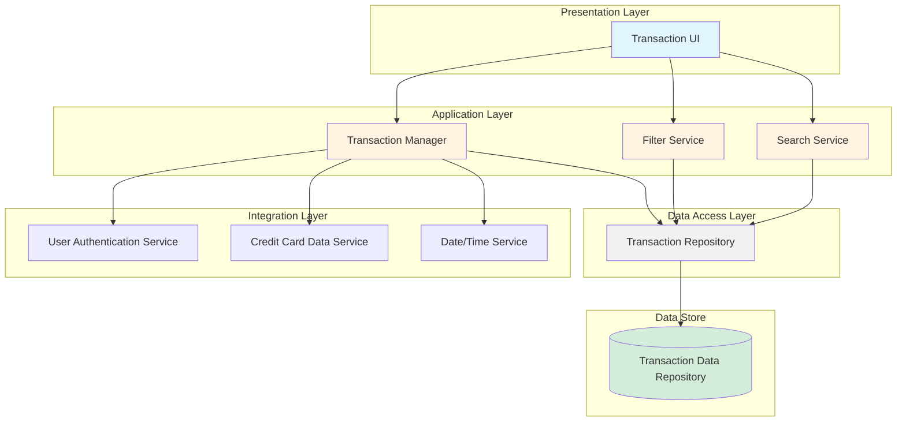
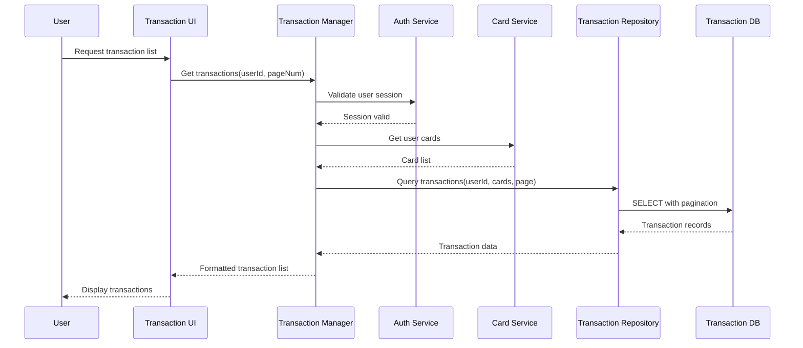
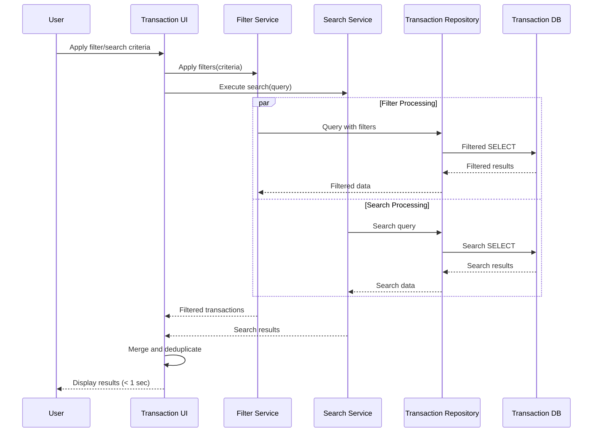

# High-Level Design Document

## Epic: DAVPETESTING001-Transaction Management and Viewing

**Project Key:** QE  
**Epic Type:** Epic  
**Labels:** DAVPETESTING001

---

## 1. Epic Overview

### 1.1 Purpose
This epic enables users to view and manage credit card transactions across all their cards. Users can access detailed transaction information, filter and search transactions, and understand their spending history. The transaction management capability provides transparency into all card activities and supports users in tracking their purchases and expenses.

### 1.2 User Value
Users can easily track and review all their credit card transactions in one place, helping them verify purchases, identify unauthorized transactions, reconcile statements, and maintain accurate records of their spending. This transparency builds trust and enables proactive financial monitoring.

### 1.3 Scope (High Level)
- Transaction list view across all cards
- Transaction details display
- Transaction filtering and search capabilities
- Card-wise transaction segregation
- Transaction history access

---

## 2. Requirements

### 2.1 Functional Requirements

| Req ID | Requirement | Source | Priority |
|--------|-------------|--------|----------|
| FR-001 | System shall provide a transaction list view across all cards | Epic Scope | High |
| FR-002 | System shall display detailed transaction information for each transaction | Epic Scope | High |
| FR-003 | System shall provide transaction filtering capabilities | Epic Scope | High |
| FR-004 | System shall provide transaction search capabilities | Epic Scope | High |
| FR-005 | System shall segregate transactions by card | Epic Scope | High |
| FR-006 | System shall provide access to transaction history | Epic Scope | High |

### 2.2 Non-Functional Requirements

| NFR ID | Requirement | Target | Category |
|--------|-------------|--------|----------|
| NFR-001 | Transaction list must support pagination for large datasets | Not specified | Performance |
| NFR-002 | Search and filter operations should complete within 1 second | ≤ 1 second | Performance |
| NFR-003 | Support display of at least 10,000 transactions per user | ≥ 10,000 transactions | Scalability |
| NFR-004 | Ensure data accuracy and consistency across all transaction views | 100% accuracy | Data Quality |

### 2.3 Out of Scope
- Real bank integration
- Transaction editing or deletion
- Card payments
- Fund transfers
- Payment gateway integration
- Transaction disputes or chargebacks

---

## 3. Architecture Overview

### 3.1 High-Level Architecture

The Transaction Management and Viewing system follows a layered architecture pattern with clear separation of concerns:

- **Presentation Layer:** User interface for displaying transactions
- **Application Layer:** Business logic for filtering, searching, and processing transaction data
- **Data Access Layer:** Repository pattern for accessing transaction data
- **Integration Layer:** Service integrations for authentication and card data

### 3.2 Architecture Diagram



---

## 4. Component Design

### 4.1 Transaction UI Component

**Responsibility:** Render transaction list, details, and provide user interaction capabilities

**Key Functions:**
- Display paginated transaction list
- Show transaction details
- Provide filter and search controls
- Enable card-wise view segregation

**Assumptions:**
- UI framework and technology stack not specified in epic
- Responsive design requirements not specified

### 4.2 Transaction Manager

**Responsibility:** Orchestrate transaction retrieval, processing, and business logic

**Key Functions:**
- Retrieve transactions for authenticated user
- Apply business rules for transaction display
- Coordinate with authentication and card services
- Manage pagination logic

**Assumptions:**
- Specific business rules for transaction display not defined
- Transaction sorting criteria not specified

### 4.3 Filter Service

**Responsibility:** Apply filtering logic to transaction data

**Key Functions:**
- Filter by date range
- Filter by card
- Filter by transaction type
- Filter by amount range

**Assumptions:**
- Specific filter criteria not fully defined in epic
- Multiple simultaneous filters support assumed

### 4.4 Search Service

**Responsibility:** Provide search capabilities across transaction data

**Key Functions:**
- Search by merchant name
- Search by transaction description
- Search by amount
- Return results within 1 second (NFR-002)

**Assumptions:**
- Search algorithm and indexing strategy not specified
- Full-text search vs. exact match behavior not defined

### 4.5 Transaction Repository

**Responsibility:** Data access and persistence operations

**Key Functions:**
- Query transaction data
- Support pagination (NFR-001)
- Ensure data consistency (NFR-004)
- Handle large datasets (NFR-003)

**Assumptions:**
- Database technology not specified
- Indexing strategy not defined

---

## 5. Data Flow

### 5.1 Transaction List Retrieval Flow



### 5.2 Search and Filter Flow



---

## 6. APIs and Integrations

### 6.1 Internal APIs

#### 6.1.1 Transaction API (Assumed)

**Endpoint:** `GET /api/transactions`

**Purpose:** Retrieve paginated transaction list

**Request Parameters:**
- `userId` (required): User identifier
- `page` (optional): Page number
- `pageSize` (optional): Records per page
- `cardId` (optional): Filter by specific card

**Response:**
```json
{
  "transactions": [],
  "totalCount": 0,
  "page": 1,
  "pageSize": 50,
  "hasMore": false
}
```

**Endpoint:** `GET /api/transactions/{transactionId}`

**Purpose:** Retrieve detailed transaction information

**Response:**
```json
{
  "transactionId": "",
  "cardId": "",
  "amount": 0.00,
  "currency": "",
  "merchantName": "",
  "description": "",
  "timestamp": "",
  "status": ""
}
```

**Endpoint:** `POST /api/transactions/search`

**Purpose:** Search transactions with criteria

**Request Body:**
```json
{
  "userId": "",
  "searchTerm": "",
  "filters": {
    "dateFrom": "",
    "dateTo": "",
    "cardIds": [],
    "minAmount": 0,
    "maxAmount": 0
  },
  "page": 1,
  "pageSize": 50
}
```

### 6.2 External Integrations

#### 6.2.1 User Authentication Service

**Dependency:** Required for user session validation

**Interface:** Not specified in epic

**Assumption:** OAuth 2.0 or similar authentication mechanism

#### 6.2.2 Credit Card Data Service

**Dependency:** Required for retrieving user's card information

**Interface:** Not specified in epic

**Assumption:** REST API providing card metadata

#### 6.2.3 Date/Time Service

**Dependency:** Required for transaction timestamp management

**Interface:** Not specified in epic

**Assumption:** Standard time service or library

#### 6.2.4 Transaction Data Repository

**Dependency:** Core data source for transaction records

**Interface:** Not specified in epic

**Assumption:** Relational or NoSQL database

---

## 7. Security Considerations

### 7.1 Authentication and Authorization

**Requirement:** User must be authenticated to view transactions

**Implementation Approach (Assumed):**
- Session-based or token-based authentication
- Integration with User Authentication Service
- User can only access their own transactions

**Gap:** Specific authentication mechanism not defined in epic

### 7.2 Data Privacy

**Requirement:** Protect sensitive transaction data

**Implementation Approach (Assumed):**
- Encrypt data in transit (HTTPS/TLS)
- Encrypt sensitive data at rest
- Mask card numbers in transaction display
- Implement audit logging

**Gap:** Data encryption and privacy requirements not explicitly stated in epic

### 7.3 Authorization

**Requirement:** Ensure users can only view their own transactions

**Implementation Approach (Assumed):**
- User ID validation on all requests
- Card ownership verification
- Role-based access control if applicable

**Gap:** Authorization model not defined in epic

---

## 8. Scalability

### 8.1 Data Volume

**Requirement:** Support display of at least 10,000 transactions per user (NFR-003)

**Design Approach:**
- Implement pagination (NFR-001)
- Database indexing on key fields (userId, cardId, timestamp)
- Query optimization for large datasets

**Assumptions:**
- Average transaction size not specified
- Growth rate not specified
- Total user base not specified

### 8.2 Performance

**Requirement:** Search and filter operations should complete within 1 second (NFR-002)

**Design Approach:**
- Database query optimization
- Caching strategy for frequently accessed data
- Asynchronous processing where applicable
- Connection pooling

**Assumptions:**
- Concurrent user load not specified
- Peak usage patterns not defined

### 8.3 Horizontal Scaling

**Design Approach (Assumed):**
- Stateless application layer for horizontal scaling
- Load balancing across multiple instances
- Database read replicas for query distribution

**Gap:** Scalability targets beyond 10,000 transactions per user not specified

---

## 9. Availability

### 9.1 Uptime Requirements

**Gap:** No specific availability SLA defined in epic (e.g., 99.9% uptime)

**Assumed Approach:**
- Implement health checks and monitoring
- Redundant service instances
- Database replication

### 9.2 Disaster Recovery

**Gap:** No disaster recovery requirements specified in epic

**Assumed Approach:**
- Regular database backups
- Backup retention policy
- Recovery time objective (RTO) and recovery point objective (RPO) to be defined

### 9.3 Monitoring and Alerting

**Assumed Approach:**
- Application performance monitoring (APM)
- Database performance monitoring
- Alert on SLA violations (e.g., search > 1 second)
- Log aggregation and analysis

**Gap:** Specific monitoring requirements not defined in epic

---

## 10. Assumptions

1. **Technology Stack:** Specific programming languages, frameworks, and database technologies are not defined in the epic
2. **UI/UX Design:** User interface design, wireframes, and user experience flows are not specified
3. **Transaction Data Model:** Detailed transaction schema and data fields are not defined
4. **Authentication Mechanism:** Specific authentication protocol and implementation are not specified
5. **API Contracts:** Detailed API specifications for integrations are not provided
6. **Deployment Environment:** Cloud provider, infrastructure, and deployment strategy are not specified
7. **Concurrent Users:** Expected number of concurrent users is not specified
8. **Data Retention:** Transaction data retention policy is not defined
9. **Internationalization:** Multi-language and multi-currency support requirements are not specified
10. **Accessibility:** WCAG or other accessibility standards are not mentioned
11. **Browser/Device Support:** Supported browsers and devices are not specified
12. **Error Handling:** Specific error handling and user messaging requirements are not defined
13. **Caching Strategy:** Caching approach and cache invalidation strategy are not specified
14. **Rate Limiting:** API rate limiting requirements are not specified
15. **Audit Requirements:** Transaction access audit logging requirements are not explicitly stated

---

## 11. Dependencies

### 11.1 External Dependencies

| Dependency | Type | Criticality | Status | Notes |
|------------|------|-------------|--------|-------|
| Transaction Data Repository | Data Store | Critical | Not Verified | Core data source |
| Credit Card Data Service | Service | Critical | Not Verified | Required for card information |
| User Authentication Service | Service | Critical | Not Verified | Required for user validation |
| Date/Time Service | Service | Medium | Not Verified | Required for timestamps |

### 11.2 Internal Dependencies

| Dependency | Type | Criticality | Notes |
|------------|------|-------------|-------|
| Database Schema | Data Model | Critical | Must be defined before implementation |
| API Specifications | Interface | Critical | Must be defined for integration |
| UI/UX Design | Design | High | Required for implementation |
| Security Standards | Policy | High | Must be established |

---

## 12. Risks and Mitigation

### 12.1 Technical Risks

| Risk ID | Risk Description | Impact | Probability | Mitigation Strategy |
|---------|------------------|--------|-------------|---------------------|
| RISK-001 | Performance degradation with large transaction datasets | High | Medium | Implement database indexing, query optimization, and caching |
| RISK-002 | Search operations exceeding 1-second SLA | High | Medium | Implement search indexing (e.g., Elasticsearch), optimize queries |
| RISK-003 | Data consistency issues across distributed systems | High | Low | Implement transaction management, eventual consistency patterns |
| RISK-004 | Integration failures with external services | Medium | Medium | Implement circuit breakers, fallback mechanisms, retry logic |
| RISK-005 | Security vulnerabilities in transaction data access | High | Low | Implement comprehensive security testing, code reviews |

### 12.2 Project Risks

| Risk ID | Risk Description | Impact | Probability | Mitigation Strategy |
|---------|------------------|--------|-------------|---------------------|
| RISK-006 | Unclear requirements leading to rework | Medium | High | Conduct requirements clarification sessions, create detailed specifications |
| RISK-007 | Undefined API contracts causing integration delays | Medium | High | Define API contracts early, use API mocking for parallel development |
| RISK-008 | Missing non-functional requirements | Medium | High | Document assumptions, seek stakeholder validation |
| RISK-009 | Dependency on external services not available | High | Medium | Identify service owners, establish SLAs, create mock services |

### 12.3 Data Risks

| Risk ID | Risk Description | Impact | Probability | Mitigation Strategy |
|---------|------------------|--------|-------------|---------------------|
| RISK-010 | Transaction data quality issues | High | Medium | Implement data validation, quality checks, monitoring |
| RISK-011 | Data synchronization delays | Medium | Medium | Implement eventual consistency patterns, user notifications |
| RISK-012 | Unauthorized access to transaction data | High | Low | Implement robust authentication, authorization, audit logging |

---

## 13. Design Gaps and Open Questions

### 13.1 Functional Gaps

1. **Transaction Details:** What specific fields should be displayed in transaction details?
2. **Filter Criteria:** What are all the filter options (date range, amount, merchant, category, status)?
3. **Search Scope:** Should search cover all fields or specific fields only?
4. **Transaction Sorting:** What are the default and available sorting options?
5. **Card Selection:** How should users select cards for filtering (dropdown, multi-select, tabs)?
6. **Transaction History:** How far back should transaction history be accessible?
7. **Export Functionality:** Is transaction export (CSV, PDF) required?
8. **Refresh Mechanism:** How should transaction data be refreshed (manual, automatic)?

### 13.2 Non-Functional Gaps

1. **Availability SLA:** What is the required uptime percentage?
2. **Response Time:** What is the acceptable response time for transaction list loading?
3. **Concurrent Users:** How many concurrent users should the system support?
4. **Data Retention:** How long should transaction data be retained?
5. **Backup Frequency:** What is the required backup frequency and retention?
6. **Browser Support:** Which browsers and versions must be supported?
7. **Mobile Support:** Is mobile responsive design or native app support required?
8. **Accessibility:** What accessibility standards must be met?

### 13.3 Integration Gaps

1. **Authentication Protocol:** What authentication mechanism is used (OAuth, SAML, JWT)?
2. **API Specifications:** What are the detailed API contracts for all integrations?
3. **Error Handling:** How should integration failures be handled and communicated?
4. **Data Format:** What is the transaction data format from the repository?
5. **Real-time Updates:** Are real-time transaction updates required?

### 13.4 Security Gaps

1. **Encryption Standards:** What encryption standards should be used?
2. **Audit Logging:** What level of audit logging is required?
3. **Data Masking:** Should sensitive data be masked in the UI?
4. **Session Management:** What are the session timeout and management requirements?
5. **Compliance:** Are there specific compliance requirements (PCI-DSS, GDPR)?

---

## 14. Validation Report

### 14.1 Requirements Traceability

| Requirement ID | Requirement | Design Component | Validation Status | Notes |
|----------------|-------------|------------------|-------------------|-------|
| FR-001 | Transaction list view across all cards | Transaction UI, Transaction Manager | Covered | Pagination support included |
| FR-002 | Display detailed transaction information | Transaction UI, Transaction Manager | Covered | Detailed view component |
| FR-003 | Transaction filtering capabilities | Filter Service | Covered | Multiple filter criteria supported |
| FR-004 | Transaction search capabilities | Search Service | Covered | Search within 1-second SLA |
| FR-005 | Card-wise transaction segregation | Transaction Manager, Filter Service | Covered | Card filtering included |
| FR-006 | Transaction history access | Transaction Repository | Covered | Historical data access |
| NFR-001 | Pagination for large datasets | Transaction Repository | Covered | Pagination implemented |
| NFR-002 | Search/filter within 1 second | Search Service, Filter Service | Covered | Performance target defined |
| NFR-003 | Support 10,000+ transactions per user | Transaction Repository, Database Design | Covered | Scalability addressed |
| NFR-004 | Data accuracy and consistency | Transaction Repository, Data Layer | Covered | Consistency mechanisms |

### 14.2 Coverage Status

- **Functional Requirements:** 6/6 (100%) covered in design
- **Non-Functional Requirements:** 4/4 (100%) covered in design
- **Dependencies:** 4/4 (100%) identified and documented
- **Out of Scope Items:** All documented and excluded from design

### 14.3 NFR Validation Targets

| NFR ID | Target | Design Approach | Validation Method | Status |
|--------|--------|-----------------|-------------------|--------|
| NFR-001 | Pagination support | Implement page-based query pattern | Load testing with large datasets | Design Complete |
| NFR-002 | ≤ 1 second response | Query optimization, indexing, caching | Performance testing with search queries | Design Complete |
| NFR-003 | ≥ 10,000 transactions | Database indexing, efficient queries | Load testing with 10K+ records | Design Complete |
| NFR-004 | 100% data accuracy | Transaction management, validation | Data integrity testing | Design Complete |

**Note:** Validation methods are proposed; actual validation will occur during implementation and testing phases.

### 14.4 Design Completeness Assessment

| Area | Completeness | Confidence | Gaps |
|------|--------------|------------|------|
| Architecture | 75% | Medium | Technology stack not specified |
| Component Design | 70% | Medium | Detailed interfaces not defined |
| Data Flow | 80% | High | Minor details on error flows |
| APIs | 50% | Low | API contracts not fully specified |
| Security | 60% | Medium | Security requirements not explicit |
| Scalability | 70% | Medium | Load targets beyond NFRs not defined |
| Availability | 40% | Low | No SLA or DR requirements |

### 14.5 Recommendations

#### 14.5.1 Immediate Actions Required

1. **Requirements Clarification:**
   - Conduct workshop to clarify functional gaps identified in Section 13.1
   - Define detailed transaction data model and fields
   - Specify UI/UX requirements and wireframes

2. **API Specification:**
   - Define detailed API contracts for all integrations
   - Document request/response formats, error codes, and status codes
   - Create API documentation (OpenAPI/Swagger)

3. **Security Requirements:**
   - Define security standards and compliance requirements
   - Specify authentication and authorization mechanisms
   - Document data encryption and privacy requirements

4. **Non-Functional Requirements:**
   - Define availability SLA and uptime targets
   - Specify disaster recovery requirements (RTO/RPO)
   - Define concurrent user load and performance targets

#### 14.5.2 Design Phase Actions

1. **Detailed Design:**
   - Create detailed component specifications
   - Define database schema and indexing strategy
   - Design caching strategy
   - Create sequence diagrams for all major flows

2. **Technology Selection:**
   - Select technology stack (languages, frameworks, databases)
   - Choose deployment platform and infrastructure
   - Select monitoring and logging tools

3. **Prototyping:**
   - Create UI/UX prototypes for stakeholder review
   - Build proof-of-concept for search performance
   - Validate pagination approach with large datasets

#### 14.5.3 Implementation Phase Actions

1. **Development:**
   - Implement components according to detailed design
   - Follow secure coding practices
   - Implement comprehensive error handling
   - Create unit and integration tests

2. **Testing:**
   - Performance testing to validate NFR-002 (1-second response)
   - Load testing to validate NFR-003 (10,000+ transactions)
   - Security testing for authentication and authorization
   - Data consistency testing

3. **Integration:**
   - Integrate with User Authentication Service
   - Integrate with Credit Card Data Service
   - Integrate with Transaction Data Repository
   - Implement monitoring and alerting

#### 14.5.4 Risk Mitigation Priorities

1. **High Priority:**
   - RISK-001: Performance degradation (implement indexing and caching early)
   - RISK-002: Search SLA violation (validate search approach with POC)
   - RISK-006: Unclear requirements (conduct clarification sessions immediately)
   - RISK-007: Undefined API contracts (define contracts before development)

2. **Medium Priority:**
   - RISK-004: Integration failures (implement resilience patterns)
   - RISK-009: Dependency availability (engage service owners early)
   - RISK-010: Data quality issues (implement validation early)

---

## 15. Conclusion

This High-Level Design document provides a comprehensive architectural blueprint for the Transaction Management and Viewing epic. The design addresses all stated functional and non-functional requirements while explicitly documenting assumptions, gaps, and risks.

### 15.1 Key Strengths

- Clear layered architecture with separation of concerns
- Pagination and performance optimization to meet NFRs
- Scalability considerations for large transaction volumes
- Comprehensive risk identification and mitigation strategies

### 15.2 Critical Success Factors

1. Clarification of identified gaps before implementation
2. Definition of detailed API contracts for all integrations
3. Validation of performance targets through prototyping
4. Establishment of security standards and compliance requirements
5. Availability of dependent services (Authentication, Card Data, Transaction Repository)

### 15.3 Next Steps

1. Review and validate this HLD with stakeholders
2. Conduct requirements clarification workshop
3. Define detailed API specifications
4. Create detailed component design documents
5. Select technology stack and tools
6. Develop implementation plan and timeline

---

## Document Control

| Version | Date | Author | Changes |
|---------|------|--------|----------|
| 1.0 | 2025 | HLD Generation Agent | Initial HLD document |

---

**Note:** This document is based on the information provided in the epic. All assumptions, gaps, and design decisions should be validated with stakeholders before proceeding to implementation. No unverified requirements are claimed as implemented or achieved.