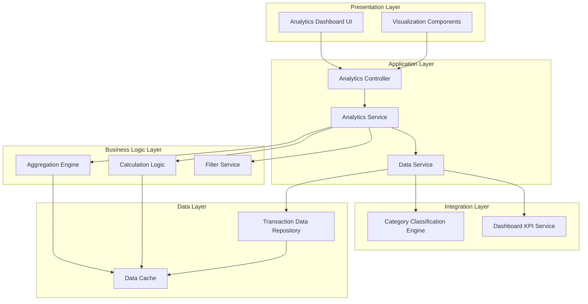
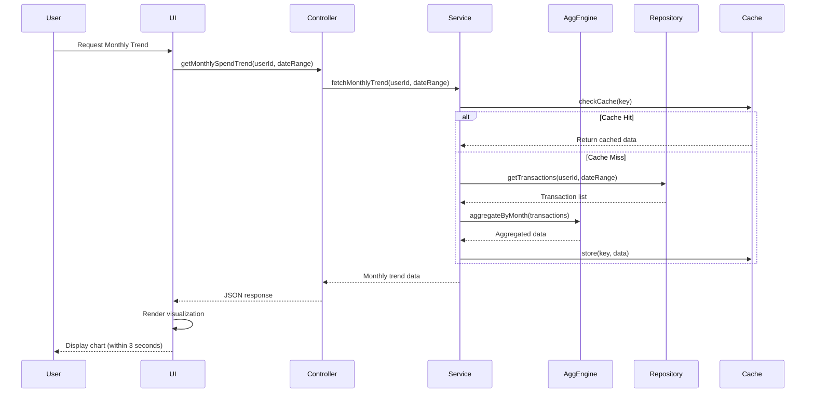
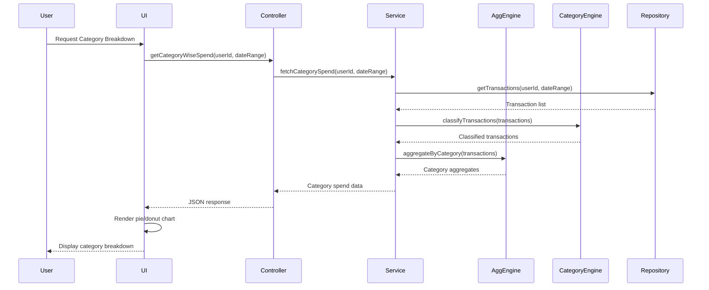
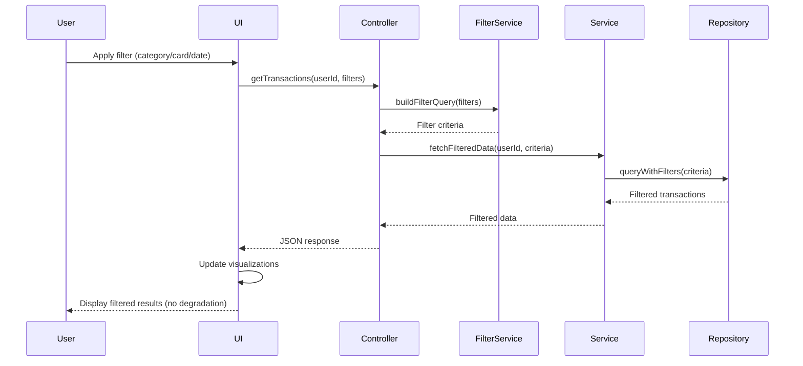

# High-Level Design Document

## Epic: DAVPETESTING002-Analytics and Spending Insights

**Project Key:** QE  
**Epic Label:** DAVPETESTING002  
**Document Version:** 1.0  
**Last Updated:** 2024

---

## 1. Epic Overview

### 1.1 Summary
DAVPETESTING002-Analytics and Spending Insights

### 1.2 Description
This epic provides comprehensive analytics and spending insights through interactive visualizations. Users can analyze their spending patterns across multiple dimensions including monthly spend trends, card-wise spend analysis, and detailed category-wise spending breakdowns. The analytics module enables users to understand where their money goes and identify opportunities to optimize spending across nine predefined categories: Food & Dining, Fuel, Shopping, Travel, Entertainment, Utilities, Healthcare, Education, and Miscellaneous.

### 1.3 User Value
Users gain actionable insights into their spending behavior, enabling them to identify high-spend categories, track trends over time, and make informed financial decisions. The visual analytics help users understand spending patterns that may not be obvious from raw transaction lists, supporting better budgeting and financial planning.

### 1.4 Epic Labels
- DAVPETESTING002

---

## 2. Requirements

### 2.1 Functional Requirements

Based on the epic scope, the following functional requirements have been identified:

| Req ID | Requirement | Source | Priority |
|--------|-------------|--------|----------|
| FR-001 | System shall provide monthly spend trend visualization | Epic Scope | High |
| FR-002 | System shall provide card-wise spend analysis and comparison | Epic Scope | High |
| FR-003 | System shall provide category-wise spending breakdown with interactive charts | Epic Scope | High |
| FR-004 | System shall support nine spending categories: Food & Dining, Fuel, Shopping, Travel, Entertainment, Utilities, Healthcare, Education, Miscellaneous | Epic Scope | High |
| FR-005 | System shall display transaction data with filtering capabilities | Epic Scope | Medium |
| FR-006 | System shall provide interactive visualization controls | Epic Scope | Medium |

### 2.2 Non-Functional Requirements (NFRs)

| NFR ID | Category | Requirement | Target Metric | Source |
|--------|----------|-------------|---------------|--------|
| NFR-001 | Performance | Interactive visualizations must render within specified time for large datasets | ≤ 3 seconds for up to 10,000 transactions | Epic NFRs |
| NFR-002 | Responsiveness | Charts and graphs must be responsive across all device types | 100% responsive design | Epic NFRs |
| NFR-003 | Accessibility | Visualizations must be accessible across all device types | WCAG 2.1 compliance (assumed) | Epic NFRs |
| NFR-004 | Data Accuracy | Data accuracy must be maintained with proper aggregation and calculation logic | 100% accuracy in calculations | Epic NFRs |
| NFR-005 | Performance | Support for drill-down and filtering operations without performance degradation | No degradation under normal load | Epic NFRs |

### 2.3 Out of Scope

The following items are explicitly excluded from this epic:

- Real bank integration
- Card payments
- Fund transfers
- Loans
- Payment gateway integration
- Predictive analytics or AI-based spending recommendations

---

## 3. Architecture Overview

### 3.1 High-Level Architecture

The Analytics and Spending Insights module follows a layered architecture pattern with clear separation between presentation, business logic, and data access layers.

### 3.2 Architecture Principles

- **Separation of Concerns:** Clear separation between UI, business logic, and data access
- **Scalability:** Support for large transaction datasets (up to 10,000 transactions)
- **Performance:** Caching strategy to optimize rendering and calculation performance
- **Maintainability:** Modular design with well-defined interfaces
- **Responsiveness:** Device-agnostic design supporting multiple form factors

---

## 4. Component Design

### 4.1 Presentation Layer Components

#### 4.1.1 Analytics Dashboard UI
**Responsibility:** Main container for all analytics visualizations and controls

**Key Features:**
- Layout management for multiple visualization widgets
- User interaction handling
- Responsive design implementation
- Navigation and filtering controls

**Technology Assumptions:**
- Modern web framework (React/Angular/Vue - not specified in epic)
- Responsive CSS framework

#### 4.1.2 Visualization Components
**Responsibility:** Render interactive charts and graphs

**Key Visualizations:**
- Monthly Spend Trend Chart (Line/Bar chart)
- Card-wise Spend Comparison (Bar/Pie chart)
- Category-wise Breakdown (Pie/Donut chart)
- Transaction List View (Data grid)

**Technology Assumptions:**
- Data visualization library (D3.js/Chart.js/Highcharts - not specified in epic)

### 4.2 Application Layer Components

#### 4.2.1 Analytics Controller
**Responsibility:** Handle HTTP requests and orchestrate service calls

**Key Operations:**
- `getMonthlySpendTrend(userId, startDate, endDate)`
- `getCardWiseSpend(userId, dateRange)`
- `getCategoryWiseSpend(userId, dateRange)`
- `getTransactions(userId, filters)`

#### 4.2.2 Analytics Service
**Responsibility:** Business logic orchestration for analytics operations

**Key Operations:**
- Coordinate data retrieval and aggregation
- Apply business rules for calculations
- Handle filtering and drill-down operations

#### 4.2.3 Data Service
**Responsibility:** Data access and integration management

**Key Operations:**
- Fetch transaction data from repository
- Integrate with category classification engine
- Retrieve KPI data from dashboard service

### 4.3 Business Logic Layer Components

#### 4.3.1 Aggregation Engine
**Responsibility:** Aggregate transaction data across multiple dimensions

**Key Aggregations:**
- Monthly aggregation
- Card-wise aggregation
- Category-wise aggregation
- Custom date range aggregation

**Performance Consideration:** Must handle up to 10,000 transactions efficiently

#### 4.3.2 Calculation Logic
**Responsibility:** Perform financial calculations with accuracy

**Key Calculations:**
- Total spend per period
- Percentage distribution across categories
- Trend calculations (growth/decline)
- Comparative metrics (card-to-card, period-to-period)

**Data Accuracy:** 100% accuracy required for all calculations

#### 4.3.3 Filter Service
**Responsibility:** Apply user-defined filters to transaction data

**Filter Types:**
- Date range filters
- Card filters
- Category filters
- Amount range filters
- Combined filters

### 4.4 Integration Layer Components

#### 4.4.1 Category Classification Engine
**Responsibility:** Classify transactions into predefined categories

**Supported Categories:**
1. Food & Dining
2. Fuel
3. Shopping
4. Travel
5. Entertainment
6. Utilities
7. Healthcare
8. Education
9. Miscellaneous

**Integration Type:** Service integration (implementation details not specified)

#### 4.4.2 Dashboard KPI Service
**Responsibility:** Provide consistent KPI data across dashboard views

**Integration Type:** Service integration (implementation details not specified)

### 4.5 Data Layer Components

#### 4.5.1 Transaction Data Repository
**Responsibility:** Persistent storage and retrieval of transaction data

**Key Operations:**
- Query transactions by user and date range
- Support for complex filtering
- Efficient data retrieval for large datasets

**Technology Assumptions:** Database technology not specified in epic

#### 4.5.2 Data Cache
**Responsibility:** Cache frequently accessed aggregated data

**Caching Strategy:**
- Cache aggregated results to improve rendering performance
- Implement cache invalidation on data updates
- Support for 3-second rendering target

**Technology Assumptions:** Caching mechanism not specified in epic

---

## 5. Data Flow

### 5.1 Monthly Spend Trend Flow

### 5.2 Category-wise Spend Flow

### 5.3 Interactive Filtering Flow

---

## 6. APIs and Integrations

### 6.1 Internal APIs

#### 6.1.1 Analytics API Endpoints

**Assumption:** RESTful API design (not specified in epic)

| Endpoint | Method | Description | Request Parameters | Response |
|----------|--------|-------------|-------------------|----------|
| `/api/analytics/monthly-trend` | GET | Get monthly spend trend | userId, startDate, endDate | Monthly aggregated data |
| `/api/analytics/card-wise` | GET | Get card-wise spend analysis | userId, dateRange | Card comparison data |
| `/api/analytics/category-wise` | GET | Get category-wise breakdown | userId, dateRange | Category aggregated data |
| `/api/analytics/transactions` | GET | Get filtered transactions | userId, filters (category, card, dateRange) | Transaction list |
| `/api/analytics/drill-down` | GET | Get drill-down details | userId, dimension, filters | Detailed breakdown |

**Performance Requirement:** All endpoints must support response times enabling 3-second visualization rendering

### 6.2 External Integrations

#### 6.2.1 Transaction Data Repository
**Type:** Data source integration  
**Purpose:** Retrieve transaction data for analysis  
**Integration Method:** Not specified in epic (assumed: database query or service call)  
**Data Volume:** Up to 10,000 transactions per query  
**SLA:** Not specified in epic

#### 6.2.2 Category Classification Engine
**Type:** Service integration  
**Purpose:** Classify transactions into predefined categories  
**Integration Method:** Not specified in epic (assumed: REST API or library)  
**Categories Supported:** 9 predefined categories  
**SLA:** Not specified in epic

#### 6.2.3 Dashboard KPI Service
**Type:** Service integration  
**Purpose:** Ensure consistent data across dashboard views  
**Integration Method:** Not specified in epic (assumed: REST API)  
**Data Consistency:** Required for unified user experience  
**SLA:** Not specified in epic

### 6.3 Integration Assumptions and Gaps

**Assumptions:**
- All external services are available and accessible
- Transaction data repository supports efficient querying for large datasets
- Category classification engine provides real-time or near-real-time classification
- Dashboard KPI service maintains data consistency

**Gaps:**
- Specific integration protocols not defined (REST, gRPC, message queue, etc.)
- Authentication and authorization mechanisms not specified
- Error handling and retry logic not detailed
- Service SLAs and availability targets not provided
- Data format and schema specifications not included

---

## 7. Security Considerations

### 7.1 Security Requirements

**Note:** Detailed security requirements are not specified in the epic. The following are assumed based on best practices for financial data applications.

#### 7.1.1 Authentication and Authorization
**Assumption:** User authentication is handled at application level
- User must be authenticated to access analytics data
- Authorization checks to ensure users can only access their own transaction data
- Role-based access control (if applicable)

**Gap:** Specific authentication mechanism not defined in epic

#### 7.1.2 Data Privacy
- Transaction data contains sensitive financial information
- Data must be protected in transit and at rest
- Compliance with data protection regulations (assumed: GDPR, PCI-DSS, etc.)

**Gap:** Specific compliance requirements not defined in epic

#### 7.1.3 API Security
- API endpoints must be secured against unauthorized access
- Input validation to prevent injection attacks
- Rate limiting to prevent abuse

**Gap:** Specific security controls not defined in epic

### 7.2 Security Gaps and Recommendations

**Identified Gaps:**
- No explicit security requirements in epic
- Authentication and authorization mechanisms not specified
- Data encryption requirements not defined
- Compliance requirements not stated
- Audit logging requirements not mentioned

**Recommendations:**
1. Define authentication and authorization requirements
2. Specify data encryption standards (TLS for transit, encryption at rest)
3. Identify applicable compliance standards
4. Implement audit logging for data access
5. Conduct security review and threat modeling

---

## 8. Scalability

### 8.1 Scalability Requirements

#### 8.1.1 Data Volume Scalability
**Specified Requirement:** Support for up to 10,000 transactions  
**Current Design:** Aggregation engine and caching strategy to handle specified volume  
**Future Scalability:** Not specified in epic

**Assumptions:**
- 10,000 transactions represents maximum expected dataset size
- Growth beyond 10,000 transactions not anticipated in current scope

**Gap:** Long-term scalability strategy not defined

#### 8.1.2 User Concurrency
**Gap:** Concurrent user load not specified in epic

**Assumptions:**
- System designed for typical web application concurrency
- Caching strategy helps support multiple concurrent users

**Recommendation:** Define expected concurrent user load and test accordingly

#### 8.1.3 Horizontal Scalability
**Gap:** Horizontal scaling strategy not defined in epic

**Assumptions:**
- Stateless application layer enables horizontal scaling
- Caching layer may require distributed cache for scale-out

**Recommendation:** Define horizontal scaling approach if user base grows

### 8.2 Performance Optimization Strategies

#### 8.2.1 Caching Strategy
- Cache aggregated results to avoid repeated calculations
- Implement cache warming for frequently accessed data
- Define cache TTL based on data update frequency

#### 8.2.2 Data Aggregation Optimization
- Pre-aggregate data where possible
- Use efficient aggregation algorithms
- Implement pagination for large result sets

#### 8.2.3 Query Optimization
- Optimize database queries with appropriate indexes
- Limit data retrieval to required date ranges
- Use database-level aggregation where supported

### 8.3 Scalability Gaps and Recommendations

**Identified Gaps:**
- Maximum concurrent users not specified
- Long-term data growth strategy not defined
- Horizontal scaling approach not detailed
- Database scalability not addressed
- Cache distribution strategy not specified

**Recommendations:**
1. Define expected user concurrency and load test
2. Plan for data growth beyond 10,000 transactions
3. Design for horizontal scalability from the start
4. Implement database partitioning strategy if needed
5. Consider distributed caching for scale-out scenarios

---

## 9. Availability and Reliability

### 9.1 Availability Requirements

**Gap:** Availability targets (uptime SLA) not specified in epic

**Assumptions:**
- Standard web application availability expected
- Analytics is non-critical feature (users can tolerate brief outages)

**Recommendation:** Define availability SLA (e.g., 99.9% uptime)

### 9.2 Reliability Considerations

#### 9.2.1 Data Accuracy
**Specified Requirement:** 100% accuracy in aggregation and calculation logic  
**Design Approach:**
- Implement comprehensive unit tests for calculation logic
- Validate aggregation results against source data
- Implement data integrity checks

#### 9.2.2 Error Handling
**Gap:** Error handling strategy not specified in epic

**Assumptions:**
- Graceful degradation if external services unavailable
- User-friendly error messages
- Logging for troubleshooting

**Recommendation:** Define comprehensive error handling strategy

#### 9.2.3 Fault Tolerance
**Gap:** Fault tolerance requirements not specified in epic

**Assumptions:**
- Retry logic for transient failures
- Circuit breaker pattern for external service calls
- Fallback mechanisms where appropriate

**Recommendation:** Implement resilience patterns (retry, circuit breaker, fallback)

### 9.3 Monitoring and Observability

**Gap:** Monitoring requirements not specified in epic

**Recommendations:**
1. Implement application performance monitoring (APM)
2. Track key metrics:
   - Visualization rendering time
   - API response times
   - Error rates
   - Cache hit rates
3. Set up alerts for performance degradation
4. Implement distributed tracing for troubleshooting
5. Log all errors and exceptions

---

## 10. Assumptions

### 10.1 Technical Assumptions

1. **Technology Stack:** Modern web technologies (specific frameworks not specified)
2. **Data Visualization Library:** Industry-standard library will be selected (D3.js, Chart.js, Highcharts, or similar)
3. **API Design:** RESTful API architecture
4. **Database:** Relational or NoSQL database with efficient querying capabilities
5. **Caching:** In-memory caching solution (Redis, Memcached, or similar)
6. **Authentication:** User authentication handled by existing application infrastructure
7. **Deployment:** Cloud-based or containerized deployment

### 10.2 Functional Assumptions

1. **Transaction Data Availability:** All required transaction data is available in the Transaction Data Repository
2. **Category Classification:** Category Classification Engine provides accurate classification for all transactions
3. **Data Consistency:** Dashboard KPI Service ensures data consistency across all views
4. **User Context:** User identity and authorization context available for all requests
5. **Data Quality:** Transaction data is clean, complete, and accurate
6. **Date Ranges:** Users will typically query data for reasonable date ranges (not entire history)

### 10.3 Business Assumptions

1. **User Base:** Target user base has basic understanding of financial analytics
2. **Device Usage:** Users will access analytics from desktop, tablet, and mobile devices
3. **Usage Patterns:** Analytics is a frequently used feature requiring good performance
4. **Data Volume:** 10,000 transactions represents 95th percentile of user data volume
5. **Categories:** Nine predefined categories cover majority of user transactions

### 10.4 Integration Assumptions

1. **Service Availability:** All dependent services (Transaction Repository, Category Engine, KPI Service) have acceptable availability
2. **Service Performance:** External services respond within acceptable timeframes
3. **Data Format:** All services provide data in compatible formats
4. **API Stability:** External service APIs are stable and versioned

---

## 11. Dependencies

### 11.1 External Dependencies

| Dependency | Type | Description | Criticality | Status |
|------------|------|-------------|-------------|--------|
| Transaction Data Repository | Data Source | Source of all transaction data for analytics | Critical | Assumed Available |
| Category Classification Engine | Service | Classifies transactions into 9 predefined categories | Critical | Assumed Available |
| Dashboard KPI Service | Service | Provides consistent KPI data across dashboard | High | Assumed Available |
| Data Visualization Library | Library | Renders interactive charts and graphs | Critical | To Be Selected |

### 11.2 Internal Dependencies

| Dependency | Type | Description | Criticality | Status |
|------------|------|-------------|-------------|--------|
| User Authentication Service | Service | Provides user identity and authorization | Critical | Assumed Available |
| Application Framework | Framework | Base application infrastructure | Critical | To Be Selected |
| Caching Infrastructure | Infrastructure | Caching layer for performance optimization | High | To Be Implemented |
| Database Infrastructure | Infrastructure | Data persistence layer | Critical | Assumed Available |

### 11.3 Dependency Risks

1. **Transaction Data Repository Unavailability:** If repository is unavailable, no analytics can be displayed
   - **Mitigation:** Implement caching, display cached data with timestamp

2. **Category Classification Engine Failure:** Transactions cannot be categorized
   - **Mitigation:** Cache classification results, implement fallback to "Miscellaneous" category

3. **Dashboard KPI Service Inconsistency:** Data may be inconsistent across views
   - **Mitigation:** Implement local consistency checks, alert on discrepancies

4. **Visualization Library Limitations:** Selected library may not support all required features
   - **Mitigation:** Thoroughly evaluate libraries before selection, consider custom implementations

---

## 12. Risks and Mitigation

### 12.1 Technical Risks

| Risk ID | Risk Description | Impact | Probability | Mitigation Strategy |
|---------|------------------|--------|-------------|---------------------|
| TR-001 | Performance degradation with large datasets (>10,000 transactions) | High | Medium | Implement pagination, data sampling, and aggressive caching |
| TR-002 | Visualization rendering exceeds 3-second target | High | Medium | Optimize aggregation logic, implement progressive rendering, use web workers |
| TR-003 | Browser compatibility issues with visualization library | Medium | Low | Select widely supported library, implement fallbacks, thorough testing |
| TR-004 | Cache invalidation issues leading to stale data | Medium | Medium | Implement robust cache invalidation strategy, display data timestamps |
| TR-005 | External service integration failures | High | Medium | Implement circuit breakers, retries, and graceful degradation |

### 12.2 Functional Risks

| Risk ID | Risk Description | Impact | Probability | Mitigation Strategy |
|---------|------------------|--------|-------------|---------------------|
| FR-001 | Calculation accuracy issues in aggregation logic | High | Low | Comprehensive unit testing, validation against source data, code reviews |
| FR-002 | Category classification inaccuracy | Medium | Medium | Validate classification engine accuracy, provide user feedback mechanism |
| FR-003 | Incomplete transaction data affecting analytics accuracy | High | Low | Implement data quality checks, handle missing data gracefully |
| FR-004 | User confusion with complex visualizations | Medium | Medium | User testing, intuitive UI design, tooltips and help text |

### 12.3 Integration Risks

| Risk ID | Risk Description | Impact | Probability | Mitigation Strategy |
|---------|------------------|--------|-------------|---------------------|
| IR-001 | Transaction Repository API changes breaking integration | High | Low | API versioning, integration tests, monitoring |
| IR-002 | Category Engine service unavailability | Medium | Medium | Caching, fallback classification, graceful degradation |
| IR-003 | Dashboard KPI Service data inconsistency | Medium | Low | Implement consistency checks, alerting on discrepancies |
| IR-004 | Network latency affecting performance | Medium | Medium | Implement timeouts, caching, optimize payload sizes |

### 12.4 Business Risks

| Risk ID | Risk Description | Impact | Probability | Mitigation Strategy |
|---------|------------------|--------|-------------|---------------------|
| BR-001 | User adoption lower than expected | Medium | Low | User training, intuitive design, gather feedback |
| BR-002 | Nine categories insufficient for user needs | Medium | Medium | Monitor user feedback, plan for category customization in future |
| BR-003 | Performance issues on mobile devices | High | Medium | Mobile-first design, responsive optimization, testing on various devices |

### 12.5 Security Risks

| Risk ID | Risk Description | Impact | Probability | Mitigation Strategy |
|---------|------------------|--------|-------------|---------------------|
| SR-001 | Unauthorized access to user financial data | High | Low | Implement robust authentication and authorization, audit logging |
| SR-002 | Data exposure through API vulnerabilities | High | Low | Security testing, input validation, rate limiting |
| SR-003 | Sensitive data in logs or error messages | Medium | Medium | Implement data masking, secure logging practices |

---

## 13. Validation Report

### 13.1 Requirements Traceability Matrix

| Requirement ID | Requirement Description | Epic Source | Design Component | Validation Status |
|----------------|-------------------------|-------------|------------------|-------------------|
| FR-001 | Monthly spend trend visualization | Epic Scope | Monthly Spend Trend Flow, Aggregation Engine | Covered |
| FR-002 | Card-wise spend analysis and comparison | Epic Scope | Card-wise Analysis Component, Aggregation Engine | Covered |
| FR-003 | Category-wise spending breakdown with interactive charts | Epic Scope | Category-wise Flow, Visualization Components | Covered |
| FR-004 | Support for nine spending categories | Epic Scope | Category Classification Engine Integration | Covered |
| FR-005 | Transaction data display and filtering | Epic Scope | Filter Service, Transaction List View | Covered |
| FR-006 | Interactive visualization controls | Epic Scope | UI Components, Interactive Controls | Covered |
| NFR-001 | Render visualizations within 3 seconds for 10,000 transactions | Epic NFRs | Caching Strategy, Aggregation Optimization | Designed (Not Verified) |
| NFR-002 | Responsive charts across all device types | Epic NFRs | Responsive Design, Visualization Components | Designed (Not Verified) |
| NFR-003 | Accessible across all device types | Epic NFRs | Accessibility Implementation | Designed (Not Verified) |
| NFR-004 | 100% data accuracy in aggregation and calculations | Epic NFRs | Calculation Logic, Validation Checks | Designed (Not Verified) |
| NFR-005 | No performance degradation with drill-down and filtering | Epic NFRs | Filter Service, Performance Optimization | Designed (Not Verified) |

### 13.2 Coverage Status

#### 13.2.1 Functional Requirements Coverage
- **Total Functional Requirements:** 6
- **Covered in Design:** 6 (100%)
- **Not Covered:** 0
- **Status:** ✅ All functional requirements addressed in design

#### 13.2.2 Non-Functional Requirements Coverage
- **Total NFRs:** 5
- **Covered in Design:** 5 (100%)
- **Verified/Validated:** 0 (0%) - Verification pending implementation and testing
- **Status:** ⚠️ All NFRs addressed in design but require validation through testing

### 13.3 NFR Validation Targets

| NFR ID | Target Metric | Validation Method | Validation Status |
|--------|---------------|-------------------|-------------------|
| NFR-001 | ≤ 3 seconds rendering time for 10,000 transactions | Performance testing with load testing tools | Not Validated |
| NFR-002 | 100% responsive design across devices | Manual testing on multiple devices and screen sizes | Not Validated |
| NFR-003 | WCAG 2.1 compliance (assumed) | Accessibility testing tools and manual validation | Not Validated |
| NFR-004 | 100% calculation accuracy | Unit tests, integration tests, data validation | Not Validated |
| NFR-005 | No performance degradation | Load testing with concurrent filtering operations | Not Validated |

**Validation Plan:**
1. **Performance Testing:** Load test with datasets of varying sizes (1K, 5K, 10K transactions)
2. **Responsive Testing:** Test on minimum 5 different device types (desktop, tablet, mobile)
3. **Accessibility Testing:** Use automated tools (WAVE, axe) and manual keyboard navigation testing
4. **Accuracy Testing:** Automated unit tests with known datasets, manual validation of calculations
5. **Stress Testing:** Concurrent user simulation with filtering and drill-down operations

### 13.4 Design Gaps

#### 13.4.1 Critical Gaps

1. **Security Requirements Not Defined**
   - **Impact:** High
   - **Description:** No authentication, authorization, or data protection requirements specified
   - **Recommendation:** Define security requirements before implementation

2. **Integration Specifications Missing**
   - **Impact:** High
   - **Description:** Integration protocols, data formats, and error handling not specified
   - **Recommendation:** Document integration contracts with all dependent services

3. **Technology Stack Not Specified**
   - **Impact:** Medium
   - **Description:** No specific technologies selected for implementation
   - **Recommendation:** Conduct technology evaluation and selection

#### 13.4.2 High Priority Gaps

4. **Availability and Reliability Targets Missing**
   - **Impact:** Medium
   - **Description:** No SLA, uptime, or reliability targets defined
   - **Recommendation:** Define availability SLA and reliability metrics

5. **Scalability Beyond 10K Transactions Not Addressed**
   - **Impact:** Medium
   - **Description:** No plan for data growth beyond specified limit
   - **Recommendation:** Define long-term scalability strategy

6. **Error Handling Strategy Not Defined**
   - **Impact:** Medium
   - **Description:** No comprehensive error handling and recovery strategy
   - **Recommendation:** Define error handling patterns and user experience

7. **Monitoring and Observability Not Specified**
   - **Impact:** Medium
   - **Description:** No monitoring, logging, or alerting requirements
   - **Recommendation:** Define observability strategy and key metrics

#### 13.4.3 Medium Priority Gaps

8. **Concurrent User Load Not Specified**
   - **Impact:** Low-Medium
   - **Description:** Expected concurrent users not defined
   - **Recommendation:** Define expected load and conduct load testing

9. **Data Retention and Archival Not Addressed**
   - **Impact:** Low-Medium
   - **Description:** No strategy for historical data management
   - **Recommendation:** Define data retention policy

10. **Internationalization Not Mentioned**
    - **Impact:** Low
    - **Description:** Multi-language support not specified
    - **Recommendation:** Clarify if internationalization is required

### 13.5 Recommendations

#### 13.5.1 Immediate Actions (Before Implementation)

1. **Define Security Requirements**
   - Document authentication and authorization approach
   - Specify data encryption requirements
   - Identify compliance requirements
   - Define audit logging strategy

2. **Document Integration Contracts**
   - Define API contracts with Transaction Data Repository
   - Specify integration with Category Classification Engine
   - Document Dashboard KPI Service integration
   - Define data formats and error handling

3. **Select Technology Stack**
   - Evaluate and select web framework
   - Choose data visualization library
   - Select caching solution
   - Document technology decisions

4. **Define Validation Strategy**
   - Create detailed test plan for NFR validation
   - Define performance testing approach
   - Plan accessibility testing
   - Set up test environments

#### 13.5.2 Short-term Actions (During Implementation)

5. **Implement Comprehensive Testing**
   - Unit tests for all calculation logic (100% accuracy requirement)
   - Integration tests for external service interactions
   - Performance tests with 10,000 transaction datasets
   - Responsive design testing on multiple devices

6. **Establish Monitoring and Observability**
   - Implement APM for performance tracking
   - Set up logging infrastructure
   - Define and track key metrics
   - Configure alerts for performance degradation

7. **Implement Security Controls**
   - Authentication and authorization checks
   - Input validation and sanitization
   - API rate limiting
   - Audit logging

#### 13.5.3 Long-term Actions (Post-Implementation)

8. **Plan for Scalability**
   - Monitor actual data volumes and user load
   - Plan for growth beyond 10,000 transactions
   - Design horizontal scaling strategy
   - Consider data partitioning if needed

9. **Gather User Feedback**
   - Monitor user adoption and usage patterns
   - Collect feedback on visualization usefulness
   - Identify additional category needs
   - Plan enhancements based on feedback

10. **Continuous Improvement**
    - Regular performance optimization
    - Update visualization library as needed
    - Enhance features based on user needs
    - Stay current with security best practices

### 13.6 Validation Summary

**Overall Design Completeness: 70%**

**Strengths:**
- ✅ All functional requirements covered in design
- ✅ Clear architecture with separation of concerns
- ✅ Performance optimization strategies defined
- ✅ Component design addresses core requirements
- ✅ Data flow documented for key scenarios

**Weaknesses:**
- ❌ Security requirements not defined
- ❌ Integration specifications incomplete
- ❌ Technology stack not selected
- ❌ Availability and reliability targets missing
- ❌ Monitoring and observability not specified

**Validation Status:**
- **Functional Requirements:** Designed but not implemented or tested
- **Non-Functional Requirements:** Designed but not validated
- **Security:** Insufficient information to validate
- **Integrations:** Insufficient information to validate
- **Scalability:** Designed for specified limits, long-term strategy needed

**Recommendation:** Address critical and high-priority gaps before proceeding to implementation. Conduct thorough validation testing during and after implementation to verify NFR compliance.

---

## 14. Appendices

### 14.1 Glossary

| Term | Definition |
|------|------------|
| Aggregation | Process of combining multiple data points into summary statistics |
| Drill-down | Interactive exploration of data from summary to detail level |
| KPI | Key Performance Indicator - measurable value demonstrating effectiveness |
| NFR | Non-Functional Requirement - quality attribute of the system |
| Transaction | Financial transaction record including amount, date, category, and card |
| Visualization | Graphical representation of data (charts, graphs, etc.) |

### 14.2 References

- Epic: DAVPETESTING002-Analytics and Spending Insights (Project: QE)
- Epic Label: DAVPETESTING002

### 14.3 Document History

| Version | Date | Author | Changes |
|---------|------|--------|----------|
| 1.0 | 2024 | HLD Generation Agent | Initial HLD document creation |

### 14.4 Approval

**Note:** This is a generated HLD document based on epic information. Formal approval process required before implementation.

| Role | Name | Signature | Date |
|------|------|-----------|------|
| Product Owner | TBD | | |
| Technical Lead | TBD | | |
| Architecture Review | TBD | | |
| Security Review | TBD | | |

---

## 15. Conclusion

This High-Level Design document provides a comprehensive architectural blueprint for the Analytics and Spending Insights epic (DAVPETESTING002). The design addresses all functional requirements specified in the epic and provides strategies to meet the non-functional requirements.

**Key Highlights:**
- Layered architecture with clear separation of concerns
- Performance optimization through caching and aggregation strategies
- Support for 10,000 transactions with 3-second rendering target
- Responsive design for multi-device support
- Integration with three external dependencies
- Nine predefined spending categories

**Critical Next Steps:**
1. Address identified design gaps, particularly security and integration specifications
2. Select and document technology stack
3. Define detailed integration contracts
4. Create comprehensive test plan for NFR validation
5. Implement monitoring and observability strategy

**Validation Status:**
While the design addresses all requirements from the epic, validation through implementation and testing is required to confirm that NFR targets can be achieved. Several critical gaps must be addressed before implementation begins.

This document should be reviewed and approved by relevant stakeholders before proceeding to detailed design and implementation phases.

---

**End of Document**