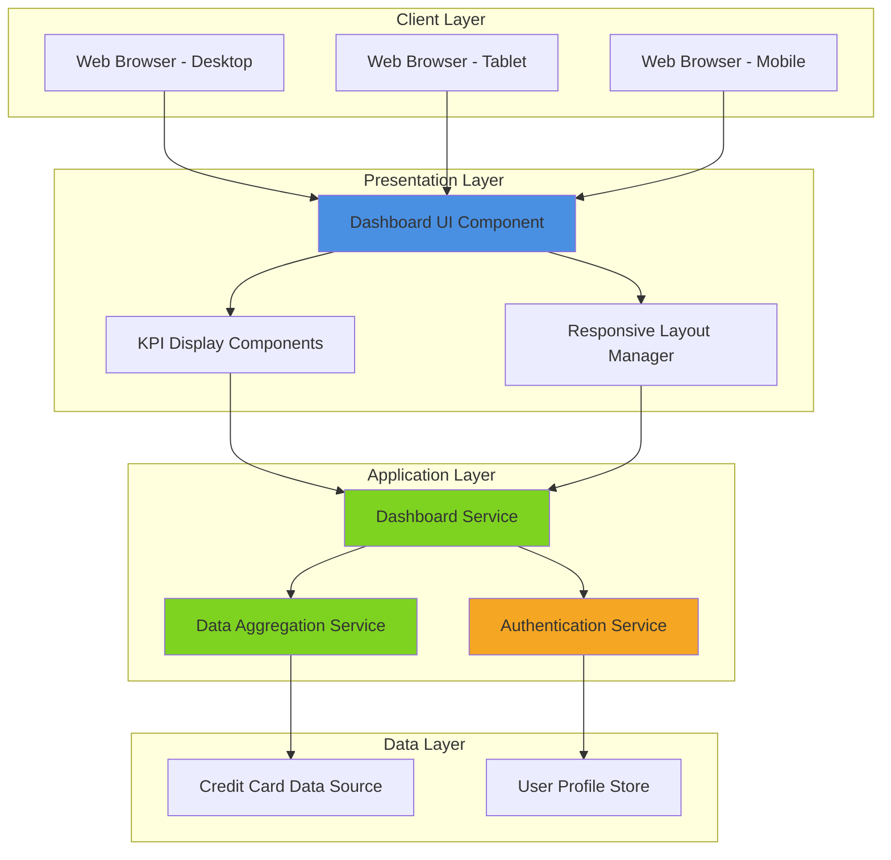
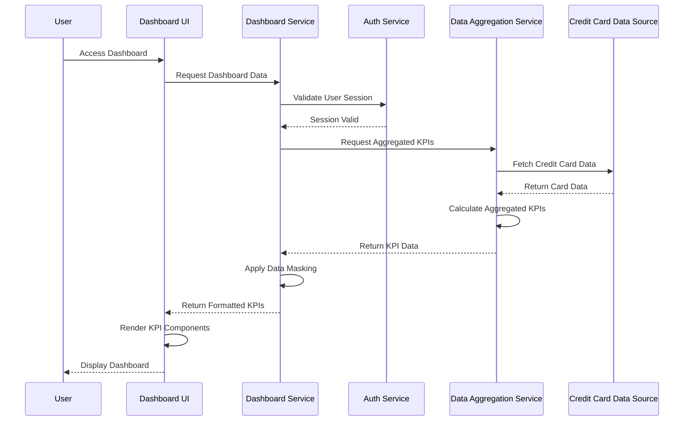
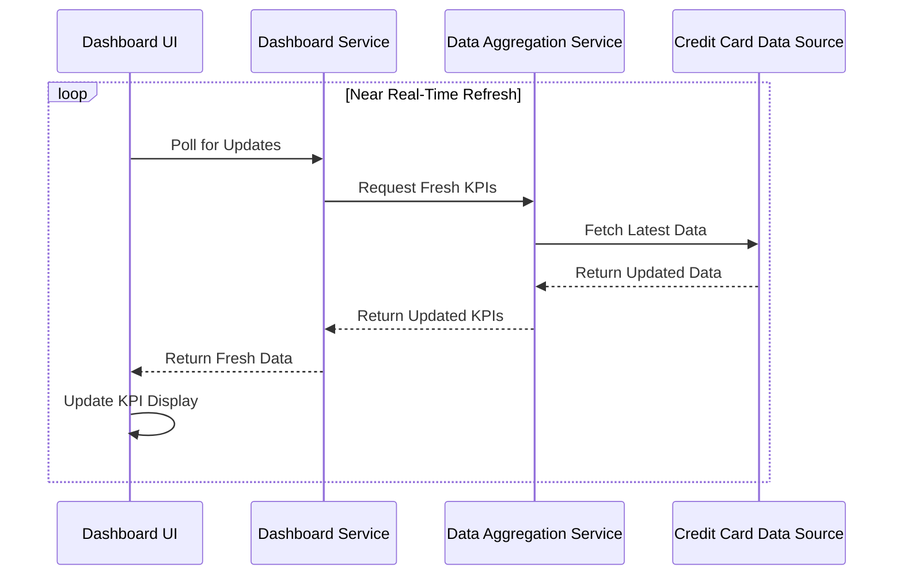

# High-Level Design Document

## Epic: DAVPETESTING002-Dashboard and KPIs

**Project Key:** QE  
**Epic Type:** Epic  
**Labels:** DAVPETESTING002

---

## 1. Epic Overview

### 1.1 Summary
This epic delivers a consolidated dashboard that displays key performance indicators (KPIs) for credit card management. Users will be able to view critical financial metrics including monthly spend, total credit limit, available credit, and outstanding amounts across all their credit cards in a single, modern, responsive interface.

### 1.2 Business Context
The dashboard provides real-time visibility into the user's overall credit card portfolio health and spending status, enabling users to make informed financial decisions without navigating multiple banking applications or statements.

### 1.3 User Value
Users gain immediate visibility into their financial position across all credit cards, enabling better spending decisions and credit utilization management. The consolidated view eliminates the need to check multiple bank apps or statements, saving time and reducing the risk of missed payments or over-utilization.

---

## 2. Requirements

### 2.1 Functional Requirements

| Req ID | Requirement | Source | Priority |
|--------|-------------|--------|----------|
| FR-001 | Dashboard UI with responsive layout | Epic Scope | High |
| FR-002 | Monthly Spend KPI display | Epic Scope | High |
| FR-003 | Total Credit Limit KPI display | Epic Scope | High |
| FR-004 | Available Credit KPI display | Epic Scope | High |
| FR-005 | Outstanding Amount KPI display | Epic Scope | High |
| FR-006 | Multiple credit card data aggregation and display | Epic Scope | High |
| FR-007 | Secure display of sensitive financial information with appropriate masking | Epic NFRs | High |

### 2.2 Non-Functional Requirements

| NFR ID | Category | Requirement | Target Metric | Source |
|--------|----------|-------------|---------------|--------|
| NFR-001 | Performance | Dashboard must load and render KPIs | ≤ 2 seconds | Epic NFRs |
| NFR-002 | Responsiveness | Support mobile, tablet, and desktop viewports | All standard breakpoints | Epic NFRs |
| NFR-003 | Data Freshness | Real-time or near-real-time data refresh | Near real-time | Epic NFRs |
| NFR-004 | Security | Secure display of sensitive financial information | Appropriate masking implemented | Epic NFRs |

### 2.3 Out of Scope

The following items are explicitly excluded from this epic:
- Real bank integration
- Card payment processing
- Fund transfers
- Loans
- Payment gateway integration

---

## 3. Architecture Overview

### 3.1 System Context

The Credit Card Dashboard system operates within a broader financial management ecosystem, interfacing with authentication services, data aggregation services, and credit card data sources.

### 3.2 High-Level Architecture Diagram



### 3.3 Technology Stack Assumptions

**Note:** The epic does not specify technology choices. The following are assumptions that should be validated:

- **Frontend Framework:** Modern JavaScript framework (React/Vue/Angular assumed)
- **Backend Services:** RESTful API or GraphQL (not specified)
- **Data Storage:** Mock data store or internal database (specified as mock or internal)
- **Authentication:** OAuth 2.0 or similar (not specified)

---

## 4. Component Design

### 4.1 Frontend Components

#### 4.1.1 Dashboard UI Component
**Responsibility:** Main container for the credit card dashboard  
**Key Functions:**
- Orchestrate layout rendering
- Manage responsive breakpoints
- Coordinate KPI component updates
- Handle loading and error states

#### 4.1.2 KPI Display Components
**Responsibility:** Render individual KPI metrics  
**Key Functions:**
- Display Monthly Spend KPI
- Display Total Credit Limit KPI
- Display Available Credit KPI
- Display Outstanding Amount KPI
- Apply data masking for sensitive information
- Format currency values

#### 4.1.3 Responsive Layout Manager
**Responsibility:** Adapt UI to different viewport sizes  
**Key Functions:**
- Detect viewport dimensions
- Apply appropriate CSS breakpoints
- Reflow KPI components for mobile/tablet/desktop

### 4.2 Backend Services

#### 4.2.1 Dashboard Service
**Responsibility:** Orchestrate dashboard data retrieval and processing  
**Key Functions:**
- Authenticate user requests
- Fetch aggregated credit card data
- Transform data for frontend consumption
- Cache responses for performance

#### 4.2.2 Data Aggregation Service
**Responsibility:** Aggregate credit card data across multiple cards  
**Key Functions:**
- Calculate total monthly spend across all cards
- Sum total credit limits
- Calculate total available credit
- Sum outstanding amounts
- Perform multi-card calculations

#### 4.2.3 Authentication Service (Dependency)
**Responsibility:** Verify user identity and authorization  
**Key Functions:**
- Validate user credentials
- Issue authentication tokens
- Authorize access to credit card data

### 4.3 Data Layer

#### 4.3.1 Credit Card Data Source
**Type:** Mock or internal data store (as specified)  
**Data Elements:**
- Card identification
- Monthly spend per card
- Credit limit per card
- Available credit per card
- Outstanding amount per card
- Card status

---

## 5. Data Flow

### 5.1 Dashboard Load Sequence



### 5.2 Data Refresh Flow

**Assumption:** Real-time or near-real-time refresh mechanism not specified in detail.



---

## 6. APIs and Integrations

### 6.1 API Endpoints (Assumed)

**Note:** Specific API contracts are not defined in the epic. The following are design assumptions:

#### 6.1.1 Get Dashboard KPIs
```
GET /api/v1/dashboard/kpis
```
**Authentication:** Required  
**Response:**
```json
{
  "monthlySpend": {
    "amount": 0.00,
    "currency": "USD"
  },
  "totalCreditLimit": {
    "amount": 0.00,
    "currency": "USD"
  },
  "availableCredit": {
    "amount": 0.00,
    "currency": "USD"
  },
  "outstandingAmount": {
    "amount": 0.00,
    "currency": "USD"
  },
  "lastUpdated": "ISO-8601 timestamp"
}
```

#### 6.1.2 Get Credit Card Details
```
GET /api/v1/creditcards
```
**Authentication:** Required  
**Response:**
```json
{
  "cards": [
    {
      "cardId": "string",
      "maskedNumber": "****1234",
      "monthlySpend": 0.00,
      "creditLimit": 0.00,
      "availableCredit": 0.00,
      "outstandingAmount": 0.00
    }
  ]
}
```

### 6.2 Integration Dependencies

| Integration | Type | Purpose | Status |
|-------------|------|---------|--------|
| User Authentication Service | Internal Dependency | Validate user identity and authorization | Required |
| Data Aggregation Service | Internal Dependency | Multi-card calculations | Required |
| Credit Card Data Source | Mock/Internal | Provide credit card data | Required |

---

## 7. Security Considerations

### 7.1 Authentication and Authorization
- Users must be authenticated before accessing dashboard
- Authorization checks must verify user owns the credit cards being displayed
- Session management must follow security best practices

**Gap:** Specific authentication mechanism not defined in epic.

### 7.2 Data Protection
- Sensitive financial information must be masked appropriately
- Credit card numbers should be masked (e.g., ****1234)
- Data transmission must use secure protocols (HTTPS assumed)
- Sensitive data should not be logged or cached insecurely

### 7.3 Security Requirements

| Requirement | Implementation Status | Notes |
|-------------|----------------------|-------|
| Secure display with masking | Required | Specified in NFRs |
| HTTPS/TLS encryption | Assumed | Not explicitly stated |
| Authentication | Required | Dependency identified |
| Authorization | Required | Implied by user-specific data |
| Input validation | Assumed | Not explicitly stated |
| OWASP compliance | Assumed | Not explicitly stated |

---

## 8. Scalability Considerations

### 8.1 Performance Requirements
- Dashboard must load and render within 2 seconds (NFR-001)
- Near real-time data refresh required (NFR-003)

### 8.2 Scalability Strategy (Assumptions)

**Note:** Scalability approach not specified in epic. The following are design considerations:

- **Caching:** Implement caching layer to reduce backend load
- **CDN:** Serve static assets via CDN for faster load times
- **API Rate Limiting:** Protect backend services from overload
- **Database Optimization:** Index credit card data for fast retrieval
- **Horizontal Scaling:** Design services to scale horizontally as user base grows

**Gap:** Specific scalability targets (concurrent users, transactions per second) not defined.

---

## 9. Availability and Reliability

### 9.1 Availability Requirements

**Gap:** No specific SLA or uptime requirements defined in the epic.

**Assumptions:**
- Standard business hours availability expected
- Graceful degradation if data sources unavailable
- Error handling and user feedback for failures

### 9.2 Reliability Considerations

- **Error Handling:** Display user-friendly error messages when data unavailable
- **Fallback Mechanisms:** Cache last known good data for display during outages
- **Monitoring:** Implement logging and monitoring for performance tracking
- **Alerting:** Set up alerts for performance degradation or failures

**Gap:** Specific reliability metrics (MTBF, MTTR) not defined.

---

## 10. Assumptions

| ID | Assumption | Impact | Validation Required |
|----|------------|--------|--------------------|
| A-001 | Modern JavaScript framework will be used for frontend | Medium | Yes |
| A-002 | RESTful API architecture for backend services | Medium | Yes |
| A-003 | Mock data source will be used initially | High | Yes |
| A-004 | HTTPS/TLS encryption for all communications | High | Yes |
| A-005 | OAuth 2.0 or similar for authentication | Medium | Yes |
| A-006 | Standard responsive breakpoints (320px, 768px, 1024px) | Low | Yes |
| A-007 | USD as primary currency | Low | Yes |
| A-008 | Polling mechanism for near real-time refresh | Medium | Yes |
| A-009 | Caching strategy for 2-second load requirement | High | Yes |
| A-010 | Business hours availability sufficient | Medium | Yes |

---

## 11. Dependencies

### 11.1 Internal Dependencies

| Dependency | Type | Criticality | Status | Notes |
|------------|------|-------------|--------|-------|
| User Authentication and Authorization Service | Service | Critical | Required | Must be available before dashboard launch |
| Data Aggregation Service | Service | Critical | Required | Core functionality for multi-card calculations |
| Credit Card Data Source (mock or internal) | Data Store | Critical | Required | Source of truth for credit card data |

### 11.2 External Dependencies

**Note:** Epic explicitly excludes real bank integration. No external dependencies identified.

### 11.3 Technology Dependencies

**Gap:** Specific technology stack not defined in epic. Technology choices must be validated.

---

## 12. Risks and Mitigation

| Risk ID | Risk Description | Probability | Impact | Mitigation Strategy | Owner |
|---------|------------------|-------------|--------|---------------------|-------|
| R-001 | 2-second load time may be challenging with multiple data sources | Medium | High | Implement aggressive caching, optimize queries, use CDN | TBD |
| R-002 | Authentication service dependency may cause delays | Low | High | Early integration, stub service for parallel development | TBD |
| R-003 | Responsive design complexity across all devices | Medium | Medium | Use established CSS framework, extensive device testing | TBD |
| R-004 | Data masking requirements may vary by regulation | Low | High | Consult security/compliance team early | TBD |
| R-005 | Near real-time refresh may impact backend performance | Medium | Medium | Implement efficient polling or WebSocket strategy | TBD |
| R-006 | Mock data may not represent real-world complexity | Medium | Medium | Design data model with extensibility for real integration | TBD |
| R-007 | Undefined scalability targets may lead to performance issues | High | High | Define concurrent user targets and load test early | TBD |

---

## 13. Design Gaps and Open Questions

### 13.1 Critical Gaps

| Gap ID | Description | Impact | Resolution Needed By |
|--------|-------------|--------|---------------------|
| G-001 | Technology stack not specified | High | Design Phase |
| G-002 | API contracts not defined | High | Design Phase |
| G-003 | Authentication mechanism not specified | High | Design Phase |
| G-004 | Data refresh mechanism (polling vs WebSocket) not specified | Medium | Design Phase |
| G-005 | Specific masking rules for sensitive data not defined | High | Design Phase |
| G-006 | Scalability targets (concurrent users, TPS) not defined | High | Design Phase |
| G-007 | Availability/SLA requirements not defined | Medium | Requirements Phase |
| G-008 | Currency handling and internationalization not addressed | Low | Design Phase |
| G-009 | Error handling and user feedback patterns not specified | Medium | Design Phase |
| G-010 | Monitoring and observability requirements not defined | Medium | Design Phase |

### 13.2 Open Questions

1. **Q1:** What specific responsive breakpoints should be supported?
2. **Q2:** What is the acceptable near real-time refresh interval?
3. **Q3:** What level of data masking is required (full card number, CVV, etc.)?
4. **Q4:** Should the dashboard support multiple currencies?
5. **Q5:** What is the expected concurrent user load?
6. **Q6:** Are there specific accessibility requirements (WCAG compliance)?
7. **Q7:** What browsers and versions must be supported?
8. **Q8:** Should historical KPI data be displayed (trends)?
9. **Q9:** What happens when a user has no credit cards?
10. **Q10:** Are there specific regulatory compliance requirements (PCI-DSS, etc.)?

---

# Validation Report

## 1. Requirements Traceability Matrix

| Requirement ID | Requirement | Source | Design Component | Status |
|----------------|-------------|--------|------------------|--------|
| FR-001 | Dashboard UI with responsive layout | Epic Scope | Dashboard UI Component, Responsive Layout Manager | Covered |
| FR-002 | Monthly Spend KPI display | Epic Scope | KPI Display Components | Covered |
| FR-003 | Total Credit Limit KPI display | Epic Scope | KPI Display Components | Covered |
| FR-004 | Available Credit KPI display | Epic Scope | KPI Display Components | Covered |
| FR-005 | Outstanding Amount KPI display | Epic Scope | KPI Display Components | Covered |
| FR-006 | Multiple credit card data aggregation | Epic Scope | Data Aggregation Service | Covered |
| FR-007 | Secure display with masking | Epic NFRs | Dashboard Service, KPI Display Components | Covered |
| NFR-001 | Load and render within 2 seconds | Epic NFRs | Caching strategy, optimization | Partially Covered |
| NFR-002 | Responsive design (mobile/tablet/desktop) | Epic NFRs | Responsive Layout Manager | Covered |
| NFR-003 | Real-time or near-real-time refresh | Epic NFRs | Data refresh flow | Partially Covered |
| NFR-004 | Secure display of sensitive information | Epic NFRs | Security considerations | Covered |

## 2. Coverage Status

### 2.1 Functional Requirements Coverage
- **Total Requirements:** 7
- **Fully Covered:** 7 (100%)
- **Partially Covered:** 0 (0%)
- **Not Covered:** 0 (0%)

### 2.2 Non-Functional Requirements Coverage
- **Total NFRs:** 4
- **Fully Covered:** 2 (50%)
- **Partially Covered:** 2 (50%)
- **Not Covered:** 0 (0%)

**Note:** NFR-001 and NFR-003 are marked as partially covered because specific implementation strategies require validation and detailed design.

## 3. NFR Validation Targets

| NFR | Target | Validation Method | Status |
|-----|--------|-------------------|--------|
| NFR-001 | ≤ 2 seconds load time | Performance testing with realistic data volumes | Not Validated |
| NFR-002 | Mobile/tablet/desktop support | Responsive design testing across devices | Not Validated |
| NFR-003 | Near real-time refresh | Measure data staleness and refresh latency | Not Validated |
| NFR-004 | Secure data masking | Security review and penetration testing | Not Validated |

**Recommendation:** Establish performance testing environment and validation criteria before implementation begins.

## 4. Design Gaps Summary

### 4.1 High Priority Gaps (Must Resolve)
1. Technology stack selection
2. API contract definitions
3. Authentication mechanism specification
4. Data masking rules definition
5. Scalability targets definition

### 4.2 Medium Priority Gaps (Should Resolve)
1. Data refresh mechanism (polling vs WebSocket)
2. Availability/SLA requirements
3. Error handling patterns
4. Monitoring requirements

### 4.3 Low Priority Gaps (Nice to Have)
1. Currency handling and internationalization
2. Accessibility requirements
3. Browser compatibility matrix

## 5. Dependency Validation

| Dependency | Identified in Epic | Addressed in Design | Status |
|------------|-------------------|---------------------|--------|
| Credit card data source | Yes | Yes | ✓ |
| User authentication service | Yes | Yes | ✓ |
| Data aggregation service | Yes | Yes | ✓ |

**All dependencies identified in the epic have been addressed in the design.**

## 6. Out-of-Scope Validation

The following items are confirmed as out of scope and have been excluded from the design:
- ✓ Real bank integration
- ✓ Card payment processing
- ✓ Fund transfers
- ✓ Loans
- ✓ Payment gateway integration

**No out-of-scope items have been included in the design.**

## 7. Recommendations

### 7.1 Immediate Actions
1. **Conduct Technology Stack Review:** Select and document frontend framework, backend technologies, and data storage solutions
2. **Define API Contracts:** Create detailed API specifications with request/response schemas
3. **Specify Authentication Mechanism:** Document authentication flow and integration approach
4. **Define Data Masking Rules:** Work with security team to establish masking requirements
5. **Set Scalability Targets:** Define expected concurrent users and performance benchmarks

### 7.2 Design Phase Actions
1. Create detailed component specifications
2. Design database schema for credit card data
3. Define caching strategy for 2-second load requirement
4. Specify data refresh mechanism (polling interval or WebSocket)
5. Create error handling and user feedback specifications
6. Define monitoring and logging requirements

### 7.3 Pre-Implementation Actions
1. Conduct security review of design
2. Validate responsive design approach with UX team
3. Create performance testing plan
4. Establish CI/CD pipeline for automated testing
5. Document deployment architecture

### 7.4 Risk Mitigation Actions
1. Create proof-of-concept for 2-second load time validation
2. Establish early integration with authentication service
3. Design extensible data model for future real bank integration
4. Implement comprehensive device and browser testing strategy

## 8. Design Quality Assessment

| Criteria | Rating | Comments |
|----------|--------|----------|
| Requirements Coverage | ✓ Good | All functional requirements addressed |
| NFR Coverage | ⚠ Partial | Implementation strategies need validation |
| Dependency Management | ✓ Good | All dependencies identified and addressed |
| Security Considerations | ⚠ Partial | High-level approach defined, details needed |
| Scalability | ⚠ Partial | Strategy outlined but targets undefined |
| Completeness | ⚠ Partial | Multiple design gaps require resolution |
| Traceability | ✓ Good | Clear mapping from requirements to design |

**Overall Assessment:** The HLD provides a solid foundation covering all stated requirements. However, significant design gaps exist due to limited technical specification in the epic. These gaps must be resolved before implementation can begin.

---

## Document Control

**Document Version:** 1.0  
**Created Date:** 2025  
**Epic Reference:** DAVPETESTING002-Dashboard and KPIs  
**Project:** QE  

**Approval Status:** Draft - Pending Review

**Review Required By:**
- Product Owner
- Technical Architect
- Security Team
- Development Team Lead

---

## Appendix A: Glossary

| Term | Definition |
|------|------------|
| KPI | Key Performance Indicator - A measurable value that demonstrates effectiveness |
| NFR | Non-Functional Requirement - System quality attributes |
| CDN | Content Delivery Network - Distributed server network for content delivery |
| API | Application Programming Interface - Set of protocols for software interaction |
| HTTPS | Hypertext Transfer Protocol Secure - Encrypted HTTP |
| TLS | Transport Layer Security - Cryptographic protocol for secure communication |
| OAuth | Open Authorization - Industry-standard authorization protocol |
| SLA | Service Level Agreement - Commitment between service provider and customer |
| MTBF | Mean Time Between Failures - Average time between system failures |
| MTTR | Mean Time To Repair - Average time to restore service after failure |

---

## Appendix B: References

**Epic Source:** item-c93a1d639cd63b0ae56d028f2efecbab829f32688e367f949c3d7bcd458138ca.json

**Related Documentation:**
- (To be added: Links to authentication service documentation)
- (To be added: Links to data aggregation service documentation)
- (To be added: Links to security standards and guidelines)
- (To be added: Links to UI/UX design guidelines)

---

*End of Document*