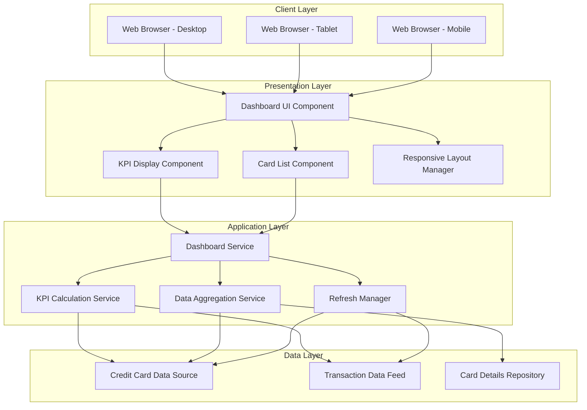
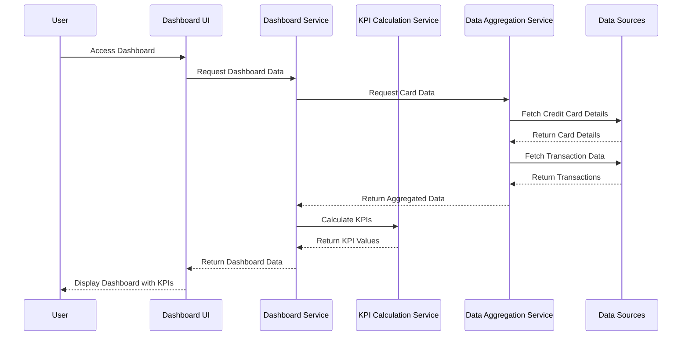
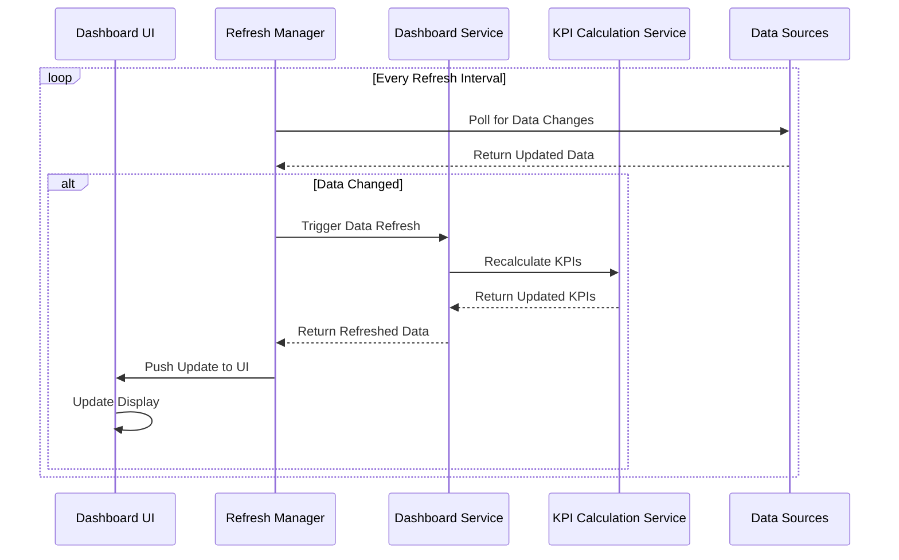

# High-Level Design Document

## Epic: EPICPROD1-Dashboard and KPI Monitoring

**Project Key:** QE  
**Epic Label:** EPICPROD1  
**Document Version:** 1.0  
**Date:** 2024

---

## 1. Epic Overview

### 1.1 Summary
This epic delivers a modern, responsive Credit Card Analysis Dashboard that provides users with a consolidated view of all their credit cards and key financial metrics. Users will be able to monitor critical KPIs including Monthly Spend, Total Credit Limit, Available Credit, and Outstanding Amount from a single interface.

### 1.2 User Value
Credit card users managing one or multiple credit cards gain a centralized platform to track their financial health at a glance, reducing the need to check multiple sources and improving their ability to manage credit utilization and spending effectively.

### 1.3 Business Objectives
- Provide consolidated view of multiple credit cards
- Enable real-time monitoring of key financial metrics
- Improve user visibility into spending patterns and outstanding balances
- Support better financial decision-making through centralized data presentation

---

## 2. Requirements

### 2.1 Functional Requirements

| Req ID | Requirement | Priority | Source |
|--------|-------------|----------|--------|
| FR-001 | Display Monthly Spend KPI for all credit cards | High | Epic Scope |
| FR-002 | Display Total Credit Limit KPI across all cards | High | Epic Scope |
| FR-003 | Display Available Credit KPI | High | Epic Scope |
| FR-004 | Display Outstanding Amount KPI | High | Epic Scope |
| FR-005 | Provide consolidated view of multiple credit cards | High | Epic Scope |
| FR-006 | Display individual card details in consolidated interface | High | Epic Scope |
| FR-007 | Implement responsive layout for dashboard | High | Epic Scope |
| FR-008 | Support real-time or near-real-time data refresh for KPIs | High | NFRs |

### 2.2 Non-Functional Requirements

| NFR ID | Category | Requirement | Target | Priority |
|--------|----------|-------------|--------|----------|
| NFR-001 | Responsiveness | Dashboard must be responsive across desktop, tablet, and mobile devices | 100% responsive design | High |
| NFR-002 | Performance | Support real-time or near-real-time data refresh for KPIs | Data refresh < 5 seconds | High |
| NFR-003 | Usability | Interface must be modern and intuitive for ease of use | User satisfaction > 80% | High |
| NFR-004 | Compatibility | Function across desktop browsers (Chrome, Firefox, Safari, Edge) | 100% compatibility | Medium |
| NFR-005 | Compatibility | Function on tablet devices (iOS, Android) | 100% compatibility | Medium |
| NFR-006 | Compatibility | Function on mobile devices (iOS, Android) | 100% compatibility | Medium |

### 2.3 Out of Scope

The following items are explicitly excluded from this epic:

- Real Bank Integration
- Card Payments functionality
- Fund Transfers
- Loans management
- Payment Gateway Integration

---

## 3. Architecture Overview

### 3.1 System Context

The Credit Card Analysis Dashboard is a web-based application that aggregates and displays credit card data from non-bank data sources. The system provides a read-only view of credit card information and KPIs without direct bank integration.

### 3.2 High-Level Architecture



### 3.3 Technology Stack (Assumptions)

**Note:** Specific technology choices are not defined in the epic. The following are assumptions that should be validated:

- **Frontend:** Modern JavaScript framework (React/Angular/Vue.js assumed)
- **Backend:** RESTful API service (technology to be determined)
- **Data Storage:** Database for credit card and transaction data (type to be determined)
- **Communication:** HTTP/HTTPS for API calls
- **Responsive Framework:** CSS framework with responsive capabilities (Bootstrap/Material-UI/Tailwind assumed)

---

## 4. Component Design

### 4.1 Frontend Components

#### 4.1.1 Dashboard UI Component
**Responsibility:** Main container for the dashboard interface

**Features:**
- Orchestrates layout of all child components
- Manages responsive breakpoints
- Handles initial data loading
- Coordinates refresh cycles

#### 4.1.2 KPI Display Component
**Responsibility:** Render key performance indicators

**KPIs to Display:**
- Monthly Spend: Total spending across all cards in current month
- Total Credit Limit: Sum of credit limits across all cards
- Available Credit: Total available credit across all cards
- Outstanding Amount: Total outstanding balance across all cards

**Features:**
- Visual representation of each KPI
- Real-time/near-real-time updates
- Responsive sizing for different devices

#### 4.1.3 Card List Component
**Responsibility:** Display consolidated view of all credit cards

**Features:**
- List or grid view of all user credit cards
- Individual card details (card number masked, card type, bank name)
- Per-card metrics (limit, available, outstanding)
- Responsive layout adaptation

#### 4.1.4 Responsive Layout Manager
**Responsibility:** Ensure proper rendering across devices

**Features:**
- Detect device type and screen size
- Apply appropriate layout configurations
- Handle orientation changes
- Optimize component placement

### 4.2 Backend Services

#### 4.2.1 Dashboard Service
**Responsibility:** Main orchestration service for dashboard data

**Operations:**
- Aggregate data from multiple sources
- Coordinate with KPI Calculation Service
- Manage data refresh cycles
- Handle client requests

#### 4.2.2 KPI Calculation Service
**Responsibility:** Calculate dashboard KPIs

**Calculations:**
- Monthly Spend: Sum of transactions in current month
- Total Credit Limit: Sum of credit limits from all cards
- Available Credit: Sum of (Credit Limit - Outstanding) for all cards
- Outstanding Amount: Sum of outstanding balances across all cards

#### 4.2.3 Data Aggregation Service
**Responsibility:** Retrieve and consolidate data from data sources

**Operations:**
- Fetch credit card details
- Retrieve transaction data
- Consolidate data from multiple repositories
- Cache data for performance optimization

#### 4.2.4 Refresh Manager
**Responsibility:** Manage real-time/near-real-time data updates

**Features:**
- Polling mechanism for data updates
- Push notification support (if available)
- Configurable refresh intervals
- Efficient data synchronization

---

## 5. Data Flow

### 5.1 Dashboard Load Flow



### 5.2 Real-Time Refresh Flow



### 5.3 Data Model (Conceptual)

**Credit Card Entity:**
```
{
  "cardId": "string",
  "cardNumber": "string (masked)",
  "cardType": "string",
  "bankName": "string",
  "creditLimit": "decimal",
  "availableCredit": "decimal",
  "outstandingAmount": "decimal",
  "status": "string"
}
```

**Transaction Entity:**
```
{
  "transactionId": "string",
  "cardId": "string",
  "amount": "decimal",
  "transactionDate": "datetime",
  "description": "string",
  "category": "string",
  "status": "string"
}
```

**Dashboard KPI Model:**
```
{
  "monthlySpend": "decimal",
  "totalCreditLimit": "decimal",
  "availableCredit": "decimal",
  "outstandingAmount": "decimal",
  "lastUpdated": "datetime"
}
```

---

## 6. APIs and Integrations

### 6.1 Internal APIs (Assumed)

#### 6.1.1 Dashboard API

**GET /api/dashboard**
- **Description:** Retrieve complete dashboard data including KPIs and card list
- **Response:**
```json
{
  "kpis": {
    "monthlySpend": 0.00,
    "totalCreditLimit": 0.00,
    "availableCredit": 0.00,
    "outstandingAmount": 0.00,
    "lastUpdated": "ISO-8601 datetime"
  },
  "cards": [
    {
      "cardId": "string",
      "cardNumber": "string",
      "cardType": "string",
      "bankName": "string",
      "creditLimit": 0.00,
      "availableCredit": 0.00,
      "outstandingAmount": 0.00
    }
  ]
}
```

**GET /api/kpis**
- **Description:** Retrieve only KPI values
- **Response:** KPI object as shown above

**GET /api/cards**
- **Description:** Retrieve list of all credit cards
- **Response:** Array of card objects

**GET /api/cards/{cardId}**
- **Description:** Retrieve details of a specific credit card
- **Response:** Single card object

### 6.2 External Integrations

#### 6.2.1 Credit Card Data Source
**Type:** Non-bank data source (as per out-of-scope constraints)  
**Purpose:** Provide credit card details and current balances  
**Integration Method:** To be determined  
**Data Provided:** Card details, credit limits, outstanding amounts

**Assumption:** This is a simulated or test data source, not a real banking system.

#### 6.2.2 Transaction Data Feed
**Type:** Data feed service  
**Purpose:** Provide transaction history for KPI calculations  
**Integration Method:** To be determined  
**Data Provided:** Transaction records, amounts, dates, categories

**Assumption:** This feed provides historical and recent transaction data.

#### 6.2.3 Card Details Repository
**Type:** Data repository  
**Purpose:** Store and retrieve card metadata  
**Integration Method:** Database connection or API  
**Data Provided:** Card metadata, bank information, card types

---

## 7. Security Considerations

### 7.1 Authentication and Authorization

**Gap Identified:** The epic does not specify authentication or authorization requirements.

**Assumptions:**
- Users must be authenticated to access the dashboard
- Users can only view their own credit card data
- Session management is required for web application

**Recommendations:**
- Define authentication mechanism (OAuth 2.0, JWT, session-based)
- Implement role-based access control if needed
- Ensure secure session management

### 7.2 Data Security

**Requirements:**
- Credit card numbers must be masked in the UI (show only last 4 digits)
- Data transmission must be encrypted (HTTPS)
- Sensitive data should not be logged
- Implement input validation to prevent injection attacks

**Assumptions:**
- PCI DSS compliance is required for handling credit card data
- Data at rest should be encrypted

### 7.3 API Security

**Requirements:**
- API endpoints must be authenticated
- Implement rate limiting to prevent abuse
- Validate all input parameters
- Use CORS policies appropriately

---

## 8. Scalability

### 8.1 Scalability Requirements

**Gap Identified:** The epic does not specify expected user load or scalability targets.

**Assumptions:**
- System should support concurrent users (target number to be defined)
- Dashboard should handle multiple credit cards per user (reasonable limit to be defined)
- Data refresh should not degrade performance under load

### 8.2 Scalability Strategy

**Frontend:**
- Implement client-side caching
- Use lazy loading for card list if user has many cards
- Optimize asset delivery (CDN, minification, compression)

**Backend:**
- Implement caching layer (Redis/Memcached assumed)
- Use connection pooling for database connections
- Consider horizontal scaling for application servers
- Implement asynchronous processing for data aggregation

**Database:**
- Index frequently queried fields
- Implement read replicas if needed
- Consider partitioning strategy for transaction data

### 8.3 Performance Targets

**Assumed Targets (to be validated):**
- Dashboard load time: < 3 seconds
- KPI refresh time: < 5 seconds (as per NFR-002)
- API response time: < 1 second (95th percentile)
- Support for at least 100 concurrent users per server instance

---

## 9. Availability and Reliability

### 9.1 Availability Requirements

**Gap Identified:** The epic does not specify availability targets or SLA requirements.

**Assumptions:**
- Target availability: 99.5% uptime (to be validated)
- Planned maintenance windows acceptable
- Graceful degradation if data sources are unavailable

### 9.2 Reliability Measures

**Error Handling:**
- Display user-friendly error messages when data cannot be loaded
- Implement retry logic for transient failures
- Log errors for monitoring and debugging

**Monitoring:**
- Monitor API response times
- Track data refresh success/failure rates
- Monitor system resource utilization
- Set up alerts for critical failures

**Backup and Recovery:**
- Define backup strategy for data repositories (if applicable)
- Document recovery procedures
- Test disaster recovery plan

---

## 10. Responsive Design Strategy

### 10.1 Breakpoints

**Desktop:** ≥ 1024px
- Full dashboard layout with side-by-side KPIs
- Grid view for credit cards (3-4 columns)
- Maximum information density

**Tablet:** 768px - 1023px
- Adjusted dashboard layout
- Grid view for credit cards (2 columns)
- Optimized touch targets

**Mobile:** < 768px
- Stacked layout for KPIs
- Single column list view for credit cards
- Hamburger menu if navigation is present
- Large touch targets

### 10.2 Responsive Features

- Fluid typography scaling
- Flexible grid system
- Touch-friendly UI elements on mobile/tablet
- Optimized images and assets per device
- Progressive enhancement approach

---

## 11. Assumptions

| ID | Assumption | Impact | Validation Required |
|----|------------|--------|--------------------|
| A-001 | Credit card data source is a non-bank, simulated data source | High | Yes - Confirm data source details |
| A-002 | Users are authenticated before accessing dashboard | High | Yes - Define authentication mechanism |
| A-003 | Real-time refresh means polling with < 5 second interval | Medium | Yes - Confirm refresh mechanism |
| A-004 | System will use modern JavaScript framework for frontend | Medium | Yes - Confirm technology stack |
| A-005 | Dashboard will support up to 20 credit cards per user | Medium | Yes - Confirm card limit |
| A-006 | Monthly spend is calculated based on current calendar month | Low | Yes - Confirm calculation period |
| A-007 | All monetary values are in single currency (USD assumed) | Medium | Yes - Confirm currency handling |
| A-008 | System requires PCI DSS compliance | High | Yes - Confirm compliance requirements |
| A-009 | Target availability is 99.5% uptime | Medium | Yes - Confirm SLA requirements |
| A-010 | System will support modern browsers (last 2 versions) | Low | Yes - Confirm browser support matrix |

---

## 12. Dependencies

### 12.1 External Dependencies

| Dependency | Type | Description | Criticality | Status |
|------------|------|-------------|-------------|--------|
| Credit Card Data Source | Integration | Non-bank data source for credit card information | Critical | To be confirmed |
| Transaction Data Feed | Integration | Feed providing transaction history | Critical | To be confirmed |
| Card Details Repository | Data Store | Repository for card metadata | Critical | To be confirmed |

### 12.2 Internal Dependencies

| Dependency | Type | Description | Criticality | Status |
|------------|------|-------------|-------------|--------|
| Authentication Service | Service | User authentication and session management | High | Assumed to exist |
| User Management System | Service | User profile and account management | Medium | Assumed to exist |

### 12.3 Technology Dependencies

| Dependency | Type | Description | Criticality |
|------------|------|-------------|-------------|
| Web Server | Infrastructure | Server to host web application | Critical |
| Application Server | Infrastructure | Server to run backend services | Critical |
| Database Server | Infrastructure | Database for data storage | Critical |
| CDN (assumed) | Infrastructure | Content delivery for static assets | Medium |

---

## 13. Risks and Mitigation

### 13.1 Technical Risks

| Risk ID | Risk Description | Probability | Impact | Mitigation Strategy |
|---------|------------------|-------------|--------|---------------------|
| R-001 | Credit card data source integration may be unreliable | Medium | High | Implement robust error handling, caching, and fallback mechanisms |
| R-002 | Real-time refresh may impact performance under load | Medium | Medium | Implement efficient polling, caching, and consider WebSocket for updates |
| R-003 | Responsive design may not work consistently across all devices | Low | Medium | Conduct thorough cross-device testing, use established responsive frameworks |
| R-004 | Data synchronization issues between multiple data sources | Medium | High | Implement data consistency checks and reconciliation processes |
| R-005 | Security vulnerabilities in handling sensitive credit card data | Low | Critical | Follow security best practices, conduct security audits, implement PCI DSS controls |

### 13.2 Business Risks

| Risk ID | Risk Description | Probability | Impact | Mitigation Strategy |
|---------|------------------|-------------|--------|---------------------|
| R-006 | User expectations for real bank integration (which is out of scope) | High | Medium | Clear communication about non-bank data source, manage expectations |
| R-007 | Incomplete or inaccurate data from data sources | Medium | High | Implement data validation, display data freshness indicators |
| R-008 | Users may expect payment functionality (out of scope) | Medium | Low | Clear UI/UX to indicate read-only nature, plan for future enhancements |

### 13.3 Project Risks

| Risk ID | Risk Description | Probability | Impact | Mitigation Strategy |
|---------|------------------|-------------|--------|---------------------|
| R-009 | Unclear requirements for data source integrations | High | High | Conduct requirements clarification sessions, document integration contracts |
| R-010 | Undefined authentication and authorization requirements | High | Medium | Prioritize security requirements definition, engage security team early |
| R-011 | Lack of defined performance and scalability targets | Medium | Medium | Define measurable targets early, conduct performance testing |

---

## 14. Design Gaps and Open Questions

### 14.1 Critical Gaps

1. **Authentication and Authorization**
   - How will users authenticate to access the dashboard?
   - What authorization model will be used?
   - How are user sessions managed?

2. **Data Source Integration Details**
   - What is the specific credit card data source?
   - What are the API contracts or data formats?
   - What is the data refresh frequency from source systems?

3. **Performance and Scalability Targets**
   - What is the expected number of concurrent users?
   - What are the acceptable response time SLAs?
   - What is the maximum number of cards per user?

4. **Compliance and Security Requirements**
   - Is PCI DSS compliance required?
   - What data retention policies apply?
   - What are the encryption requirements?

### 14.2 Open Questions

1. Should the dashboard support multiple currencies?
2. What is the definition of "Monthly Spend" - current calendar month, rolling 30 days, or statement period?
3. Should users be able to customize which KPIs are displayed?
4. Is there a need for historical trend views or only current values?
5. Should the system support exporting dashboard data?
6. What browsers and browser versions must be supported?
7. Are there accessibility requirements (WCAG compliance)?
8. What is the expected data latency from source systems?
9. Should the dashboard support filtering or sorting of credit cards?
10. Are there any regulatory compliance requirements beyond PCI DSS?

---

# Validation Report

## 1. Requirements Traceability Matrix

| Requirement ID | Requirement Description | Epic Source | Design Coverage | HLD Section | Status |
|----------------|------------------------|-------------|-----------------|-------------|--------|
| FR-001 | Display Monthly Spend KPI | Scope | Yes | 4.1.2, 5.1 | Covered |
| FR-002 | Display Total Credit Limit KPI | Scope | Yes | 4.1.2, 5.1 | Covered |
| FR-003 | Display Available Credit KPI | Scope | Yes | 4.1.2, 5.1 | Covered |
| FR-004 | Display Outstanding Amount KPI | Scope | Yes | 4.1.2, 5.1 | Covered |
| FR-005 | Consolidated view of multiple credit cards | Scope | Yes | 4.1.3, 5.1 | Covered |
| FR-006 | Display individual card details | Scope | Yes | 4.1.3, 5.3 | Covered |
| FR-007 | Responsive layout design | Scope | Yes | 4.1.4, 10 | Covered |
| FR-008 | Real-time/near-real-time data refresh | NFRs | Yes | 4.2.4, 5.2 | Covered |
| NFR-001 | Responsive across desktop, tablet, mobile | NFRs | Yes | 2.2, 10 | Covered |
| NFR-002 | Real-time/near-real-time data refresh < 5s | NFRs | Yes | 2.2, 8.3 | Covered |
| NFR-003 | Modern and intuitive interface | NFRs | Partial | 2.2, 4.1 | Partially Covered |
| NFR-004 | Desktop browser compatibility | Derived | Yes | 10.1 | Covered |
| NFR-005 | Tablet device compatibility | Derived | Yes | 10.1 | Covered |
| NFR-006 | Mobile device compatibility | Derived | Yes | 10.1 | Covered |

## 2. Coverage Status

### 2.1 Functional Requirements Coverage
- **Total Functional Requirements:** 8
- **Fully Covered:** 8 (100%)
- **Partially Covered:** 0 (0%)
- **Not Covered:** 0 (0%)

### 2.2 Non-Functional Requirements Coverage
- **Total NFRs:** 6
- **Fully Covered:** 5 (83%)
- **Partially Covered:** 1 (17%) - NFR-003 (Usability)
- **Not Covered:** 0 (0%)

### 2.3 Integration Requirements Coverage
- **Credit Card Data Source:** Identified, integration details pending
- **Transaction Data Feed:** Identified, integration details pending
- **Card Details Repository:** Identified, integration details pending

### 2.4 Out-of-Scope Items Preserved
All out-of-scope items have been documented and preserved:
- Real Bank Integration
- Card Payments
- Fund Transfers
- Loans
- Payment Gateway Integration

## 3. NFR Validation Targets

| NFR ID | Category | Target | Validation Method | Status |
|--------|----------|--------|-------------------|--------|
| NFR-001 | Responsiveness | 100% responsive design | Cross-device testing | Design Complete |
| NFR-002 | Performance | Data refresh < 5 seconds | Performance testing | Design Complete |
| NFR-003 | Usability | User satisfaction > 80% | User testing | Requires UX Design |
| NFR-004 | Compatibility | Desktop browsers | Compatibility testing | Design Complete |
| NFR-005 | Compatibility | Tablet devices | Compatibility testing | Design Complete |
| NFR-006 | Compatibility | Mobile devices | Compatibility testing | Design Complete |

## 4. Design Gaps Summary

### 4.1 High Priority Gaps
1. **Authentication/Authorization** - No specification provided in epic
2. **Data Source Integration Contracts** - Specific APIs and data formats undefined
3. **Performance Targets** - Beyond data refresh, no specific targets defined
4. **Security Requirements** - PCI DSS and encryption requirements not specified

### 4.2 Medium Priority Gaps
1. **Scalability Targets** - Concurrent user capacity undefined
2. **Availability Requirements** - SLA and uptime targets not specified
3. **Currency Handling** - Multi-currency support not addressed
4. **Browser Support Matrix** - Specific browser versions not defined

### 4.3 Low Priority Gaps
1. **Accessibility Requirements** - WCAG compliance not mentioned
2. **Data Export Functionality** - Not specified if needed
3. **Customization Options** - User preferences not addressed
4. **Historical Data Views** - Only current values specified

## 5. Assumptions Requiring Validation

### 5.1 Critical Assumptions
1. Credit card data source is non-bank, simulated system
2. User authentication exists and will be integrated
3. PCI DSS compliance is required
4. Real-time means polling with < 5 second refresh

### 5.2 Important Assumptions
1. System supports up to 20 credit cards per user
2. Monthly spend is current calendar month
3. All values in single currency (USD)
4. Modern JavaScript framework will be used

## 6. Recommendations

### 6.1 Immediate Actions Required
1. **Define Authentication Strategy** - Critical for security and user management
2. **Specify Data Source Integration Details** - Required for implementation planning
3. **Establish Performance Baselines** - Define measurable targets beyond 5-second refresh
4. **Clarify Security Requirements** - Confirm PCI DSS scope and encryption needs

### 6.2 Design Enhancements
1. **Implement Caching Strategy** - To meet performance targets under load
2. **Add Data Freshness Indicators** - Show users when data was last updated
3. **Design Error States** - Clear user communication when data unavailable
4. **Plan for Extensibility** - Architecture should support future payment features

### 6.3 Technical Recommendations
1. Use established responsive framework (Bootstrap, Material-UI, or Tailwind CSS)
2. Implement WebSocket or Server-Sent Events for real-time updates instead of polling
3. Use Redis or similar for caching layer to improve performance
4. Implement comprehensive logging and monitoring from day one
5. Design API contracts with versioning strategy
6. Implement feature flags for gradual rollout

### 6.4 Process Recommendations
1. Conduct requirements clarification workshop for gaps identified
2. Engage security team early for PCI DSS compliance review
3. Create detailed technical design document for each component
4. Establish performance testing strategy and benchmarks
5. Plan for accessibility audit and WCAG compliance review
6. Define data governance and retention policies

## 7. Risk Assessment Summary

### 7.1 High-Risk Items
- Integration with undefined credit card data source (R-001)
- Data synchronization across multiple sources (R-004)
- Security vulnerabilities with sensitive data (R-005)
- Unclear integration requirements (R-009)
- Undefined authentication requirements (R-010)

### 7.2 Risk Mitigation Priority
1. **Immediate:** Define data source integration contracts and authentication mechanism
2. **Short-term:** Establish security controls and PCI DSS compliance plan
3. **Ongoing:** Implement robust error handling and monitoring

## 8. Compliance and Standards

### 8.1 Assumed Compliance Requirements
- **PCI DSS:** Assumed required for credit card data handling
- **GDPR/Data Privacy:** May apply depending on user location
- **WCAG 2.1:** Recommended for accessibility
- **OWASP Top 10:** Security best practices

### 8.2 Validation Required
All compliance requirements should be formally validated with legal and compliance teams.

## 9. Success Criteria

### 9.1 Functional Success Criteria
- ✅ All four KPIs (Monthly Spend, Total Credit Limit, Available Credit, Outstanding Amount) are displayed
- ✅ Multiple credit cards can be viewed in consolidated interface
- ✅ Dashboard is responsive across desktop, tablet, and mobile
- ✅ Data refreshes within 5 seconds

### 9.2 Non-Functional Success Criteria
- ⚠️ User satisfaction > 80% (requires user testing)
- ✅ Cross-device compatibility achieved
- ⚠️ Performance targets met (requires definition and testing)
- ⚠️ Security requirements satisfied (requires validation)

### 9.3 Business Success Criteria
- Users can track financial health from single interface
- Reduced need to check multiple sources
- Improved visibility into spending patterns
- Better credit utilization management

## 10. Conclusion

This High-Level Design provides comprehensive coverage of the functional requirements specified in the epic. All four KPIs, multi-card view, responsive design, and real-time refresh capabilities have been addressed in the architecture and component design.

**Key Strengths:**
- Complete functional requirement coverage (100%)
- Clear component architecture with separation of concerns
- Responsive design strategy defined for all device types
- Data flow and integration points identified

**Critical Gaps Requiring Resolution:**
- Authentication and authorization mechanism undefined
- Data source integration contracts not specified
- Security and compliance requirements need validation
- Performance and scalability targets beyond data refresh need definition

**Next Steps:**
1. Conduct requirements clarification workshop to address identified gaps
2. Define authentication strategy and integrate with existing systems
3. Establish data source integration contracts and API specifications
4. Validate security and compliance requirements with appropriate teams
5. Create detailed technical design documents for each component
6. Establish performance baselines and testing strategy
7. Begin implementation with iterative validation against requirements

**Overall Assessment:**  
The design is feasible and addresses all specified requirements. However, successful implementation depends on resolving the critical gaps identified, particularly around authentication, data source integration, and security requirements. With these gaps addressed, the solution can deliver the intended user value of providing a centralized, responsive dashboard for credit card monitoring and financial health tracking.

---

**Document Status:** Draft - Pending Validation  
**Next Review Date:** To be scheduled  
**Approval Required From:** Product Owner, Technical Lead, Security Team, Architecture Review Board

---

*End of High-Level Design Document*