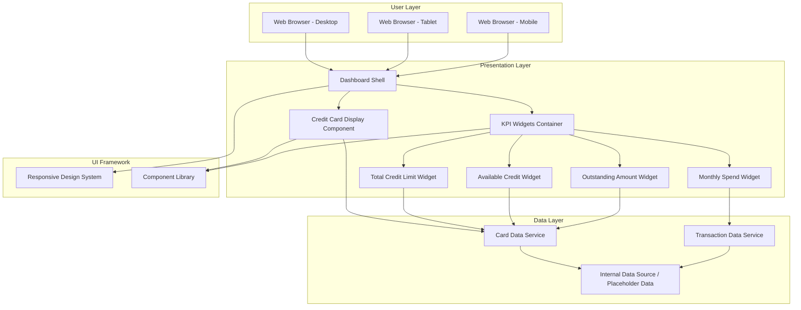
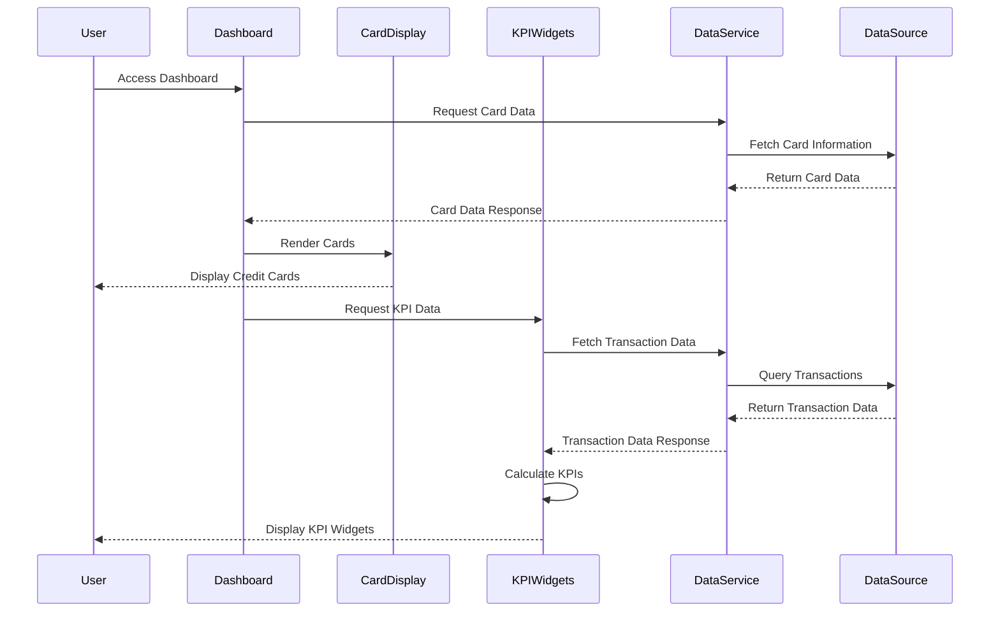

# High-Level Design Document
## Foundational Credit Card Dashboard & KPIs

---

## 1. Epic Overview

**Epic Summary:** Foundational Credit Card Dashboard & KPIs

**Issue Type:** Epic

**Description:**
Build a modern, responsive Credit Card Analysis Dashboard that provides a consolidated view of all credit cards and key KPIs such as monthly spend, total credit limit, available credit, and outstanding amount.

**User Value:**
Credit card users managing one or multiple credit cards gain a single interface to view all cards, understand their overall spending behavior, monitor utilization of credit limits, and track outstanding balances, leading to improved financial visibility and decision-making.

---

## 2. Requirements

### 2.1 Functional Requirements

| Req ID | Requirement | Source | Priority |
|--------|-------------|--------|----------|
| FR-001 | Dashboard shell and layout | Epic Scope | High |
| FR-002 | Display for multiple credit cards | Epic Scope | High |
| FR-003 | Core KPI widget: Monthly Spend | Epic Scope | High |
| FR-004 | Core KPI widget: Total Credit Limit | Epic Scope | High |
| FR-005 | Core KPI widget: Available Credit | Epic Scope | High |
| FR-006 | Core KPI widget: Outstanding Amount | Epic Scope | High |
| FR-007 | Responsive UI behavior to ensure dashboard adjusts to different device sizes | Epic Scope | High |

### 2.2 Non-Functional Requirements (NFRs)

| NFR ID | Requirement | Category | Target Metric | Validation Status |
|--------|-------------|----------|---------------|-------------------|
| NFR-001 | Responsive layouts for dashboard to view multiple cards and KPIs on different devices | Usability/Responsiveness | Support mobile, tablet, desktop viewports | To Be Validated |
| NFR-002 | Interactive but performant UI with KPI data loading without noticeable lag | Performance | Page load time < 2s, KPI render time < 500ms | To Be Validated |
| NFR-003 | Usability sufficient for users to clearly understand card and KPI information at a glance | Usability | User comprehension rate > 90% in usability testing | To Be Validated |

### 2.3 Out of Scope

The following items are explicitly excluded from this epic:
- Real Bank Integration
- Card Payments
- Fund Transfers
- Loans
- Payment Gateway Integration

---

## 3. Architecture Overview

### 3.1 System Context

The Credit Card Dashboard is a frontend-focused solution that presents credit card information and KPIs to end users. It relies on internal data sources or placeholder data to populate card details and KPI metrics.

### 3.2 High-Level Architecture Diagram



### 3.3 Technology Stack Assumptions

**Assumption:** The following technology stack is assumed based on modern web development practices. Actual implementation may vary.

- **Frontend Framework:** React, Vue.js, or Angular (not specified in epic)
- **UI Component Library:** Material-UI, Ant Design, or custom design system
- **Responsive Framework:** CSS Grid, Flexbox, or Bootstrap
- **State Management:** Redux, Vuex, or Context API (if needed)
- **Data Format:** JSON for data exchange
- **Build Tools:** Webpack, Vite, or similar

---

## 4. Component Design

### 4.1 Dashboard Shell Component

**Purpose:** Main container for the entire dashboard interface

**Responsibilities:**
- Provide overall layout structure
- Manage responsive breakpoints
- Coordinate child component rendering
- Handle global state or context

**Key Properties:**
- Responsive grid layout
- Flexible container for cards and KPIs
- Navigation structure (if applicable)

### 4.2 Credit Card Display Component

**Purpose:** Display individual or multiple credit card information

**Responsibilities:**
- Render credit card details (card number, card type, cardholder name)
- Display card-specific information
- Support multiple card instances
- Adapt layout based on screen size

**Data Requirements:**
- Card ID
- Card Number (masked)
- Card Type (Visa, Mastercard, etc.)
- Cardholder Name
- Expiry Date
- Card Status

### 4.3 KPI Widgets Container

**Purpose:** Container for all KPI widgets

**Responsibilities:**
- Organize KPI widgets in responsive grid
- Manage widget layout and spacing
- Coordinate data fetching for all KPIs

### 4.4 Individual KPI Widgets

#### 4.4.1 Monthly Spend Widget

**Purpose:** Display total spending for the current month

**Data Points:**
- Current month spend amount
- Currency
- Optional: Comparison with previous month
- Optional: Trend indicator

#### 4.4.2 Total Credit Limit Widget

**Purpose:** Display aggregate credit limit across all cards

**Data Points:**
- Total credit limit amount
- Currency
- Optional: Per-card breakdown

#### 4.4.3 Available Credit Widget

**Purpose:** Display remaining available credit

**Data Points:**
- Available credit amount
- Currency
- Optional: Utilization percentage
- Optional: Visual indicator (progress bar)

#### 4.4.4 Outstanding Amount Widget

**Purpose:** Display total outstanding balance

**Data Points:**
- Outstanding amount
- Currency
- Optional: Due date
- Optional: Minimum payment due

---

## 5. Data Flow

### 5.1 Data Flow Diagram



### 5.2 Data Models

#### Credit Card Data Model

```json
{
  "cardId": "string",
  "cardNumber": "string (masked)",
  "cardType": "string",
  "cardholderName": "string",
  "expiryDate": "string (MM/YY)",
  "creditLimit": "number",
  "availableCredit": "number",
  "outstandingAmount": "number",
  "status": "string"
}
```

#### Transaction Data Model

```json
{
  "transactionId": "string",
  "cardId": "string",
  "amount": "number",
  "currency": "string",
  "transactionDate": "string (ISO 8601)",
  "merchantName": "string",
  "category": "string",
  "status": "string"
}
```

#### KPI Data Model

```json
{
  "monthlySpend": {
    "amount": "number",
    "currency": "string",
    "month": "string",
    "year": "number"
  },
  "totalCreditLimit": {
    "amount": "number",
    "currency": "string"
  },
  "availableCredit": {
    "amount": "number",
    "currency": "string",
    "utilizationPercentage": "number"
  },
  "outstandingAmount": {
    "amount": "number",
    "currency": "string",
    "dueDate": "string (ISO 8601)"
  }
}
```

---

## 6. APIs and Integrations

### 6.1 Internal Data APIs (Assumed)

**Assumption:** The following APIs are assumed to exist or need to be created. Actual API specifications are not provided in the epic.

#### 6.1.1 Get Credit Cards API

**Endpoint:** `GET /api/cards`

**Purpose:** Retrieve all credit cards for the logged-in user

**Request Parameters:**
- `userId` (from authentication context)

**Response:**
```json
{
  "cards": [
    {
      "cardId": "string",
      "cardNumber": "string",
      "cardType": "string",
      "cardholderName": "string",
      "expiryDate": "string",
      "creditLimit": "number",
      "availableCredit": "number",
      "outstandingAmount": "number",
      "status": "string"
    }
  ]
}
```

#### 6.1.2 Get KPI Data API

**Endpoint:** `GET /api/kpis`

**Purpose:** Retrieve calculated KPI metrics

**Request Parameters:**
- `userId` (from authentication context)
- `month` (optional, defaults to current month)
- `year` (optional, defaults to current year)

**Response:**
```json
{
  "monthlySpend": {
    "amount": "number",
    "currency": "string"
  },
  "totalCreditLimit": {
    "amount": "number",
    "currency": "string"
  },
  "availableCredit": {
    "amount": "number",
    "currency": "string",
    "utilizationPercentage": "number"
  },
  "outstandingAmount": {
    "amount": "number",
    "currency": "string"
  }
}
```

### 6.2 Dependencies

**From Epic:**
- Internal data source or placeholder transaction and card data to populate card details and KPI metrics
- UI framework or design system for responsive layouts

**Design Gap:** Specific data source endpoints, authentication mechanisms, and data refresh strategies are not defined in the epic.

---

## 7. Security Considerations

### 7.1 Security Requirements (Assumed)

**Assumption:** The following security measures are assumed as best practices but not explicitly specified in the epic.

| Security Aspect | Requirement | Implementation Status |
|-----------------|-------------|----------------------|
| Authentication | User must be authenticated to access dashboard | To Be Implemented |
| Authorization | User can only view their own credit cards | To Be Implemented |
| Data Masking | Credit card numbers must be masked (e.g., **** **** **** 1234) | To Be Implemented |
| HTTPS | All communication must use HTTPS | To Be Implemented |
| Session Management | Secure session handling with timeout | To Be Implemented |
| Input Validation | Validate all user inputs (if any) | To Be Implemented |
| XSS Protection | Implement XSS prevention measures | To Be Implemented |
| CSRF Protection | Implement CSRF tokens for state-changing operations | To Be Implemented |

**Design Gap:** Specific security requirements, compliance standards (PCI-DSS, etc.), and security testing criteria are not defined in the epic.

---

## 8. Scalability and Performance

### 8.1 Performance Targets

**From NFR-002:** Interactive but performant UI with KPI data loading without noticeable lag

**Assumed Performance Targets:**
- Initial page load time: < 2 seconds
- KPI widget render time: < 500ms
- Time to interactive (TTI): < 3 seconds
- API response time: < 1 second

### 8.2 Scalability Considerations

**Assumption:** Scalability requirements are not explicitly defined in the epic.

- **User Concurrency:** Target number of concurrent users not specified
- **Data Volume:** Expected number of cards per user not specified
- **Transaction Volume:** Expected transaction history size not specified

**Recommended Approach:**
- Implement pagination for transaction history (if displayed)
- Use lazy loading for non-critical components
- Implement caching strategy for KPI data
- Consider CDN for static assets
- Optimize bundle size for faster load times

### 8.3 Responsive Design Breakpoints

**From NFR-001:** Responsive layouts for dashboard to view multiple cards and KPIs on different devices

**Assumed Breakpoints:**
- Mobile: < 768px
- Tablet: 768px - 1024px
- Desktop: > 1024px

**Layout Adaptations:**
- Mobile: Single column layout, stacked cards and KPIs
- Tablet: Two-column layout, cards and KPIs in grid
- Desktop: Multi-column layout, optimized spacing

---

## 9. Availability and Reliability

### 9.1 Availability Requirements

**Design Gap:** Availability targets (e.g., 99.9% uptime) are not specified in the epic.

**Assumed Requirements:**
- Dashboard should be available during business hours at minimum
- Graceful degradation if data service is unavailable
- Error handling for failed API calls
- Loading states for asynchronous operations

### 9.2 Error Handling

**Error Scenarios:**
1. Data service unavailable
2. Network timeout
3. Invalid or missing data
4. Authentication failure
5. Authorization failure

**Handling Strategy:**
- Display user-friendly error messages
- Provide retry mechanisms
- Log errors for monitoring and debugging
- Implement fallback UI states

---

## 10. Assumptions

| ID | Assumption | Impact | Risk Level |
|----|------------|--------|------------|
| A-001 | User authentication is handled by an existing authentication system | High - Required for user-specific data | Medium |
| A-002 | Internal data source or placeholder data is available via REST APIs | High - Core functionality depends on this | High |
| A-003 | UI framework or design system is already selected and available | Medium - Affects implementation approach | Low |
| A-004 | Credit card data is stored in a secure backend system | High - Security and compliance requirement | Medium |
| A-005 | Users can have multiple credit cards (1 to N cards) | Medium - Affects UI design and data handling | Low |
| A-006 | Currency is consistent across all cards (or multi-currency is handled) | Medium - Affects KPI calculations | Medium |
| A-007 | Monthly spend is calculated from transaction data | High - Core KPI calculation logic | Medium |
| A-008 | Real-time data updates are not required; periodic refresh is acceptable | Low - Affects architecture complexity | Low |
| A-009 | Browser compatibility: Modern browsers (Chrome, Firefox, Safari, Edge - latest 2 versions) | Medium - Affects testing scope | Low |
| A-010 | No offline functionality required | Low - Simplifies implementation | Low |

---

## 11. Dependencies

### 11.1 Internal Dependencies

| Dependency | Description | Owner | Status | Impact |
|------------|-------------|-------|--------|--------|
| DEP-001 | Internal data source or placeholder transaction data | Backend Team | Unknown | High - Blocks development |
| DEP-002 | Internal data source for card data | Backend Team | Unknown | High - Blocks development |
| DEP-003 | UI framework or design system | Frontend Team / Design Team | Unknown | High - Affects implementation |
| DEP-004 | Authentication and authorization service | Security Team | Unknown | High - Required for user access |
| DEP-005 | API specifications for card and transaction data | API Team | Unknown | High - Required for integration |

### 11.2 External Dependencies

**From Epic:** No external dependencies specified. Real bank integration is explicitly out of scope.

---

## 12. Risks and Mitigation

| Risk ID | Risk Description | Probability | Impact | Mitigation Strategy |
|---------|------------------|-------------|--------|---------------------|
| R-001 | Data source APIs not available or not defined | High | High | Early engagement with backend team; use mock data for parallel development |
| R-002 | UI framework or design system not finalized | Medium | High | Clarify technology stack early; select framework based on team expertise |
| R-003 | Performance targets not met on mobile devices | Medium | Medium | Early performance testing; optimize bundle size; implement lazy loading |
| R-004 | Responsive design does not work across all devices | Medium | Medium | Comprehensive device testing; use responsive design testing tools |
| R-005 | Security requirements not fully defined | High | High | Engage security team early; implement security best practices by default |
| R-006 | KPI calculation logic not clearly defined | Medium | Medium | Clarify business rules with product owner; document calculation formulas |
| R-007 | User experience does not meet usability expectations | Medium | Medium | Conduct usability testing; gather user feedback early; iterate on design |
| R-008 | Data refresh strategy not defined | Low | Medium | Define refresh requirements; implement manual refresh as minimum viable solution |

---

## 13. Design Gaps and Open Questions

### 13.1 Design Gaps

| Gap ID | Description | Priority | Needs Clarification From |
|--------|-------------|----------|-------------------------|
| GAP-001 | Specific API endpoints and data contracts not defined | High | Backend Team / API Team |
| GAP-002 | Authentication and authorization mechanism not specified | High | Security Team |
| GAP-003 | Technology stack (frontend framework, libraries) not specified | High | Technical Lead / Architecture Team |
| GAP-004 | KPI calculation formulas not defined (e.g., how is monthly spend calculated?) | High | Product Owner / Business Analyst |
| GAP-005 | Data refresh strategy not defined (real-time, polling, manual refresh) | Medium | Product Owner / Technical Lead |
| GAP-006 | Error handling and fallback behavior not specified | Medium | Product Owner / UX Designer |
| GAP-007 | Accessibility requirements (WCAG compliance) not mentioned | Medium | UX Designer / Compliance Team |
| GAP-008 | Browser and device compatibility targets not specified | Medium | Product Owner / QA Team |
| GAP-009 | Internationalization and localization requirements not mentioned | Low | Product Owner |
| GAP-010 | Analytics and tracking requirements not specified | Low | Product Owner / Analytics Team |

### 13.2 Open Questions

1. **Q1:** What is the exact calculation formula for "Monthly Spend"? Does it include pending transactions?
2. **Q2:** How should the dashboard handle users with zero credit cards?
3. **Q3:** Should KPIs aggregate data across all cards or be displayed per card?
4. **Q4:** What is the expected data refresh frequency?
5. **Q5:** Are there any specific color schemes or branding guidelines to follow?
6. **Q6:** Should the dashboard support filtering or sorting of cards?
7. **Q7:** What level of WCAG accessibility compliance is required (A, AA, AAA)?
8. **Q8:** Are there any regulatory compliance requirements (e.g., PCI-DSS)?
9. **Q9:** Should historical trend data be displayed for KPIs?
10. **Q10:** What is the expected user load (concurrent users)?

---

## 14. Validation Report

### 14.1 Requirements Traceability Matrix

| Requirement ID | Requirement Description | Design Component | Validation Method | Status |
|----------------|-------------------------|------------------|-------------------|--------|
| FR-001 | Dashboard shell and layout | Dashboard Shell Component | UI Review, Testing | Designed |
| FR-002 | Display for multiple credit cards | Credit Card Display Component | UI Review, Testing | Designed |
| FR-003 | Core KPI widget: Monthly Spend | Monthly Spend Widget | UI Review, Testing | Designed |
| FR-004 | Core KPI widget: Total Credit Limit | Total Credit Limit Widget | UI Review, Testing | Designed |
| FR-005 | Core KPI widget: Available Credit | Available Credit Widget | UI Review, Testing | Designed |
| FR-006 | Core KPI widget: Outstanding Amount | Outstanding Amount Widget | UI Review, Testing | Designed |
| FR-007 | Responsive UI behavior | Responsive Design System | Device Testing, Responsive Testing Tools | Designed |
| NFR-001 | Responsive layouts for different devices | Responsive Design System, Breakpoints | Device Testing (Mobile, Tablet, Desktop) | To Be Validated |
| NFR-002 | Performant UI with no noticeable lag | Performance Optimization Strategy | Performance Testing, Load Time Measurement | To Be Validated |
| NFR-003 | Usability for clear understanding | Component Design, UX Design | Usability Testing, User Feedback | To Be Validated |

### 14.2 Coverage Status

**Functional Requirements Coverage:** 100% (7/7 requirements addressed in design)

**Non-Functional Requirements Coverage:** 100% (3/3 NFRs addressed in design)

**Implementation Status:** 0% (Design phase only; implementation not started)

### 14.3 NFR Validation Targets

| NFR ID | Target Metric | Validation Method | Acceptance Criteria | Status |
|--------|---------------|-------------------|---------------------|--------|
| NFR-001 | Responsive across mobile, tablet, desktop | Manual device testing, Responsive design tools, Browser dev tools | Dashboard renders correctly on all target devices; No horizontal scrolling; All content accessible | To Be Validated |
| NFR-002 | Page load < 2s, KPI render < 500ms | Performance testing tools (Lighthouse, WebPageTest), Network throttling | Initial load time < 2s on 3G; KPI widgets render < 500ms; Time to Interactive < 3s | To Be Validated |
| NFR-003 | User comprehension > 90% | Usability testing sessions, User surveys, Task completion analysis | 90% of test users can identify card information and KPIs within 10 seconds; Task success rate > 95% | To Be Validated |

### 14.4 Design Completeness Assessment

| Design Area | Completeness | Comments |
|-------------|--------------|----------|
| Functional Requirements | 90% | Core requirements addressed; detailed interaction flows need definition |
| Non-Functional Requirements | 70% | Performance and responsiveness addressed; security and compliance need detail |
| Architecture | 75% | High-level architecture defined; detailed component interactions need specification |
| Data Models | 80% | Core data models defined; validation rules and constraints need detail |
| APIs | 40% | API structure assumed; actual endpoints and contracts not defined |
| Security | 50% | Security considerations listed; specific implementation not defined |
| Error Handling | 60% | Error scenarios identified; detailed handling logic not defined |
| Testing Strategy | 30% | Validation methods identified; detailed test cases not defined |

### 14.5 Recommendations

#### High Priority Recommendations

1. **API Definition:** Immediately engage with backend team to define API contracts for card data and KPI data. This is a blocking dependency.

2. **Technology Stack Selection:** Finalize frontend framework and UI component library to enable development to begin.

3. **Security Requirements:** Engage security team to define authentication, authorization, and data protection requirements, especially for handling sensitive credit card information.

4. **KPI Calculation Logic:** Document exact formulas for calculating each KPI, including edge cases and business rules.

5. **Performance Baseline:** Establish performance testing environment and baseline metrics before implementation.

#### Medium Priority Recommendations

6. **UX/UI Design:** Create detailed mockups and wireframes for different device sizes to guide implementation.

7. **Error Handling Strategy:** Define comprehensive error handling approach, including user-facing messages and fallback behaviors.

8. **Accessibility Standards:** Define WCAG compliance level and incorporate accessibility requirements into design and development.

9. **Data Refresh Strategy:** Define how and when data should be refreshed (automatic polling, manual refresh, websockets, etc.).

10. **Testing Strategy:** Develop comprehensive test plan covering unit tests, integration tests, responsive tests, and performance tests.

#### Low Priority Recommendations

11. **Analytics Integration:** Consider adding analytics tracking for user interactions to inform future improvements.

12. **Internationalization:** Plan for future internationalization if the application may be used in multiple locales.

13. **Progressive Enhancement:** Consider implementing progressive web app (PWA) features for improved mobile experience.

---

## 15. Conclusion

This High-Level Design document provides a comprehensive architectural blueprint for the Foundational Credit Card Dashboard & KPIs epic. The design addresses all functional requirements and non-functional requirements specified in the epic, while explicitly documenting assumptions, dependencies, design gaps, and risks.

**Key Takeaways:**

- **Scope:** The design covers dashboard layout, multiple credit card display, and four core KPI widgets with responsive behavior.
- **Dependencies:** Critical dependencies on internal data sources and UI framework need immediate resolution.
- **Gaps:** API specifications, security requirements, and KPI calculation logic require clarification before implementation.
- **Risks:** Primary risks relate to undefined dependencies and performance on mobile devices.
- **Next Steps:** Resolve high-priority design gaps, finalize technology stack, and engage with dependent teams before proceeding to implementation.

This design serves as a foundation for implementation while acknowledging areas requiring further definition. All assumptions and gaps are explicitly documented to ensure transparency and enable informed decision-making.

---

**Document Version:** 1.0  
**Last Updated:** 2024  
**Status:** Design Phase - Pending Stakeholder Review
