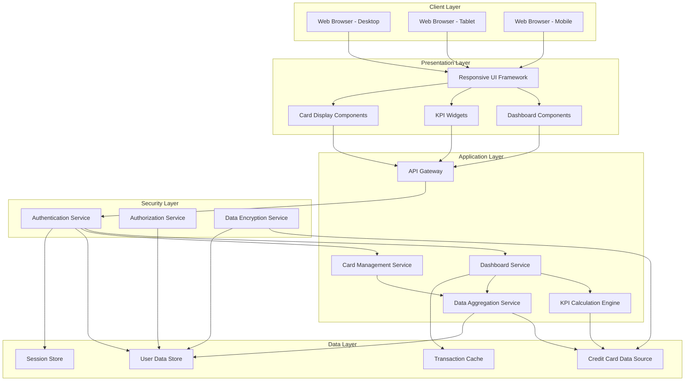
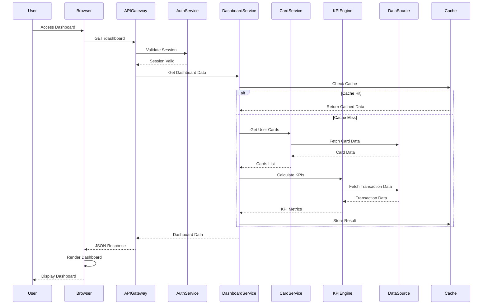
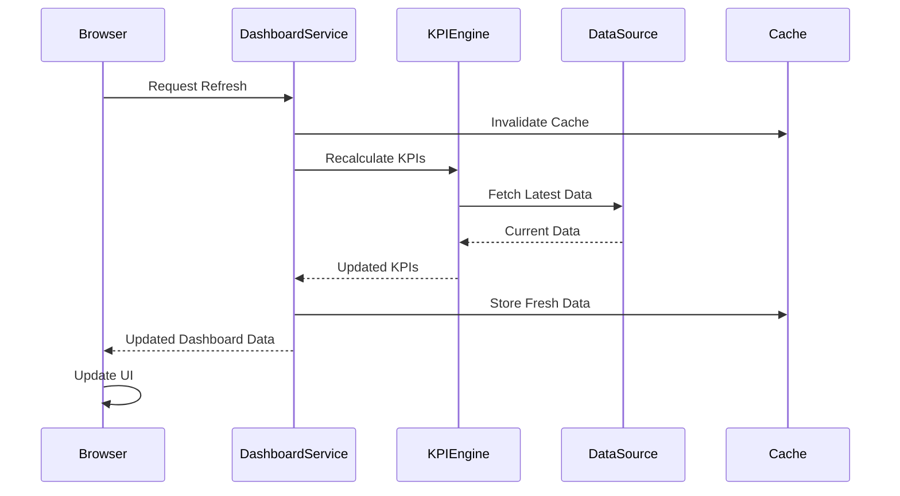

# High-Level Design Document
## HITL10-UpdatedCredit Card Dashboard and KPI Monitoring

**Project Key:** QE  
**Epic Type:** Epic  
**Label:** HITL10  
**Date:** 2024  
**Version:** 1.0  

---

## 1. Epic Overview

### 1.1 Summary
HITL10-UpdatedCredit Card Dashboard and KPI Monitoring

### 1.2 Description
Build a modern, responsive dashboard that provides users with a consolidated view of all their credit cards and key performance indicators. The dashboard will display critical financial metrics including monthly spend, total credit limit, available credit, and outstanding amounts across all cards. Users will be able to monitor their credit card portfolio from a single, unified interface with real-time visibility into their financial position.

### 1.3 User Value
Users gain immediate visibility into their credit card portfolio health, enabling better financial decision-making and spending control. The consolidated view eliminates the need to check multiple bank apps or statements, saving time and reducing the risk of missed payments or credit limit breaches.

### 1.4 Business Objectives
- Provide a consolidated view of all credit cards
- Improve visibility into monthly spending and outstanding balances
- Enable users to monitor their credit card portfolio from a single interface
- Deliver real-time visibility into financial position

### 1.5 Target Users
Credit card users managing one or multiple credit cards.

---

## 2. Requirements

### 2.1 Functional Requirements

#### FR-1: Dashboard KPIs Display
**Priority:** Must Have  
**Description:** Display critical financial metrics on the dashboard
- **FR-1.1:** Display Monthly Spend across all cards
- **FR-1.2:** Display Total Credit Limit (sum of all cards)
- **FR-1.3:** Display Available Credit (sum across all cards)
- **FR-1.4:** Display Outstanding Amount (total across all cards)

#### FR-2: Multiple Credit Cards View
**Priority:** Must Have  
**Description:** Display all user credit cards in a consolidated interface
- **FR-2.1:** Show list/grid of all credit cards
- **FR-2.2:** Display card-specific details (card number, bank, type)
- **FR-2.3:** Show per-card metrics (limit, available, outstanding)

#### FR-3: Consolidated Card Portfolio Interface
**Priority:** Must Have  
**Description:** Provide unified interface for portfolio management
- **FR-3.1:** Aggregate data from multiple cards
- **FR-3.2:** Present consolidated financial position
- **FR-3.3:** Enable quick navigation between cards

#### FR-4: Responsive Layout Design
**Priority:** Must Have  
**Description:** Support multiple device types and screen sizes
- **FR-4.1:** Desktop layout optimization
- **FR-4.2:** Tablet layout optimization
- **FR-4.3:** Mobile layout optimization
- **FR-4.4:** Adaptive UI components

### 2.2 Non-Functional Requirements (NFRs)

#### NFR-1: Responsive Design
**Category:** Usability  
**Target:** Responsive design supporting desktop, tablet, and mobile devices  
**Measurement:** UI must adapt seamlessly to screen sizes: Desktop (≥1024px), Tablet (768px-1023px), Mobile (<768px)

#### NFR-2: Data Refresh Performance
**Category:** Performance  
**Target:** Real-time or near-real-time data refresh for accurate financial metrics  
**Measurement:** Data refresh latency ≤ 3 seconds; Dashboard load time ≤ 2 seconds

#### NFR-3: Multi-Card Performance
**Category:** Performance  
**Target:** Performance should support monitoring of multiple credit cards without degradation  
**Measurement:** System must handle up to 10 credit cards per user with no performance degradation; Response time increase ≤ 10% per additional card

#### NFR-4: Security
**Category:** Security  
**Target:** Secure display of sensitive financial information  
**Measurement:** All financial data must be encrypted in transit (TLS 1.2+) and at rest; Sensitive card numbers must be masked (show last 4 digits only); Session timeout ≤ 15 minutes of inactivity

#### NFR-5: Availability
**Category:** Availability  
**Target:** High availability for critical financial monitoring  
**Measurement:** System uptime ≥ 99.5%; Planned maintenance windows communicated 48 hours in advance

---

## 3. Architecture Overview

### 3.1 System Context
The Credit Card Dashboard is a web-based application that provides users with consolidated visibility into their credit card portfolio. The system integrates with a credit card data source (non-bank integration), user authentication system, and data storage layer to deliver real-time financial metrics.

### 3.2 High-Level Architecture



### 3.3 Technology Stack (Assumptions)
**Note:** Specific technologies are not defined in the epic. The following are architectural assumptions that should be validated:

- **Frontend:** Modern JavaScript framework (React/Vue/Angular) with responsive CSS framework
- **Backend:** RESTful API services (technology stack TBD)
- **Database:** Relational database for structured financial data (PostgreSQL/MySQL assumed)
- **Caching:** Redis or similar for session and data caching
- **Security:** OAuth 2.0 / JWT for authentication, TLS 1.2+ for encryption

---

## 4. Component Design

### 4.1 Frontend Components

#### 4.1.1 Dashboard Container Component
**Responsibility:** Main orchestrator for dashboard layout and data flow  
**Key Functions:**
- Initialize dashboard state
- Coordinate data fetching
- Manage responsive layout switching
- Handle user interactions

#### 4.1.2 KPI Widget Component
**Responsibility:** Display individual KPI metrics  
**Key Functions:**
- Render KPI value and label
- Format financial data (currency, decimals)
- Update on data refresh
- Responsive sizing

**KPI Widgets:**
- Monthly Spend Widget
- Total Credit Limit Widget
- Available Credit Widget
- Outstanding Amount Widget

#### 4.1.3 Credit Card List Component
**Responsibility:** Display multiple credit cards  
**Key Functions:**
- Render card grid/list view
- Display card details
- Handle card selection
- Responsive layout (grid to list transition)

#### 4.1.4 Credit Card Item Component
**Responsibility:** Display individual card information  
**Key Functions:**
- Show masked card number
- Display card-specific metrics
- Visual card representation
- Responsive card design

### 4.2 Backend Services

#### 4.2.1 Dashboard Service
**Responsibility:** Orchestrate dashboard data retrieval  
**Key APIs:**
- `GET /api/dashboard` - Retrieve complete dashboard data
- `GET /api/dashboard/kpis` - Retrieve KPI metrics only
- `GET /api/dashboard/refresh` - Trigger data refresh

**Business Logic:**
- Aggregate data from multiple sources
- Calculate portfolio-level metrics
- Cache frequently accessed data
- Handle concurrent user requests

#### 4.2.2 Card Management Service
**Responsibility:** Manage credit card data  
**Key APIs:**
- `GET /api/cards` - Retrieve all user cards
- `GET /api/cards/{cardId}` - Retrieve specific card details
- `GET /api/cards/{cardId}/balance` - Get card balance information

**Business Logic:**
- Fetch card data from data source
- Validate card ownership
- Mask sensitive card information
- Apply security filters

#### 4.2.3 KPI Calculation Engine
**Responsibility:** Calculate financial metrics  
**Key Functions:**
- Calculate monthly spend (sum of transactions in current month)
- Calculate total credit limit (sum across all cards)
- Calculate available credit (total limit - total outstanding)
- Calculate outstanding amount (sum of balances across cards)

**Calculation Logic:**
```
Monthly Spend = SUM(transactions WHERE transaction_date >= start_of_month AND transaction_date <= current_date)
Total Credit Limit = SUM(card.credit_limit FOR all user cards)
Available Credit = Total Credit Limit - Total Outstanding
Outstanding Amount = SUM(card.outstanding_balance FOR all user cards)
```

#### 4.2.4 Data Aggregation Service
**Responsibility:** Aggregate data from multiple sources  
**Key Functions:**
- Fetch data from credit card data source
- Combine data from multiple cards
- Apply business rules and filters
- Cache aggregated results

---

## 5. Data Flow

### 5.1 Dashboard Load Flow



### 5.2 Data Refresh Flow



### 5.3 Data Model

**User**
```
User {
  userId: string (PK)
  username: string
  email: string
  createdDate: timestamp
  lastLoginDate: timestamp
}
```

**CreditCard**
```
CreditCard {
  cardId: string (PK)
  userId: string (FK)
  cardNumber: string (encrypted)
  cardNumberMasked: string
  bankName: string
  cardType: string
  creditLimit: decimal
  outstandingBalance: decimal
  availableCredit: decimal
  billingCycle: date
  status: string
  createdDate: timestamp
  updatedDate: timestamp
}
```

**Transaction** (for KPI calculation)
```
Transaction {
  transactionId: string (PK)
  cardId: string (FK)
  transactionDate: timestamp
  amount: decimal
  merchantName: string
  category: string
  status: string
  createdDate: timestamp
}
```

**DashboardKPI** (cached)
```
DashboardKPI {
  userId: string (PK)
  monthlySpend: decimal
  totalCreditLimit: decimal
  availableCredit: decimal
  outstandingAmount: decimal
  calculatedDate: timestamp
  expiryTime: timestamp
}
```

---

## 6. APIs and Integrations

### 6.1 External Dependencies

#### 6.1.1 Credit Card Data Source
**Type:** Non-bank integration (as per scope)  
**Purpose:** Retrieve credit card information and transaction data  
**Assumption:** REST API or database connection available  
**Data Required:**
- Credit card details (number, limit, balance)
- Transaction history
- Real-time balance updates

**Integration Points:**
- Card information retrieval
- Balance and limit queries
- Transaction data access

#### 6.1.2 User Authentication System
**Type:** External authentication service  
**Purpose:** Authenticate and authorize users  
**Assumption:** OAuth 2.0 or similar protocol  
**Integration Points:**
- User login/logout
- Session management
- Token validation

#### 6.1.3 Data Storage
**Type:** Database system  
**Purpose:** Store card information and balances  
**Integration Points:**
- Card data persistence
- User preferences
- Cached KPI data
- Session data

### 6.2 Internal APIs

#### API-1: Get Dashboard Data
```
GET /api/v1/dashboard
Headers: Authorization: Bearer {token}

Response 200:
{
  "kpis": {
    "monthlySpend": 2450.75,
    "totalCreditLimit": 50000.00,
    "availableCredit": 42549.25,
    "outstandingAmount": 7450.75
  },
  "cards": [
    {
      "cardId": "card-001",
      "cardNumberMasked": "**** **** **** 1234",
      "bankName": "Bank A",
      "cardType": "Visa Platinum",
      "creditLimit": 30000.00,
      "availableCredit": 25000.00,
      "outstandingBalance": 5000.00
    }
  ],
  "lastUpdated": "2024-01-15T10:30:00Z"
}
```

#### API-2: Get KPIs Only
```
GET /api/v1/dashboard/kpis
Headers: Authorization: Bearer {token}

Response 200:
{
  "monthlySpend": 2450.75,
  "totalCreditLimit": 50000.00,
  "availableCredit": 42549.25,
  "outstandingAmount": 7450.75,
  "calculatedAt": "2024-01-15T10:30:00Z"
}
```

#### API-3: Get All Cards
```
GET /api/v1/cards
Headers: Authorization: Bearer {token}

Response 200:
{
  "cards": [
    {
      "cardId": "card-001",
      "cardNumberMasked": "**** **** **** 1234",
      "bankName": "Bank A",
      "cardType": "Visa Platinum",
      "creditLimit": 30000.00,
      "availableCredit": 25000.00,
      "outstandingBalance": 5000.00,
      "status": "active"
    }
  ],
  "totalCards": 3
}
```

#### API-4: Refresh Dashboard
```
POST /api/v1/dashboard/refresh
Headers: Authorization: Bearer {token}

Response 200:
{
  "status": "success",
  "message": "Dashboard data refreshed",
  "refreshedAt": "2024-01-15T10:35:00Z"
}
```

---

## 7. Security Considerations

### 7.1 Authentication & Authorization
- **User Authentication:** All API requests require valid authentication token
- **Session Management:** Secure session handling with timeout (≤15 minutes inactivity)
- **Token Security:** JWT or OAuth 2.0 tokens with appropriate expiration
- **Authorization:** Role-based access control (users can only view their own cards)

### 7.2 Data Security
- **Encryption in Transit:** TLS 1.2+ for all API communications
- **Encryption at Rest:** Sensitive data encrypted in database
- **Card Number Masking:** Display only last 4 digits of card numbers
- **PCI Compliance:** Adhere to PCI DSS standards for card data handling (assumption)

### 7.3 Security Best Practices
- Input validation and sanitization
- Protection against SQL injection
- Protection against XSS attacks
- CSRF token implementation
- Rate limiting on API endpoints
- Audit logging for sensitive operations

### 7.4 Security Gaps (To Be Addressed)
- **Gap:** Specific encryption algorithms not defined
- **Gap:** Key management strategy not specified
- **Gap:** Audit logging requirements not detailed
- **Gap:** Incident response procedures not defined

---

## 8. Scalability

### 8.1 Scalability Requirements
- Support multiple credit cards per user (up to 10 cards per NFR-3)
- Handle concurrent user sessions
- Maintain performance with growing transaction data

### 8.2 Scalability Strategy

#### 8.2.1 Horizontal Scaling
- **Application Layer:** Stateless services enable horizontal scaling
- **Load Balancing:** Distribute traffic across multiple service instances
- **Database:** Read replicas for query distribution

#### 8.2.2 Caching Strategy
- **KPI Caching:** Cache calculated KPIs with TTL (Time To Live)
- **Card Data Caching:** Cache card information to reduce database queries
- **Session Caching:** Distributed cache (Redis) for session data

#### 8.2.3 Performance Optimization
- **Lazy Loading:** Load card details on demand
- **Data Pagination:** Paginate transaction lists if needed
- **Asynchronous Processing:** Background jobs for heavy calculations
- **CDN:** Static assets served via CDN

### 8.3 Scalability Assumptions
- Average user has 2-3 credit cards
- Peak concurrent users: Not specified (assumption: 1000 concurrent users)
- Data growth rate: Not specified

---

## 9. Availability

### 9.1 Availability Target
- **Target:** 99.5% uptime (per NFR-5)
- **Allowed Downtime:** ~3.65 hours per month
- **Planned Maintenance:** Communicated 48 hours in advance

### 9.2 High Availability Strategy

#### 9.2.1 Redundancy
- **Application Servers:** Multiple instances behind load balancer
- **Database:** Primary-replica configuration with automatic failover
- **Cache:** Redis cluster with replication

#### 9.2.2 Fault Tolerance
- **Health Checks:** Regular health monitoring of all services
- **Automatic Failover:** Switch to backup instances on failure
- **Circuit Breaker:** Prevent cascading failures
- **Graceful Degradation:** Core features remain available during partial outages

#### 9.2.3 Disaster Recovery
- **Backup Strategy:** Regular database backups (frequency TBD)
- **Recovery Time Objective (RTO):** Not specified (assumption: 4 hours)
- **Recovery Point Objective (RPO):** Not specified (assumption: 1 hour)

### 9.3 Monitoring & Alerting
- **Application Monitoring:** Track service health and performance
- **Infrastructure Monitoring:** Monitor server resources (CPU, memory, disk)
- **Alerting:** Automated alerts for critical failures
- **Logging:** Centralized logging for troubleshooting

---

## 10. Assumptions

### 10.1 Technical Assumptions
1. **Technology Stack:** Modern web technologies available (JavaScript framework, REST APIs)
2. **Browser Support:** Modern browsers (Chrome, Firefox, Safari, Edge) - last 2 versions
3. **Network Connectivity:** Users have stable internet connection
4. **Data Source API:** Credit card data source provides REST API or database access
5. **Authentication System:** Existing authentication system is available and compatible
6. **Database:** Relational database suitable for financial data
7. **Caching Infrastructure:** Redis or similar caching solution available
8. **Concurrent Users:** System designed for up to 1000 concurrent users (not specified in epic)

### 10.2 Business Assumptions
1. **User Base:** Target users are tech-savvy credit card holders
2. **Card Limit:** Users manage 1-10 credit cards
3. **Data Accuracy:** Credit card data source provides accurate, up-to-date information
4. **Regulatory Compliance:** Solution complies with financial data regulations
5. **Non-Bank Integration:** Data source is not direct bank integration (as per scope)
6. **User Training:** Minimal training required due to intuitive UI

### 10.3 Data Assumptions
1. **Data Freshness:** Data refresh every 3 seconds or on-demand is acceptable
2. **Historical Data:** Transaction history available for monthly spend calculation
3. **Data Format:** Standardized data format from credit card data source
4. **Card Status:** Active cards only displayed by default

---

## 11. Dependencies

### 11.1 External Dependencies

| Dependency | Type | Criticality | Status | Risk |
|------------|------|-------------|--------|------|
| Credit Card Data Source | Integration | High | TBD | High - Core functionality depends on this |
| User Authentication System | Integration | High | TBD | High - Required for access control |
| Data Storage System | Infrastructure | High | TBD | High - Required for data persistence |
| Caching Infrastructure | Infrastructure | Medium | TBD | Medium - Performance optimization |
| Load Balancer | Infrastructure | Medium | TBD | Medium - Required for high availability |

### 11.2 Internal Dependencies

| Dependency | Type | Criticality | Status | Risk |
|------------|------|-------------|--------|------|
| Frontend Framework | Technology | High | TBD | Medium - Must support responsive design |
| Backend Framework | Technology | High | TBD | Medium - Must support RESTful APIs |
| Charting Library | Technology | Low | TBD | Low - For future analytics features |

### 11.3 Team Dependencies

| Dependency | Type | Criticality | Status | Risk |
|------------|------|-------------|--------|------|
| UI/UX Design Team | Resource | High | TBD | Medium - Required for responsive design |
| Backend Development Team | Resource | High | TBD | High - Core service development |
| Security Team | Resource | High | TBD | High - Security implementation and review |
| DevOps Team | Resource | Medium | TBD | Medium - Infrastructure setup |
| QA Team | Resource | High | TBD | Medium - Testing across devices |

---

## 12. Risks and Mitigation

### 12.1 Technical Risks

#### Risk-1: Data Source Integration Complexity
**Description:** Credit card data source integration may be complex or unreliable  
**Impact:** High - Core functionality blocked  
**Probability:** Medium  
**Mitigation:**
- Early integration testing
- Mock data source for development
- Fallback mechanisms for data retrieval failures
- Clear API contract with data source provider

#### Risk-2: Performance Degradation with Multiple Cards
**Description:** System performance may degrade with users having many cards  
**Impact:** Medium - Poor user experience  
**Probability:** Medium  
**Mitigation:**
- Implement caching strategy
- Optimize database queries
- Load testing with 10+ cards per user
- Lazy loading of card details

#### Risk-3: Real-time Data Refresh Latency
**Description:** Achieving real-time or near-real-time refresh may be challenging  
**Impact:** Medium - User experience affected  
**Probability:** Medium  
**Mitigation:**
- Set realistic refresh intervals (3 seconds per NFR)
- Implement efficient caching
- Optimize data aggregation logic
- Consider WebSocket for real-time updates

#### Risk-4: Responsive Design Complexity
**Description:** Ensuring consistent UX across all devices may be complex  
**Impact:** Medium - User experience on some devices  
**Probability:** Low  
**Mitigation:**
- Use proven responsive framework
- Extensive testing on multiple devices
- Progressive enhancement approach
- Mobile-first design strategy

### 12.2 Security Risks

#### Risk-5: Sensitive Data Exposure
**Description:** Financial data may be exposed through vulnerabilities  
**Impact:** High - Data breach, compliance violations  
**Probability:** Low  
**Mitigation:**
- Comprehensive security review
- Penetration testing
- Encryption at rest and in transit
- Regular security audits
- Implement security best practices

#### Risk-6: Authentication System Failure
**Description:** Dependency on external authentication system  
**Impact:** High - Users cannot access dashboard  
**Probability:** Low  
**Mitigation:**
- SLA with authentication provider
- Fallback authentication mechanism
- Session caching to reduce auth calls
- Monitoring and alerting

### 12.3 Business Risks

#### Risk-7: Unclear Data Source Availability
**Description:** Non-bank integration data source not clearly defined  
**Impact:** High - Project may be blocked  
**Probability:** Medium  
**Mitigation:**
- Clarify data source early in project
- Define clear integration requirements
- Prototype integration early
- Have backup data source options

#### Risk-8: Scope Creep
**Description:** Requests for features marked as out-of-scope  
**Impact:** Medium - Timeline and budget impact  
**Probability:** High  
**Mitigation:**
- Clear documentation of scope boundaries
- Change control process
- Regular stakeholder communication
- Phased delivery approach

### 12.4 Operational Risks

#### Risk-9: Availability Target Not Met
**Description:** 99.5% uptime may be challenging without proper infrastructure  
**Impact:** Medium - SLA violations  
**Probability:** Medium  
**Mitigation:**
- Redundant infrastructure
- Automated failover
- Comprehensive monitoring
- Incident response procedures

---

## 13. Out of Scope

The following items are explicitly **OUT OF SCOPE** for this epic:

1. **Real Bank Integration:** Direct integration with banking systems
2. **Card Payments:** Payment processing functionality
3. **Fund Transfers:** Money transfer capabilities
4. **Loans:** Loan management or application features
5. **Payment Gateway Integration:** Integration with payment gateways
6. **Predictive Analytics:** Future spending predictions or forecasting
7. **Budget Creation:** Budget planning and management tools
8. **Alerts and Notifications:** Proactive alerts for spending or due dates
9. **Transaction Categorization:** Automatic categorization of transactions (covered in separate epic)
10. **Historical Trend Analysis:** Multi-month trend visualization (covered in separate epic)

---

## 14. Design Gaps and Open Questions

### 14.1 Design Gaps

1. **Technology Stack:** Specific technologies not defined (frontend framework, backend language, database)
2. **Data Source Details:** Credit card data source API specifications not provided
3. **Authentication Details:** Authentication mechanism and protocol not specified
4. **Encryption Standards:** Specific encryption algorithms not defined
5. **Performance Baselines:** Exact performance targets not quantified (assumed 2-3 seconds)
6. **Scalability Limits:** Maximum user capacity not specified
7. **Backup Strategy:** Backup frequency and retention not defined
8. **Monitoring Tools:** Specific monitoring and alerting tools not identified
9. **Deployment Strategy:** Deployment approach and CI/CD pipeline not defined
10. **Error Handling:** Error handling and user messaging strategy not detailed

### 14.2 Open Questions

1. **Q1:** What is the specific API contract for the credit card data source?
2. **Q2:** Which authentication system will be used (OAuth, SAML, custom)?
3. **Q3:** What is the expected user load (concurrent users, daily active users)?
4. **Q4:** Are there specific compliance requirements (PCI DSS, GDPR, etc.)?
5. **Q5:** What is the data retention policy for transaction and card data?
6. **Q6:** Should the dashboard support multiple currencies?
7. **Q7:** What is the expected data refresh frequency from the data source?
8. **Q8:** Are there specific browser version requirements?
9. **Q9:** What is the disaster recovery RTO and RPO?
10. **Q10:** Should the system support user preferences (default view, card ordering)?
11. **Q11:** What level of audit logging is required?
12. **Q12:** Are there specific accessibility requirements (WCAG compliance)?

---

## 15. Validation Report

### 15.1 Requirements Traceability Matrix

| Requirement ID | Requirement Description | Design Component | Validation Status | Coverage |
|----------------|------------------------|------------------|-------------------|----------|
| FR-1 | Dashboard KPIs Display | KPI Widget Component, KPI Calculation Engine | Designed | Complete |
| FR-1.1 | Display Monthly Spend | Monthly Spend Widget, KPI API | Designed | Complete |
| FR-1.2 | Display Total Credit Limit | Total Credit Limit Widget, KPI API | Designed | Complete |
| FR-1.3 | Display Available Credit | Available Credit Widget, KPI API | Designed | Complete |
| FR-1.4 | Display Outstanding Amount | Outstanding Amount Widget, KPI API | Designed | Complete |
| FR-2 | Multiple Credit Cards View | Credit Card List Component, Card Service | Designed | Complete |
| FR-2.1 | Show list/grid of all cards | Credit Card List Component | Designed | Complete |
| FR-2.2 | Display card-specific details | Credit Card Item Component | Designed | Complete |
| FR-2.3 | Show per-card metrics | Credit Card Item Component, Card API | Designed | Complete |
| FR-3 | Consolidated Portfolio Interface | Dashboard Container, Data Aggregation Service | Designed | Complete |
| FR-3.1 | Aggregate data from multiple cards | Data Aggregation Service | Designed | Complete |
| FR-3.2 | Present consolidated financial position | Dashboard Service, KPI Engine | Designed | Complete |
| FR-3.3 | Enable quick navigation | Dashboard UI Navigation | Designed | Complete |
| FR-4 | Responsive Layout Design | Responsive UI Framework | Designed | Complete |
| FR-4.1 | Desktop layout optimization | Responsive CSS (≥1024px) | Designed | Complete |
| FR-4.2 | Tablet layout optimization | Responsive CSS (768-1023px) | Designed | Complete |
| FR-4.3 | Mobile layout optimization | Responsive CSS (<768px) | Designed | Complete |
| FR-4.4 | Adaptive UI components | Responsive UI Framework | Designed | Complete |

### 15.2 NFR Validation Targets

| NFR ID | NFR Description | Target Metric | Design Approach | Validation Method | Status |
|--------|----------------|---------------|-----------------|-------------------|--------|
| NFR-1 | Responsive Design | Support Desktop/Tablet/Mobile | Responsive UI Framework with breakpoints | Cross-device testing | Designed |
| NFR-2 | Data Refresh Performance | ≤3s refresh latency, ≤2s load time | Caching, optimized queries | Performance testing | Designed |
| NFR-3 | Multi-Card Performance | Up to 10 cards, ≤10% degradation per card | Efficient aggregation, caching | Load testing with 10+ cards | Designed |
| NFR-4 | Security | TLS 1.2+, masked card numbers, 15min timeout | Encryption, masking, session management | Security audit, penetration testing | Designed |
| NFR-5 | Availability | ≥99.5% uptime | Redundancy, failover, monitoring | Uptime monitoring | Designed |

### 15.3 Coverage Status

**Functional Requirements Coverage:** 100% (18/18 requirements designed)  
**Non-Functional Requirements Coverage:** 100% (5/5 NFRs addressed)  
**Dependencies Identified:** 100% (All 3 external dependencies documented)  
**Out-of-Scope Items Documented:** 100% (10 items explicitly listed)  

### 15.4 Design Completeness Assessment

| Design Area | Completeness | Gaps | Recommendations |
|-------------|--------------|------|------------------|
| Architecture | 80% | Technology stack not specified | Finalize technology choices in design phase |
| Component Design | 90% | Implementation details pending | Detailed design in development phase |
| Data Model | 85% | Some field types assumed | Validate with data source provider |
| APIs | 90% | Error responses not detailed | Document error codes and messages |
| Security | 70% | Specific standards not defined | Conduct security design review |
| Scalability | 75% | Load assumptions not validated | Conduct capacity planning |
| Availability | 75% | DR procedures not detailed | Define disaster recovery plan |
| Integration | 60% | Data source contract missing | Obtain API specifications |

**Overall Design Completeness:** 78%

### 15.5 Recommendations

#### High Priority
1. **Clarify Data Source Integration:** Obtain detailed API specifications and integration requirements from credit card data source provider
2. **Define Technology Stack:** Finalize frontend framework, backend technology, and database choices
3. **Security Design Review:** Conduct comprehensive security design review with security team
4. **Performance Baseline:** Establish specific performance baselines through prototyping

#### Medium Priority
5. **Capacity Planning:** Define expected user load and conduct capacity planning
6. **Error Handling Strategy:** Document comprehensive error handling and user messaging approach
7. **Monitoring Strategy:** Select and configure monitoring and alerting tools
8. **Disaster Recovery Plan:** Define detailed DR procedures with RTO/RPO targets

#### Low Priority
9. **Accessibility Requirements:** Clarify accessibility standards (WCAG compliance level)
10. **User Preferences:** Determine if user customization features are needed
11. **Multi-Currency Support:** Clarify if international users with multiple currencies are in scope
12. **Audit Logging:** Define audit logging requirements and retention policies

### 15.6 Validation Summary

This High-Level Design document provides comprehensive coverage of the epic requirements with the following characteristics:

✅ **Strengths:**
- All functional requirements traced to design components
- All NFRs addressed with specific targets and approaches
- Clear architecture with component breakdown
- Comprehensive data flow documentation
- Security considerations documented
- Scalability and availability strategies defined
- Risks identified with mitigation strategies
- Dependencies and out-of-scope items clearly documented

⚠️ **Gaps Acknowledged:**
- Technology stack requires finalization
- Data source integration details pending
- Some performance metrics assumed (not specified in epic)
- Security standards require detailed specification
- Capacity planning assumptions need validation

📋 **Next Steps:**
1. Review and approve HLD with stakeholders
2. Clarify open questions and design gaps
3. Conduct detailed design phase for components
4. Prototype data source integration
5. Finalize technology stack decisions
6. Conduct security design review
7. Create detailed implementation plan

---

## 16. Appendix

### 16.1 Glossary

- **KPI:** Key Performance Indicator - Measurable value demonstrating effectiveness
- **NFR:** Non-Functional Requirement - Quality attributes of the system
- **TLS:** Transport Layer Security - Cryptographic protocol for secure communication
- **JWT:** JSON Web Token - Compact token format for secure information transmission
- **OAuth:** Open Authorization - Industry-standard protocol for authorization
- **API:** Application Programming Interface - Set of protocols for building software
- **REST:** Representational State Transfer - Architectural style for web services
- **CDN:** Content Delivery Network - Distributed network of servers for content delivery
- **RTO:** Recovery Time Objective - Target time for service restoration
- **RPO:** Recovery Point Objective - Maximum acceptable data loss period
- **PCI DSS:** Payment Card Industry Data Security Standard - Security standard for card data

### 16.2 References

1. Epic: HITL10-UpdatedCredit Card Dashboard and KPI Monitoring (QE Project)
2. Supporting Document: CreditCardAnalysisDashboard.docx
3. Related Epic: HITL10-Spending Analytics and Transaction Insights

### 16.3 Document Control

| Version | Date | Author | Changes |
|---------|------|--------|----------|
| 1.0 | 2024 | HLD Generation Agent | Initial HLD document |

### 16.4 Approval

| Role | Name | Signature | Date |
|------|------|-----------|------|
| Product Owner | TBD | | |
| Technical Lead | TBD | | |
| Security Lead | TBD | | |
| QA Lead | TBD | | |

---

**End of Document**