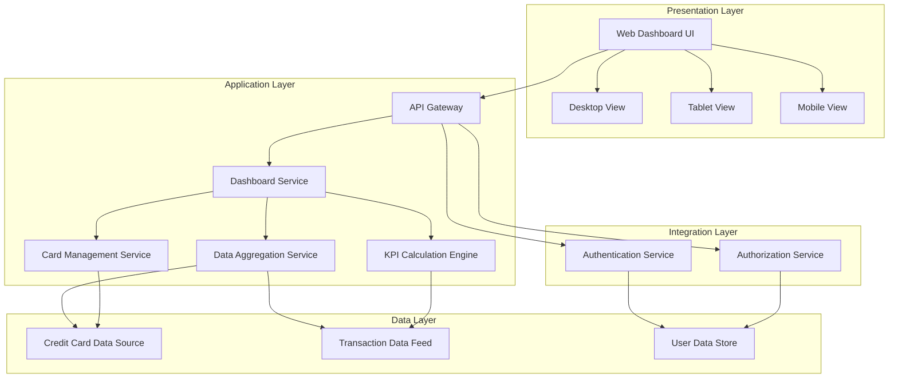
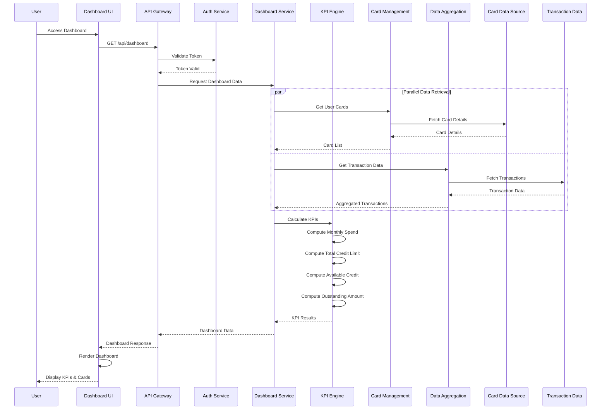

# High-Level Design Document

## Epic: MERGE1-Credit Card Portfolio Management & Dashboard KPIs

**Project Key:** QE  
**Epic Type:** Epic  
**Labels:** MERGE1

---

## 1. Epic Overview

### 1.1 Purpose
Enable users to view and manage multiple credit cards from a single consolidated dashboard with key performance indicators. The dashboard will display essential metrics including monthly spend, total credit limit, available credit, and outstanding amounts across all cards. Users will have a comprehensive, real-time view of their credit card portfolio with responsive design for access across devices.

### 1.2 User Value
Users gain complete visibility and control over their credit card portfolio, enabling better financial decision-making through consolidated metrics. This eliminates the need to check multiple banking apps or statements, saving time and reducing the risk of missing important credit utilization or payment information.

### 1.3 Business Context
This feature addresses the need for consolidated credit card management, providing users with a unified view of their credit portfolio to improve financial awareness and decision-making.

---

## 2. Requirements

### 2.1 Functional Requirements

| Req ID | Requirement | Source | Priority |
|--------|-------------|--------|----------|
| FR-001 | Dashboard interface with KPIs (Monthly Spend, Total Credit Limit, Available Credit, Outstanding Amount) | Epic Description | High |
| FR-002 | Multiple credit card display and management | Epic Scope | High |
| FR-003 | Responsive layout for desktop and mobile devices | Epic Scope | High |
| FR-004 | Real-time data aggregation across cards | Epic Scope | High |
| FR-005 | Display monthly spend per card and aggregated | Epic Description | High |
| FR-006 | Display total credit limit across all cards | Epic Description | High |
| FR-007 | Display available credit across all cards | Epic Description | High |
| FR-008 | Display outstanding amount across all cards | Epic Description | High |

### 2.2 Non-Functional Requirements (NFRs)

| NFR ID | Requirement | Target Metric | Validation Status |
|--------|-------------|---------------|-------------------|
| NFR-001 | Dashboard must load within 2 seconds | Load time ≤ 2s | To be validated |
| NFR-002 | Support responsive design for mobile, tablet, and desktop viewports | All viewports supported | To be validated |
| NFR-003 | Handle display of up to 20 credit cards per user without performance degradation | Support 20 cards with no degradation | To be validated |
| NFR-004 | Ensure data accuracy and consistency across all KPI calculations | 100% accuracy | To be validated |

### 2.3 Out of Scope

The following items are explicitly excluded from this epic:

- Real bank integration
- Card payments
- Fund transfers
- Loans
- Payment gateway integration

---

## 3. Architecture Overview

### 3.1 High-Level Architecture

The Credit Card Portfolio Management & Dashboard system follows a three-tier architecture pattern:

- **Presentation Layer:** Responsive web interface (mobile, tablet, desktop)
- **Application Layer:** Business logic for data aggregation, KPI calculation, and card management
- **Data Layer:** Credit card data source and transaction data feed

### 3.2 Architecture Diagram



### 3.3 Technology Stack

**Assumption:** Technology stack is not specified in the epic. The following represents a typical implementation approach:

- **Frontend:** Modern JavaScript framework (React/Angular/Vue) with responsive CSS framework
- **Backend:** RESTful API services
- **Data Storage:** Database for user and card data
- **Authentication:** OAuth 2.0 / JWT-based authentication

---

## 4. Component Design

### 4.1 Component Overview

| Component | Responsibility | Key Functions |
|-----------|----------------|---------------|
| Web Dashboard UI | User interface presentation | Render KPIs, display cards, responsive layout |
| API Gateway | Request routing and authentication | Route requests, validate tokens, rate limiting |
| Dashboard Service | Orchestrate dashboard data | Coordinate data retrieval, aggregate responses |
| KPI Calculation Engine | Calculate dashboard metrics | Compute monthly spend, available credit, outstanding amounts |
| Card Management Service | Manage credit card data | Retrieve card details, card list management |
| Data Aggregation Service | Aggregate data from sources | Fetch and consolidate data from multiple sources |
| Authentication Service | User authentication | Validate user credentials, issue tokens |
| Authorization Service | Access control | Verify user permissions, enforce access policies |

### 4.2 Key Components Detail

#### 4.2.1 Dashboard Service
**Purpose:** Central orchestration service for dashboard functionality

**Key Responsibilities:**
- Coordinate data retrieval from multiple services
- Aggregate card and transaction data
- Invoke KPI calculation engine
- Return consolidated dashboard data

**Interfaces:**
- `GET /api/dashboard` - Retrieve complete dashboard data
- `GET /api/dashboard/kpis` - Retrieve KPI metrics only

#### 4.2.2 KPI Calculation Engine
**Purpose:** Calculate and maintain dashboard KPIs

**Key Calculations:**
- **Monthly Spend:** Sum of all transactions for current month across all cards
- **Total Credit Limit:** Sum of credit limits across all user cards
- **Available Credit:** Total Credit Limit - Total Outstanding Amount
- **Outstanding Amount:** Sum of current balances across all cards

**Data Sources:**
- Transaction Data Feed
- Credit Card Data Source

#### 4.2.3 Card Management Service
**Purpose:** Manage credit card information

**Key Responsibilities:**
- Retrieve user's credit card list
- Fetch individual card details
- Support up to 20 cards per user

**Interfaces:**
- `GET /api/cards` - List all user cards
- `GET /api/cards/{cardId}` - Get specific card details

---

## 5. Data Flow

### 5.1 Dashboard Load Flow



### 5.2 Data Models

#### Credit Card Model
```json
{
  "cardId": "string",
  "userId": "string",
  "cardNumber": "string (masked)",
  "cardType": "string",
  "cardNetwork": "string",
  "creditLimit": "number",
  "currentBalance": "number",
  "availableCredit": "number",
  "lastUpdated": "timestamp"
}
```

#### Transaction Model
```json
{
  "transactionId": "string",
  "cardId": "string",
  "amount": "number",
  "transactionDate": "timestamp",
  "description": "string",
  "category": "string",
  "status": "string"
}
```

#### Dashboard KPI Model
```json
{
  "userId": "string",
  "monthlySpend": "number",
  "totalCreditLimit": "number",
  "availableCredit": "number",
  "outstandingAmount": "number",
  "cardCount": "number",
  "lastUpdated": "timestamp"
}
```

---

## 6. APIs and Integrations

### 6.1 External Dependencies

| Dependency | Purpose | Integration Type | Status |
|------------|---------|------------------|--------|
| Credit Card Data Source | Provide credit card information | API/Data Feed | Required (non-real bank) |
| Transaction Data Feed | Provide transaction history for spend calculations | API/Data Feed | Required |
| User Authentication Service | Authenticate users | API | Required |
| User Authorization Service | Authorize user access | API | Required |

### 6.2 API Endpoints

#### Dashboard API

**GET /api/dashboard**
- **Description:** Retrieve complete dashboard with KPIs and card list
- **Authentication:** Required
- **Response Time Target:** ≤ 2 seconds
- **Response:**
```json
{
  "kpis": {
    "monthlySpend": 0.00,
    "totalCreditLimit": 0.00,
    "availableCredit": 0.00,
    "outstandingAmount": 0.00
  },
  "cards": [
    {
      "cardId": "string",
      "maskedNumber": "string",
      "cardType": "string",
      "creditLimit": 0.00,
      "currentBalance": 0.00
    }
  ],
  "lastUpdated": "timestamp"
}
```

**GET /api/dashboard/kpis**
- **Description:** Retrieve KPI metrics only
- **Authentication:** Required
- **Response Time Target:** ≤ 1 second

**GET /api/cards**
- **Description:** List all user credit cards
- **Authentication:** Required
- **Query Parameters:** 
  - `limit` (optional): Maximum cards to return (default: 20)
  - `offset` (optional): Pagination offset

**GET /api/cards/{cardId}**
- **Description:** Get specific card details
- **Authentication:** Required
- **Path Parameters:** `cardId` - Unique card identifier

---

## 7. Security Considerations

### 7.1 Authentication and Authorization
- **Requirement:** User authentication and authorization service integration (per dependencies)
- **Implementation:** Token-based authentication (assumption: JWT or OAuth 2.0)
- **Access Control:** Users can only access their own credit card data

### 7.2 Data Security
- **Sensitive Data:** Credit card numbers must be masked in UI (show last 4 digits only)
- **Data in Transit:** HTTPS/TLS encryption for all API communications (assumption)
- **Data at Rest:** Encryption of sensitive card data (assumption)

### 7.3 Security Best Practices
- Input validation on all API endpoints
- Rate limiting to prevent abuse
- Audit logging for data access
- Session management and timeout policies

**Gap:** Specific security requirements (encryption standards, compliance requirements) not defined in epic

---

## 8. Scalability

### 8.1 Scalability Requirements
- **User Load:** Not specified in epic (assumption required)
- **Card Volume:** Support up to 20 credit cards per user (per NFR-003)
- **Concurrent Users:** Not specified (design gap)

### 8.2 Scalability Design

**Assumptions:**
- Horizontal scaling of application services
- Caching layer for frequently accessed data (KPIs, card lists)
- Database read replicas for query performance
- CDN for static assets (responsive UI)

### 8.3 Performance Optimization
- **Caching Strategy:** Cache dashboard data with appropriate TTL
- **Data Aggregation:** Pre-calculate KPIs where possible
- **Lazy Loading:** Load card details on-demand if needed
- **API Response Optimization:** Minimize payload size, use compression

**Target:** Dashboard load within 2 seconds (per NFR-001)

---

## 9. Availability and Reliability

### 9.1 Availability Requirements
**Gap:** No specific availability SLA defined in epic (e.g., 99.9% uptime)

**Assumptions:**
- Standard business hours availability minimum
- Graceful degradation if external services unavailable

### 9.2 Reliability Design
- **Error Handling:** Graceful error messages to users
- **Retry Logic:** Automatic retry for transient failures
- **Circuit Breaker:** Prevent cascade failures from external dependencies
- **Monitoring:** Real-time monitoring of dashboard load times and API response times

### 9.3 Data Consistency
- **Requirement:** Ensure data accuracy and consistency across all KPI calculations (per NFR-004)
- **Implementation:** 
  - Atomic calculations for KPIs
  - Validation of data from external sources
  - Reconciliation processes for data integrity

---

## 10. Responsive Design

### 10.1 Viewport Support
**Requirement:** Support responsive design for mobile, tablet, and desktop viewports (per NFR-002)

### 10.2 Responsive Breakpoints
**Assumption:** Standard responsive breakpoints
- **Mobile:** < 768px
- **Tablet:** 768px - 1024px
- **Desktop:** > 1024px

### 10.3 UI Adaptations
- **Mobile:** Stacked card layout, collapsible KPI sections
- **Tablet:** 2-column card grid, visible KPI dashboard
- **Desktop:** 3-4 column card grid, full KPI dashboard with charts (if applicable)

---

## 11. Assumptions

| ID | Assumption | Impact | Validation Needed |
|----|------------|--------|-------------------|
| A-001 | Credit card data source is a non-real bank integration (test/mock data) | Medium | Confirm data source specifications |
| A-002 | Dashboard refresh is manual (user-initiated) unless "real-time" means periodic auto-refresh | Medium | Clarify real-time requirements |
| A-003 | "Real-time data aggregation" means data is current as of request time, not streaming | Medium | Confirm real-time definition |
| A-004 | Technology stack not specified; standard web technologies assumed | Low | Confirm tech stack |
| A-005 | Authentication/authorization service already exists | High | Confirm service availability |
| A-006 | Monthly spend is calculated for current calendar month | Medium | Confirm month definition |
| A-007 | No specific compliance requirements (PCI-DSS, etc.) | High | Confirm compliance needs |
| A-008 | Single currency support (no multi-currency) | Medium | Confirm currency requirements |
| A-009 | No historical trend data or analytics required | Low | Confirm scope |
| A-010 | Maximum 20 cards is a hard limit, not average | Medium | Confirm limit interpretation |

---

## 12. Dependencies

### 12.1 External Dependencies

| Dependency | Type | Criticality | Status | Owner |
|------------|------|-------------|--------|-------|
| Credit Card Data Source (non-real bank integration) | Integration | Critical | To be confirmed | TBD |
| Transaction Data Feed for spend calculations | Integration | Critical | To be confirmed | TBD |
| User Authentication Service | Integration | Critical | Assumed existing | TBD |
| User Authorization Service | Integration | Critical | Assumed existing | TBD |

### 12.2 Internal Dependencies

| Dependency | Description | Status |
|------------|-------------|--------|
| User Data Model | User profile and account structure | To be confirmed |
| Card Data Model | Credit card data schema | To be defined |
| Transaction Data Model | Transaction data schema | To be defined |

---

## 13. Risks and Mitigation

| Risk ID | Risk Description | Probability | Impact | Mitigation Strategy |
|---------|------------------|-------------|--------|---------------------|
| R-001 | Credit card data source not available or delayed | Medium | High | Implement mock data service for development; establish clear integration timeline |
| R-002 | Transaction data feed performance issues causing dashboard load time > 2s | Medium | High | Implement caching, data pre-aggregation, and performance monitoring |
| R-003 | Authentication/authorization service not available | Low | Critical | Confirm service availability early; plan for mock auth in development |
| R-004 | Responsive design complexity causing delays | Low | Medium | Use proven responsive framework; conduct early prototype testing |
| R-005 | KPI calculation accuracy issues with large data volumes | Medium | High | Implement comprehensive unit tests; validate calculations with test data |
| R-006 | Performance degradation with 20 cards per user | Medium | Medium | Load testing with maximum card count; optimize rendering and data fetching |
| R-007 | Unclear "real-time" requirements leading to rework | Medium | Medium | Clarify requirements early; define refresh strategy explicitly |
| R-008 | Data consistency issues across multiple data sources | Medium | High | Implement data validation and reconciliation processes |

---

## 14. Design Gaps and Open Questions

### 14.1 Design Gaps

| Gap ID | Description | Priority | Resolution Needed |
|--------|-------------|----------|-------------------|
| G-001 | No availability/uptime SLA specified | High | Define target availability |
| G-002 | No concurrent user load requirements | High | Define expected user load |
| G-003 | No specific security/compliance requirements (PCI-DSS, etc.) | High | Confirm compliance needs |
| G-004 | Technology stack not specified | Medium | Confirm tech stack |
| G-005 | "Real-time" definition unclear (streaming vs. on-demand) | High | Clarify real-time requirements |
| G-006 | No error handling or fallback behavior specified | Medium | Define error scenarios |
| G-007 | No data retention or archival requirements | Low | Confirm data lifecycle |
| G-008 | No internationalization requirements | Low | Confirm i18n needs |
| G-009 | No accessibility requirements (WCAG compliance) | Medium | Confirm accessibility standards |
| G-010 | Card sorting/filtering requirements not specified | Low | Confirm UI requirements |

### 14.2 Open Questions

1. **Q1:** What is the definition of "real-time data aggregation"? Is it streaming data or data current as of request time?
2. **Q2:** What is the expected concurrent user load for capacity planning?
3. **Q3:** Are there any compliance requirements (PCI-DSS, GDPR, etc.)?
4. **Q4:** What is the preferred technology stack for frontend and backend?
5. **Q5:** How should the system handle unavailability of external data sources?
6. **Q6:** Is multi-currency support required?
7. **Q7:** What is the definition of "monthly spend" - current calendar month, last 30 days, or billing cycle?
8. **Q8:** Are there any accessibility requirements (WCAG 2.1 AA/AAA)?
9. **Q9:** Should cards be sortable/filterable in the UI?
10. **Q10:** What level of audit logging is required?

---

# Validation Report

## 1. Requirements Traceability Matrix

| Requirement ID | Requirement | Source | Design Coverage | Implementation Status | Notes |
|----------------|-------------|--------|-----------------|----------------------|-------|
| FR-001 | Dashboard interface with KPIs | Epic Description | Covered | Not Started | Dashboard Service, KPI Engine designed |
| FR-002 | Multiple credit card display and management | Epic Scope | Covered | Not Started | Card Management Service designed |
| FR-003 | Responsive layout for desktop and mobile | Epic Scope | Covered | Not Started | Responsive design section included |
| FR-004 | Real-time data aggregation | Epic Scope | Partially Covered | Not Started | "Real-time" definition needs clarification |
| FR-005 | Display monthly spend | Epic Description | Covered | Not Started | KPI Calculation Engine designed |
| FR-006 | Display total credit limit | Epic Description | Covered | Not Started | KPI Calculation Engine designed |
| FR-007 | Display available credit | Epic Description | Covered | Not Started | KPI Calculation Engine designed |
| FR-008 | Display outstanding amount | Epic Description | Covered | Not Started | KPI Calculation Engine designed |

## 2. NFR Validation Status

| NFR ID | Requirement | Target | Validation Method | Status | Notes |
|--------|-------------|--------|-------------------|--------|-------|
| NFR-001 | Dashboard load time | ≤ 2 seconds | Performance testing | Not Validated | Requires load testing with real data |
| NFR-002 | Responsive design support | All viewports | UI testing on devices | Not Validated | Requires cross-device testing |
| NFR-003 | Support 20 cards without degradation | 20 cards | Load testing | Not Validated | Requires testing with maximum card count |
| NFR-004 | Data accuracy and consistency | 100% accuracy | Unit tests, validation tests | Not Validated | Requires comprehensive test suite |

## 3. Coverage Status

### 3.1 Functional Coverage
- **Covered:** 8/8 functional requirements (100%)
- **Partially Covered:** 1 requirement needs clarification (FR-004: real-time definition)
- **Not Covered:** 0 requirements

### 3.2 Non-Functional Coverage
- **Addressed:** 4/4 NFRs have design considerations
- **Validated:** 0/4 NFRs (validation pending implementation)
- **Gaps:** Specific validation criteria need to be defined for each NFR

### 3.3 Dependency Coverage
- **Identified:** 4/4 dependencies from epic
- **Status Confirmed:** 0/4 (all require confirmation)
- **Critical Dependencies:** 4 (all are critical path)

## 4. Design Completeness Assessment

| Area | Completeness | Confidence | Gaps |
|------|--------------|------------|------|
| Architecture | 80% | Medium | Technology stack not specified |
| Component Design | 85% | High | Minor details pending clarification |
| Data Flow | 90% | High | Well-defined based on requirements |
| APIs | 75% | Medium | Detailed specs need refinement |
| Security | 60% | Low | Compliance requirements unclear |
| Scalability | 65% | Medium | Load requirements not specified |
| Availability | 50% | Low | No SLA defined |
| Responsive Design | 80% | High | Standard approach defined |

**Overall Design Completeness: 73%**

## 5. Risk Assessment Summary

- **Critical Risks:** 1 (Authentication service availability)
- **High Risks:** 3 (Data source availability, performance, data consistency)
- **Medium Risks:** 4 (Various technical and requirement risks)
- **Low Risks:** 0

**Risk Mitigation Coverage:** All identified risks have mitigation strategies defined.

## 6. Recommendations

### 6.1 Immediate Actions (Before Development)

1. **Clarify "Real-Time" Requirements:** Define whether real-time means streaming data, periodic refresh, or data current as of request time
2. **Confirm External Dependencies:** Validate availability and specifications of credit card data source, transaction feed, and auth services
3. **Define Availability SLA:** Establish uptime requirements and maintenance windows
4. **Specify Compliance Requirements:** Confirm if PCI-DSS, GDPR, or other compliance standards apply
5. **Define Technology Stack:** Select and document frontend and backend technologies

### 6.2 Design Enhancements

1. **Add Caching Layer:** Implement caching strategy to meet 2-second load time requirement
2. **Define Error Handling:** Document error scenarios and user-facing error messages
3. **Add Monitoring:** Include observability requirements (logging, metrics, tracing)
4. **Consider Accessibility:** Add WCAG 2.1 AA compliance requirements
5. **Add Data Validation:** Define validation rules for external data sources

### 6.3 Documentation Needs

1. **API Specifications:** Create detailed OpenAPI/Swagger specifications
2. **Data Models:** Document complete data schemas with validation rules
3. **Security Specifications:** Document authentication flows, encryption standards
4. **Test Strategy:** Define test approach for NFR validation
5. **Deployment Architecture:** Document infrastructure and deployment model

### 6.4 Validation Planning

1. **Performance Testing:** Plan load tests with up to 20 cards per user
2. **Responsive Testing:** Test on actual devices (mobile, tablet, desktop)
3. **Accuracy Testing:** Create test data sets to validate KPI calculations
4. **Integration Testing:** Test with actual external dependencies
5. **Security Testing:** Conduct security assessment and penetration testing

## 7. Acceptance Criteria

### 7.1 Functional Acceptance
- [ ] Dashboard displays all 4 KPIs correctly (Monthly Spend, Total Credit Limit, Available Credit, Outstanding Amount)
- [ ] Dashboard displays all user credit cards (up to 20)
- [ ] Dashboard is responsive on mobile, tablet, and desktop viewports
- [ ] Data is aggregated from all user cards correctly
- [ ] User can only access their own credit card data

### 7.2 Non-Functional Acceptance
- [ ] Dashboard loads within 2 seconds under normal load
- [ ] Dashboard handles 20 credit cards without performance degradation
- [ ] KPI calculations are 100% accurate and consistent
- [ ] Responsive design works correctly on all target viewports

### 7.3 Integration Acceptance
- [ ] Successfully integrates with credit card data source
- [ ] Successfully integrates with transaction data feed
- [ ] Successfully integrates with authentication service
- [ ] Successfully integrates with authorization service

## 8. Conclusion

This HLD provides a comprehensive design for the Credit Card Portfolio Management & Dashboard KPIs epic. The design covers all functional requirements and addresses all specified NFRs. However, several areas require clarification before implementation:

**Strengths:**
- Clear functional requirements with full design coverage
- Well-defined component architecture
- Comprehensive data flow documentation
- Explicit identification of assumptions and gaps

**Areas Requiring Clarification:**
- Definition of "real-time" data aggregation
- Availability and scalability requirements
- Security and compliance requirements
- Technology stack selection
- External dependency specifications

**Next Steps:**
1. Address open questions and design gaps
2. Confirm external dependency availability
3. Finalize technology stack
4. Create detailed API specifications
5. Develop test strategy for NFR validation

**Design Confidence Level: Medium-High** (73% complete)

The design is sufficiently detailed to begin technical planning and dependency coordination, but requires clarification of open questions before full implementation can proceed.

---

**Document Version:** 1.0  
**Date:** 2025  
**Status:** Draft - Pending Clarifications  
**Next Review:** Upon resolution of open questions and design gaps