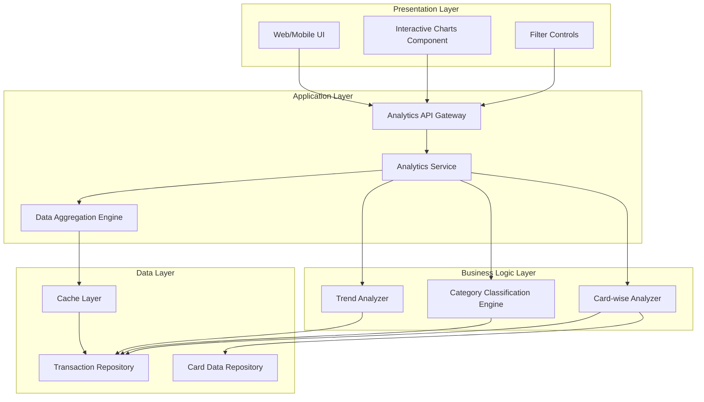
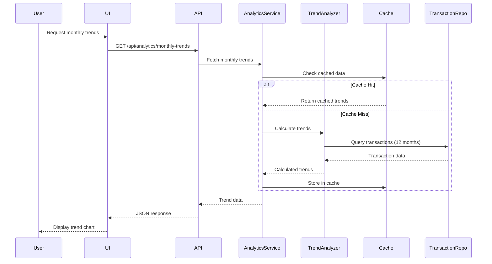
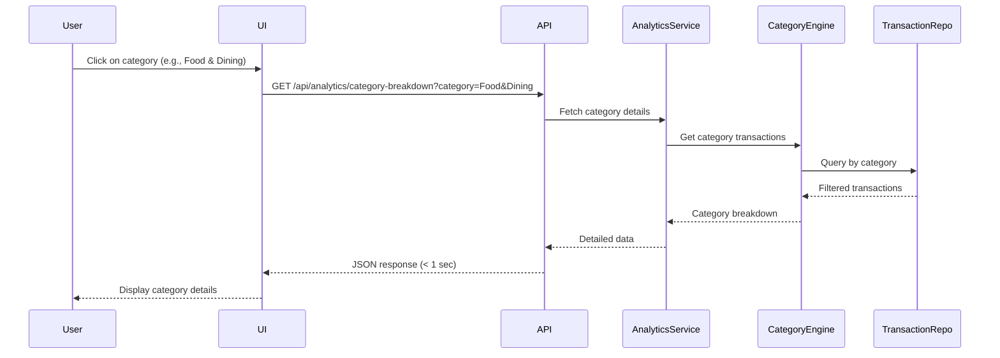
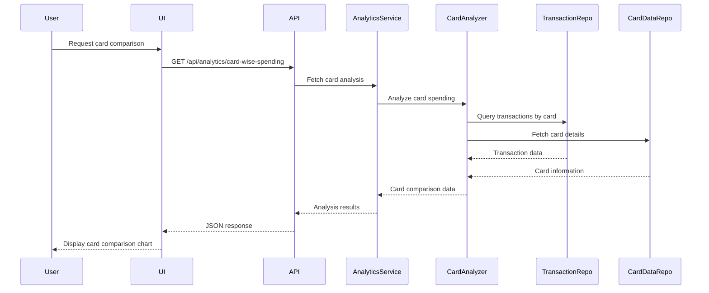

# High-Level Design Document

## Epic: MERGE1-Spending Analytics & Transaction Insights

**Project Key:** QE  
**Epic Label:** MERGE1  
**Issue Type:** Epic

---

## 1. Epic Overview

### 1.1 Summary
MERGE1-Spending Analytics & Transaction Insights

### 1.2 Description
Provide comprehensive spending analytics through interactive visualizations that help users understand their spending patterns. This includes monthly spend trends over time, card-wise spend analysis to compare usage across different cards, and category-wise spending breakdowns. Users can drill down into nine spending categories: Food & Dining, Fuel, Shopping, Travel, Entertainment, Utilities, Healthcare, Education, and Miscellaneous to identify where their money is going.

### 1.3 User Value
Users gain actionable insights into their spending behavior, enabling them to identify overspending in specific categories, optimize card usage based on benefits, and make informed budgeting decisions. The visual analytics transform raw transaction data into meaningful patterns that support better financial planning.

---

## 2. Requirements

### 2.1 Functional Requirements

| Req ID | Requirement | Source |
|--------|-------------|--------|
| FR-001 | Monthly spend trend visualization | Epic Scope |
| FR-002 | Card-wise spend analysis and comparison | Epic Scope |
| FR-003 | Category-wise spending breakdown across 9 categories | Epic Scope |
| FR-004 | Support for 9 spending categories: Food & Dining, Fuel, Shopping, Travel, Entertainment, Utilities, Healthcare, Education, and Miscellaneous | Epic Scope |
| FR-005 | Interactive charts and graphs | Epic Scope |
| FR-006 | Transaction history view | Epic Scope |
| FR-007 | Drill-down capability into spending categories | Epic Description |
| FR-008 | Comparison of card usage across different cards | Epic Description |

### 2.2 Non-Functional Requirements (NFRs)

| NFR ID | Requirement | Target | Source |
|--------|-------------|--------|--------|
| NFR-001 | Analytics visualizations render time | ≤ 3 seconds | Epic NFRs |
| NFR-002 | Filtering and drill-down interaction response time | < 1 second | Epic NFRs |
| NFR-003 | Transaction history support | Up to 12 months | Epic NFRs |
| NFR-004 | Transaction categorization accuracy | ≥ 95% | Epic NFRs |
| NFR-005 | Performance under load | No degradation with 12 months of data | Epic NFRs |

---

## 3. Architecture Overview

### 3.1 High-Level Architecture

The Spending Analytics & Transaction Insights feature follows a layered architecture pattern with clear separation between presentation, business logic, and data layers.



### 3.2 Architecture Principles

- **Separation of Concerns:** Clear boundaries between presentation, business logic, and data layers
- **Performance Optimization:** Caching layer for frequently accessed aggregated data
- **Scalability:** Stateless service design to support horizontal scaling
- **Responsiveness:** Asynchronous data loading for improved user experience

---

## 4. Component Design

### 4.1 Presentation Layer Components

#### 4.1.1 Interactive Charts Component
- **Purpose:** Render spending analytics visualizations
- **Key Features:**
  - Monthly trend line charts
  - Card-wise comparison bar/pie charts
  - Category breakdown donut/pie charts
  - Drill-down capability
- **Technology Assumption:** Modern charting library (e.g., Chart.js, D3.js, Recharts)

#### 4.1.2 Filter Controls
- **Purpose:** Enable users to filter data by date range, cards, and categories
- **Key Features:**
  - Date range selector (up to 12 months)
  - Multi-select card filter
  - Category filter
  - Real-time filter application

### 4.2 Application Layer Components

#### 4.2.1 Analytics API Gateway
- **Purpose:** Single entry point for all analytics requests
- **Endpoints:**
  - `GET /api/analytics/monthly-trends`
  - `GET /api/analytics/card-wise-spending`
  - `GET /api/analytics/category-breakdown`
  - `GET /api/analytics/transaction-history`
- **Response Time Target:** < 3 seconds for initial load, < 1 second for interactions

#### 4.2.2 Analytics Service
- **Purpose:** Orchestrate analytics operations and coordinate between components
- **Responsibilities:**
  - Request validation
  - Service orchestration
  - Response formatting
  - Error handling

#### 4.2.3 Data Aggregation Engine
- **Purpose:** Pre-compute and cache aggregated spending data
- **Responsibilities:**
  - Monthly aggregation calculations
  - Card-wise spending summaries
  - Category totals computation
  - Cache management

### 4.3 Business Logic Layer Components

#### 4.3.1 Trend Analyzer
- **Purpose:** Calculate spending trends over time
- **Capabilities:**
  - Month-over-month trend calculation
  - Spending pattern identification
  - Trend data preparation for visualization

#### 4.3.2 Category Classification Engine
- **Purpose:** Categorize transactions into predefined categories
- **Categories Supported:**
  1. Food & Dining
  2. Fuel
  3. Shopping
  4. Travel
  5. Entertainment
  6. Utilities
  7. Healthcare
  8. Education
  9. Miscellaneous
- **Accuracy Target:** ≥ 95%
- **Assumption:** Rule-based classification engine (not AI/ML as per out-of-scope)

#### 4.3.3 Card-wise Analyzer
- **Purpose:** Analyze and compare spending across different cards
- **Capabilities:**
  - Per-card spending calculation
  - Card usage comparison
  - Card benefit optimization insights

### 4.4 Data Layer Components

#### 4.4.1 Transaction Repository
- **Purpose:** Store and retrieve transaction data
- **Data Retention:** Minimum 12 months
- **Key Attributes:**
  - Transaction ID
  - Card ID
  - Amount
  - Date/Time
  - Category
  - Merchant
  - Description

#### 4.4.2 Card Data Repository
- **Purpose:** Store credit card information
- **Key Attributes:**
  - Card ID
  - Card Type
  - Card Benefits
  - User ID

#### 4.4.3 Cache Layer
- **Purpose:** Store pre-aggregated data for fast retrieval
- **Cache Strategy:** Time-based expiration with on-demand refresh
- **Cached Data:**
  - Monthly aggregates
  - Category summaries
  - Card-wise totals

---

## 5. Data Flow

### 5.1 Monthly Trend Visualization Flow



### 5.2 Category Drill-Down Flow



### 5.3 Card-wise Analysis Flow



---

## 6. APIs and Integrations

### 6.1 Internal APIs

#### 6.1.1 Monthly Trends API
```
GET /api/analytics/monthly-trends
Query Parameters:
  - startDate: string (YYYY-MM-DD)
  - endDate: string (YYYY-MM-DD)
  - cardIds: array (optional)

Response:
{
  "trends": [
    {
      "month": "2024-01",
      "totalSpending": 15000.00,
      "transactionCount": 45
    }
  ],
  "metadata": {
    "currency": "USD",
    "period": "12 months"
  }
}
```

#### 6.1.2 Category Breakdown API
```
GET /api/analytics/category-breakdown
Query Parameters:
  - startDate: string (YYYY-MM-DD)
  - endDate: string (YYYY-MM-DD)
  - category: string (optional)
  - cardIds: array (optional)

Response:
{
  "categories": [
    {
      "name": "Food & Dining",
      "totalSpending": 3500.00,
      "percentage": 23.3,
      "transactionCount": 28
    }
  ],
  "totalSpending": 15000.00
}
```

#### 6.1.3 Card-wise Spending API
```
GET /api/analytics/card-wise-spending
Query Parameters:
  - startDate: string (YYYY-MM-DD)
  - endDate: string (YYYY-MM-DD)

Response:
{
  "cards": [
    {
      "cardId": "card-001",
      "cardType": "Visa Platinum",
      "totalSpending": 8500.00,
      "transactionCount": 32,
      "categoryBreakdown": [...]
    }
  ]
}
```

#### 6.1.4 Transaction History API
```
GET /api/analytics/transaction-history
Query Parameters:
  - startDate: string (YYYY-MM-DD)
  - endDate: string (YYYY-MM-DD)
  - category: string (optional)
  - cardId: string (optional)
  - limit: integer (default: 50)
  - offset: integer (default: 0)

Response:
{
  "transactions": [
    {
      "transactionId": "txn-001",
      "date": "2024-01-15T10:30:00Z",
      "amount": 125.50,
      "merchant": "Restaurant ABC",
      "category": "Food & Dining",
      "cardId": "card-001"
    }
  ],
  "pagination": {
    "total": 450,
    "limit": 50,
    "offset": 0
  }
}
```

### 6.2 External Dependencies/Integrations

| Integration | Purpose | Dependency Type |
|-------------|---------|----------------|
| Transaction Data Repository | Source of transaction data | Required |
| Category Classification Engine | Transaction categorization | Required |
| Data Aggregation Service | Trend calculations | Required |
| Credit Card Data | Card-wise analysis | Required |

**Note:** As per out-of-scope items, real bank integration, payment gateway integration, and automated AI/ML-based categorization are NOT included.

---

## 7. Security Considerations

### 7.1 Authentication & Authorization
- **Assumption:** User authentication is handled by upstream authentication service
- **Authorization:** Users can only access their own transaction data
- **API Security:** Token-based authentication (e.g., JWT) required for all API calls

### 7.2 Data Privacy
- **PII Protection:** Sensitive card information must be masked in UI
- **Data Encryption:** Transaction data encrypted at rest and in transit
- **Audit Logging:** Log all data access for compliance purposes

### 7.3 Input Validation
- Validate all date range inputs
- Sanitize filter parameters to prevent injection attacks
- Implement rate limiting on API endpoints

### 7.4 Security Gaps
- **Gap:** Specific authentication mechanism not defined in epic
- **Gap:** Data retention and deletion policies not specified
- **Gap:** Compliance requirements (PCI-DSS, GDPR) not detailed

---

## 8. Scalability

### 8.1 Scalability Strategy

#### 8.1.1 Horizontal Scaling
- **Application Layer:** Stateless services can be scaled horizontally
- **Load Balancing:** Distribute requests across multiple service instances
- **Auto-scaling:** Scale based on CPU/memory utilization and request volume

#### 8.1.2 Data Layer Scaling
- **Database Partitioning:** Partition transaction data by date (monthly partitions)
- **Read Replicas:** Use read replicas for analytics queries
- **Caching:** Reduce database load through aggressive caching of aggregated data

#### 8.1.3 Performance Optimization
- **Pre-aggregation:** Calculate and store monthly/category aggregates during off-peak hours
- **Lazy Loading:** Load detailed transaction data on-demand
- **Pagination:** Implement pagination for transaction history (50 records per page)

### 8.2 Scalability Assumptions
- **User Base:** Design assumes support for thousands of concurrent users
- **Transaction Volume:** Each user may have 100-500 transactions per month
- **Data Growth:** 12-month rolling window limits data growth

### 8.3 Scalability Gaps
- **Gap:** Specific user concurrency targets not defined
- **Gap:** Peak load characteristics not specified
- **Gap:** Geographic distribution requirements not mentioned

---

## 9. Availability

### 9.1 Availability Targets
- **Target SLA:** Not specified in epic (Assumption: 99.9% uptime)
- **Recovery Time Objective (RTO):** Not specified (Assumption: < 1 hour)
- **Recovery Point Objective (RPO):** Not specified (Assumption: < 15 minutes)

### 9.2 High Availability Design

#### 9.2.1 Redundancy
- **Multi-instance Deployment:** Deploy multiple instances of each service
- **Database Replication:** Master-slave replication for data redundancy
- **Cache Redundancy:** Distributed cache with replication

#### 9.2.2 Fault Tolerance
- **Graceful Degradation:** If cache fails, fall back to direct database queries
- **Circuit Breaker:** Prevent cascade failures in service dependencies
- **Retry Logic:** Implement exponential backoff for transient failures

#### 9.2.3 Monitoring & Alerting
- **Health Checks:** Regular health checks on all services
- **Performance Monitoring:** Track API response times against NFR targets
- **Error Tracking:** Monitor error rates and alert on anomalies

### 9.3 Availability Gaps
- **Gap:** Specific SLA requirements not defined in epic
- **Gap:** Disaster recovery procedures not specified
- **Gap:** Backup and restore strategies not detailed

---

## 10. Assumptions

### 10.1 Technical Assumptions
1. Transaction data is already available in a structured repository
2. Category classification uses rule-based engine (not AI/ML)
3. Users are authenticated via upstream authentication service
4. Modern web browsers/mobile platforms support required charting libraries
5. Database supports efficient date-range queries and aggregations
6. Cache infrastructure (e.g., Redis) is available
7. API response format is JSON
8. Currency is consistent across all transactions

### 10.2 Business Assumptions
1. Users have access to at least one credit card
2. Transaction categorization rules are pre-defined and maintained separately
3. 12-month historical data is sufficient for user needs
4. Categories are fixed (9 categories as specified)
5. Card benefits data is maintained in card data repository
6. Users access analytics through web or mobile interface

### 10.3 Data Assumptions
1. Transaction data includes merchant information for categorization
2. Transactions are recorded in real-time or near real-time
3. Historical data (12 months) is already available at launch
4. Data quality is maintained at source (accurate amounts, dates, etc.)

---

## 11. Dependencies

### 11.1 External Dependencies

| Dependency | Description | Criticality | Status |
|------------|-------------|-------------|--------|
| Transaction Data Repository | Source of all transaction data | Critical | As per epic |
| Category Classification Engine | Rule-based transaction categorization | Critical | As per epic |
| Data Aggregation Service | Service for trend calculations | Critical | As per epic |
| Credit Card Data | Card information for card-wise analysis | Critical | As per epic |

### 11.2 Internal Dependencies

| Dependency | Description | Criticality |
|------------|-------------|-------------|
| Authentication Service | User authentication and authorization | Critical |
| User Profile Service | User information and preferences | High |
| Charting Library | Visualization component library | High |
| Cache Infrastructure | Caching layer for performance | High |

### 11.3 Dependency Risks
- **Risk:** Transaction data repository availability impacts all analytics features
- **Risk:** Category classification engine accuracy directly affects user experience
- **Risk:** Aggregation service performance impacts NFR compliance

---

## 12. Risks

### 12.1 Technical Risks

| Risk ID | Risk Description | Impact | Probability | Mitigation |
|---------|------------------|--------|-------------|------------|
| TR-001 | Analytics rendering exceeds 3-second NFR | High | Medium | Implement aggressive caching and pre-aggregation |
| TR-002 | Transaction categorization accuracy below 95% | High | Medium | Implement category validation and user feedback mechanism |
| TR-003 | Performance degradation with 12 months of data | Medium | Low | Database indexing, partitioning, and query optimization |
| TR-004 | Cache infrastructure failure impacts performance | Medium | Low | Implement fallback to direct queries with circuit breaker |
| TR-005 | Drill-down interactions exceed 1-second response time | Medium | Medium | Optimize queries and implement result caching |

### 12.2 Integration Risks

| Risk ID | Risk Description | Impact | Probability | Mitigation |
|---------|------------------|--------|-------------|------------|
| IR-001 | Transaction data repository unavailability | Critical | Low | Implement retry logic and graceful error handling |
| IR-002 | Category classification engine inconsistency | High | Medium | Implement validation rules and fallback categorization |
| IR-003 | Data aggregation service latency | Medium | Medium | Cache aggregated results and implement timeout handling |

### 12.3 Business Risks

| Risk ID | Risk Description | Impact | Probability | Mitigation |
|---------|------------------|--------|-------------|------------|
| BR-001 | User expectations exceed defined scope | Medium | High | Clear documentation of in-scope vs out-of-scope features |
| BR-002 | Inaccurate categorization reduces user trust | High | Medium | Provide manual category override capability |
| BR-003 | 12-month limit insufficient for some users | Low | Medium | Document limitation and consider future enhancement |

### 12.4 Security Risks

| Risk ID | Risk Description | Impact | Probability | Mitigation |
|---------|------------------|--------|-------------|------------|
| SR-001 | Unauthorized access to transaction data | Critical | Low | Implement robust authentication and authorization |
| SR-002 | Data leakage through API responses | High | Low | Implement data masking and access controls |
| SR-003 | Injection attacks through filter parameters | Medium | Medium | Input validation and parameterized queries |

---

## 13. Out of Scope

The following items are explicitly **OUT OF SCOPE** for this epic:

1. **Real Bank Integration:** No direct integration with banking systems
2. **Card Payments:** Payment processing functionality not included
3. **Fund Transfers:** Money transfer capabilities not included
4. **Loans:** Loan management features not included
5. **Payment Gateway Integration:** No payment gateway connectivity
6. **Automated Transaction Categorization using AI/ML:** Only rule-based categorization is in scope

---

# Validation Report

## 1. Requirements Traceability Matrix

| Requirement ID | Requirement | Source | Design Component | Status |
|----------------|-------------|--------|------------------|--------|
| FR-001 | Monthly spend trend visualization | Epic Scope | Trend Analyzer + Monthly Trends API | Covered |
| FR-002 | Card-wise spend analysis and comparison | Epic Scope | Card-wise Analyzer + Card-wise Spending API | Covered |
| FR-003 | Category-wise spending breakdown | Epic Scope | Category Classification Engine + Category Breakdown API | Covered |
| FR-004 | Support 9 spending categories | Epic Scope | Category Classification Engine | Covered |
| FR-005 | Interactive charts and graphs | Epic Scope | Interactive Charts Component | Covered |
| FR-006 | Transaction history view | Epic Scope | Transaction History API | Covered |
| FR-007 | Drill-down capability | Epic Description | Filter Controls + Category Breakdown API | Covered |
| FR-008 | Card usage comparison | Epic Description | Card-wise Analyzer | Covered |

## 2. NFR Validation Targets

| NFR ID | Requirement | Target | Design Strategy | Validation Approach |
|--------|-------------|--------|-----------------|---------------------|
| NFR-001 | Analytics rendering time | ≤ 3 seconds | Caching + Pre-aggregation | Performance testing with 12 months data |
| NFR-002 | Interaction response time | < 1 second | Result caching + Query optimization | Load testing with drill-down scenarios |
| NFR-003 | Transaction history support | 12 months | Database partitioning + Indexing | Verify data retention and query performance |
| NFR-004 | Categorization accuracy | ≥ 95% | Rule-based classification engine | Accuracy testing with sample transactions |
| NFR-005 | Performance under load | No degradation | Horizontal scaling + Caching | Stress testing with full 12-month dataset |

## 3. Coverage Status

### 3.1 Functional Coverage
- ✅ **Fully Covered:** All 8 functional requirements have corresponding design components
- ✅ **Traceability:** Clear mapping between requirements and architecture components
- ✅ **Completeness:** All scope items from epic are addressed in design

### 3.2 Non-Functional Coverage
- ✅ **Performance:** Design includes caching and pre-aggregation strategies
- ✅ **Scalability:** Horizontal scaling and database optimization addressed
- ⚠️ **Security:** Basic security considerations included, but detailed requirements missing
- ⚠️ **Availability:** High-level availability design provided, but SLA targets not specified

### 3.3 Integration Coverage
- ✅ **Dependencies Identified:** All 4 external dependencies from epic are documented
- ✅ **API Design:** Complete API specifications for all analytics endpoints
- ⚠️ **Integration Details:** Specific integration protocols not defined (assumption-based)

## 4. Design Gaps

### 4.1 Critical Gaps
1. **Authentication Mechanism:** Specific authentication approach not defined in epic
2. **SLA Targets:** No specific availability or uptime requirements provided
3. **Compliance Requirements:** PCI-DSS, GDPR, or other regulatory requirements not specified
4. **Error Handling Strategy:** Detailed error scenarios and user messaging not defined

### 4.2 High Priority Gaps
1. **User Concurrency Targets:** Expected number of concurrent users not specified
2. **Data Retention Policy:** Long-term data retention beyond 12 months not addressed
3. **Manual Category Override:** User ability to correct miscategorized transactions not specified
4. **Export Functionality:** Ability to export analytics data not mentioned
5. **Multi-currency Support:** Handling of transactions in different currencies not addressed

### 4.3 Medium Priority Gaps
1. **Notification/Alerts:** Spending alerts or threshold notifications not in scope
2. **Comparison Periods:** Ability to compare different time periods not specified
3. **Budget Integration:** Integration with budgeting features not mentioned
4. **Merchant Analytics:** Detailed merchant-level analytics not specified
5. **Mobile Responsiveness:** Specific mobile UI/UX requirements not detailed

### 4.4 Low Priority Gaps
1. **Customizable Categories:** User-defined categories not in scope
2. **Scheduled Reports:** Automated report generation not mentioned
3. **Social Sharing:** Ability to share analytics not specified
4. **Accessibility Requirements:** WCAG compliance not mentioned

## 5. Assumptions Requiring Validation

### 5.1 Critical Assumptions
1. ❓ **Transaction data repository structure and access patterns**
2. ❓ **Category classification engine accuracy and performance**
3. ❓ **Authentication service availability and integration method**
4. ❓ **Cache infrastructure availability and configuration**

### 5.2 High Priority Assumptions
1. ❓ **12-month data volume per user**
2. ❓ **Peak concurrent user load**
3. ❓ **Data aggregation service SLA**
4. ❓ **Browser/platform compatibility requirements**

### 5.3 Medium Priority Assumptions
1. ❓ **Currency consistency across transactions**
2. ❓ **Card benefits data availability**
3. ❓ **Merchant information quality**
4. ❓ **Historical data availability at launch**

## 6. Recommendations

### 6.1 Immediate Actions
1. **Validate NFR Targets:** Conduct performance baseline testing to confirm 3-second and 1-second targets are achievable
2. **Define Authentication:** Clarify authentication mechanism and integration approach
3. **Categorization Accuracy:** Validate category classification engine can achieve 95% accuracy target
4. **Database Design:** Finalize transaction repository schema and indexing strategy

### 6.2 Short-term Actions
1. **SLA Definition:** Define specific availability and uptime requirements
2. **Security Requirements:** Document detailed security and compliance requirements
3. **Error Handling:** Design comprehensive error handling and user messaging strategy
4. **User Testing:** Conduct usability testing of interactive visualizations
5. **Integration Testing:** Validate integration with all 4 external dependencies

### 6.3 Long-term Considerations
1. **Manual Category Override:** Consider adding user ability to correct categorization
2. **Export Functionality:** Evaluate need for data export capabilities
3. **Multi-currency Support:** Plan for international expansion requirements
4. **Advanced Analytics:** Consider predictive analytics and spending forecasts for future iterations
5. **AI/ML Enhancement:** Plan migration path from rule-based to AI/ML categorization

### 6.4 Risk Mitigation Priorities
1. **High Priority:** Address TR-001 (rendering performance) and TR-002 (categorization accuracy)
2. **High Priority:** Mitigate IR-001 (transaction repository availability)
3. **Medium Priority:** Address TR-005 (drill-down response time)
4. **Medium Priority:** Mitigate BR-002 (categorization trust)

## 7. Compliance and Validation Checklist

### 7.1 Requirements Compliance
- ✅ All functional requirements from epic scope are addressed
- ✅ All NFRs have corresponding design strategies
- ✅ All dependencies are identified and documented
- ✅ Out-of-scope items are clearly documented
- ✅ No invented features beyond epic scope

### 7.2 Design Quality
- ✅ Architecture follows industry best practices
- ✅ Component responsibilities are clearly defined
- ✅ Data flows are documented with sequence diagrams
- ✅ APIs are fully specified
- ✅ Mermaid diagrams use valid syntax

### 7.3 Documentation Quality
- ✅ All assumptions are explicitly documented
- ✅ All gaps are identified and categorized
- ✅ Risks are assessed with mitigation strategies
- ✅ Traceability matrix links requirements to design
- ✅ No unverified claims of implementation

---

## Document Control

**Document Version:** 1.0  
**Created Date:** 2024  
**Epic Reference:** MERGE1-Spending Analytics & Transaction Insights  
**Project:** QE  
**Status:** Draft for Review

---

**End of High-Level Design Document**