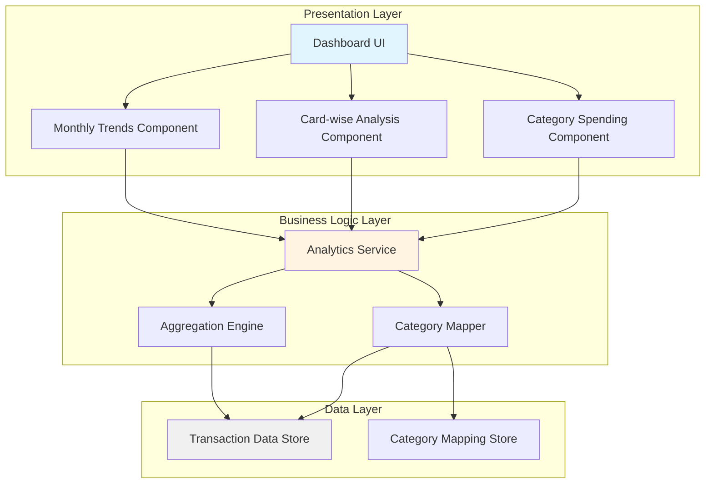
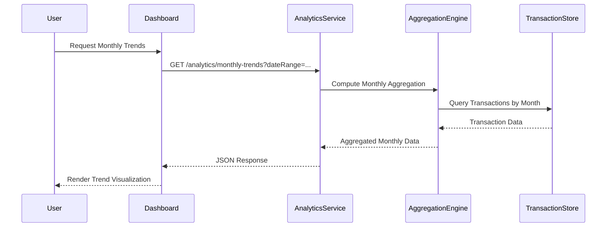
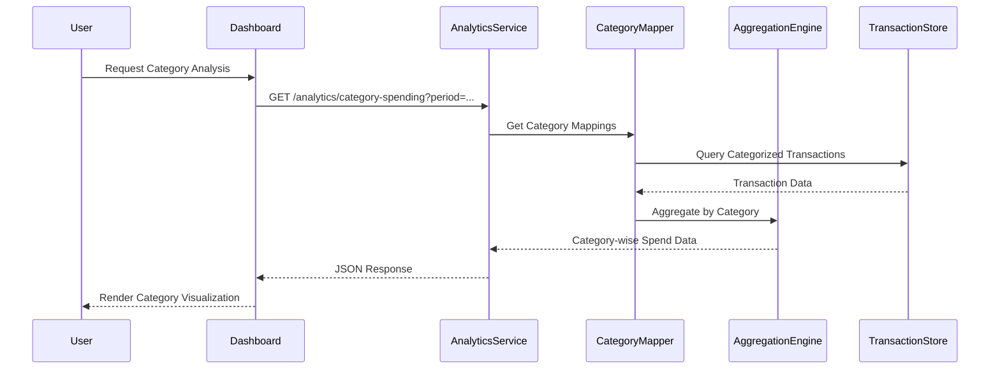

# High-Level Design Document

## Epic: Monthly & Category-wise Spending Analytics

---

## 1. Epic Overview

### 1.1 Summary
Monthly & Category-wise Spending Analytics

### 1.2 Description
Deliver interactive analytics within the dashboard focused on monthly spend trends and category-wise spending, covering categories such as Food & Dining, Fuel, Shopping, Travel, Entertainment, Utilities, Healthcare, Education, and Miscellaneous.

### 1.3 User Value
Users gain richer financial insight into how their spending evolves over time and which categories dominate their expenses, helping them identify patterns, control discretionary spend, and make better budgeting decisions.

### 1.4 Issue Type
Epic

---

## 2. Requirements

### 2.1 Functional Requirements

#### FR-001: Monthly Spend Trends Visualization
- **Description**: Display monthly spending trends over time
- **Source**: Epic Scope - "Monthly Spend Trends visualization"
- **Priority**: High

#### FR-002: Card-wise Spend Analysis
- **Description**: Provide views for analyzing spending across different cards
- **Source**: Epic Scope - "Card-wise Spend Analysis views"
- **Priority**: High

#### FR-003: Category-wise Spending Visualization
- **Description**: Interactive visualizations for spending across defined categories:
  - Food & Dining
  - Fuel
  - Shopping
  - Travel
  - Entertainment
  - Utilities
  - Healthcare
  - Education
  - Miscellaneous
- **Source**: Epic Scope - "interactive visualizations for category-wise spending"
- **Priority**: High

#### FR-004: Dashboard Integration
- **Description**: Integrate analytics into the main dashboard experience
- **Source**: Epic Scope - "integration of these analytics into the main dashboard experience"
- **Priority**: High

### 2.2 Non-Functional Requirements

#### NFR-001: Interactive Performance
- **Description**: Interactive visualizations must respond smoothly to user input without noticeable lag
- **Source**: Epic NFRs
- **Target**: Response time < 200ms for user interactions
- **Status**: To be validated during implementation

#### NFR-002: Responsive Rendering
- **Description**: Charts and graphs should render clearly on responsive layouts
- **Source**: Epic NFRs
- **Target**: Support for mobile, tablet, and desktop viewports
- **Status**: To be validated during implementation

#### NFR-003: Data Accuracy
- **Description**: Accurate aggregation of spend by month and by category corresponding to underlying transactions
- **Source**: Epic NFRs
- **Target**: 100% accuracy in spend aggregation calculations
- **Status**: To be validated through testing

### 2.3 Out of Scope
- Real Bank Integration
- Card Payments
- Fund Transfers
- Loans
- Payment Gateway Integration

---

## 3. Architecture Overview

### 3.1 High-Level Architecture

The solution follows a three-tier architecture pattern:

1. **Presentation Layer**: Dashboard UI with interactive visualization components
2. **Business Logic Layer**: Analytics computation and aggregation services
3. **Data Layer**: Categorized transaction data store

### 3.2 Architecture Diagram



---

## 4. Component Design

### 4.1 Dashboard UI Component

**Responsibility**: Main container for analytics visualizations

**Key Features**:
- Layout management for analytics components
- User interaction handling
- State management for filters and selections

**Technology Assumptions**:
- Modern web framework (React/Angular/Vue - to be determined)
- Responsive design framework

### 4.2 Monthly Trends Component

**Responsibility**: Visualize monthly spending trends

**Key Features**:
- Time-series chart rendering
- Month-over-month comparison
- Interactive data point selection
- Drill-down capabilities

**Inputs**:
- Monthly aggregated spend data
- Date range filters

**Outputs**:
- Interactive trend visualization

### 4.3 Card-wise Analysis Component

**Responsibility**: Display spending analysis per card

**Key Features**:
- Multi-card comparison views
- Card selection filters
- Spend distribution visualization

**Inputs**:
- Card-wise aggregated data
- Card identifiers and metadata

**Outputs**:
- Card comparison charts

### 4.4 Category Spending Component

**Responsibility**: Visualize spending across predefined categories

**Key Features**:
- Category breakdown charts (pie/bar charts)
- Category filtering and selection
- Percentage and absolute value displays
- Support for 9 categories: Food & Dining, Fuel, Shopping, Travel, Entertainment, Utilities, Healthcare, Education, Miscellaneous

**Inputs**:
- Category-wise aggregated spend data
- Time period filters

**Outputs**:
- Interactive category visualizations

### 4.5 Analytics Service

**Responsibility**: Orchestrate analytics computations and data retrieval

**Key Features**:
- API endpoints for analytics data
- Request validation and parameter handling
- Response formatting

**Inputs**:
- User requests with filters (date range, card selection, categories)

**Outputs**:
- Aggregated analytics data in JSON format

### 4.6 Aggregation Engine

**Responsibility**: Compute spending aggregations

**Key Features**:
- Monthly spend aggregation
- Card-wise spend aggregation
- Category-wise spend aggregation
- Efficient data processing algorithms

**Assumptions**:
- Aggregation logic will be implemented using appropriate database queries or in-memory processing
- Performance optimization required for large transaction volumes

### 4.7 Category Mapper

**Responsibility**: Map transactions to spending categories

**Key Features**:
- Transaction categorization logic
- Category mapping rules management
- Support for 9 predefined categories

**Assumptions**:
- Transaction data includes category information or merchant codes for categorization
- Mapping rules are configurable

---

## 5. Data Flow

### 5.1 Monthly Trends Data Flow



### 5.2 Category-wise Spending Data Flow



---

## 6. APIs and Integrations

### 6.1 Analytics API Endpoints

#### 6.1.1 Get Monthly Trends

**Endpoint**: `GET /api/v1/analytics/monthly-trends`

**Query Parameters**:
- `startDate` (optional): Start date for analysis (ISO 8601 format)
- `endDate` (optional): End date for analysis (ISO 8601 format)
- `cardId` (optional): Filter by specific card

**Response**:
```json
{
  "data": [
    {
      "month": "2024-01",
      "totalSpend": 15000.00,
      "transactionCount": 45
    }
  ],
  "metadata": {
    "currency": "USD",
    "period": "2024-01 to 2024-12"
  }
}
```

#### 6.1.2 Get Card-wise Analysis

**Endpoint**: `GET /api/v1/analytics/card-wise-spending`

**Query Parameters**:
- `startDate` (optional): Start date for analysis
- `endDate` (optional): End date for analysis

**Response**:
```json
{
  "data": [
    {
      "cardId": "card-001",
      "cardName": "Primary Card",
      "totalSpend": 25000.00,
      "percentage": 65.5
    }
  ]
}
```

#### 6.1.3 Get Category-wise Spending

**Endpoint**: `GET /api/v1/analytics/category-spending`

**Query Parameters**:
- `startDate` (optional): Start date for analysis
- `endDate` (optional): End date for analysis
- `cardId` (optional): Filter by specific card
- `categories` (optional): Comma-separated list of categories to include

**Response**:
```json
{
  "data": [
    {
      "category": "Food & Dining",
      "totalSpend": 5000.00,
      "percentage": 20.0,
      "transactionCount": 30
    },
    {
      "category": "Fuel",
      "totalSpend": 3000.00,
      "percentage": 12.0,
      "transactionCount": 15
    }
  ],
  "totalSpend": 25000.00,
  "categories": [
    "Food & Dining",
    "Fuel",
    "Shopping",
    "Travel",
    "Entertainment",
    "Utilities",
    "Healthcare",
    "Education",
    "Miscellaneous"
  ]
}
```

### 6.2 Dependencies and Integrations

#### 6.2.1 Transaction Data Access
- **Dependency**: Access to categorized transaction data
- **Integration Point**: Transaction Data Store
- **Requirements**: 
  - Read access to transaction records
  - Transaction data must include: amount, date, card identifier, category
  - Data must be mapped to the 9 specified spending categories

#### 6.2.2 Visualization Library
- **Dependency**: Charting/visualization library
- **Assumptions**: 
  - Library must support interactive charts (line, bar, pie charts)
  - Must be responsive and performant
  - Examples: Chart.js, D3.js, Recharts, or similar
- **Status**: To be selected during technical design phase

---

## 7. Security Considerations

### 7.1 Data Access Control
- **Requirement**: Users should only access their own spending analytics
- **Implementation Assumption**: Authentication and authorization mechanisms will be in place
- **Gap**: Specific authentication/authorization mechanism not defined in epic

### 7.2 Data Privacy
- **Requirement**: Sensitive transaction details must be protected
- **Implementation Assumption**: 
  - API endpoints secured with authentication tokens
  - HTTPS/TLS for data in transit
  - Appropriate data masking for sensitive information

### 7.3 API Security
- **Assumption**: Standard API security practices will be applied:
  - Rate limiting
  - Input validation
  - SQL injection prevention
  - XSS protection

**Note**: Detailed security requirements are not specified in the epic and should be defined during detailed design.

---

## 8. Scalability Considerations

### 8.1 Data Volume
- **Assumption**: System should handle typical user transaction volumes
- **Gap**: Specific volume requirements not defined (e.g., number of transactions per user, concurrent users)

### 8.2 Performance Optimization Strategies

#### 8.2.1 Data Aggregation
- **Strategy**: Pre-compute monthly and category aggregations
- **Assumption**: Aggregations can be computed asynchronously and cached
- **Benefit**: Reduces real-time computation overhead

#### 8.2.2 Caching
- **Strategy**: Cache frequently accessed analytics data
- **Assumption**: Analytics data can tolerate slight staleness
- **Implementation**: Cache with appropriate TTL (Time To Live)

#### 8.2.3 Database Indexing
- **Strategy**: Index transaction data on key fields
- **Recommended Indexes**:
  - Transaction date
  - Card identifier
  - Category
  - User identifier

### 8.3 Scalability Gaps
- Specific performance targets not defined (e.g., concurrent users, response time SLAs)
- Data retention policies not specified
- Archive strategy for historical data not defined

---

## 9. Availability and Reliability

### 9.1 Availability Requirements
- **Gap**: Specific availability targets (e.g., 99.9% uptime) not defined in epic
- **Assumption**: Standard web application availability expectations apply

### 9.2 Error Handling
- **Requirement**: Graceful degradation when data is unavailable
- **Implementation Assumptions**:
  - Appropriate error messages for users
  - Logging for troubleshooting
  - Fallback UI states for loading and error conditions

### 9.3 Data Consistency
- **Requirement**: Analytics must accurately reflect transaction data (NFR-003)
- **Implementation Assumption**: 
  - Eventual consistency acceptable for analytics
  - Reconciliation processes to ensure data accuracy

---

## 10. Assumptions

### 10.1 Data Assumptions
1. Transaction data is already categorized or contains sufficient information (e.g., merchant codes) for automatic categorization
2. Transaction data includes card identifiers for card-wise analysis
3. Transaction dates are accurately recorded for monthly trend analysis
4. All transactions are mapped to one of the 9 predefined categories

### 10.2 Technical Assumptions
1. Modern web browser support (Chrome, Firefox, Safari, Edge - latest versions)
2. Users have stable internet connectivity for interactive features
3. Visualization library will be selected based on performance and feature requirements
4. Backend services are available and performant
5. Database supports efficient aggregation queries

### 10.3 User Assumptions
1. Users have basic familiarity with financial dashboards
2. Users understand spending categories
3. Users access the dashboard through supported devices (desktop, tablet, mobile)

### 10.4 Integration Assumptions
1. Transaction data store provides read access via API or database queries
2. Category mapping configuration is available and maintained
3. Authentication and authorization services are available

---

## 11. Dependencies

### 11.1 Internal Dependencies

| Dependency | Description | Status | Impact |
|------------|-------------|--------|--------|
| Transaction Data Store | Access to categorized transaction data mapped to spending categories | Required | High - Core functionality depends on this |
| Analytics Computation Layer | Logic to aggregate spends by month, card, and category | To be implemented | High - Core functionality |
| Visualization Components | Charting library integrated into dashboard | To be selected | High - User experience depends on this |
| Dashboard Framework | Main dashboard application | Assumed available | High - Integration point |

### 11.2 External Dependencies

| Dependency | Description | Status | Impact |
|------------|-------------|--------|--------|
| Charting Library | Third-party visualization library (e.g., Chart.js, D3.js) | To be selected | Medium - Alternative libraries available |

### 11.3 Dependency Risks
- Transaction data quality and completeness may affect analytics accuracy
- Performance of underlying data store may impact analytics responsiveness
- Visualization library limitations may constrain interactive features

---

## 12. Risks and Mitigation

### 12.1 Technical Risks

| Risk | Impact | Probability | Mitigation Strategy |
|------|--------|-------------|---------------------|
| Performance degradation with large transaction volumes | High | Medium | Implement data aggregation, caching, and database optimization |
| Visualization library limitations | Medium | Low | Evaluate multiple libraries during selection; ensure extensibility |
| Data categorization inaccuracy | High | Medium | Implement validation and reconciliation processes; allow manual corrections |
| Browser compatibility issues | Medium | Low | Use well-supported visualization library; implement progressive enhancement |

### 12.2 Data Risks

| Risk | Impact | Probability | Mitigation Strategy |
|------|--------|-------------|---------------------|
| Incomplete transaction categorization | High | Medium | Implement fallback to "Miscellaneous" category; provide categorization rules |
| Data synchronization delays | Medium | Medium | Set appropriate user expectations; implement refresh mechanisms |
| Historical data unavailability | Medium | Low | Define data retention policies; implement archival strategy |

### 12.3 User Experience Risks

| Risk | Impact | Probability | Mitigation Strategy |
|------|--------|-------------|---------------------|
| Slow chart rendering on mobile devices | Medium | Medium | Optimize rendering; implement progressive loading |
| Confusing category definitions | Low | Medium | Provide clear category descriptions; implement tooltips |
| Information overload | Medium | Low | Implement progressive disclosure; allow customization |

### 12.4 Integration Risks

| Risk | Impact | Probability | Mitigation Strategy |
|------|--------|-------------|---------------------|
| Transaction data API unavailability | High | Low | Implement retry logic; provide cached data; graceful error handling |
| Dashboard integration complexity | Medium | Medium | Define clear integration contracts; implement modular components |

---

## 13. Design Gaps and Open Questions

### 13.1 Requirements Gaps

1. **User Authentication and Authorization**
   - Gap: Security and access control mechanisms not specified
   - Impact: Cannot design secure API endpoints
   - Recommendation: Define authentication strategy and user authorization model

2. **Performance Targets**
   - Gap: Specific performance metrics not defined beyond "no noticeable lag"
   - Impact: Cannot validate NFR-001 objectively
   - Recommendation: Define specific targets (e.g., < 200ms interaction response, < 2s initial load)

3. **Data Volume and Scale**
   - Gap: Expected transaction volumes and concurrent users not specified
   - Impact: Cannot design appropriate scalability measures
   - Recommendation: Define expected scale (e.g., transactions per user, concurrent users)

4. **Date Range Defaults**
   - Gap: Default time periods for analytics not specified
   - Impact: UX inconsistency risk
   - Recommendation: Define default views (e.g., last 6 months, current year)

5. **Category Assignment Rules**
   - Gap: How transactions are categorized is not specified
   - Impact: Cannot implement Category Mapper accurately
   - Recommendation: Define categorization rules or confirm pre-categorized data availability

### 13.2 Technical Gaps

1. **Technology Stack**
   - Gap: Frontend and backend technologies not specified
   - Impact: Cannot make specific implementation recommendations
   - Recommendation: Define technology stack during detailed design

2. **Visualization Library Selection**
   - Gap: Specific charting library not chosen
   - Impact: Cannot validate interactive features feasibility
   - Recommendation: Evaluate and select library based on requirements

3. **Data Storage Schema**
   - Gap: Transaction data schema not provided
   - Impact: Cannot design efficient queries
   - Recommendation: Document transaction data model

4. **API Versioning Strategy**
   - Gap: API versioning approach not defined
   - Impact: Future compatibility concerns
   - Recommendation: Define API versioning strategy

### 13.3 Non-Functional Gaps

1. **Availability SLA**
   - Gap: No specific availability target defined
   - Impact: Cannot design appropriate redundancy
   - Recommendation: Define availability requirements

2. **Data Retention Policy**
   - Gap: How long to retain transaction data for analytics not specified
   - Impact: Storage and performance implications
   - Recommendation: Define data retention and archival policies

3. **Accessibility Requirements**
   - Gap: WCAG compliance or accessibility standards not mentioned
   - Impact: May not meet accessibility needs
   - Recommendation: Define accessibility requirements (e.g., WCAG 2.1 Level AA)

4. **Internationalization**
   - Gap: Multi-currency, multi-language support not addressed
   - Impact: Limited to single locale
   - Recommendation: Clarify internationalization requirements

---

## 14. Validation Report

### 14.1 Requirements Traceability Matrix

| Requirement ID | Requirement | Source | Design Component | Validation Status |
|----------------|-------------|--------|------------------|-------------------|
| FR-001 | Monthly Spend Trends Visualization | Epic Scope | Monthly Trends Component, Analytics Service, Aggregation Engine | Covered |
| FR-002 | Card-wise Spend Analysis | Epic Scope | Card-wise Analysis Component, Analytics Service | Covered |
| FR-003 | Category-wise Spending Visualization | Epic Scope | Category Spending Component, Category Mapper, Analytics Service | Covered |
| FR-004 | Dashboard Integration | Epic Scope | Dashboard UI Component | Covered |
| NFR-001 | Interactive Performance | Epic NFRs | All UI Components, Analytics Service | Partially Covered - Needs specific targets |
| NFR-002 | Responsive Rendering | Epic NFRs | All UI Components, Visualization Library | Covered - Pending library selection |
| NFR-003 | Data Accuracy | Epic NFRs | Aggregation Engine, Category Mapper | Covered - Requires testing validation |

### 14.2 Coverage Status

#### Functional Requirements Coverage: 100%
- All 4 functional requirements are addressed in the design
- Components and data flows defined for each requirement

#### Non-Functional Requirements Coverage: 75%
- NFR-001 (Interactive Performance): Partially covered - specific performance targets needed
- NFR-002 (Responsive Rendering): Covered - pending technology selection
- NFR-003 (Data Accuracy): Covered - validation through testing required

#### Out of Scope Items: Documented
- Real Bank Integration
- Card Payments
- Fund Transfers
- Loans
- Payment Gateway Integration

### 14.3 NFR Validation Targets

| NFR | Target | Validation Method | Status |
|-----|--------|-------------------|--------|
| NFR-001: Interactive Performance | Response time < 200ms for user interactions | Performance testing with realistic data volumes | To be validated |
| NFR-002: Responsive Rendering | Support for mobile (320px+), tablet (768px+), desktop (1024px+) | Cross-device testing | To be validated |
| NFR-003: Data Accuracy | 100% accuracy in aggregation calculations | Automated testing with known datasets; reconciliation reports | To be validated |

### 14.4 Design Gaps Summary

**Critical Gaps** (Block Implementation):
1. Transaction data schema and categorization rules not defined
2. Authentication and authorization mechanism not specified

**High Priority Gaps** (Impact Quality):
1. Specific performance targets not defined
2. Data volume and scale expectations not specified
3. Technology stack not selected

**Medium Priority Gaps** (Impact Future Maintenance):
1. API versioning strategy not defined
2. Data retention policies not specified
3. Accessibility requirements not defined

**Low Priority Gaps** (Nice to Have):
1. Internationalization requirements not addressed
2. Default date range preferences not specified

### 14.5 Recommendations

#### Immediate Actions Required
1. **Define Transaction Data Model**: Document the schema and categorization approach for transaction data
2. **Specify Authentication Mechanism**: Define how users will be authenticated and authorized
3. **Set Performance Targets**: Establish measurable performance criteria for NFR-001
4. **Select Technology Stack**: Choose frontend framework and visualization library

#### Before Implementation
1. **Define Data Volume Expectations**: Specify expected transaction volumes and concurrent users
2. **Establish Data Retention Policy**: Define how long analytics data should be retained
3. **Create Categorization Rules**: Document how transactions map to the 9 spending categories
4. **Define API Contracts**: Formalize API endpoint specifications

#### During Implementation
1. **Implement Comprehensive Testing**: Unit tests, integration tests, and performance tests
2. **Create Monitoring and Logging**: Implement observability for analytics performance
3. **Develop User Documentation**: Create help content explaining categories and features

#### Post-Implementation
1. **Validate NFRs**: Conduct performance testing and user acceptance testing
2. **Gather User Feedback**: Collect feedback on visualization clarity and usefulness
3. **Monitor Performance**: Track actual performance against targets
4. **Plan Enhancements**: Based on usage patterns and feedback

---

## 15. Conclusion

This High-Level Design document provides a comprehensive architecture for the Monthly & Category-wise Spending Analytics epic. The design covers:

- **Functional Requirements**: All 4 functional requirements are addressed with appropriate components and data flows
- **Non-Functional Requirements**: Performance, responsiveness, and accuracy requirements are incorporated with validation strategies
- **Architecture**: Three-tier architecture with clear separation of concerns
- **Components**: Detailed design for 7 key components
- **APIs**: Defined 3 primary API endpoints with request/response formats
- **Dependencies**: Documented internal and external dependencies

**Key Strengths**:
- Modular component design enabling independent development and testing
- Clear data flow and API contracts
- Scalability considerations with caching and aggregation strategies
- Comprehensive risk analysis with mitigation strategies

**Key Limitations**:
- Several design gaps require clarification before implementation
- Technology stack selection pending
- Specific performance targets need definition
- Authentication and authorization mechanisms not specified

**Next Steps**:
1. Address critical design gaps (transaction data model, authentication)
2. Define specific performance and scale targets
3. Select technology stack and visualization library
4. Proceed to detailed technical design
5. Create implementation plan with clear milestones

This design provides a solid foundation for implementation while explicitly documenting assumptions, gaps, and areas requiring further definition.
