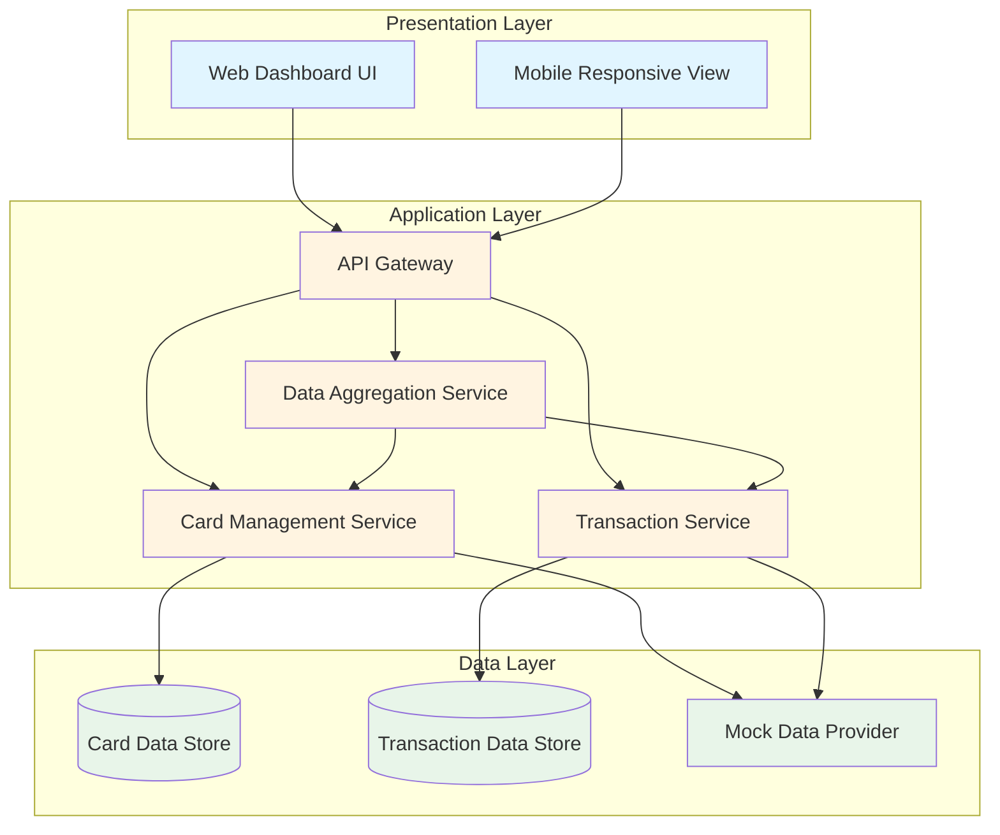
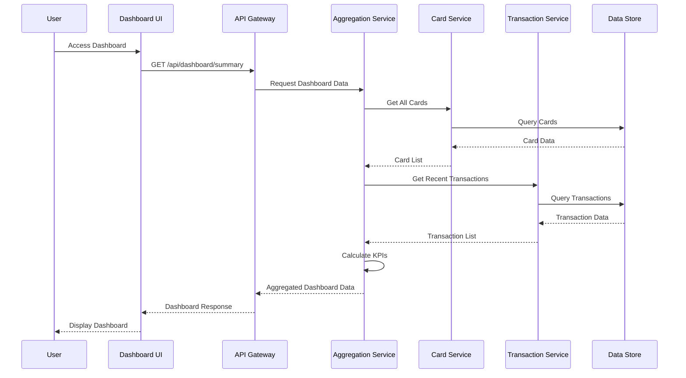
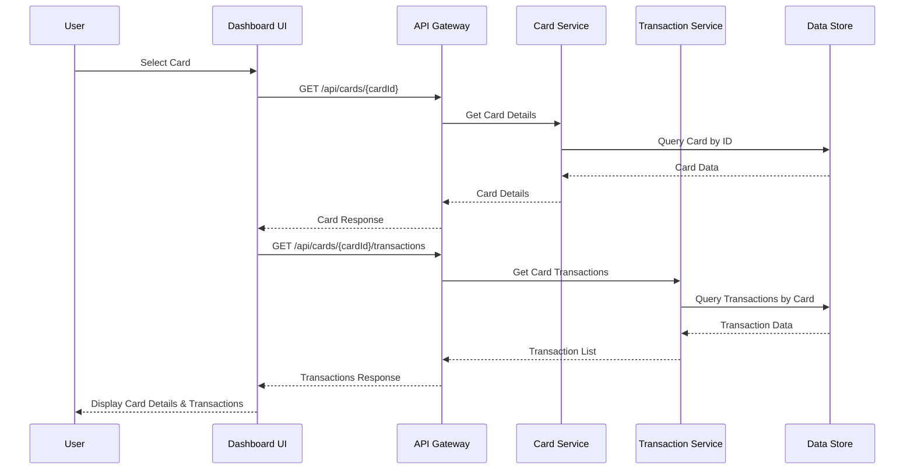
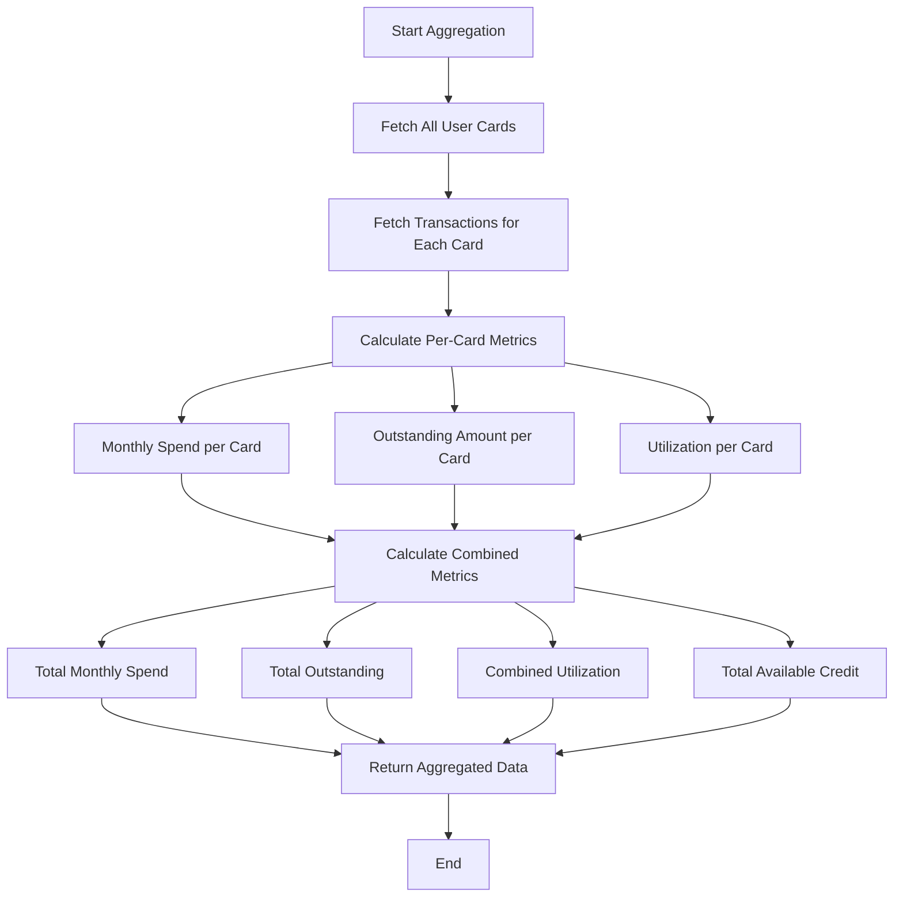

# High-Level Design Document

## Epic: Multi-Card Management & Transaction Visibility

---

## 1. Executive Summary

### 1.1 Epic Overview

**Epic Summary:** Multi-Card Management & Transaction Visibility

**Epic Type:** Epic

**Description:**  
Enable users to manage and view information for one or multiple credit cards in a consolidated dashboard, including associated transactions that drive the core KPIs.

**User Value:**  
Users with multiple cards can see all their cards in one place instead of switching between different bank portals, allowing them to understand combined exposure, track card-specific usage, and review underlying transactions that contribute to monthly spend and outstanding balances.

---

## 2. Requirements

### 2.1 Functional Requirements

#### FR-001: Multiple Credit Card Support
- **Description:** The system shall support the display and management of one or multiple credit cards within a consolidated dashboard.
- **Source:** Epic Scope
- **Priority:** High

#### FR-002: Card-Level Details Presentation
- **Description:** The system shall present card-level details including but not limited to credit limits and outstanding amounts for each card.
- **Source:** Epic Scope
- **Priority:** High

#### FR-003: Transaction Visibility
- **Description:** The system shall provide basic transaction visibility aligned with the in-scope "Cards" and "Transactions" elements to support dashboard KPIs.
- **Source:** Epic Scope
- **Priority:** High

#### FR-004: Transaction-to-Card Linkage
- **Description:** The system shall link transactions to their respective card records to correctly aggregate monthly spend and outstanding amounts.
- **Source:** Dependencies/Integrations
- **Priority:** High

#### FR-005: Consolidated View
- **Description:** The system shall provide a consolidated view allowing users to see all their cards in one place without switching between different portals.
- **Source:** User Value
- **Priority:** High

#### FR-006: Combined Exposure Tracking
- **Description:** The system shall enable users to understand their combined exposure across all cards.
- **Source:** User Value
- **Priority:** Medium

#### FR-007: Card-Specific Usage Tracking
- **Description:** The system shall allow users to track card-specific usage patterns.
- **Source:** User Value
- **Priority:** Medium

### 2.2 Non-Functional Requirements (NFRs)

#### NFR-001: Data Consistency and Accuracy
- **Description:** Data for multiple cards shall render consistently and accurately across the dashboard.
- **Category:** Reliability
- **Target:** 100% data consistency across all card displays
- **Validation:** Data integrity checks and automated testing

#### NFR-002: Responsiveness
- **Description:** The experience of switching between or viewing multiple cards shall remain responsive and usable.
- **Category:** Performance
- **Target:** Page load time < 2 seconds; card switching < 500ms
- **Validation:** Performance testing under various load conditions
- **Assumption:** Target values are assumed based on industry standards; actual targets not specified in epic

#### NFR-003: Scalability of Layout
- **Description:** Layout shall scale so that card and transaction information remains readable on various screen sizes.
- **Category:** Usability / Responsive Design
- **Target:** Support for mobile (320px+), tablet (768px+), and desktop (1024px+) viewports
- **Validation:** Cross-device testing and responsive design validation
- **Assumption:** Specific viewport breakpoints are assumed based on common standards

### 2.3 Out of Scope

The following items are explicitly excluded from this epic:

1. **Real Bank Integration** - No integration with actual banking systems
2. **Card Payments** - Payment processing functionality
3. **Fund Transfers** - Transfer of funds between accounts or cards
4. **Loans** - Loan management or loan-related features
5. **Payment Gateway Integration** - Integration with external payment gateways

---

## 3. Architecture Overview

### 3.1 High-Level Architecture

The Multi-Card Management & Transaction Visibility system follows a three-tier architecture pattern with a presentation layer, application/business logic layer, and data layer.



### 3.2 Architecture Principles

1. **Separation of Concerns:** Clear separation between presentation, business logic, and data layers
2. **Service-Oriented:** Modular services for card management, transactions, and aggregation
3. **Responsive Design:** Support for multiple device types and screen sizes
4. **Data Consistency:** Centralized aggregation service to ensure consistent data across views

---

## 4. Component Design

### 4.1 Presentation Layer Components

#### 4.1.1 Web Dashboard UI
- **Purpose:** Primary user interface for desktop and tablet users
- **Responsibilities:**
  - Render consolidated card dashboard
  - Display card-level details (limits, outstanding amounts)
  - Show transaction lists per card
  - Provide card switching functionality
  - Display aggregated KPIs (monthly spend, combined exposure)
- **Technology:** Assumed web framework (React/Angular/Vue - not specified)
- **Key Features:**
  - Multi-card carousel or grid view
  - Card detail panels
  - Transaction tables with filtering
  - Responsive layout components

#### 4.1.2 Mobile Responsive View
- **Purpose:** Optimized interface for mobile devices
- **Responsibilities:**
  - Adapt layout for smaller screens
  - Maintain readability and usability
  - Support touch interactions
- **Design Considerations:**
  - Collapsible card sections
  - Swipe gestures for card navigation
  - Simplified transaction views

### 4.2 Application Layer Components

#### 4.2.1 API Gateway
- **Purpose:** Single entry point for all client requests
- **Responsibilities:**
  - Route requests to appropriate services
  - Handle authentication and authorization (assumed)
  - Request validation
  - Response formatting
- **Key Endpoints (Assumed):**
  - `GET /api/cards` - Retrieve all cards for user
  - `GET /api/cards/{cardId}` - Retrieve specific card details
  - `GET /api/cards/{cardId}/transactions` - Retrieve transactions for a card
  - `GET /api/dashboard/summary` - Retrieve aggregated dashboard data

#### 4.2.2 Card Management Service
- **Purpose:** Manage card-related operations
- **Responsibilities:**
  - Retrieve card information
  - Provide card details (limits, outstanding amounts)
  - Support multiple card queries
  - Ensure data consistency
- **Data Model (Assumed):**
  ```json
  {
    "cardId": "string",
    "cardNumber": "string (masked)",
    "cardType": "string",
    "creditLimit": "number",
    "outstandingAmount": "number",
    "availableCredit": "number",
    "expiryDate": "string",
    "status": "string"
  }
  ```

#### 4.2.3 Transaction Service
- **Purpose:** Manage transaction-related operations
- **Responsibilities:**
  - Retrieve transactions by card
  - Filter transactions by date range, amount, category
  - Link transactions to cards
  - Calculate transaction-based metrics
- **Data Model (Assumed):**
  ```json
  {
    "transactionId": "string",
    "cardId": "string",
    "amount": "number",
    "currency": "string",
    "transactionDate": "string",
    "merchantName": "string",
    "category": "string",
    "status": "string"
  }
  ```

#### 4.2.4 Data Aggregation Service
- **Purpose:** Aggregate data from multiple sources for dashboard KPIs
- **Responsibilities:**
  - Calculate monthly spend per card and total
  - Calculate combined exposure across all cards
  - Aggregate outstanding amounts
  - Compute utilization percentages
  - Generate dashboard summary data
- **Key Calculations:**
  - Total Outstanding = Sum of all card outstanding amounts
  - Total Credit Limit = Sum of all card credit limits
  - Combined Utilization = (Total Outstanding / Total Credit Limit) × 100
  - Monthly Spend = Sum of transactions in current month

### 4.3 Data Layer Components

#### 4.3.1 Card Data Store
- **Purpose:** Persistent storage for card information
- **Type:** Assumed relational or document database
- **Key Entities:**
  - Cards table/collection
  - User-Card associations

#### 4.3.2 Transaction Data Store
- **Purpose:** Persistent storage for transaction information
- **Type:** Assumed relational or document database
- **Key Entities:**
  - Transactions table/collection
  - Card-Transaction associations

#### 4.3.3 Mock Data Provider
- **Purpose:** Provide simulated data for development and testing
- **Scope:** Used in absence of real bank integration
- **Responsibilities:**
  - Generate realistic card data
  - Generate realistic transaction data
  - Maintain data consistency between cards and transactions

---

## 5. Data Flow

### 5.1 Dashboard Load Flow



### 5.2 Card Details View Flow



### 5.3 Data Aggregation Flow



---

## 6. APIs and Integrations

### 6.1 Internal APIs

#### 6.1.1 Card Management API

**Endpoint:** `GET /api/cards`  
**Description:** Retrieve all cards for the authenticated user  
**Request Parameters:** None (user identified via authentication token)  
**Response:**
```json
{
  "cards": [
    {
      "cardId": "string",
      "cardNumber": "string",
      "cardType": "string",
      "creditLimit": "number",
      "outstandingAmount": "number",
      "availableCredit": "number",
      "status": "string"
    }
  ],
  "totalCards": "number"
}
```

**Endpoint:** `GET /api/cards/{cardId}`  
**Description:** Retrieve details for a specific card  
**Path Parameters:** `cardId` (string)  
**Response:**
```json
{
  "cardId": "string",
  "cardNumber": "string",
  "cardType": "string",
  "creditLimit": "number",
  "outstandingAmount": "number",
  "availableCredit": "number",
  "expiryDate": "string",
  "status": "string",
  "billingCycle": "string"
}
```

#### 6.1.2 Transaction API

**Endpoint:** `GET /api/cards/{cardId}/transactions`  
**Description:** Retrieve transactions for a specific card  
**Path Parameters:** `cardId` (string)  
**Query Parameters:**
- `startDate` (optional): Filter transactions from date
- `endDate` (optional): Filter transactions to date
- `limit` (optional): Number of transactions to return
- `offset` (optional): Pagination offset

**Response:**
```json
{
  "transactions": [
    {
      "transactionId": "string",
      "cardId": "string",
      "amount": "number",
      "currency": "string",
      "transactionDate": "string",
      "merchantName": "string",
      "category": "string",
      "status": "string"
    }
  ],
  "totalTransactions": "number",
  "hasMore": "boolean"
}
```

#### 6.1.3 Dashboard Aggregation API

**Endpoint:** `GET /api/dashboard/summary`  
**Description:** Retrieve aggregated dashboard data including KPIs  
**Request Parameters:** None (user identified via authentication token)  
**Response:**
```json
{
  "summary": {
    "totalCards": "number",
    "totalCreditLimit": "number",
    "totalOutstanding": "number",
    "totalAvailableCredit": "number",
    "combinedUtilization": "number",
    "monthlySpend": "number",
    "currentMonth": "string"
  },
  "cards": [
    {
      "cardId": "string",
      "cardNumber": "string",
      "outstandingAmount": "number",
      "monthlySpend": "number",
      "utilization": "number"
    }
  ],
  "recentTransactions": [
    {
      "transactionId": "string",
      "cardId": "string",
      "amount": "number",
      "merchantName": "string",
      "transactionDate": "string"
    }
  ]
}
```

### 6.2 Data Sources

#### 6.2.1 Internal Card Data Source
- **Type:** Internal service or mock data provider
- **Purpose:** Provide card information
- **Interface:** Service API or database query
- **Assumption:** Actual implementation details not specified; assumed to be internal service

#### 6.2.2 Internal Transaction Data Source
- **Type:** Internal service or mock data provider
- **Purpose:** Provide transaction information
- **Interface:** Service API or database query
- **Assumption:** Actual implementation details not specified; assumed to be internal service

### 6.3 Integration Points

#### 6.3.1 Card-Transaction Linkage
- **Purpose:** Link transactions to card records for aggregation
- **Mechanism:** Foreign key relationship or reference field (cardId in transaction records)
- **Requirement:** Essential for calculating monthly spend and outstanding amounts per card

#### 6.3.2 Authentication Service (Assumed)
- **Purpose:** User authentication and authorization
- **Integration:** API Gateway integrates with authentication service
- **Assumption:** Authentication mechanism exists but not specified in epic

---

## 7. Security Considerations

### 7.1 Data Security

#### 7.1.1 Sensitive Data Handling
- **Card Numbers:** Must be masked in UI (e.g., **** **** **** 1234)
- **Personal Information:** User data must be protected
- **Assumption:** Specific security requirements not detailed in epic; standard practices assumed

#### 7.1.2 Data Encryption
- **In Transit:** HTTPS/TLS for all API communications (assumed)
- **At Rest:** Database encryption for sensitive data (assumed)
- **Gap:** Specific encryption standards not specified in epic

### 7.2 Authentication and Authorization

- **User Authentication:** Required to access dashboard (assumed)
- **Authorization:** Users should only access their own cards and transactions
- **Session Management:** Secure session handling (assumed)
- **Gap:** Authentication and authorization mechanisms not specified in epic

### 7.3 API Security

- **API Authentication:** Token-based authentication (assumed)
- **Rate Limiting:** Prevent abuse of API endpoints (assumed)
- **Input Validation:** Validate all user inputs and API parameters
- **Gap:** Specific API security measures not detailed in epic

### 7.4 Security Gaps and Assumptions

**Gaps:**
1. No specific security requirements mentioned in epic
2. Encryption standards not specified
3. Authentication mechanism not detailed
4. Compliance requirements (PCI-DSS, GDPR) not mentioned

**Assumptions:**
1. Standard web application security practices apply
2. HTTPS is used for all communications
3. User authentication is implemented
4. Sensitive data is properly protected

**Recommendation:** Conduct security requirements gathering and threat modeling exercise

---

## 8. Scalability and Performance

### 8.1 Scalability Considerations

#### 8.1.1 Horizontal Scalability
- **Application Layer:** Services can be scaled horizontally by adding more instances
- **Load Balancing:** Distribute requests across multiple service instances (assumed)
- **Stateless Design:** Services should be stateless to support horizontal scaling (assumed)

#### 8.1.2 Data Layer Scalability
- **Database Scaling:** Support for read replicas or sharding (assumed)
- **Caching:** Implement caching layer for frequently accessed data (assumed)
- **Gap:** Specific scalability requirements not defined in epic

#### 8.1.3 User Load
- **Current Scope:** Number of concurrent users not specified
- **Cards per User:** No limit specified; system should support multiple cards
- **Transactions per Card:** Volume not specified
- **Assumption:** System should handle typical consumer banking load patterns

### 8.2 Performance Requirements

#### 8.2.1 Response Time Targets

**From NFR-002 (with assumptions):**
- **Dashboard Load:** < 2 seconds (assumed target)
- **Card Switching:** < 500ms (assumed target)
- **Transaction List Load:** < 1 second (assumed target)

**Gap:** Specific performance targets not provided in epic; values are assumed based on industry standards

#### 8.2.2 Performance Optimization Strategies

1. **Caching:**
   - Cache card data (low change frequency)
   - Cache aggregated dashboard data with appropriate TTL
   - Client-side caching for static resources

2. **Data Pagination:**
   - Paginate transaction lists
   - Lazy loading for large data sets

3. **Optimized Queries:**
   - Index database tables appropriately
   - Optimize aggregation queries

4. **Asynchronous Processing:**
   - Load card data and transaction data in parallel
   - Pre-calculate KPIs where possible

### 8.3 Scalability Gaps and Recommendations

**Gaps:**
1. No specific performance targets defined
2. Expected user load not specified
3. Data volume expectations not provided
4. Scalability requirements not detailed

**Recommendations:**
1. Define specific performance SLAs
2. Conduct load testing to establish baselines
3. Define expected user and data growth
4. Plan for horizontal scaling of services

---

## 9. Availability and Reliability

### 9.1 Availability Requirements

**Gap:** No specific availability targets (e.g., 99.9% uptime) mentioned in epic

**Assumptions:**
- Standard business hours availability expected
- Graceful degradation in case of service failures
- Error handling and user-friendly error messages

### 9.2 Reliability Measures

#### 9.2.1 Data Consistency (from NFR-001)
- **Requirement:** Data for multiple cards should render consistently and accurately
- **Implementation:**
  - Transactional data operations where appropriate
  - Data validation at service boundaries
  - Consistency checks in aggregation service

#### 9.2.2 Error Handling
- **Service Failures:** Graceful degradation when services are unavailable
- **Data Errors:** Validation and error reporting
- **User Experience:** Clear error messages without exposing system details

#### 9.2.3 Monitoring and Alerting (Assumed)
- **Application Monitoring:** Track service health and performance
- **Error Tracking:** Log and alert on errors
- **Performance Monitoring:** Track response times and resource utilization

### 9.3 Disaster Recovery

**Gap:** No disaster recovery requirements specified in epic

**Assumptions:**
- Database backups are performed regularly
- Recovery procedures are documented
- RTO and RPO targets should be defined

**Recommendation:** Define availability, reliability, and disaster recovery requirements

---

## 10. Assumptions

The following assumptions have been made due to gaps in the epic specification:

### 10.1 Technical Assumptions

1. **Technology Stack:** Modern web framework (React/Angular/Vue) for frontend; RESTful API architecture for backend
2. **Authentication:** User authentication and authorization mechanisms exist
3. **Database:** Relational or document database for data persistence
4. **Hosting:** Cloud-based or on-premise infrastructure with standard DevOps practices
5. **API Protocol:** RESTful APIs using JSON over HTTPS

### 10.2 Functional Assumptions

1. **User Context:** Single user accessing their own cards (multi-tenancy not specified)
2. **Card Types:** System supports credit cards (other card types not specified)
3. **Transaction Types:** Standard purchase transactions (other types not specified)
4. **Currency:** Single currency support (multi-currency not specified)
5. **Date Ranges:** Monthly aggregation for spend calculations

### 10.3 Non-Functional Assumptions

1. **Performance Targets:** Industry-standard response times (< 2s for page load, < 500ms for interactions)
2. **Availability:** Standard business application availability expectations
3. **Security:** Standard web application security practices apply
4. **Scalability:** System should support typical consumer banking load
5. **Responsive Breakpoints:** Standard mobile (320px+), tablet (768px+), desktop (1024px+)

### 10.4 Data Assumptions

1. **Data Source:** Internal services or mock data provider (real bank integration out of scope)
2. **Data Freshness:** Near real-time data updates (specific SLA not defined)
3. **Historical Data:** Transaction history available for at least current month
4. **Data Volume:** Reasonable number of cards per user (< 10) and transactions per card (< 1000 per month)

---

## 11. Dependencies

### 11.1 Internal Dependencies

#### 11.1.1 Card Data Source
- **Type:** Internal service or mock data provider
- **Purpose:** Provide card information including limits and outstanding amounts
- **Status:** Assumed to exist or be developed in parallel
- **Risk:** If not available, development will be blocked

#### 11.1.2 Transaction Data Source
- **Type:** Internal service or mock data provider
- **Purpose:** Provide transaction information
- **Status:** Assumed to exist or be developed in parallel
- **Risk:** If not available, transaction visibility cannot be implemented

#### 11.1.3 Card-Transaction Linkage
- **Type:** Data relationship or service integration
- **Purpose:** Link transactions to card records for aggregation
- **Requirement:** Essential for monthly spend and outstanding amount calculations
- **Risk:** Without proper linkage, KPI calculations will be inaccurate

#### 11.1.4 Authentication Service
- **Type:** Internal service (assumed)
- **Purpose:** User authentication and authorization
- **Status:** Assumed to exist
- **Risk:** If not available, user access control cannot be implemented

### 11.2 External Dependencies

**None specified in epic scope.** Real bank integration is explicitly out of scope.

### 11.3 Infrastructure Dependencies

1. **Hosting Environment:** Cloud or on-premise infrastructure
2. **Database Infrastructure:** Database servers and storage
3. **Network Infrastructure:** Load balancers, API gateways
4. **Monitoring Tools:** Application and infrastructure monitoring

**Gap:** Specific infrastructure requirements not detailed in epic

---

## 12. Risks and Mitigation

### 12.1 Technical Risks

#### Risk 1: Data Source Availability
- **Description:** Internal card and transaction data sources may not be available or complete
- **Impact:** High - Blocks core functionality
- **Probability:** Medium
- **Mitigation:** 
  - Use mock data provider for development and testing
  - Define clear data contracts early
  - Parallel development of data sources if needed

#### Risk 2: Performance at Scale
- **Description:** Performance may degrade with multiple cards and large transaction volumes
- **Impact:** Medium - Affects user experience (NFR-002)
- **Probability:** Medium
- **Mitigation:**
  - Implement caching strategies
  - Optimize database queries and indexing
  - Conduct performance testing early
  - Implement pagination for large data sets

#### Risk 3: Data Consistency
- **Description:** Inconsistent data rendering across dashboard (violates NFR-001)
- **Impact:** High - Affects data accuracy and user trust
- **Probability:** Low to Medium
- **Mitigation:**
  - Implement centralized aggregation service
  - Use transactional operations where appropriate
  - Implement comprehensive data validation
  - Automated testing for data consistency

#### Risk 4: Responsive Design Complexity
- **Description:** Maintaining readability across various screen sizes (NFR-003)
- **Impact:** Medium - Affects usability
- **Probability:** Low
- **Mitigation:**
  - Use responsive design framework
  - Conduct cross-device testing
  - Implement mobile-first design approach
  - User testing on various devices

### 12.2 Functional Risks

#### Risk 5: Incomplete Requirements
- **Description:** Many technical details and requirements not specified in epic
- **Impact:** High - May lead to rework and delays
- **Probability:** High
- **Mitigation:**
  - Document all assumptions clearly
  - Conduct requirements gathering sessions
  - Iterative development with frequent stakeholder feedback
  - Maintain flexibility in design

#### Risk 6: Card-Transaction Linkage Complexity
- **Description:** Correctly linking transactions to cards for accurate aggregation
- **Impact:** High - Affects KPI accuracy
- **Probability:** Medium
- **Mitigation:**
  - Define clear data model and relationships
  - Implement data validation
  - Comprehensive testing of aggregation logic
  - Data reconciliation processes

### 12.3 Integration Risks

#### Risk 7: Service Integration Delays
- **Description:** Delays in integrating with internal card and transaction services
- **Impact:** High - Blocks development and testing
- **Probability:** Medium
- **Mitigation:**
  - Use mock data provider initially
  - Define service contracts early
  - Parallel development tracks
  - Regular integration checkpoints

### 12.4 Security Risks

#### Risk 8: Insufficient Security Requirements
- **Description:** Security requirements not detailed in epic
- **Impact:** High - Potential security vulnerabilities
- **Probability:** Medium
- **Mitigation:**
  - Conduct security requirements gathering
  - Follow security best practices
  - Security review and testing
  - Compliance assessment

### 12.5 Risk Summary Matrix

| Risk ID | Risk Description | Impact | Probability | Priority | Mitigation Status |
|---------|-----------------|--------|-------------|----------|-------------------|
| R1 | Data Source Availability | High | Medium | High | Planned |
| R2 | Performance at Scale | Medium | Medium | Medium | Planned |
| R3 | Data Consistency | High | Low-Med | High | Planned |
| R4 | Responsive Design | Medium | Low | Low | Planned |
| R5 | Incomplete Requirements | High | High | Critical | In Progress |
| R6 | Card-Transaction Linkage | High | Medium | High | Planned |
| R7 | Service Integration Delays | High | Medium | High | Planned |
| R8 | Insufficient Security | High | Medium | High | Planned |

---

## 13. Design Gaps and Recommendations

### 13.1 Requirements Gaps

1. **Performance Targets:** Specific response time and throughput requirements not defined
   - **Recommendation:** Define measurable performance SLAs

2. **Availability Requirements:** No uptime or availability targets specified
   - **Recommendation:** Define availability SLA (e.g., 99.9% uptime)

3. **Security Requirements:** No specific security controls or compliance requirements mentioned
   - **Recommendation:** Conduct security requirements gathering; identify compliance needs (PCI-DSS, GDPR)

4. **Scalability Requirements:** Expected user load and data volumes not specified
   - **Recommendation:** Define expected user base, growth projections, and data volume expectations

5. **Error Handling:** User experience for error scenarios not defined
   - **Recommendation:** Define error handling strategy and user messaging

6. **Data Freshness:** How often data should be updated not specified
   - **Recommendation:** Define data refresh intervals and real-time requirements

7. **Historical Data:** How much transaction history to display not specified
   - **Recommendation:** Define data retention and display policies

8. **Multi-Currency:** Support for multiple currencies not addressed
   - **Recommendation:** Clarify currency requirements

9. **Accessibility:** No accessibility requirements mentioned
   - **Recommendation:** Define accessibility standards (WCAG 2.1 AA)

10. **Browser Support:** Supported browsers and versions not specified
    - **Recommendation:** Define browser compatibility matrix

### 13.2 Technical Gaps

1. **Technology Stack:** Specific technologies not identified
   - **Recommendation:** Define technology stack and frameworks

2. **Authentication Mechanism:** User authentication approach not specified
   - **Recommendation:** Define authentication and authorization strategy

3. **API Specifications:** Detailed API contracts not provided
   - **Recommendation:** Create OpenAPI/Swagger specifications

4. **Database Schema:** Data models not defined
   - **Recommendation:** Design detailed database schema

5. **Caching Strategy:** Caching approach not specified
   - **Recommendation:** Define caching strategy and TTL policies

6. **Monitoring and Logging:** Observability requirements not defined
   - **Recommendation:** Define monitoring, logging, and alerting strategy

7. **Deployment Strategy:** Deployment approach not specified
   - **Recommendation:** Define CI/CD pipeline and deployment strategy

8. **Testing Strategy:** Testing approach not detailed
   - **Recommendation:** Define testing strategy (unit, integration, E2E, performance)

### 13.3 Design Recommendations

1. **Implement Caching Layer:** Improve performance by caching card data and aggregated KPIs

2. **Use Responsive Framework:** Leverage established responsive design framework (Bootstrap, Material-UI)

3. **Implement Progressive Loading:** Load critical data first, then enhance with additional details

4. **Design for Extensibility:** Structure services to accommodate future enhancements (payments, transfers)

5. **Implement Comprehensive Error Handling:** Graceful degradation and user-friendly error messages

6. **Add Monitoring and Observability:** Implement comprehensive logging, monitoring, and alerting

7. **Conduct User Testing:** Validate responsive design and usability across devices

8. **Implement Data Validation:** Validate data at all service boundaries

9. **Security by Design:** Incorporate security controls from the beginning

10. **Document APIs:** Create comprehensive API documentation for all endpoints

---

## 14. Validation Report

### 14.1 Requirements Traceability Matrix

| Requirement ID | Requirement Description | Source | Design Component | Implementation Status | Validation Method |
|----------------|------------------------|--------|------------------|----------------------|-------------------|
| FR-001 | Multiple Credit Card Support | Epic Scope | Card Management Service, Dashboard UI | Designed | Integration Testing |
| FR-002 | Card-Level Details Presentation | Epic Scope | Card Management Service, UI Components | Designed | UI Testing |
| FR-003 | Transaction Visibility | Epic Scope | Transaction Service, UI Components | Designed | Integration Testing |
| FR-004 | Transaction-to-Card Linkage | Dependencies | Data Model, Aggregation Service | Designed | Data Validation Testing |
| FR-005 | Consolidated View | User Value | Dashboard UI, Aggregation Service | Designed | User Acceptance Testing |
| FR-006 | Combined Exposure Tracking | User Value | Aggregation Service, Dashboard UI | Designed | Functional Testing |
| FR-007 | Card-Specific Usage Tracking | User Value | Transaction Service, UI Components | Designed | Functional Testing |
| NFR-001 | Data Consistency and Accuracy | NFRs | Aggregation Service, Data Validation | Designed | Automated Testing, Data Integrity Checks |
| NFR-002 | Responsiveness | NFRs | All Services, Caching Strategy | Designed | Performance Testing |
| NFR-003 | Scalability of Layout | NFRs | Responsive UI Components | Designed | Cross-Device Testing |

### 14.2 Coverage Status

#### Functional Requirements Coverage
- **Total Functional Requirements:** 7
- **Covered in Design:** 7 (100%)
- **Not Covered:** 0
- **Status:** ✅ All functional requirements addressed in design

#### Non-Functional Requirements Coverage
- **Total NFRs:** 3
- **Covered in Design:** 3 (100%)
- **Not Covered:** 0
- **Status:** ✅ All NFRs addressed in design

#### Out of Scope Items
- **Total Out of Scope:** 5 items
- **Status:** ✅ Clearly documented and excluded from design

### 14.3 NFR Validation Targets

| NFR ID | NFR Description | Target Metric | Validation Method | Status |
|--------|----------------|---------------|-------------------|--------|
| NFR-001 | Data Consistency | 100% data consistency | Automated data integrity tests | Target Defined |
| NFR-002 | Responsiveness | Page load < 2s, switching < 500ms | Performance testing | Target Assumed* |
| NFR-003 | Scalability of Layout | Support 320px+ viewports | Cross-device testing | Target Assumed* |

**Note:** Targets marked with * are assumed based on industry standards as specific values were not provided in the epic.

### 14.4 Design Gaps Summary

#### Critical Gaps (High Priority)
1. **Security Requirements:** No specific security controls defined
2. **Performance Targets:** Specific SLAs not provided (assumed values used)
3. **Authentication Mechanism:** Not specified in epic
4. **Scalability Requirements:** User load and data volumes not defined

#### Important Gaps (Medium Priority)
5. **API Specifications:** Detailed contracts need to be defined
6. **Database Schema:** Detailed data models need to be designed
7. **Error Handling Strategy:** Not specified in epic
8. **Data Freshness Requirements:** Update frequency not defined

#### Minor Gaps (Low Priority)
9. **Browser Compatibility:** Supported browsers not specified
10. **Accessibility Standards:** Not mentioned in epic

### 14.5 Validation Recommendations

#### Immediate Actions
1. **Requirements Clarification Session:** Conduct workshop to address critical gaps
2. **Security Assessment:** Perform security requirements gathering and threat modeling
3. **Performance Baseline:** Define specific performance SLAs and conduct baseline testing
4. **API Contract Definition:** Create detailed API specifications (OpenAPI/Swagger)

#### Short-Term Actions
5. **Database Design:** Complete detailed database schema design
6. **Authentication Design:** Define and design authentication/authorization mechanism
7. **Error Handling Design:** Define error handling strategy and user messaging
8. **Monitoring Strategy:** Define logging, monitoring, and alerting approach

#### Ongoing Actions
9. **Iterative Validation:** Regular validation with stakeholders throughout development
10. **Testing Strategy:** Implement comprehensive testing at all levels
11. **Documentation:** Maintain up-to-date technical documentation
12. **User Feedback:** Conduct user testing to validate design decisions

### 14.6 Assumptions Requiring Validation

The following assumptions must be validated with stakeholders:

1. **Performance Targets:** Page load < 2s, card switching < 500ms
2. **Responsive Breakpoints:** Mobile 320px+, Tablet 768px+, Desktop 1024px+
3. **Technology Stack:** Modern web framework and RESTful architecture
4. **Authentication:** User authentication mechanism exists
5. **Data Volume:** < 10 cards per user, < 1000 transactions per card per month
6. **Currency:** Single currency support
7. **Card Types:** Credit cards only
8. **Data Freshness:** Near real-time updates
9. **Historical Data:** At least current month transaction history
10. **Availability:** Standard business application availability

### 14.7 Validation Status Summary

| Category | Total Items | Validated | Assumed | Gap Identified | Status |
|----------|-------------|-----------|---------|----------------|--------|
| Functional Requirements | 7 | 7 | 0 | 0 | ✅ Complete |
| Non-Functional Requirements | 3 | 1 | 2 | 0 | ⚠️ Assumptions Made |
| Security Requirements | 0 | 0 | 8 | 1 | ❌ Gap Identified |
| Performance Requirements | 1 | 0 | 3 | 1 | ⚠️ Assumptions Made |
| Integration Requirements | 3 | 3 | 0 | 0 | ✅ Complete |
| Out of Scope Items | 5 | 5 | 0 | 0 | ✅ Complete |

**Overall Status:** Design is complete based on available information, but contains assumptions that require validation. Critical gaps in security and performance requirements must be addressed before implementation.

---

## 15. Conclusion

This High-Level Design document provides a comprehensive architecture and design for the Multi-Card Management & Transaction Visibility epic. The design addresses all functional requirements and NFRs specified in the epic while maintaining clarity about assumptions, gaps, and out-of-scope items.

### Key Highlights

1. **Complete Functional Coverage:** All 7 functional requirements are addressed in the design
2. **NFR Compliance:** Design incorporates all 3 NFRs with specific implementation strategies
3. **Modular Architecture:** Service-oriented architecture enables scalability and maintainability
4. **Responsive Design:** Multi-device support as required by NFR-003
5. **Data Consistency:** Centralized aggregation service ensures consistent data rendering (NFR-001)
6. **Performance Considerations:** Caching and optimization strategies to meet responsiveness requirements (NFR-002)

### Critical Success Factors

1. **Data Source Availability:** Internal card and transaction data sources must be available
2. **Requirements Validation:** Assumptions must be validated with stakeholders
3. **Security Implementation:** Security requirements must be defined and implemented
4. **Performance Testing:** Early performance testing to validate assumed targets
5. **Iterative Development:** Frequent stakeholder feedback to address gaps

### Next Steps

1. **Stakeholder Review:** Review this HLD with stakeholders to validate assumptions
2. **Requirements Refinement:** Address identified gaps through requirements gathering
3. **Detailed Design:** Proceed with detailed technical design and API specifications
4. **Security Design:** Conduct security requirements gathering and threat modeling
5. **Prototype Development:** Build proof-of-concept for key components
6. **Testing Strategy:** Define comprehensive testing approach
7. **Implementation Planning:** Create detailed implementation roadmap

### Risk Mitigation Priority

1. **High Priority:** Data source availability, incomplete requirements, security gaps
2. **Medium Priority:** Performance at scale, service integration delays
3. **Low Priority:** Responsive design complexity

This design provides a solid foundation for implementation while maintaining transparency about limitations and areas requiring further clarification.

---

## Document Control

**Document Version:** 1.0  
**Date:** Generated from Epic Specification  
**Epic:** Multi-Card Management & Transaction Visibility  
**Status:** Draft - Pending Stakeholder Review  

**Change Log:**
| Version | Date | Author | Changes |
|---------|------|--------|----------|
| 1.0 | Initial | HLD Generation Agent | Initial document creation from epic specification |

**Approval:**
- [ ] Product Owner
- [ ] Technical Lead
- [ ] Security Team
- [ ] Architecture Review Board

---

**End of Document**