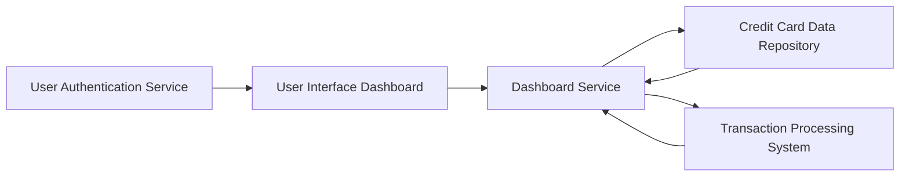

#### 1. High-Level Design

**Summary:** This epic delivers a consolidated dashboard that provides real-time visibility into credit card portfolio health through key performance indicators including monthly spend, total credit limit, available credit, and outstanding amounts across multiple credit cards.

**Component Flow:**

**Integration Points:**
- **Upstream:** User authentication service for secure access control
- **Downstream:** Credit card data repository for card information and balances; Transaction processing system for monthly spend calculations and outstanding amounts

**Key Assumptions:**
- Data refresh occurs at regular intervals (assumed every 5 minutes) to provide near real-time updates
- Credit card data repository maintains current balance and limit information with eventual consistency

**NFR Highlights:** Dashboard must load within 2 seconds, support real-time data refresh, be responsive across all devices, and handle up to 20 credit cards per user without performance degradation

#### 2. Validation Report

**Requirements Coverage:** The design fully covers the epic's stated scope by providing a consolidated dashboard interface that aggregates data from the credit card repository and transaction processing system. The component flow ensures that all KPIs (monthly spend, total credit limit, available credit, outstanding amounts) can be calculated and displayed efficiently. The integration with authentication service ensures secure access, while the responsive layout requirement is addressed through the UI layer design.