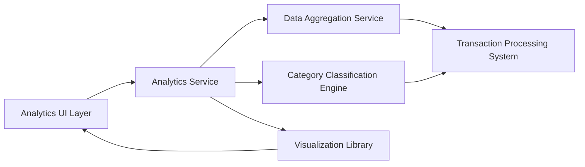

#### 1. High-Level Design

**Summary:** This epic delivers powerful analytical capabilities through interactive visualizations that transform transaction data into actionable insights, including monthly spend trends, card-wise analysis, and category-wise breakdowns across nine predefined spending categories.

**Component Flow:**

**Integration Points:**
- **Upstream:** Transaction processing system for raw transaction data
- **Downstream:** Category classification engine for transaction categorization; Data aggregation service for computing trends; Visualization library for rendering interactive charts

**Key Assumptions:**
- Transactions are automatically classified into predefined categories (Food & Dining, Fuel, Shopping, Travel, Entertainment, Utilities, Healthcare, Education, Miscellaneous) using rule-based or ML classification
- Aggregation computations are performed on-demand with caching for frequently accessed date ranges

**NFR Highlights:** Analytics visualizations must render within 3 seconds, support interactive filtering and drill-down, be responsive across screen sizes, and efficiently handle aggregation for up to 10,000 transactions

#### 2. Validation Report

**Requirements Coverage:** The design comprehensively covers all analytical requirements including monthly trends, card-wise analysis, category-wise breakdowns, interactive charts, pattern identification, multi-category comparison, and time-based analysis. The component architecture separates concerns effectively with dedicated services for aggregation, classification, and visualization. The category classification engine enables the nine-category breakdown specified in scope. The 3-second rendering NFR is achievable through the data aggregation service's caching strategy and efficient visualization library integration. All interactive requirements are supported through the visualization layer's drill-down capabilities.