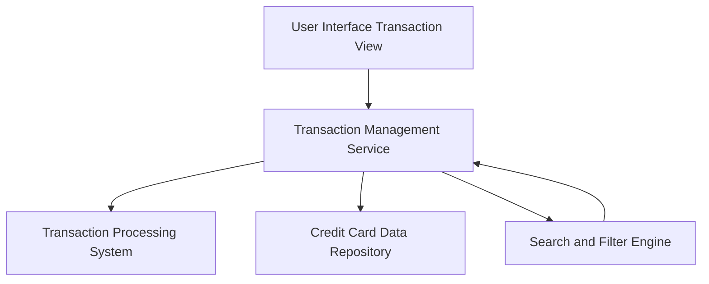

#### 1. High-Level Design

**Summary:** This epic enables comprehensive transaction viewing and management capabilities across all registered credit cards, providing users with detailed transaction histories, search/filter functionality, and spending activity tracking for financial record-keeping and verification.

**Component Flow:**

**Integration Points:**
- **Upstream:** User authentication service for secure transaction access
- **Downstream:** Transaction processing system for retrieving transaction data; Credit card data repository for mapping transactions to specific cards

**Key Assumptions:**
- Transaction data is indexed for efficient search and filtering operations
- Pagination defaults to 50 transactions per page for optimal performance

**NFR Highlights:** Transaction queries must return results within 1 second for up to 1000 transactions, support pagination, encrypt data at rest, and maintain 24-month transaction history

#### 2. Validation Report

**Requirements Coverage:** The design addresses all core requirements including transaction listing, history access, search/filtering, card-wise segregation, detail views, and date range filtering. The search and filter engine component ensures efficient query performance meeting the 1-second NFR. Integration with both transaction processing and credit card repositories enables complete transaction-to-card mapping. The 24-month retention requirement is satisfied through the transaction processing system's data storage policies.