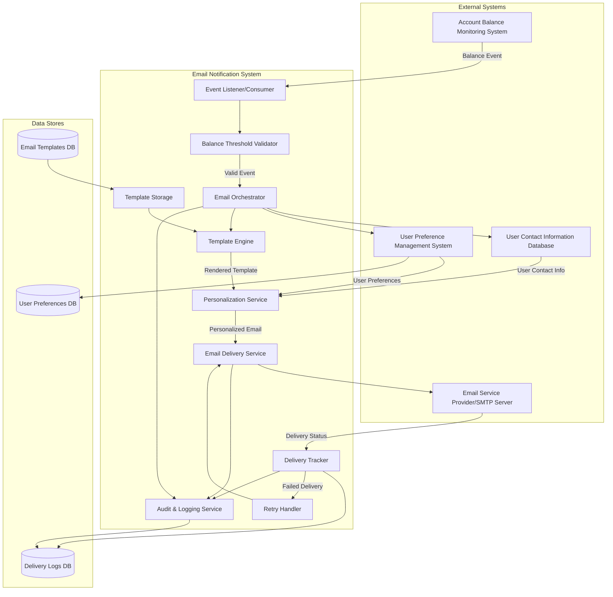
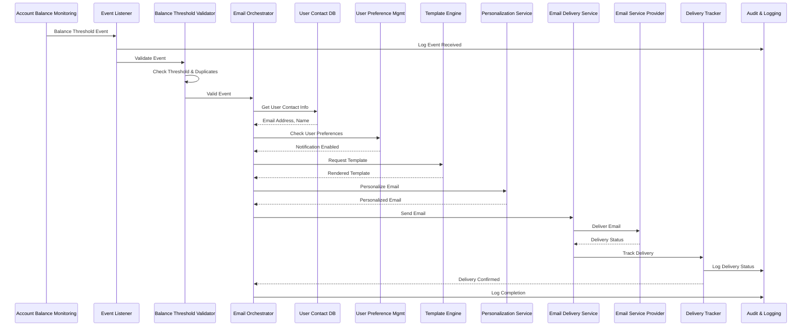
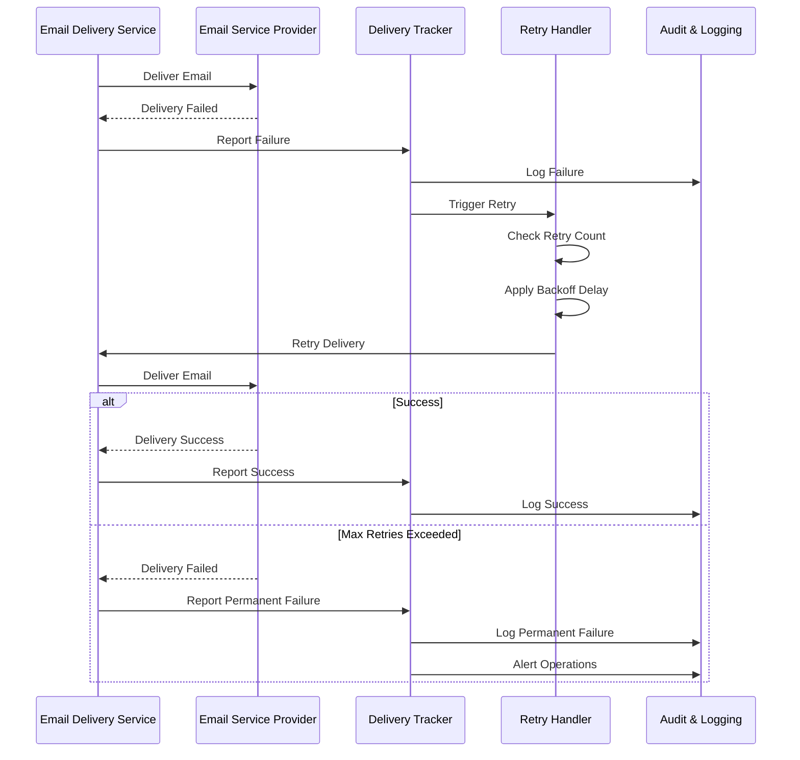

# High-Level Design Document

## Epic: PRD!-Automated Email Notification System

**Project Key:** QE  
**Epic Type:** Epic  
**Labels:** PRD!

---

## 1. Epic Overview

### 1.1 Summary
Develop an automated email notification system that sends targeted emails to users whose account balances have fallen below the minimum maintenance amount. The system will trigger email delivery based on balance monitoring events and provide users with relevant account information and recommended actions.

### 1.2 User Value
Users receive immediate, automated email alerts about low account balances, enabling them to maintain compliance with minimum balance requirements and avoid potential fees or service interruptions. This reduces the need for manual monitoring and provides clear guidance on next steps.

### 1.3 Business Context
This system addresses the critical need for proactive customer communication regarding account balance thresholds, improving customer satisfaction and reducing support burden while ensuring regulatory compliance.

---

## 2. Requirements

### 2.1 Functional Requirements

| Requirement ID | Description | Priority | Source |
|----------------|-------------|----------|--------|
| FR-001 | Email template design and management | High | Epic Scope |
| FR-002 | Automated email triggering based on balance events | High | Epic Scope |
| FR-003 | Personalized email content with account details | High | Epic Scope |
| FR-004 | Email delivery service integration | High | Epic Scope |
| FR-005 | Delivery status tracking and logging | Medium | Epic Scope |
| FR-006 | Unsubscribe and preference management | High | Epic Scope |

### 2.2 Non-Functional Requirements (NFRs)

| NFR ID | Category | Requirement | Target Metric | Priority |
|--------|----------|-------------|---------------|----------|
| NFR-001 | Performance | Emails must be delivered within a defined time window after balance threshold breach | TBD - To be defined with business stakeholders | High |
| NFR-002 | Scalability | System must handle high volumes of concurrent email sends | TBD - Baseline to be established | High |
| NFR-003 | Reliability | Email delivery must be reliable with retry logic for failures | 99.5% delivery success rate (assumption) | High |
| NFR-004 | Compliance | Must comply with email regulations and anti-spam requirements | 100% compliance with CAN-SPAM, GDPR | Critical |
| NFR-005 | Performance | Must support email personalization at scale | TBD - Performance benchmarks needed | Medium |

### 2.3 Out of Scope

The following items are explicitly excluded from this epic:
- SMS or push notifications
- In-app messaging
- Phone call notifications
- Email marketing campaigns
- Newsletter functionality
- Two-way email communication or responses

---

## 3. Architecture Overview

### 3.1 System Context

The Automated Email Notification System operates as an event-driven service that monitors account balance events and triggers personalized email notifications to affected users.

### 3.2 High-Level Architecture Diagram



### 3.3 Architecture Principles

1. **Event-Driven Architecture**: System responds to balance threshold events asynchronously
2. **Separation of Concerns**: Clear boundaries between event processing, template management, personalization, and delivery
3. **Resilience**: Built-in retry mechanisms and failure handling
4. **Scalability**: Designed to handle high volumes through horizontal scaling
5. **Compliance-First**: User preferences and regulatory requirements enforced at every stage

---

## 4. Component Design

### 4.1 Event Listener/Consumer

**Responsibility**: Receives and processes balance threshold breach events from the Account Balance Monitoring System

**Key Functions**:
- Subscribe to balance event queue/topic
- Validate event schema and data integrity
- Forward valid events to Balance Threshold Validator

**Technology Considerations**: Message queue consumer (e.g., Kafka, RabbitMQ, AWS SQS)

### 4.2 Balance Threshold Validator

**Responsibility**: Validates that the balance event meets criteria for email notification

**Key Functions**:
- Verify balance has fallen below minimum maintenance threshold
- Check for duplicate events within time window
- Apply business rules for notification eligibility

### 4.3 Email Orchestrator

**Responsibility**: Coordinates the email generation and delivery workflow

**Key Functions**:
- Retrieve user contact information
- Check user notification preferences and opt-out status
- Coordinate template rendering and personalization
- Initiate email delivery
- Handle workflow errors and exceptions

### 4.4 Template Engine

**Responsibility**: Manages email templates and renders them with dynamic content

**Key Functions**:
- Store and version email templates
- Render templates with placeholder variables
- Support multiple template formats (HTML, plain text)
- Enable A/B testing of templates (future consideration)

**Technology Considerations**: Template engines like Handlebars, Mustache, or Thymeleaf

### 4.5 Personalization Service

**Responsibility**: Enriches email content with user-specific account information

**Key Functions**:
- Inject account balance details
- Add user-specific recommended actions
- Format currency and date/time values per user locale
- Apply user preference settings

### 4.6 Email Delivery Service

**Responsibility**: Sends emails via the configured email service provider

**Key Functions**:
- Interface with email service provider API or SMTP server
- Handle authentication and connection management
- Batch email sends when appropriate
- Return delivery status

**Technology Considerations**: Integration with SendGrid, AWS SES, Mailgun, or SMTP

### 4.7 Delivery Tracker

**Responsibility**: Monitors and logs email delivery status

**Key Functions**:
- Track delivery attempts and outcomes
- Log delivery timestamps
- Monitor bounce rates and delivery failures
- Trigger retry logic for failed deliveries

### 4.8 Retry Handler

**Responsibility**: Implements retry logic for failed email deliveries

**Key Functions**:
- Implement exponential backoff strategy
- Track retry attempts and limits
- Handle permanent vs. transient failures
- Alert on persistent delivery failures

### 4.9 Audit & Logging Service

**Responsibility**: Provides comprehensive logging and audit trail

**Key Functions**:
- Log all system events and state changes
- Maintain audit trail for compliance
- Support troubleshooting and diagnostics
- Generate operational metrics

---

## 5. Data Flow

### 5.1 Primary Email Notification Flow



### 5.2 Retry Flow for Failed Deliveries



---

## 6. APIs and Integrations

### 6.1 External Dependencies

#### 6.1.1 Email Service Provider / SMTP Server

**Purpose**: Deliver emails to end users

**Integration Type**: REST API or SMTP protocol

**Key Operations**:
- Send single email
- Send batch emails
- Query delivery status
- Handle webhooks for delivery events

**Assumptions**:
- Email service provider supports required volume
- API rate limits are sufficient for peak loads
- Webhook support available for delivery status updates

#### 6.1.2 User Contact Information Database

**Purpose**: Retrieve user email addresses and contact details

**Integration Type**: Database query or REST API

**Key Operations**:
- Query user by user ID
- Retrieve email address and name
- Validate email address format

**Assumptions**:
- Contact information is current and validated
- Database is highly available
- Response time is within acceptable limits

#### 6.1.3 Account Balance Monitoring System

**Purpose**: Publish balance threshold breach events

**Integration Type**: Message queue/event stream

**Key Operations**:
- Publish balance event with user ID, account ID, current balance, threshold
- Guarantee event delivery

**Assumptions**:
- Events are published in real-time or near real-time
- Event schema is well-defined and versioned
- No duplicate events within reasonable time window

#### 6.1.4 User Preference Management System

**Purpose**: Retrieve user notification preferences and opt-out status

**Integration Type**: REST API or database query

**Key Operations**:
- Query user notification preferences
- Check opt-out status
- Retrieve communication channel preferences

**Assumptions**:
- Preference data is synchronized and current
- System enforces opt-out immediately
- Default preference is opt-in (to be confirmed)

#### 6.1.5 Email Template Storage

**Purpose**: Store and retrieve email templates

**Integration Type**: Database, file storage, or CMS

**Key Operations**:
- Retrieve template by ID or name
- Version templates
- Support template variables

**Assumptions**:
- Templates are pre-created and tested
- Template versioning supports rollback
- Templates support internationalization (future)

### 6.2 Internal APIs

#### 6.2.1 Email Notification API

**Purpose**: Trigger email notifications programmatically (if needed)

**Endpoint**: `POST /api/v1/notifications/email`

**Request**:
```json
{
  "userId": "string",
  "accountId": "string",
  "currentBalance": "number",
  "threshold": "number",
  "templateId": "string"
}
```

**Response**:
```json
{
  "notificationId": "string",
  "status": "queued|sent|failed",
  "timestamp": "ISO8601"
}
```

#### 6.2.2 Delivery Status API

**Purpose**: Query email delivery status

**Endpoint**: `GET /api/v1/notifications/{notificationId}/status`

**Response**:
```json
{
  "notificationId": "string",
  "status": "queued|sent|delivered|bounced|failed",
  "attempts": "number",
  "lastAttempt": "ISO8601",
  "deliveredAt": "ISO8601"
}
```

---

## 7. Security Considerations

### 7.1 Data Protection

- **PII Handling**: User email addresses and account information must be encrypted in transit and at rest
- **Access Control**: Implement role-based access control (RBAC) for template management and system administration
- **Audit Trail**: Maintain comprehensive audit logs for all email sends and user data access

### 7.2 Email Security

- **SPF/DKIM/DMARC**: Configure email authentication to prevent spoofing
- **TLS Encryption**: Use TLS for all email transmissions
- **Content Sanitization**: Sanitize all user-generated content to prevent injection attacks

### 7.3 Compliance

- **CAN-SPAM Compliance**: Include unsubscribe links, physical address, and accurate subject lines
- **GDPR Compliance**: Honor user consent and right to be forgotten
- **Data Retention**: Define and implement data retention policies for logs and delivery records

### 7.4 Authentication & Authorization

- **API Security**: Secure all APIs with OAuth 2.0 or API keys
- **Service-to-Service**: Use mutual TLS or service mesh for inter-service communication
- **Secrets Management**: Store email service provider credentials in secure vault (e.g., AWS Secrets Manager, HashiCorp Vault)

### 7.5 Security Gaps & Assumptions

**Gap**: Specific encryption standards not defined  
**Assumption**: Industry-standard encryption (AES-256) will be used

**Gap**: Authentication mechanism for internal APIs not specified  
**Assumption**: OAuth 2.0 with JWT tokens will be implemented

---

## 8. Scalability

### 8.1 Horizontal Scaling

- **Stateless Services**: All components designed to be stateless for easy horizontal scaling
- **Load Balancing**: Use load balancers to distribute traffic across multiple instances
- **Auto-Scaling**: Implement auto-scaling based on queue depth and CPU/memory utilization

### 8.2 Performance Optimization

- **Batch Processing**: Group email sends where possible to optimize throughput
- **Caching**: Cache frequently accessed templates and user preferences
- **Connection Pooling**: Maintain connection pools to email service provider
- **Asynchronous Processing**: Use asynchronous patterns to avoid blocking operations

### 8.3 Capacity Planning

**Assumption**: Peak load estimation required from business stakeholders

**Metrics to Monitor**:
- Events processed per second
- Email send rate
- Queue depth
- API response times
- Email delivery success rate

**Scalability Targets** (to be defined):
- Support X concurrent email sends
- Process Y balance events per second
- Maintain sub-second latency for event processing

### 8.4 Scalability Gaps

**Gap**: Specific volume requirements not provided  
**Recommendation**: Conduct capacity planning exercise with business stakeholders to define:
- Expected number of users
- Frequency of balance threshold breaches
- Peak load scenarios
- Growth projections

---

## 9. Availability & Reliability

### 9.1 High Availability Design

- **Multi-AZ Deployment**: Deploy across multiple availability zones
- **Redundancy**: Eliminate single points of failure
- **Health Checks**: Implement health check endpoints for all services
- **Circuit Breakers**: Implement circuit breaker pattern for external dependencies

### 9.2 Disaster Recovery

- **Backup Strategy**: Regular backups of templates, configuration, and delivery logs
- **Recovery Time Objective (RTO)**: To be defined
- **Recovery Point Objective (RPO)**: To be defined
- **Failover Procedures**: Document and test failover procedures

### 9.3 Reliability Mechanisms

- **Retry Logic**: Exponential backoff with jitter for failed deliveries
- **Dead Letter Queue**: Capture events that cannot be processed after max retries
- **Idempotency**: Ensure email sends are idempotent to prevent duplicate sends
- **Monitoring & Alerting**: Real-time monitoring with alerts for failures

### 9.4 Service Level Objectives (SLOs)

**Assumption**: SLOs to be defined with business stakeholders

**Proposed SLOs**:
- **Availability**: 99.9% uptime
- **Email Delivery Success Rate**: 99.5%
- **Event Processing Latency**: 95th percentile < 5 seconds
- **Email Delivery Time**: 95th percentile < defined time window (NFR-001)

### 9.5 Availability Gaps

**Gap**: RTO and RPO not defined  
**Recommendation**: Define disaster recovery requirements based on business impact analysis

**Gap**: Specific uptime requirements not specified  
**Assumption**: 99.9% availability target is appropriate for this system

---

## 10. Monitoring & Observability

### 10.1 Key Metrics

**System Health**:
- Service uptime and availability
- Error rates by component
- API response times
- Queue depth and lag

**Business Metrics**:
- Emails sent per hour/day
- Delivery success rate
- Bounce rate
- Opt-out rate
- Average time from event to delivery

**Performance Metrics**:
- Event processing throughput
- Template rendering time
- Email service provider API latency
- Retry rate and success

### 10.2 Logging Strategy

- **Structured Logging**: Use JSON format for all logs
- **Correlation IDs**: Track requests across all components
- **Log Levels**: Appropriate use of DEBUG, INFO, WARN, ERROR
- **Centralized Logging**: Aggregate logs in centralized system (e.g., ELK, Splunk)

### 10.3 Alerting

**Critical Alerts**:
- Service down or unhealthy
- Email delivery failure rate exceeds threshold
- External dependency unavailable
- Queue depth exceeds threshold

**Warning Alerts**:
- Elevated error rate
- Slow API response times
- High retry rate
- Approaching capacity limits

---

## 11. Assumptions

| ID | Assumption | Impact | Validation Needed |
|----|------------|--------|-------------------|
| A-001 | Users have valid email addresses in the contact database | High | Verify data quality in user contact database |
| A-002 | Balance threshold breach events are published in real-time | High | Confirm with Account Balance Monitoring System team |
| A-003 | Email service provider can handle required volume | High | Conduct capacity planning and load testing |
| A-004 | Default user preference is opt-in for notifications | Medium | Confirm with compliance and business teams |
| A-005 | Email delivery within "defined time window" means < 5 minutes | Medium | Clarify specific time window requirement with stakeholders |
| A-006 | System will support English language only initially | Low | Confirm internationalization roadmap |
| A-007 | Email templates will be created and managed by business team | Medium | Identify template owners and approval process |
| A-008 | Delivery success rate of 99.5% is acceptable | High | Validate with business stakeholders |
| A-009 | AES-256 encryption is sufficient for data protection | Medium | Confirm with security team |
| A-010 | OAuth 2.0 will be used for API authentication | Low | Align with enterprise authentication standards |

---

## 12. Dependencies

### 12.1 External System Dependencies

| Dependency | Type | Criticality | Risk | Mitigation |
|------------|------|-------------|------|------------|
| Email Service Provider / SMTP Server | Integration | Critical | Service outage, rate limiting | Implement retry logic, consider backup provider |
| User Contact Information Database | Integration | Critical | Database unavailable, stale data | Implement caching, validate data quality |
| Account Balance Monitoring System | Integration | Critical | Event delivery failure, incorrect events | Implement event validation, dead letter queue |
| User Preference Management System | Integration | High | Service unavailable, preference conflicts | Cache preferences, define default behavior |
| Email Template Storage | Integration | Medium | Storage unavailable, corrupted templates | Version templates, implement backup storage |

### 12.2 Technical Dependencies

- **Message Queue Infrastructure**: Kafka, RabbitMQ, or AWS SQS for event processing
- **Database**: For storing templates, logs, and delivery status
- **Email Service Provider SDK/Library**: For integration with email delivery service
- **Template Engine Library**: For rendering email templates
- **Monitoring & Logging Infrastructure**: For observability

### 12.3 Organizational Dependencies

- **Template Design**: Business team to provide email template content and design
- **Compliance Review**: Legal/compliance team to review email content and opt-out process
- **Security Review**: Security team to review architecture and implementation
- **Capacity Planning**: Infrastructure team to provision resources

---

## 13. Risks

| Risk ID | Risk Description | Likelihood | Impact | Mitigation Strategy |
|---------|------------------|------------|--------|---------------------|
| R-001 | Email service provider rate limits exceeded during peak load | Medium | High | Implement throttling, batch processing, and consider multiple providers |
| R-002 | High bounce rate due to invalid email addresses | Medium | Medium | Implement email validation, regular data cleanup, monitor bounce rates |
| R-003 | Emails marked as spam by recipient email servers | Medium | High | Implement SPF/DKIM/DMARC, warm up IP addresses, monitor spam complaints |
| R-004 | Duplicate email sends due to event duplication | Low | Medium | Implement idempotency checks, deduplication logic |
| R-005 | Delayed email delivery due to external dependency failures | Medium | High | Implement retry logic, monitor SLAs, consider backup provider |
| R-006 | Non-compliance with email regulations (CAN-SPAM, GDPR) | Low | Critical | Conduct compliance review, implement required features (unsubscribe, consent) |
| R-007 | Template rendering performance degrades under load | Medium | Medium | Optimize template engine, implement caching, load test |
| R-008 | Insufficient capacity planning leads to system overload | Medium | High | Conduct capacity planning exercise, implement auto-scaling, monitor metrics |
| R-009 | User preference data out of sync with actual preferences | Low | Medium | Implement real-time preference sync, cache invalidation strategy |
| R-010 | Security vulnerabilities in email content or system | Low | Critical | Conduct security review, penetration testing, implement security best practices |

---

## 14. Design Gaps & Open Questions

### 14.1 Requirements Gaps

| Gap ID | Description | Impact | Action Required |
|--------|-------------|--------|------------------|
| G-001 | Specific time window for email delivery not defined (NFR-001) | High | Define acceptable delivery time window with business stakeholders |
| G-002 | "High volumes" of concurrent email sends not quantified (NFR-002) | High | Conduct capacity planning to determine expected volumes |
| G-003 | Email template content and design not provided | Medium | Engage business team to create and approve templates |
| G-004 | User preference data model and API not defined | Medium | Collaborate with User Preference Management System team |
| G-005 | Unsubscribe workflow and UI not specified | Medium | Define unsubscribe process and landing page requirements |
| G-006 | Internationalization requirements not specified | Low | Clarify if multi-language support is needed |
| G-007 | A/B testing requirements for templates not specified | Low | Determine if template testing is in scope |
| G-008 | Bounce handling and email validation process not defined | Medium | Define process for handling bounces and invalid emails |

### 14.2 Technical Design Gaps

| Gap ID | Description | Impact | Action Required |
|--------|-------------|--------|------------------|
| T-001 | Email service provider not selected | High | Evaluate and select email service provider |
| T-002 | Message queue technology not selected | High | Select message queue technology based on requirements |
| T-003 | Database technology for logs and templates not selected | Medium | Select appropriate database technology |
| T-004 | Template engine not selected | Medium | Evaluate and select template engine |
| T-005 | Monitoring and logging platform not specified | Medium | Align with enterprise monitoring standards |
| T-006 | Authentication mechanism for APIs not defined | Medium | Define API authentication approach |
| T-007 | Deployment architecture (cloud provider, regions) not specified | Medium | Define deployment strategy and infrastructure |
| T-008 | Retry strategy parameters (max retries, backoff intervals) not defined | Low | Define specific retry parameters |

### 14.3 Open Questions

1. **Q-001**: What is the acceptable time window for email delivery after a balance threshold breach?
2. **Q-002**: What is the expected volume of balance threshold breach events per day/hour?
3. **Q-003**: What is the expected peak load scenario?
4. **Q-004**: Are there specific email service provider preferences or constraints?
5. **Q-005**: What is the default user preference for balance notifications (opt-in or opt-out)?
6. **Q-006**: Are there specific compliance requirements beyond CAN-SPAM and GDPR?
7. **Q-007**: What is the process for updating email templates?
8. **Q-008**: How should permanent email delivery failures be handled?
9. **Q-009**: Are there specific branding or design requirements for emails?
10. **Q-010**: What level of personalization is required beyond account balance and recommended actions?
11. **Q-011**: Should the system support scheduled maintenance windows?
12. **Q-012**: What are the disaster recovery requirements (RTO/RPO)?

---

## 15. Implementation Considerations

### 15.1 Phased Approach

**Phase 1: MVP**
- Basic event processing and email delivery
- Single email template
- Integration with email service provider
- Basic logging and monitoring

**Phase 2: Enhanced Features**
- Multiple email templates
- Advanced personalization
- Comprehensive retry logic
- User preference management integration

**Phase 3: Optimization**
- Performance optimization
- Advanced monitoring and alerting
- A/B testing support
- Internationalization

### 15.2 Testing Strategy

- **Unit Testing**: Comprehensive unit tests for all components
- **Integration Testing**: Test integrations with external systems
- **Load Testing**: Validate system performance under expected and peak loads
- **Security Testing**: Penetration testing and security audit
- **Compliance Testing**: Verify compliance with email regulations
- **End-to-End Testing**: Validate complete email delivery flow

### 15.3 Deployment Strategy

- **Blue-Green Deployment**: Zero-downtime deployments
- **Feature Flags**: Gradual rollout of new features
- **Canary Releases**: Test with small percentage of traffic first
- **Rollback Plan**: Quick rollback capability in case of issues

---

# Validation Report

## 1. Requirements Traceability

### 1.1 Functional Requirements Mapping

| Requirement ID | Requirement | Design Component(s) | Status | Notes |
|----------------|-------------|---------------------|--------|-------|
| FR-001 | Email template design and management | Template Engine, Template Storage, Email Templates DB | Covered | Template versioning and management addressed |
| FR-002 | Automated email triggering based on balance events | Event Listener, Balance Threshold Validator, Email Orchestrator | Covered | Event-driven architecture supports automated triggering |
| FR-003 | Personalized email content with account details | Personalization Service, Email Orchestrator | Covered | Component dedicated to personalization |
| FR-004 | Email delivery service integration | Email Delivery Service, Email Service Provider integration | Covered | Integration architecture defined |
| FR-005 | Delivery status tracking and logging | Delivery Tracker, Audit & Logging Service, Delivery Logs DB | Covered | Comprehensive tracking and logging |
| FR-006 | Unsubscribe and preference management | Email Orchestrator integration with User Preference Management System | Partially Covered | Integration defined, but unsubscribe workflow details missing (Gap G-005) |

### 1.2 Non-Functional Requirements Mapping

| NFR ID | Requirement | Design Element(s) | Status | Notes |
|--------|-------------|-------------------|--------|-------|
| NFR-001 | Emails delivered within defined time window | Event-driven architecture, asynchronous processing | Partially Covered | Architecture supports timely delivery, but specific time window not defined (Gap G-001) |
| NFR-002 | Handle high volumes of concurrent email sends | Horizontal scaling, batch processing, auto-scaling | Partially Covered | Scalability mechanisms in place, but specific volume targets not defined (Gap G-002) |
| NFR-003 | Reliable delivery with retry logic | Retry Handler, Delivery Tracker, exponential backoff | Covered | Comprehensive retry mechanism designed |
| NFR-004 | Comply with email regulations and anti-spam | Security considerations, unsubscribe links, user preferences | Covered | Compliance requirements addressed in security section |
| NFR-005 | Support email personalization at scale | Personalization Service, caching, horizontal scaling | Covered | Personalization architecture supports scale |

## 2. Coverage Status

### 2.1 Functional Coverage

- **Fully Covered**: 5 out of 6 functional requirements (83%)
- **Partially Covered**: 1 out of 6 functional requirements (17%)
- **Not Covered**: 0 out of 6 functional requirements (0%)

**Summary**: All functional requirements have been addressed in the design. One requirement (FR-006) is partially covered due to missing details on the unsubscribe workflow.

### 2.2 Non-Functional Coverage

- **Fully Covered**: 3 out of 5 NFRs (60%)
- **Partially Covered**: 2 out of 5 NFRs (40%)
- **Not Covered**: 0 out of 5 NFRs (0%)

**Summary**: All NFRs have been addressed. Two NFRs (NFR-001, NFR-002) are partially covered due to missing specific target metrics.

### 2.3 Out-of-Scope Items

All out-of-scope items have been explicitly documented and excluded from the design:
- SMS or push notifications
- In-app messaging
- Phone call notifications
- Email marketing campaigns
- Newsletter functionality
- Two-way email communication or responses

## 3. NFR Validation Targets

| NFR ID | Target Metric | Current Status | Validation Method | Gap |
|--------|---------------|----------------|-------------------|-----|
| NFR-001 | Delivery within defined time window | TBD | Performance testing, monitoring | Specific time window not defined |
| NFR-002 | Handle high volumes | TBD | Load testing, capacity planning | Specific volume targets not defined |
| NFR-003 | 99.5% delivery success rate | Target defined (assumption) | Monitoring delivery metrics | Validate target with stakeholders |
| NFR-004 | 100% compliance | Target defined | Compliance audit, legal review | None |
| NFR-005 | Personalization at scale | TBD | Performance testing | Specific performance benchmarks needed |

## 4. Design Gaps Summary

### 4.1 Critical Gaps (High Impact)

1. **G-001**: Specific time window for email delivery not defined
2. **G-002**: Expected email volumes not quantified
3. **T-001**: Email service provider not selected
4. **T-002**: Message queue technology not selected

### 4.2 Medium Impact Gaps

1. **G-003**: Email template content not provided
2. **G-004**: User preference data model not defined
3. **G-005**: Unsubscribe workflow not specified
4. **G-008**: Bounce handling process not defined
5. **T-003**: Database technology not selected
6. **T-004**: Template engine not selected
7. **T-006**: API authentication mechanism not defined
8. **T-007**: Deployment architecture not specified

### 4.3 Low Impact Gaps

1. **G-006**: Internationalization requirements not specified
2. **G-007**: A/B testing requirements not specified
3. **T-008**: Retry strategy parameters not defined

## 5. Dependency Validation

### 5.1 External Dependencies Status

| Dependency | Identified | Integration Defined | Risk Assessed | Status |
|------------|------------|---------------------|---------------|--------|
| Email Service Provider / SMTP Server | ✓ | ✓ | ✓ | Pending selection |
| User Contact Information Database | ✓ | ✓ | ✓ | Validated |
| Account Balance Monitoring System | ✓ | ✓ | ✓ | Validated |
| User Preference Management System | ✓ | ✓ | ✓ | Validated |
| Email Template Storage | ✓ | ✓ | ✓ | Validated |

### 5.2 Dependency Risks

All external dependencies have been identified, and risks have been assessed with mitigation strategies defined.

## 6. Assumptions Validation

10 key assumptions have been documented. All assumptions require validation with appropriate stakeholders:

**High Impact Assumptions** (require immediate validation):
- A-001: Users have valid email addresses
- A-002: Real-time event publishing
- A-003: Email service provider capacity
- A-008: Acceptable delivery success rate

**Medium Impact Assumptions** (require validation during design phase):
- A-004: Default opt-in preference
- A-005: Email delivery time window
- A-007: Template management ownership
- A-009: Encryption standards

**Low Impact Assumptions** (can be validated during implementation):
- A-006: English language only
- A-010: OAuth 2.0 authentication

## 7. Recommendations

### 7.1 Immediate Actions

1. **Conduct Capacity Planning Workshop**: Engage business stakeholders to define expected volumes, peak loads, and growth projections (addresses G-001, G-002)
2. **Select Email Service Provider**: Evaluate and select email service provider based on volume requirements, cost, and features (addresses T-001)
3. **Define Delivery Time Window**: Clarify acceptable time window for email delivery with business stakeholders (addresses G-001, NFR-001)
4. **Validate Assumptions**: Schedule sessions with relevant teams to validate all high-impact assumptions

### 7.2 Design Phase Actions

1. **Define User Preference Data Model**: Collaborate with User Preference Management System team to define integration contract (addresses G-004)
2. **Create Email Templates**: Work with business team to design and approve email templates (addresses G-003)
3. **Define Unsubscribe Workflow**: Specify unsubscribe process, landing page, and user experience (addresses G-005)
4. **Select Technology Stack**: Finalize message queue, database, and template engine selections (addresses T-002, T-003, T-004)
5. **Define Bounce Handling Process**: Specify how bounces and invalid emails will be handled (addresses G-008)

### 7.3 Implementation Phase Actions

1. **Implement Phased Rollout**: Start with MVP and iterate based on feedback
2. **Conduct Load Testing**: Validate system performance under expected and peak loads
3. **Perform Security Audit**: Conduct security review and penetration testing
4. **Compliance Review**: Engage legal/compliance team to review implementation
5. **Establish Monitoring**: Implement comprehensive monitoring and alerting

### 7.4 Post-Implementation Actions

1. **Monitor Metrics**: Track delivery success rates, performance metrics, and user feedback
2. **Iterate on Templates**: A/B test templates to improve engagement
3. **Optimize Performance**: Continuously optimize based on production metrics
4. **Plan for Internationalization**: Prepare for multi-language support if needed

## 8. Compliance Checklist

### 8.1 CAN-SPAM Compliance

- [ ] Include accurate "From" and "To" information
- [ ] Include accurate subject line
- [ ] Identify message as advertisement (if applicable)
- [ ] Include physical postal address
- [ ] Provide clear unsubscribe mechanism
- [ ] Honor opt-out requests within 10 business days
- [ ] Monitor third-party email sending on your behalf

### 8.2 GDPR Compliance

- [ ] Obtain user consent for email communications
- [ ] Provide clear privacy notice
- [ ] Honor right to access personal data
- [ ] Honor right to be forgotten (data deletion)
- [ ] Implement data portability
- [ ] Maintain records of processing activities
- [ ] Implement data protection by design and default
- [ ] Conduct Data Protection Impact Assessment (DPIA) if required

### 8.3 Security Compliance

- [ ] Encrypt data in transit (TLS)
- [ ] Encrypt data at rest (AES-256)
- [ ] Implement access controls (RBAC)
- [ ] Maintain audit logs
- [ ] Secure API endpoints
- [ ] Store credentials securely
- [ ] Implement SPF/DKIM/DMARC
- [ ] Conduct security testing

## 9. Success Criteria

### 9.1 Technical Success Criteria

- [ ] System processes balance events within defined latency (95th percentile < 5 seconds)
- [ ] Email delivery success rate meets or exceeds 99.5%
- [ ] System handles expected peak load without degradation
- [ ] All external integrations function correctly
- [ ] Retry logic successfully recovers from transient failures
- [ ] System maintains 99.9% uptime

### 9.2 Business Success Criteria

- [ ] Users receive timely notifications about low balances
- [ ] Email content is clear and actionable
- [ ] Opt-out rate is within acceptable range (to be defined)
- [ ] Bounce rate is within acceptable range (to be defined)
- [ ] Support tickets related to balance notifications decrease
- [ ] User satisfaction with notifications is positive

### 9.3 Compliance Success Criteria

- [ ] System passes compliance audit
- [ ] All regulatory requirements are met
- [ ] No spam complaints or violations
- [ ] User preferences are honored 100% of the time
- [ ] Audit trail is complete and accurate

## 10. Validation Summary

### 10.1 Overall Assessment

**Design Completeness**: 75%

**Strengths**:
- Comprehensive architecture addressing all functional requirements
- Robust scalability and reliability mechanisms
- Clear component boundaries and responsibilities
- Security and compliance considerations addressed
- Risks and mitigation strategies identified

**Areas Requiring Attention**:
- Specific performance targets need definition
- Technology selections need to be finalized
- Template content and design need to be created
- Unsubscribe workflow needs detailed specification
- Capacity planning exercise required

### 10.2 Readiness for Next Phase

**Recommendation**: Proceed to detailed design phase with the following prerequisites:

1. Complete capacity planning workshop
2. Define specific time window for email delivery
3. Select email service provider
4. Validate high-impact assumptions
5. Define user preference integration contract

**Risk Level**: Medium

The design is solid and comprehensive, but several critical details need to be finalized before implementation can begin. The identified gaps are manageable and do not represent fundamental design flaws.

### 10.3 Next Steps

1. **Week 1-2**: Address immediate actions (capacity planning, provider selection, assumption validation)
2. **Week 3-4**: Complete design phase actions (data models, templates, technology selections)
3. **Week 5-6**: Finalize detailed design and begin implementation planning
4. **Week 7+**: Begin phased implementation starting with MVP

---

## Document Control

**Document Version**: 1.0  
**Created Date**: 2024  
**Last Updated**: 2024  
**Status**: Draft  
**Owner**: Product Management  
**Reviewers**: Engineering, Security, Compliance, Business Stakeholders  

---

## Appendices

### Appendix A: Glossary

- **Balance Threshold**: Minimum account balance required to avoid fees or service interruptions
- **CAN-SPAM**: US law regulating commercial email
- **DKIM**: DomainKeys Identified Mail - email authentication method
- **DMARC**: Domain-based Message Authentication, Reporting & Conformance
- **GDPR**: General Data Protection Regulation - EU data protection law
- **NFR**: Non-Functional Requirement
- **RPO**: Recovery Point Objective - acceptable data loss in disaster
- **RTO**: Recovery Time Objective - acceptable downtime in disaster
- **SPF**: Sender Policy Framework - email authentication method
- **TLS**: Transport Layer Security - encryption protocol

### Appendix B: References

- Epic: QE - PRD!-Automated Email Notification System
- CAN-SPAM Act Compliance Guide
- GDPR Official Documentation
- Email Service Provider Documentation (to be added upon selection)
- Enterprise Architecture Standards (to be referenced)

### Appendix C: Revision History

| Version | Date | Author | Changes |
|---------|------|--------|----------|
| 1.0 | 2024 | HLD Generation Agent | Initial draft |

---

**End of Document**