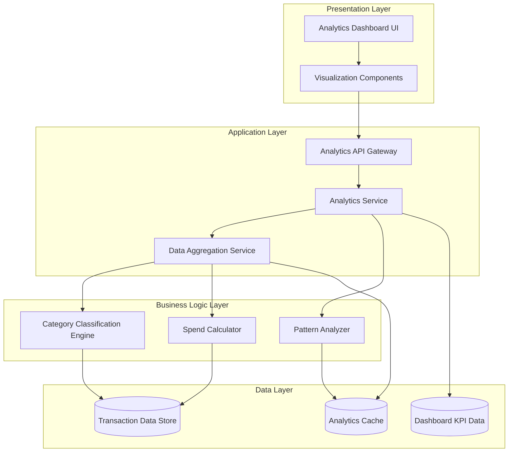
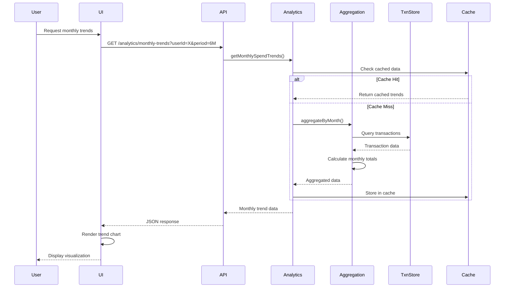
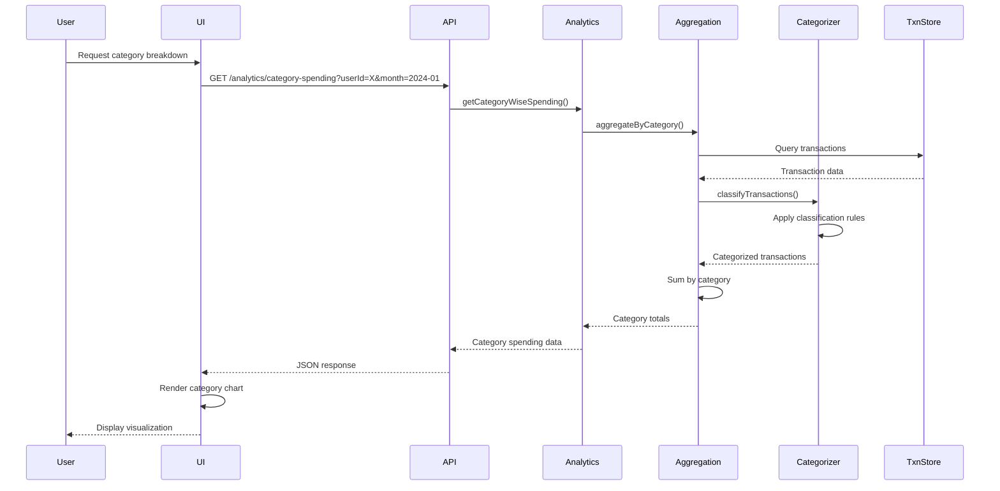

# High-Level Design Document

## Epic: PRD1-Analytics and Spending Insights

**Project Key:** QE  
**Epic Summary:** PRD1-Analytics and Spending Insights  
**Labels:** PRD1

---

## 1. Epic Overview

### 1.1 Description
Develop comprehensive analytics capabilities that provide users with deep insights into their spending patterns through interactive visualizations. This includes monthly spend trend analysis, card-wise spend breakdown, and category-wise spending analysis across predefined categories (Food & Dining, Fuel, Shopping, Travel, Entertainment, Utilities, Healthcare, Education, and Miscellaneous). Users will be able to identify spending patterns, compare performance across cards, and understand where their money is going.

### 1.2 User Value
Users can identify spending patterns, optimize card usage based on category benefits, and make informed decisions about budget allocation by understanding their spending behavior across time periods and categories.

### 1.3 Scope (High Level)
- Monthly Spend Trends visualization
- Card-wise Spend Analysis
- Category-wise Spending analytics
- Interactive visualizations and charts
- Transaction data aggregation by category
- Spending pattern identification across nine predefined categories

### 1.4 Out of Scope
- Real Bank Integration
- Predictive analytics or forecasting
- Custom category creation
- Budget setting and alerts
- Export or reporting functionality
- Payment-related features

---

## 2. Requirements

### 2.1 Functional Requirements

| Req ID | Requirement | Source | Status |
|--------|-------------|--------|--------|
| FR-001 | System shall provide monthly spend trend visualization | Epic Description | Derived |
| FR-002 | System shall provide card-wise spend analysis | Epic Description | Derived |
| FR-003 | System shall provide category-wise spending analytics | Epic Description | Derived |
| FR-004 | System shall support nine predefined spending categories: Food & Dining, Fuel, Shopping, Travel, Entertainment, Utilities, Healthcare, Education, and Miscellaneous | Epic Description | Derived |
| FR-005 | System shall aggregate transaction data by category | Epic Description | Derived |
| FR-006 | System shall enable spending pattern identification | Epic Description | Derived |
| FR-007 | System shall provide interactive visualizations and charts | Epic Description | Derived |
| FR-008 | System shall enable comparison of spending performance across cards | Epic Description | Derived |

### 2.2 Non-Functional Requirements

| NFR ID | Requirement | Category | Target | Status |
|--------|-------------|----------|--------|--------|
| NFR-001 | Interactive visualization performance with smooth rendering | Performance | To be defined | Not Verified |
| NFR-002 | Support for historical data analysis across multiple months | Scalability | To be defined | Not Verified |
| NFR-003 | Accurate data aggregation and categorization logic | Accuracy | 100% accuracy | Not Verified |

**Note:** Specific performance targets (e.g., rendering time < 2 seconds) and historical data retention periods need to be defined during detailed design phase.

### 2.3 Dependencies and Integrations

| Dependency ID | Component/System | Type | Description | Status |
|---------------|------------------|------|-------------|--------|
| DEP-001 | Transaction data store | Data Source | Source of transaction data for analytics | Assumed Available |
| DEP-002 | Category classification engine or rules | Service/Logic | Categorizes transactions into predefined categories | To be Designed |
| DEP-003 | Dashboard KPI data | Data Source | Provides context and drill-down capabilities | Assumed Available |

---

## 3. Architecture Overview

### 3.1 High-Level Architecture

The Analytics and Spending Insights feature follows a layered architecture pattern with clear separation between presentation, business logic, and data layers.



### 3.2 Architecture Principles
- **Separation of Concerns:** Clear boundaries between UI, business logic, and data layers
- **Scalability:** Caching layer to support historical data analysis
- **Performance:** Aggregation service to pre-compute spending metrics
- **Maintainability:** Modular design with independent services

---

## 4. Component Design

### 4.1 Analytics Dashboard UI
**Responsibility:** Render interactive visualizations and handle user interactions

**Key Features:**
- Monthly spend trend charts
- Card-wise comparison views
- Category breakdown visualizations
- Interactive filtering and drill-down

**Technology Assumptions:**
- Modern JavaScript framework (React/Angular/Vue)
- Charting library (D3.js/Chart.js/Recharts)

### 4.2 Analytics Service
**Responsibility:** Orchestrate analytics data retrieval and processing

**Key Operations:**
- `getMonthlySpendTrends(userId, startDate, endDate)`
- `getCardWiseAnalysis(userId, period)`
- `getCategoryWiseSpending(userId, period)`
- `getSpendingPatterns(userId, analysisType)`

**Inputs:** User ID, date range, filter criteria  
**Outputs:** Aggregated analytics data in JSON format

### 4.3 Data Aggregation Service
**Responsibility:** Aggregate transaction data by various dimensions

**Key Operations:**
- Aggregate by time period (monthly)
- Aggregate by card
- Aggregate by category
- Calculate totals, averages, and trends

**Processing Logic:**
- Query transaction data store
- Apply category classification
- Perform aggregation calculations
- Cache results for performance

### 4.4 Category Classification Engine
**Responsibility:** Classify transactions into predefined categories

**Predefined Categories:**
1. Food & Dining
2. Fuel
3. Shopping
4. Travel
5. Entertainment
6. Utilities
7. Healthcare
8. Education
9. Miscellaneous

**Classification Approach:**
- Rule-based classification (merchant codes, merchant names, transaction descriptions)
- Default to "Miscellaneous" for unclassified transactions

**Note:** Specific classification rules need to be defined during implementation.

### 4.5 Pattern Analyzer
**Responsibility:** Identify spending patterns and trends

**Pattern Types:**
- Month-over-month trends
- Category concentration
- Card usage patterns
- Spending velocity

**Note:** Predictive analytics is out of scope; only historical pattern identification is included.

---

## 5. Data Flow

### 5.1 Monthly Spend Trends Flow



### 5.2 Category-wise Spending Flow



---

## 6. APIs and Integrations

### 6.1 Analytics API Endpoints

#### 6.1.1 Get Monthly Spend Trends
```
GET /api/v1/analytics/monthly-trends

Query Parameters:
- userId: string (required)
- startDate: string (ISO 8601, optional, default: 6 months ago)
- endDate: string (ISO 8601, optional, default: current date)
- cardId: string (optional, filter by specific card)

Response:
{
  "userId": "string",
  "period": {
    "startDate": "2024-01-01",
    "endDate": "2024-06-30"
  },
  "trends": [
    {
      "month": "2024-01",
      "totalSpend": 15000.00,
      "transactionCount": 45
    }
  ]
}
```

#### 6.1.2 Get Card-wise Analysis
```
GET /api/v1/analytics/card-analysis

Query Parameters:
- userId: string (required)
- period: string (e.g., "1M", "3M", "6M", "1Y")

Response:
{
  "userId": "string",
  "period": "6M",
  "cards": [
    {
      "cardId": "string",
      "cardName": "string",
      "totalSpend": 45000.00,
      "transactionCount": 120,
      "percentageOfTotal": 60.5
    }
  ]
}
```

#### 6.1.3 Get Category-wise Spending
```
GET /api/v1/analytics/category-spending

Query Parameters:
- userId: string (required)
- month: string (YYYY-MM format, optional, default: current month)
- cardId: string (optional)

Response:
{
  "userId": "string",
  "month": "2024-06",
  "categories": [
    {
      "categoryName": "Food & Dining",
      "totalSpend": 8500.00,
      "transactionCount": 25,
      "percentageOfTotal": 28.3
    },
    {
      "categoryName": "Fuel",
      "totalSpend": 3200.00,
      "transactionCount": 8,
      "percentageOfTotal": 10.7
    }
  ],
  "totalSpend": 30000.00
}
```

### 6.2 Integration Requirements

#### 6.2.1 Transaction Data Store Integration
**Interface Type:** Database query or REST API  
**Data Required:**
- Transaction ID
- User ID
- Card ID
- Transaction date
- Amount
- Merchant name
- Merchant category code (if available)
- Transaction description

**Assumption:** Transaction data store is available and accessible with appropriate query performance.

#### 6.2.2 Dashboard KPI Data Integration
**Interface Type:** REST API or shared data access  
**Purpose:** Provide context for drill-down from dashboard KPIs to detailed analytics

**Assumption:** Dashboard KPI data structure and access patterns are defined.

---

## 7. Security Considerations

### 7.1 Authentication and Authorization
- **Requirement:** All analytics API endpoints must be authenticated
- **Authorization:** Users can only access their own analytics data
- **Implementation Approach:** JWT-based authentication with user-scoped access control

**Gap:** Specific authentication mechanism not defined in epic; needs clarification.

### 7.2 Data Privacy
- **Sensitive Data:** Transaction details, spending amounts, card information
- **Protection Measures:**
  - Encrypt data in transit (HTTPS/TLS)
  - Encrypt sensitive data at rest
  - Implement data access logging
  - Apply data retention policies

**Assumption:** Standard data protection practices will be applied.

### 7.3 Input Validation
- Validate all user inputs (date ranges, user IDs, filter parameters)
- Prevent SQL injection and other injection attacks
- Implement rate limiting to prevent abuse

---

## 8. Scalability Considerations

### 8.1 Data Volume
**Challenge:** Historical data analysis across multiple months for many users

**Design Approaches:**
- **Caching:** Cache aggregated results to reduce database load
- **Pre-aggregation:** Compute and store monthly aggregates during transaction processing
- **Pagination:** Implement pagination for large result sets
- **Indexing:** Ensure proper database indexes on userId, date, and cardId

**Assumption:** Transaction volume and user base size not specified; scalability targets need definition.

### 8.2 Performance Optimization
- **Target:** Smooth rendering of interactive visualizations (NFR-001)
- **Approaches:**
  - Lazy loading of visualization data
  - Client-side caching
  - Asynchronous data loading
  - Progressive rendering for large datasets

**Gap:** Specific performance targets (e.g., response time < 2 seconds) not defined.

### 8.3 Horizontal Scaling
- Analytics service should be stateless to enable horizontal scaling
- Cache layer should support distributed caching (e.g., Redis cluster)
- Database read replicas for analytics queries

---

## 9. Availability and Reliability

### 9.1 Availability Targets
**Gap:** No specific SLA or availability targets defined in epic.

**Recommendation:** Define availability requirements (e.g., 99.9% uptime) during detailed design.

### 9.2 Error Handling
- Graceful degradation if analytics data is temporarily unavailable
- User-friendly error messages
- Retry logic for transient failures
- Fallback to cached data when possible

### 9.3 Monitoring and Alerting
**Recommended Metrics:**
- API response times
- Cache hit rates
- Data aggregation processing times
- Error rates
- User engagement with analytics features

**Gap:** Monitoring requirements not specified in epic.

---

## 10. Assumptions

| ID | Assumption | Impact if Invalid | Mitigation |
|----|------------|-------------------|------------|
| A-001 | Transaction data store is available and queryable | High - Core functionality blocked | Verify data store availability and access patterns early |
| A-002 | Transaction data includes merchant information for categorization | Medium - Affects categorization accuracy | Define fallback categorization logic |
| A-003 | Dashboard KPI data integration is feasible | Low - Drill-down feature affected | Clarify integration requirements with dashboard team |
| A-004 | Users have at least one card with transaction history | Medium - Empty state handling needed | Design empty state UI and onboarding flow |
| A-005 | Historical data is retained for at least 12 months | Medium - Limits historical analysis | Confirm data retention policies |
| A-006 | Standard authentication/authorization mechanism exists | High - Security requirement | Clarify authentication approach early |
| A-007 | Category classification rules can be defined with reasonable accuracy | High - Core feature quality | Validate classification approach with sample data |
| A-008 | UI framework and charting library are already selected | Low - Technology choice | Confirm technology stack during sprint planning |

---

## 11. Dependencies

### 11.1 Internal Dependencies

| Dependency | Description | Owner | Status | Risk |
|------------|-------------|-------|--------|------|
| Transaction Data Store | Source of transaction data | Data Team | Assumed Available | Medium |
| Dashboard KPI System | Provides drill-down context | Dashboard Team | Assumed Available | Low |
| Authentication Service | User authentication and authorization | Security Team | Assumed Available | High |

### 11.2 External Dependencies

| Dependency | Description | Provider | Status | Risk |
|------------|-------------|----------|--------|------|
| Charting Library | Visualization components | Open Source / Vendor | To be Selected | Low |
| Caching Infrastructure | Redis or similar | Infrastructure Team | Assumed Available | Medium |

### 11.3 Dependency Risks
- **Transaction Data Store:** If schema or access patterns are incompatible, significant rework may be required
- **Category Classification:** Accuracy depends on quality of merchant data and classification rules
- **Performance:** Cache infrastructure must support required throughput

---

## 12. Risks and Mitigation

| Risk ID | Risk Description | Probability | Impact | Mitigation Strategy |
|---------|------------------|-------------|--------|---------------------|
| R-001 | Transaction data quality issues (missing/incorrect merchant info) | Medium | High | Implement robust categorization fallback logic; validate data quality early |
| R-002 | Performance degradation with large historical datasets | Medium | High | Implement caching and pre-aggregation; conduct performance testing |
| R-003 | Category classification accuracy below user expectations | Medium | Medium | Validate classification rules with sample data; plan for iterative improvement |
| R-004 | Visualization rendering performance issues on low-end devices | Low | Medium | Optimize client-side rendering; implement progressive loading |
| R-005 | Integration challenges with transaction data store | Low | High | Conduct early technical spike; validate data access patterns |
| R-006 | Scope creep (requests for custom categories, budgets, etc.) | High | Medium | Clearly communicate out-of-scope items; maintain product backlog |
| R-007 | Undefined authentication/authorization mechanism | Medium | High | Clarify security requirements in sprint 0 |
| R-008 | Insufficient historical data for meaningful analysis | Low | Medium | Design empty state UI; set user expectations |

---

## 13. Validation Report

### 13.1 Requirements Traceability

| Requirement ID | Requirement | Design Component | Status |
|----------------|-------------|------------------|--------|
| FR-001 | Monthly spend trend visualization | Analytics Service, UI Components | Covered |
| FR-002 | Card-wise spend analysis | Analytics Service, Card Analysis API | Covered |
| FR-003 | Category-wise spending analytics | Analytics Service, Category API | Covered |
| FR-004 | Nine predefined spending categories | Category Classification Engine | Covered |
| FR-005 | Transaction data aggregation by category | Data Aggregation Service | Covered |
| FR-006 | Spending pattern identification | Pattern Analyzer | Covered |
| FR-007 | Interactive visualizations and charts | Analytics Dashboard UI | Covered |
| FR-008 | Comparison across cards | Card Analysis API, UI Components | Covered |

**Coverage Status:** 8/8 functional requirements covered (100%)

### 13.2 NFR Validation

| NFR ID | Requirement | Design Approach | Validation Status | Gap |
|--------|-------------|-----------------|-------------------|-----|
| NFR-001 | Interactive visualization performance with smooth rendering | Caching, lazy loading, client-side optimization | Not Verified | Specific performance targets not defined |
| NFR-002 | Support for historical data analysis across multiple months | Caching layer, pre-aggregation, database indexing | Not Verified | Retention period not specified |
| NFR-003 | Accurate data aggregation and categorization logic | Category Classification Engine with rule-based approach | Not Verified | Classification rules not defined; accuracy target not quantified |

**NFR Coverage:** Design approaches identified for all 3 NFRs, but validation criteria need definition.

### 13.3 Design Gaps

| Gap ID | Gap Description | Severity | Recommendation |
|--------|-----------------|----------|----------------|
| GAP-001 | Performance targets not quantified (e.g., response time, rendering time) | High | Define specific performance SLAs (e.g., API response < 2s, UI render < 1s) |
| GAP-002 | Historical data retention period not specified | Medium | Define retention policy (recommend 12-24 months) |
| GAP-003 | Category classification rules not defined | High | Document classification rules with merchant codes and keywords |
| GAP-004 | Authentication and authorization mechanism not specified | High | Clarify authentication approach and implement user-scoped access control |
| GAP-005 | Empty state handling not addressed | Low | Design UI for users with no transaction history |
| GAP-006 | Error handling and fallback behavior not detailed | Medium | Define error scenarios and user-facing messages |
| GAP-007 | Monitoring and alerting requirements not specified | Medium | Define key metrics and alerting thresholds |
| GAP-008 | Data refresh frequency not defined | Medium | Specify how often analytics data should be updated (real-time, hourly, daily) |
| GAP-009 | Pagination strategy for large datasets not defined | Low | Define pagination approach for API responses |
| GAP-010 | Technology stack (UI framework, charting library) not specified | Low | Select and document technology choices |

### 13.4 Out-of-Scope Validation

The following items are explicitly out of scope and should not be included in this epic:
- ✓ Real Bank Integration
- ✓ Predictive analytics or forecasting
- ✓ Custom category creation
- ✓ Budget setting and alerts
- ✓ Export or reporting functionality
- ✓ Payment-related features

**Validation:** Design does not include any out-of-scope items.

### 13.5 Dependency Validation

| Dependency | Status | Validation |
|------------|--------|------------|
| Transaction data store | Assumed Available | Requires validation of schema and access patterns |
| Category classification engine or rules | To be Designed | Requires definition of classification rules |
| Dashboard KPI data | Assumed Available | Requires validation of integration approach |

**Recommendation:** Conduct technical spikes to validate all dependencies before implementation.

### 13.6 Recommendations

1. **High Priority:**
   - Define specific performance targets for NFR-001 (e.g., API response time < 2 seconds, UI rendering < 1 second)
   - Document category classification rules with merchant codes, keywords, and fallback logic
   - Clarify authentication and authorization mechanism
   - Validate transaction data store schema and access patterns

2. **Medium Priority:**
   - Define historical data retention policy (recommend 12-24 months)
   - Specify data refresh frequency for analytics
   - Define monitoring metrics and alerting thresholds
   - Document error handling scenarios and user-facing messages

3. **Low Priority:**
   - Select UI framework and charting library
   - Design empty state UI for users with no transaction history
   - Define pagination strategy for large datasets

4. **Risk Mitigation:**
   - Conduct early technical spike to validate transaction data quality
   - Perform load testing with realistic data volumes
   - Validate category classification accuracy with sample data
   - Implement feature flags for gradual rollout

---

## 14. Conclusion

This High-Level Design provides a comprehensive architecture for the Analytics and Spending Insights feature. The design covers all functional requirements and addresses the specified non-functional requirements with appropriate architectural patterns including caching, aggregation, and modular service design.

**Key Strengths:**
- Clear separation of concerns with layered architecture
- Scalable design with caching and pre-aggregation strategies
- Comprehensive API design for all analytics features
- Traceability from requirements to design components

**Critical Next Steps:**
1. Define and document category classification rules
2. Specify quantitative performance targets
3. Validate transaction data store integration
4. Clarify authentication and authorization approach
5. Conduct technical spikes for high-risk dependencies

**Design Confidence:** Medium-High
- All functional requirements are addressed
- Architecture is sound and scalable
- Multiple gaps require clarification before implementation
- Dependencies need validation

This HLD should be reviewed with stakeholders, and the identified gaps should be addressed during detailed design and sprint planning phases.

---

**Document Version:** 1.0  
**Last Updated:** 2024  
**Status:** Draft for Review