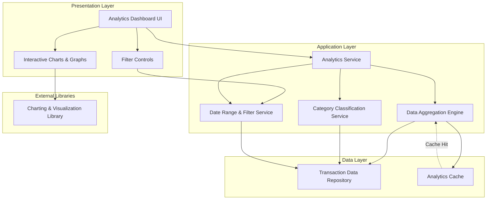
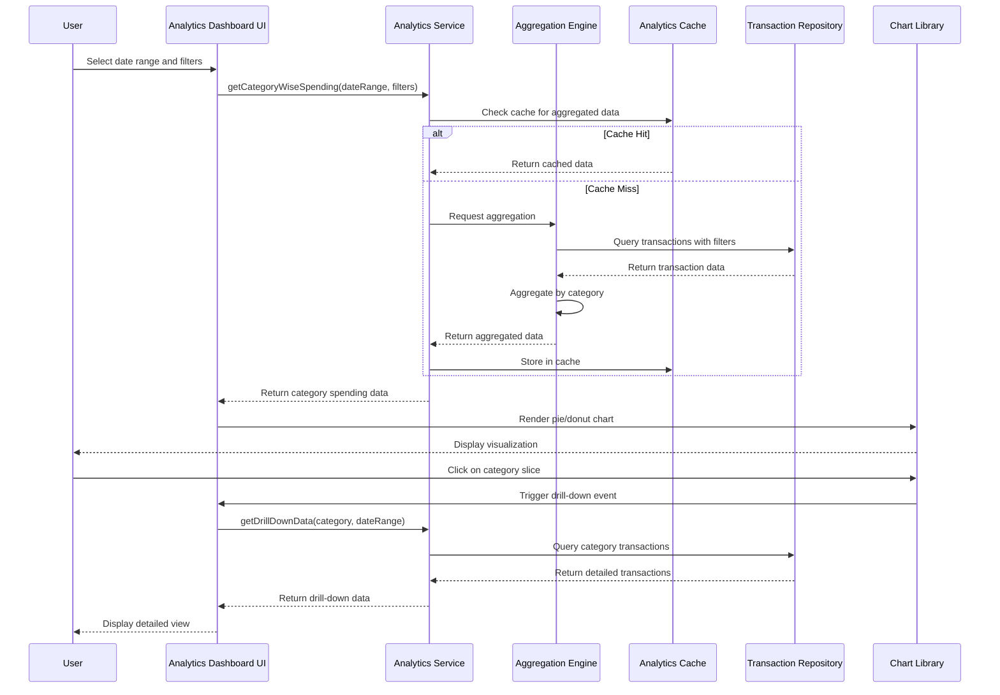
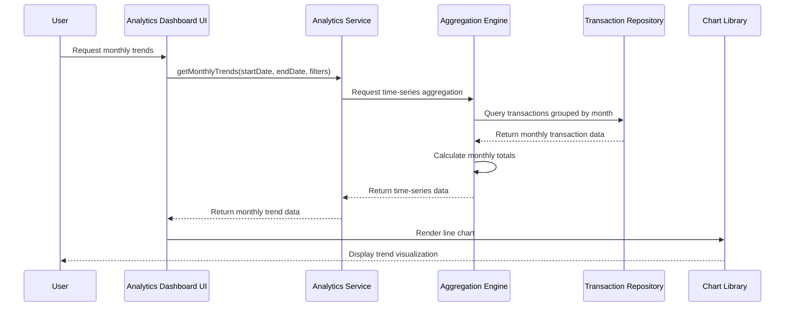
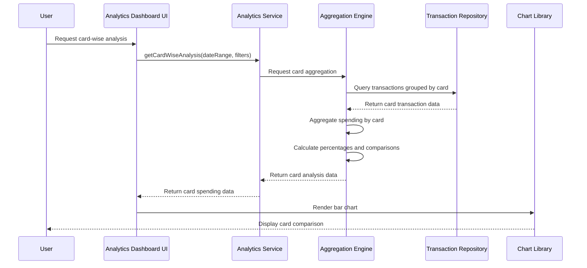

# High-Level Design: PRD1-Analytics and Spending Insights

## 1. Epic Overview

**Project Key:** QE  
**Epic Summary:** PRD1-Analytics and Spending Insights  
**Label:** PRD1  

### 1.1 Description

This epic covers the development of interactive analytics and visualization capabilities that enable users to understand their spending patterns across different categories and time periods. Users will be able to analyze their spending through category-wise breakdowns (Food & Dining, Fuel, Shopping, Travel, Entertainment, Utilities, Healthcare, Education, and Miscellaneous), view monthly spend trends, and perform card-wise spend analysis. The analytics module will provide actionable insights through intuitive charts, graphs, and visual representations that help users identify spending habits and opportunities for financial optimization.

### 1.2 User Value

Users can identify where their money is going, discover spending trends over time, and make data-driven decisions to optimize their credit card usage. The category-wise breakdown helps users understand their lifestyle expenses and adjust budgets accordingly. Card-wise analysis enables users to maximize rewards and benefits by using the right card for specific purchase categories. This transparency leads to better financial planning and control.

### 1.3 Scope (High Level)

- Interactive visualizations and charts
- Category-wise spending analysis (9 predefined categories)
- Monthly spend trends visualization
- Card-wise spend analysis and comparison
- Transaction history display
- Filtering and drill-down capabilities for detailed analysis

---

## 2. Requirements

### 2.1 Functional Requirements

| Requirement ID | Description | Priority |
|----------------|-------------|----------|
| FR-1 | System shall provide interactive visualizations and charts for spending data | High |
| FR-2 | System shall support category-wise spending analysis across 9 predefined categories (Food & Dining, Fuel, Shopping, Travel, Entertainment, Utilities, Healthcare, Education, Miscellaneous) | High |
| FR-3 | System shall display monthly spend trends visualization | High |
| FR-4 | System shall provide card-wise spend analysis and comparison | High |
| FR-5 | System shall display transaction history | Medium |
| FR-6 | System shall support filtering and drill-down capabilities for detailed analysis | High |
| FR-7 | System shall enable users to analyze spending patterns across different time periods | Medium |
| FR-8 | System shall provide actionable insights through intuitive charts and graphs | High |

### 2.2 Non-Functional Requirements (NFRs)

| NFR ID | Category | Requirement | Target Metric | Priority |
|--------|----------|-------------|---------------|----------|
| NFR-1 | Performance | Visualizations must render efficiently even with large transaction datasets | Minimum 12 months of data | High |
| NFR-2 | Performance | Interactive charts should respond to user interactions | Within 500ms | High |
| NFR-3 | Performance | Analytics engine must support filtering and aggregation operations without performance degradation | No degradation under normal load | High |
| NFR-4 | Usability | Charts and graphs must be responsive and adapt to different screen sizes | Maintain readability on all devices | High |
| NFR-5 | Scalability | System should handle growing transaction volumes efficiently | Support for future data growth | Medium |

### 2.3 Out of Scope

- Real bank integration
- Card payment processing
- Fund transfers
- Loan management
- Payment gateway integration
- Predictive analytics or AI-based spending recommendations

---

## 3. Architecture Overview

### 3.1 System Context

The Analytics and Spending Insights module is a visualization and analytics layer that sits on top of the transaction data repository. It aggregates, processes, and presents spending data through interactive visualizations to provide users with actionable insights.

### 3.2 High-Level Architecture Diagram



### 3.3 Architecture Principles

- **Separation of Concerns:** Clear separation between presentation, business logic, and data layers
- **Performance Optimization:** Caching strategy for frequently accessed aggregated data
- **Responsive Design:** Mobile-first approach for visualizations
- **Modularity:** Independent services for different analytics functions

---

## 4. Component Design

### 4.1 Analytics Dashboard UI

**Responsibility:** Provide the main user interface for viewing and interacting with spending analytics

**Key Features:**
- Display multiple visualization types (pie charts, bar charts, line graphs, tables)
- Provide filter controls for date range, categories, and cards
- Support drill-down interactions
- Responsive layout adaptation

**Technology Assumptions:**
- Modern JavaScript framework (React/Angular/Vue)
- Responsive CSS framework

### 4.2 Analytics Service

**Responsibility:** Orchestrate analytics operations and coordinate between UI and data layers

**Key Operations:**
- `getCategoryWiseSpending(dateRange, filters)` - Returns spending breakdown by category
- `getMonthlyTrends(startDate, endDate, filters)` - Returns monthly spending trends
- `getCardWiseAnalysis(dateRange, filters)` - Returns card-wise spending comparison
- `getTransactionHistory(filters, pagination)` - Returns filtered transaction list
- `getDrillDownData(category, dateRange)` - Returns detailed breakdown for specific category

**Performance Considerations:**
- Implement result caching for common queries
- Support pagination for large datasets
- Async processing for heavy aggregations

### 4.3 Data Aggregation Engine

**Responsibility:** Perform data aggregation, grouping, and statistical calculations

**Key Functions:**
- Aggregate transactions by category, card, and time period
- Calculate totals, averages, and percentages
- Generate time-series data for trend analysis
- Support dynamic filtering and re-aggregation

**Performance Strategy:**
- Pre-compute common aggregations
- Utilize database-level aggregation where possible
- Implement incremental aggregation for new transactions

### 4.4 Category Classification Service

**Responsibility:** Map transactions to predefined spending categories

**Categories:**
1. Food & Dining
2. Fuel
3. Shopping
4. Travel
5. Entertainment
6. Utilities
7. Healthcare
8. Education
9. Miscellaneous

**Classification Logic:**
- Rule-based classification using merchant codes or transaction descriptions
- Fallback to Miscellaneous for unclassified transactions

### 4.5 Date Range & Filter Service

**Responsibility:** Handle date range selection and filter application

**Supported Filters:**
- Date range (custom, last 30 days, last 3 months, last 6 months, last 12 months)
- Category filter (single or multiple)
- Card filter (single or multiple)
- Amount range filter

### 4.6 Charting & Visualization Library

**Responsibility:** Render interactive charts and graphs

**Chart Types Required:**
- Pie/Donut charts for category distribution
- Bar charts for card-wise comparison
- Line charts for monthly trends
- Data tables for transaction history

**Library Assumptions:**
- Use established charting library (e.g., Chart.js, D3.js, Recharts, ApexCharts)
- Support responsive rendering
- Provide interaction callbacks

---

## 5. Data Flow

### 5.1 Category-Wise Spending Analysis Flow



### 5.2 Monthly Trends Visualization Flow



### 5.3 Card-Wise Analysis Flow



---

## 6. APIs and Integrations

### 6.1 Internal APIs

#### 6.1.1 Analytics Service API

**Base Path:** `/api/analytics`

| Endpoint | Method | Description | Request Parameters | Response |
|----------|--------|-------------|-------------------|----------|
| `/category-spending` | GET | Get category-wise spending breakdown | `startDate`, `endDate`, `cardIds[]`, `categoryIds[]` | Category spending data with amounts and percentages |
| `/monthly-trends` | GET | Get monthly spending trends | `startDate`, `endDate`, `cardIds[]`, `categoryIds[]` | Time-series data with monthly totals |
| `/card-analysis` | GET | Get card-wise spending analysis | `startDate`, `endDate`, `categoryIds[]` | Card spending data with comparisons |
| `/transactions` | GET | Get filtered transaction history | `startDate`, `endDate`, `cardIds[]`, `categoryIds[]`, `page`, `pageSize` | Paginated transaction list |
| `/drill-down/{category}` | GET | Get detailed breakdown for category | `categoryId`, `startDate`, `endDate`, `cardIds[]` | Detailed transaction list for category |

**Response Format Example:**

```json
{
  "success": true,
  "data": {
    "categories": [
      {
        "categoryId": "food_dining",
        "categoryName": "Food & Dining",
        "totalAmount": 15420.50,
        "percentage": 28.5,
        "transactionCount": 87
      }
    ],
    "totalSpending": 54120.75,
    "dateRange": {
      "startDate": "2024-01-01",
      "endDate": "2024-12-31"
    }
  },
  "metadata": {
    "generatedAt": "2024-12-20T10:30:00Z",
    "cached": false
  }
}
```

### 6.2 External Dependencies

| Dependency | Purpose | Integration Type | Assumptions |
|------------|---------|------------------|-------------|
| Transaction Data Repository | Source of transaction data | Database/API | Provides structured transaction data with required fields |
| Data Analytics and Aggregation Service | Perform complex aggregations | Internal Service | Supports SQL-like aggregation operations |
| Charting and Visualization Library | Render charts | JavaScript Library | Supports required chart types and interactions |
| Category Classification Engine/Service | Classify transactions into categories | Internal Service/Rule Engine | Pre-configured with classification rules |
| Date Range and Filtering Service | Handle date and filter operations | Internal Service | Provides standardized filtering capabilities |

---

## 7. Security Considerations

### 7.1 Authentication & Authorization

**Requirement:** Users must be authenticated to access analytics data

**Implementation Assumptions:**
- Session-based or token-based authentication
- Users can only view analytics for their own transactions
- Role-based access control if multiple user types exist

**Design Gaps:**
- Specific authentication mechanism not defined in epic
- Authorization rules need to be clarified

### 7.2 Data Privacy

**Considerations:**
- Transaction data contains sensitive financial information
- Analytics data should be user-specific and isolated
- No cross-user data leakage in aggregations

**Recommendations:**
- Implement user-level data filtering at the service layer
- Audit logging for analytics data access
- Encrypt sensitive data in transit (HTTPS)

### 7.3 Input Validation

**Requirements:**
- Validate date ranges to prevent invalid queries
- Sanitize filter parameters to prevent injection attacks
- Limit query complexity to prevent DoS

---

## 8. Scalability Considerations

### 8.1 Data Volume Scalability

**Challenge:** Handle growing transaction volumes over time

**Strategies:**
- Implement data archival for old transactions
- Use database indexing on frequently queried fields (date, category, card)
- Consider data partitioning by date ranges

**NFR Alignment:** NFR-5 requires support for future data growth

### 8.2 Concurrent User Scalability

**Challenge:** Support multiple users accessing analytics simultaneously

**Strategies:**
- Implement caching layer for common queries
- Use read replicas for transaction database
- Load balancing for analytics service instances

**Assumptions:**
- Expected concurrent user load not specified in epic
- Scalability targets need to be defined

### 8.3 Performance Optimization

**Strategies:**
- Pre-compute daily/monthly aggregations
- Implement lazy loading for detailed drill-downs
- Use pagination for transaction history
- Client-side caching of visualization data

**NFR Alignment:**
- NFR-1: Support minimum 12 months of data
- NFR-2: 500ms response time for interactions
- NFR-3: No performance degradation under filtering

---

## 9. Availability and Reliability

### 9.1 Availability Requirements

**Assumptions:**
- Analytics is a non-critical feature (compared to payment processing)
- Target availability not specified in epic

**Recommendations:**
- Define target availability SLA (e.g., 99.5%)
- Implement graceful degradation if analytics service is unavailable
- Provide cached data as fallback

### 9.2 Reliability Considerations

**Error Handling:**
- Handle database connection failures gracefully
- Provide meaningful error messages to users
- Implement retry logic for transient failures

**Data Consistency:**
- Analytics data should reflect latest transactions within acceptable delay
- Define acceptable data freshness (e.g., near real-time vs. hourly updates)

---

## 10. Assumptions

| ID | Assumption | Impact | Validation Needed |
|----|------------|--------|-------------------|
| A-1 | Transaction data repository already exists with required transaction fields | High | Verify schema and data availability |
| A-2 | Transactions are pre-classified into categories or classification rules exist | High | Confirm classification mechanism |
| A-3 | Users have at least 12 months of transaction history for meaningful analytics | Medium | Verify data retention policy |
| A-4 | Modern web browsers with JavaScript support | Medium | Define minimum browser requirements |
| A-5 | Authentication and authorization mechanisms exist in the platform | High | Confirm integration approach |
| A-6 | Charting library supports all required chart types and interactions | Medium | Evaluate and select specific library |
| A-7 | Database supports efficient aggregation queries | High | Verify database capabilities |
| A-8 | Users access analytics primarily through web interface | Medium | Clarify mobile app requirements |
| A-9 | Real-time analytics not required; near real-time acceptable | Medium | Confirm data freshness requirements |
| A-10 | Single currency for all transactions | Low | Clarify multi-currency support |

---

## 11. Dependencies

### 11.1 Technical Dependencies

| Dependency | Type | Status | Risk |
|------------|------|--------|------|
| Transaction Data Repository | Data Source | Assumed Available | High |
| Data Analytics and Aggregation Service | Service | Assumed Available | High |
| Charting and Visualization Library | Library | To Be Selected | Medium |
| Category Classification Engine or Service | Service | Assumed Available | High |
| Date Range and Filtering Service | Service | Assumed Available | Medium |

### 11.2 Functional Dependencies

- Transaction data must be available before analytics can be generated
- Category classification must be completed before category-wise analysis
- User authentication must be in place before analytics access

### 11.3 Dependency Risks

**Risk:** Transaction data repository schema may not contain all required fields
- **Mitigation:** Validate schema early and request enhancements if needed

**Risk:** Category classification service may not exist
- **Mitigation:** Implement basic rule-based classification within analytics module

**Risk:** Aggregation service performance may not meet NFR-2 (500ms response)
- **Mitigation:** Implement caching and pre-computation strategies

---

## 12. Risks and Mitigation

| Risk ID | Risk Description | Probability | Impact | Mitigation Strategy |
|---------|-----------------|-------------|--------|---------------------|
| R-1 | Performance degradation with large datasets (>12 months) | Medium | High | Implement aggressive caching, data pagination, and pre-computed aggregations |
| R-2 | Charting library may not support all required interactions | Low | Medium | Evaluate multiple libraries early; have fallback options |
| R-3 | Transaction data may be incomplete or inconsistent | Medium | High | Implement data validation and handle missing data gracefully |
| R-4 | 500ms response time target may not be achievable for complex queries | Medium | High | Implement query optimization, caching, and async loading |
| R-5 | Category classification accuracy may be low | Medium | Medium | Allow manual category correction; improve rules iteratively |
| R-6 | Responsive design may compromise chart readability on small screens | Low | Medium | Design mobile-first; test on multiple devices |
| R-7 | Database aggregation queries may lock tables and impact performance | Low | High | Use read replicas; optimize query patterns |
| R-8 | User expectations may exceed defined scope (e.g., predictive analytics) | Medium | Low | Clear communication of scope; document future enhancements |

---

## 13. Design Gaps and Open Questions

### 13.1 Design Gaps

| Gap ID | Description | Impact | Recommendation |
|--------|-------------|--------|----------------|
| DG-1 | Authentication and authorization mechanism not specified | High | Define authentication approach and user access controls |
| DG-2 | Specific charting library not identified | Medium | Evaluate and select library based on requirements |
| DG-3 | Data freshness requirements not defined | Medium | Define acceptable delay between transaction and analytics visibility |
| DG-4 | Concurrent user load and scalability targets not specified | Medium | Define expected user load and performance benchmarks |
| DG-5 | Error handling and fallback behavior not detailed | Medium | Define error scenarios and user experience |
| DG-6 | Mobile app requirements not clarified | Low | Confirm if mobile native app support is needed |
| DG-7 | Multi-currency support not addressed | Low | Clarify if multi-currency transactions are in scope |
| DG-8 | Export functionality not mentioned | Low | Determine if users need to export analytics data |
| DG-9 | Notification/alerting for spending patterns not defined | Low | Consider future enhancement for spending alerts |
| DG-10 | Accessibility requirements not specified | Medium | Define WCAG compliance requirements |

### 13.2 Open Questions

1. **Q1:** What is the expected concurrent user load for the analytics module?
   - **Impact:** Affects caching strategy and infrastructure sizing

2. **Q2:** Should analytics data be available in real-time or is a delay acceptable?
   - **Impact:** Affects architecture complexity and caching strategy

3. **Q3:** Are there specific accessibility (WCAG) requirements for visualizations?
   - **Impact:** Affects chart library selection and design

4. **Q4:** Should users be able to export analytics data (PDF, CSV)?
   - **Impact:** Requires additional export functionality

5. **Q5:** What is the data retention policy for transactions?
   - **Impact:** Affects available historical data for analytics

6. **Q6:** Should the system support custom date ranges or only predefined ranges?
   - **Impact:** Affects UI design and validation logic

7. **Q7:** Are there any compliance requirements (PCI-DSS, GDPR) for analytics data?
   - **Impact:** Affects security and data handling design

8. **Q8:** Should analytics support comparison between different time periods?
   - **Impact:** Requires additional aggregation logic

9. **Q9:** What level of drill-down detail is required (transaction level or summary level)?
   - **Impact:** Affects data retrieval and UI design

10. **Q10:** Should the system support saved filters or favorite views?
    - **Impact:** Requires user preference storage

---

# Validation Report

## 1. Requirements Traceability Matrix

| Requirement ID | Requirement Description | Design Component | Coverage Status | Notes |
|----------------|------------------------|------------------|-----------------|-------|
| FR-1 | Interactive visualizations and charts | Analytics Dashboard UI + Charting Library | Covered | Multiple chart types designed |
| FR-2 | Category-wise spending analysis (9 categories) | Category Classification Service + Analytics Service | Covered | All 9 categories defined |
| FR-3 | Monthly spend trends visualization | Analytics Service + Aggregation Engine | Covered | Time-series aggregation designed |
| FR-4 | Card-wise spend analysis and comparison | Analytics Service + Aggregation Engine | Covered | Card aggregation logic defined |
| FR-5 | Transaction history display | Analytics Service API | Covered | Transaction endpoint with pagination |
| FR-6 | Filtering and drill-down capabilities | Filter Service + Analytics Service | Covered | Filter parameters and drill-down flow designed |
| FR-7 | Analyze spending patterns across time periods | Analytics Service + Aggregation Engine | Covered | Date range filtering supported |
| FR-8 | Actionable insights through intuitive charts | Analytics Dashboard UI + Charting Library | Covered | Multiple visualization types designed |

**Functional Requirements Coverage: 8/8 (100%)**

## 2. Non-Functional Requirements Validation

| NFR ID | NFR Description | Target | Design Strategy | Validation Status | Gap/Risk |
|--------|----------------|--------|-----------------|-------------------|----------|
| NFR-1 | Render with large datasets (min 12 months) | 12 months data | Caching, pagination, pre-computation | Addressed | Requires performance testing |
| NFR-2 | Interactive chart response time | <500ms | Caching, client-side rendering, optimized queries | Addressed | May require optimization based on testing |
| NFR-3 | No performance degradation with filtering | No degradation | Indexed queries, efficient aggregation | Addressed | Database indexing required |
| NFR-4 | Responsive charts on all screen sizes | Maintain readability | Responsive charting library, mobile-first design | Addressed | Requires cross-device testing |
| NFR-5 | Support future data growth | Scalable | Data partitioning, archival strategy | Partially Addressed | Specific scalability targets not defined |

**NFR Coverage: 5/5 (100% addressed, with validation requirements)**

## 3. Dependency Validation

| Dependency | Required By | Availability Status | Risk Level | Mitigation |
|------------|-------------|---------------------|------------|------------|
| Transaction Data Repository | All components | Assumed Available | High | Validate schema and data availability early |
| Data Analytics and Aggregation Service | Analytics Service | Assumed Available | High | Verify performance capabilities |
| Charting and Visualization Library | Analytics Dashboard UI | To Be Selected | Medium | Evaluate options early in implementation |
| Category Classification Engine/Service | Category Classification Service | Assumed Available | High | Implement fallback classification if unavailable |
| Date Range and Filtering Service | Filter Service | Assumed Available | Medium | Can be implemented within analytics module if needed |

**Dependency Risk:** High - Multiple critical dependencies assumed but not verified

## 4. Out-of-Scope Items (Confirmed)

- ✓ Real bank integration - Confirmed out of scope
- ✓ Card payment processing - Confirmed out of scope
- ✓ Fund transfers - Confirmed out of scope
- ✓ Loan management - Confirmed out of scope
- ✓ Payment gateway integration - Confirmed out of scope
- ✓ Predictive analytics or AI-based spending recommendations - Confirmed out of scope

## 5. Design Completeness Assessment

| Design Area | Completeness | Confidence Level | Comments |
|-------------|--------------|------------------|----------|
| Functional Design | 90% | High | All functional requirements addressed |
| Architecture Design | 80% | Medium | High-level architecture defined; detailed component design needs validation |
| Data Flow Design | 85% | High | Key flows documented; edge cases need clarification |
| API Design | 75% | Medium | Endpoints defined; detailed contracts need refinement |
| Security Design | 60% | Low | High-level considerations only; detailed security design needed |
| Performance Design | 75% | Medium | Strategies defined; requires validation through testing |
| Scalability Design | 70% | Medium | Approaches identified; specific targets needed |
| UI/UX Design | 50% | Low | Functional requirements clear; detailed UI design not in scope of HLD |

**Overall Design Completeness: 73%**

## 6. Critical Gaps Requiring Resolution

### High Priority Gaps

1. **Authentication/Authorization Mechanism** (DG-1)
   - **Impact:** Cannot implement secure access without this
   - **Action:** Define authentication approach before implementation

2. **Transaction Data Schema Validation** (Dependency Risk)
   - **Impact:** May require schema changes or data transformation
   - **Action:** Validate transaction data structure immediately

3. **Performance Testing Strategy** (NFR-2, NFR-3)
   - **Impact:** Cannot validate 500ms response time without testing
   - **Action:** Define performance test scenarios and benchmarks

### Medium Priority Gaps

4. **Charting Library Selection** (DG-2)
   - **Impact:** Affects development timeline and capabilities
   - **Action:** Evaluate and select library in design phase

5. **Data Freshness Requirements** (DG-3)
   - **Impact:** Affects caching strategy and user expectations
   - **Action:** Define acceptable data latency

6. **Scalability Targets** (DG-4)
   - **Impact:** Affects infrastructure sizing and architecture decisions
   - **Action:** Define expected user load and growth projections

## 7. Recommendations

### 7.1 Immediate Actions

1. **Validate Dependencies:** Confirm availability and capabilities of all dependent services
2. **Define Security Requirements:** Specify authentication, authorization, and data protection mechanisms
3. **Select Charting Library:** Evaluate options and select library that meets all requirements
4. **Performance Baseline:** Establish performance testing approach and success criteria

### 7.2 Design Enhancements

1. **Implement Comprehensive Caching Strategy:** Multi-level caching (client, application, database) to meet NFR-2
2. **Add Export Functionality:** Consider adding CSV/PDF export for user convenience
3. **Implement Progressive Loading:** Load summary data first, then detailed data on demand
4. **Add Comparison Features:** Allow users to compare spending across different time periods

### 7.3 Future Considerations

1. **Predictive Analytics:** While out of scope now, design should allow for future integration
2. **Spending Alerts:** Consider notification system for unusual spending patterns
3. **Budget Tracking:** Integration with budget management features
4. **Custom Categories:** Allow users to create custom spending categories

## 8. Validation Summary

### Coverage Status
- **Functional Requirements:** ✅ 100% Covered (8/8)
- **Non-Functional Requirements:** ✅ 100% Addressed (5/5, pending validation)
- **Dependencies:** ⚠️ All identified, availability to be confirmed
- **Out-of-Scope:** ✅ Clearly documented (6 items)

### Design Confidence
- **High Confidence Areas:** Functional design, data flows, component responsibilities
- **Medium Confidence Areas:** Architecture scalability, API contracts, performance strategies
- **Low Confidence Areas:** Security implementation, UI/UX details, dependency availability

### Readiness Assessment

**Overall Readiness for Implementation: 75%**

**Blockers:**
- Authentication/authorization mechanism undefined
- Transaction data schema not validated
- Dependent services availability not confirmed

**Recommendations:**
- Resolve high-priority gaps before starting implementation
- Conduct architecture review with stakeholders
- Validate all assumptions through technical spikes
- Define detailed acceptance criteria for NFRs

---

## Document Control

**Document Version:** 1.0  
**Created Date:** 2024-12-20  
**Epic Reference:** QE - PRD1-Analytics and Spending Insights  
**Status:** Draft for Review  

**Revision History:**

| Version | Date | Author | Changes |
|---------|------|--------|----------|
| 1.0 | 2024-12-20 | HLD Generation Agent | Initial HLD document created |

**Approval:**

| Role | Name | Signature | Date |
|------|------|-----------|------|
| Product Owner | | | |
| Technical Architect | | | |
| Engineering Lead | | | |

---

**End of Document**