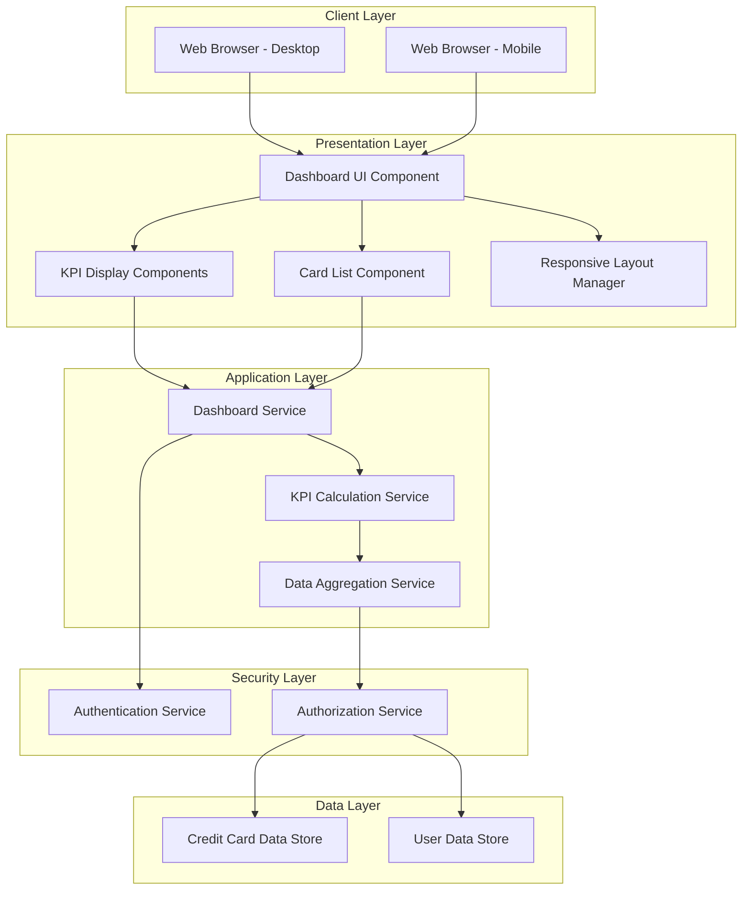
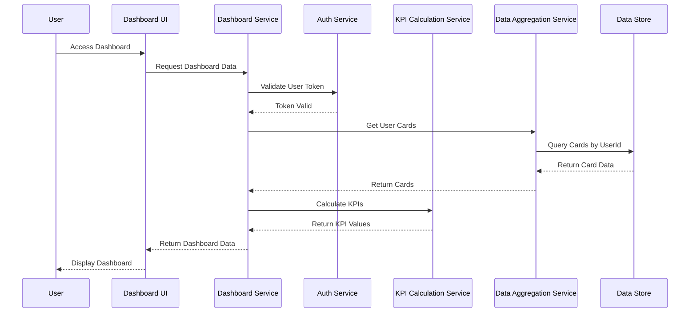
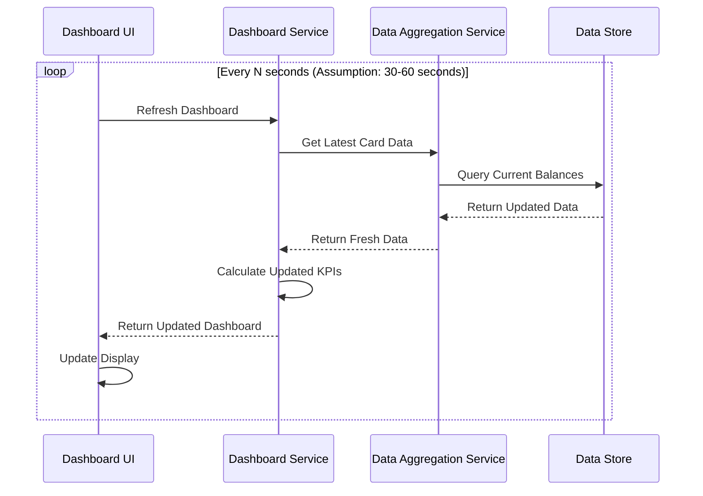

# High-Level Design Document
## PRD1-Dashboard and KPI Monitoring

**Project Key:** QE  
**Epic Label:** PRD1  
**Document Version:** 1.0  
**Last Updated:** 2024

---

## 1. Executive Summary

### 1.1 Epic Overview
This High-Level Design document describes the architecture and design approach for building a modern, responsive Credit Card Analysis Dashboard. The dashboard provides users with a consolidated view of all their credit cards and key performance indicators (KPIs), enabling them to monitor their credit card portfolio from a single unified interface.

### 1.2 Business Value
Users gain immediate visibility into their overall credit card health and financial position across all cards, enabling better financial decision-making and spending awareness without switching between multiple card portals or statements.

### 1.3 Key Features
- Dashboard KPIs (Monthly Spend, Total Credit Limit, Available Credit, Outstanding Amount)
- Multiple Credit Cards view
- Consolidated card portfolio interface
- Responsive layouts for desktop and mobile devices

---

## 2. Requirements Analysis

### 2.1 Functional Requirements

| Req ID | Requirement | Source | Priority |
|--------|-------------|--------|----------|
| FR-001 | Display Monthly Spend KPI across all credit cards | Epic Description | High |
| FR-002 | Display Total Credit Limit KPI across all credit cards | Epic Description | High |
| FR-003 | Display Available Credit KPI across all credit cards | Epic Description | High |
| FR-004 | Display Outstanding Amount KPI across all credit cards | Epic Description | High |
| FR-005 | Provide consolidated view of multiple credit cards | Epic Description | High |
| FR-006 | Support responsive layouts for desktop viewports | Epic Description | High |
| FR-007 | Support responsive layouts for mobile viewports | Epic Description | High |

### 2.2 Non-Functional Requirements

| NFR ID | Requirement | Category | Target Metric | Validation Status |
|--------|-------------|----------|---------------|-------------------|
| NFR-001 | Responsive design supporting desktop and mobile viewports | Usability | Support viewport widths from 320px to 1920px+ | To Be Validated |
| NFR-002 | Real-time data refresh for accurate KPI display | Performance | Data refresh within 2-3 seconds | To Be Validated |
| NFR-003 | Performance optimization for dashboard load times with multiple cards | Performance | Initial load < 3 seconds for up to 10 cards | To Be Validated |

### 2.3 Dependencies and Integrations

| Dep ID | Dependency | Type | Status | Notes |
|--------|------------|------|--------|-------|
| DEP-001 | Credit card data source (mock or internal data store) | Data Source | Required | Mock data acceptable for initial implementation |
| DEP-002 | User authentication and authorization system | Security | Required | Must validate user identity before displaying card data |

### 2.4 Out of Scope
The following items are explicitly excluded from this epic:
- Real Bank Integration
- Card Payments
- Fund Transfers
- Loans
- Payment Gateway Integration
- Transaction-level details on dashboard

---

## 3. Architecture Overview

### 3.1 High-Level Architecture



### 3.2 Architecture Principles
- **Separation of Concerns:** Clear separation between presentation, business logic, and data layers
- **Responsive Design:** Mobile-first approach with progressive enhancement for larger screens
- **Security by Design:** Authentication and authorization enforced at all layers
- **Performance Optimization:** Efficient data aggregation and caching strategies
- **Scalability:** Stateless services to support horizontal scaling

---

## 4. Component Design

### 4.1 Presentation Layer Components

#### 4.1.1 Dashboard UI Component
**Responsibility:** Main container for the dashboard interface

**Key Features:**
- Orchestrates layout of KPI widgets and card list
- Manages responsive breakpoints
- Handles data refresh triggers

**Technology Assumption:** Modern JavaScript framework (React/Vue/Angular)

#### 4.1.2 KPI Display Components
**Responsibility:** Render individual KPI metrics

**KPI Widgets:**
- Monthly Spend Widget
- Total Credit Limit Widget
- Available Credit Widget
- Outstanding Amount Widget

**Features:**
- Visual indicators (icons, colors)
- Trend indicators (if historical data available)
- Responsive sizing

#### 4.1.3 Card List Component
**Responsibility:** Display consolidated view of all credit cards

**Features:**
- Card summary information
- Individual card metrics
- Card status indicators

#### 4.1.4 Responsive Layout Manager
**Responsibility:** Manage layout adaptation across devices

**Breakpoints (Assumption):**
- Mobile: 320px - 767px
- Tablet: 768px - 1023px
- Desktop: 1024px+

### 4.2 Application Layer Components

#### 4.2.1 Dashboard Service
**Responsibility:** Coordinate dashboard data retrieval and business logic

**Key Operations:**
- `getDashboardData(userId): DashboardData`
- `refreshDashboard(userId): DashboardData`
- `validateUserAccess(userId): boolean`

#### 4.2.2 KPI Calculation Service
**Responsibility:** Calculate aggregate KPIs from card data

**Key Operations:**
- `calculateMonthlySpend(cards[]): number`
- `calculateTotalCreditLimit(cards[]): number`
- `calculateAvailableCredit(cards[]): number`
- `calculateOutstandingAmount(cards[]): number`

**Calculation Logic (Assumptions):**
- Monthly Spend: Sum of current month transactions across all cards
- Total Credit Limit: Sum of credit limits across all cards
- Available Credit: Total Credit Limit - Outstanding Amount
- Outstanding Amount: Sum of unpaid balances across all cards

#### 4.2.3 Data Aggregation Service
**Responsibility:** Retrieve and aggregate card data from data sources

**Key Operations:**
- `getUserCards(userId): Card[]`
- `getCardTransactions(cardId, dateRange): Transaction[]`
- `getCardBalances(cardId): Balance`

### 4.3 Security Layer Components

#### 4.3.1 Authentication Service
**Responsibility:** Verify user identity

**Key Operations:**
- `authenticateUser(credentials): AuthToken`
- `validateToken(token): boolean`
- `refreshToken(token): AuthToken`

**Note:** Implementation details depend on existing authentication system (DEP-002)

#### 4.3.2 Authorization Service
**Responsibility:** Verify user access to credit card data

**Key Operations:**
- `authorizeCardAccess(userId, cardId): boolean`
- `getUserPermissions(userId): Permission[]`

### 4.4 Data Layer Components

#### 4.4.1 Credit Card Data Store
**Responsibility:** Persist and retrieve credit card information

**Data Entities (Assumed Schema):**

**Card Entity:**
```json
{
  "cardId": "string",
  "userId": "string",
  "cardNumber": "string (masked)",
  "cardType": "string",
  "creditLimit": "number",
  "currentBalance": "number",
  "availableCredit": "number",
  "status": "string",
  "lastUpdated": "timestamp"
}
```

**Transaction Entity (for Monthly Spend calculation):**
```json
{
  "transactionId": "string",
  "cardId": "string",
  "amount": "number",
  "transactionDate": "timestamp",
  "category": "string",
  "description": "string"
}
```

#### 4.4.2 User Data Store
**Responsibility:** Store user profile and authentication data

**Note:** Depends on existing user authentication system (DEP-002)

---

## 5. Data Flow

### 5.1 Dashboard Load Flow



### 5.2 Real-Time Data Refresh Flow



### 5.3 Data Processing Pipeline

1. **Authentication:** User token validated
2. **Authorization:** User access to cards verified
3. **Data Retrieval:** Card data fetched from data store
4. **Aggregation:** Card data consolidated
5. **Calculation:** KPIs computed from aggregated data
6. **Transformation:** Data formatted for UI presentation
7. **Rendering:** Dashboard displayed to user

---

## 6. API Specifications

### 6.1 Dashboard API

#### Get Dashboard Data
```
GET /api/v1/dashboard

Headers:
  Authorization: Bearer {token}

Response: 200 OK
{
  "userId": "string",
  "kpis": {
    "monthlySpend": {
      "value": number,
      "currency": "string",
      "period": "string"
    },
    "totalCreditLimit": {
      "value": number,
      "currency": "string"
    },
    "availableCredit": {
      "value": number,
      "currency": "string"
    },
    "outstandingAmount": {
      "value": number,
      "currency": "string"
    }
  },
  "cards": [
    {
      "cardId": "string",
      "cardNumber": "string (masked)",
      "cardType": "string",
      "creditLimit": number,
      "currentBalance": number,
      "availableCredit": number,
      "status": "string"
    }
  ],
  "lastUpdated": "timestamp"
}
```

#### Refresh Dashboard
```
POST /api/v1/dashboard/refresh

Headers:
  Authorization: Bearer {token}

Response: 200 OK
{
  "status": "success",
  "data": { /* Same as GET /api/v1/dashboard */ }
}
```

### 6.2 Integration Points

| Integration | Type | Purpose | Status |
|-------------|------|---------|--------|
| Credit Card Data Source | Internal/Mock | Retrieve card data | Required - DEP-001 |
| Authentication System | Internal | User authentication | Required - DEP-002 |
| Authorization System | Internal | Access control | Required - DEP-002 |

---

## 7. Security Design

### 7.1 Authentication
- **Mechanism:** Token-based authentication (JWT assumed)
- **Token Validation:** All API requests must include valid authentication token
- **Token Expiry:** Tokens should have reasonable expiry time with refresh mechanism

### 7.2 Authorization
- **Principle:** Users can only access their own credit card data
- **Enforcement:** Authorization checks at service layer before data retrieval
- **Card Ownership Validation:** Verify userId matches card ownership before returning data

### 7.3 Data Security
- **Card Number Masking:** Display only last 4 digits (e.g., **** **** **** 1234)
- **Sensitive Data:** Never log or expose full card numbers
- **Transport Security:** HTTPS/TLS for all communications (assumption)
- **Data at Rest:** Encryption of sensitive data in data store (assumption)

### 7.4 Security Considerations
- **Session Management:** Implement session timeout for inactive users
- **Rate Limiting:** Protect APIs from abuse (assumption)
- **Input Validation:** Validate all user inputs
- **Error Handling:** Avoid exposing sensitive information in error messages

---

## 8. Scalability Design

### 8.1 Scalability Requirements
- **Assumption:** Support for 10,000+ concurrent users
- **Assumption:** Average 5 cards per user
- **Assumption:** Dashboard refresh every 30-60 seconds

### 8.2 Scalability Strategies

#### 8.2.1 Horizontal Scaling
- **Stateless Services:** All application services designed to be stateless
- **Load Balancing:** Distribute requests across multiple service instances
- **Auto-scaling:** Scale service instances based on load metrics

#### 8.2.2 Data Layer Scaling
- **Read Replicas:** Use read replicas for dashboard queries
- **Caching:** Implement caching layer for frequently accessed data
- **Cache Strategy:** Cache dashboard data with TTL of 30-60 seconds

#### 8.2.3 Performance Optimization
- **Data Aggregation:** Pre-calculate KPIs where possible
- **Lazy Loading:** Load card details on demand if needed
- **Pagination:** Implement pagination for users with many cards (>10)
- **CDN:** Serve static assets from CDN
- **Minification:** Minify and compress frontend assets

### 8.3 Performance Targets

| Metric | Target | Validation |
|--------|--------|------------|
| Dashboard Initial Load | < 3 seconds | NFR-003 |
| Data Refresh | < 2-3 seconds | NFR-002 |
| API Response Time | < 500ms (p95) | Assumption |
| Concurrent Users | 10,000+ | Assumption |

---

## 9. Availability and Reliability

### 9.1 Availability Requirements
- **Target Availability:** 99.9% uptime (assumption)
- **Planned Maintenance:** Off-peak hours with user notification

### 9.2 Reliability Strategies

#### 9.2.1 Fault Tolerance
- **Service Redundancy:** Multiple instances of each service
- **Graceful Degradation:** Display cached data if real-time refresh fails
- **Circuit Breakers:** Prevent cascade failures

#### 9.2.2 Error Handling
- **User-Friendly Messages:** Display clear error messages to users
- **Retry Logic:** Automatic retry for transient failures
- **Fallback Mechanisms:** Show last known good data if refresh fails

#### 9.2.3 Monitoring and Alerting
- **Health Checks:** Regular health checks for all services
- **Metrics Collection:** Track key performance and business metrics
- **Alerting:** Alert on service failures or performance degradation
- **Logging:** Comprehensive logging for troubleshooting

### 9.3 Disaster Recovery
- **Data Backup:** Regular backups of credit card data store
- **Recovery Time Objective (RTO):** < 4 hours (assumption)
- **Recovery Point Objective (RPO):** < 1 hour (assumption)

---

## 10. Technology Stack (Assumptions)

### 10.1 Frontend
- **Framework:** React/Vue.js/Angular
- **State Management:** Redux/Vuex/NgRx
- **UI Library:** Material-UI/Bootstrap/Tailwind CSS
- **Responsive Framework:** CSS Grid/Flexbox
- **Build Tool:** Webpack/Vite

### 10.2 Backend
- **Language:** Java/Node.js/Python
- **Framework:** Spring Boot/Express/Django
- **API Style:** RESTful
- **Authentication:** JWT

### 10.3 Data Layer
- **Database:** PostgreSQL/MySQL/MongoDB
- **Caching:** Redis/Memcached
- **ORM:** Hibernate/Sequelize/SQLAlchemy

### 10.4 Infrastructure
- **Cloud Provider:** AWS/Azure/GCP
- **Container Orchestration:** Kubernetes/Docker Swarm
- **Load Balancer:** Nginx/HAProxy/Cloud Load Balancer
- **CDN:** CloudFront/Cloudflare

---

## 11. Assumptions and Constraints

### 11.1 Assumptions

| ID | Assumption | Impact | Risk |
|----|------------|--------|------|
| A-001 | Mock or internal data store is sufficient for initial implementation | No real bank integration needed | Low |
| A-002 | User authentication system already exists | Can leverage existing auth | Medium |
| A-003 | Users have between 1-10 credit cards on average | Affects performance optimization strategy | Low |
| A-004 | Dashboard refresh rate of 30-60 seconds is acceptable | Determines real-time requirements | Low |
| A-005 | Currency is consistent across all cards for a user | Simplifies KPI calculation | Medium |
| A-006 | Monthly spend is calculated from current month transactions | Requires transaction data access | Medium |
| A-007 | HTTPS/TLS is enforced at infrastructure level | Security requirement | Low |
| A-008 | Modern browsers with JavaScript enabled | Limits browser support | Low |

### 11.2 Constraints

| ID | Constraint | Impact |
|----|------------|--------|
| C-001 | No real bank integration | Must use mock or internal data |
| C-002 | No transaction-level details on dashboard | Dashboard shows aggregated data only |
| C-003 | No payment functionality | Dashboard is read-only |
| C-004 | Must support mobile and desktop | Requires responsive design |
| C-005 | Real-time data refresh required | Performance implications |

---

## 12. Dependencies and Risks

### 12.1 Dependencies

| Dependency | Type | Criticality | Mitigation |
|------------|------|-------------|------------|
| DEP-001: Credit card data source | Technical | High | Use mock data for development; define clear data contract |
| DEP-002: Authentication/Authorization system | Technical | High | Early integration testing; fallback to basic auth if needed |
| Responsive design framework | Technical | Medium | Select proven framework early |
| Frontend framework selection | Technical | Medium | Evaluate and decide in design phase |

### 12.2 Risks

| Risk ID | Risk | Probability | Impact | Mitigation Strategy |
|---------|------|-------------|--------|---------------------|
| R-001 | Authentication system integration delays | Medium | High | Start integration early; use mock auth for parallel development |
| R-002 | Performance issues with multiple cards | Medium | Medium | Implement pagination and lazy loading; performance testing |
| R-003 | Real-time refresh impacts performance | Medium | Medium | Implement efficient caching; optimize queries |
| R-004 | Responsive design complexity | Low | Medium | Use proven responsive framework; extensive device testing |
| R-005 | Data accuracy issues from source | Medium | High | Implement data validation; clear error messaging |
| R-006 | Security vulnerabilities | Low | High | Security review; penetration testing; follow security best practices |
| R-007 | Browser compatibility issues | Low | Low | Test on major browsers; use polyfills |
| R-008 | Unclear KPI calculation requirements | Medium | Medium | Document assumptions; validate with stakeholders |

---

## 13. Implementation Phases (Recommendation)

### Phase 1: Foundation
- Set up development environment
- Implement authentication integration
- Create mock data source
- Develop basic UI framework

### Phase 2: Core Features
- Implement KPI calculation service
- Develop dashboard UI components
- Implement data aggregation service
- Create API endpoints

### Phase 3: Responsive Design
- Implement responsive layouts
- Mobile optimization
- Cross-browser testing

### Phase 4: Performance & Security
- Implement caching
- Performance optimization
- Security hardening
- Load testing

### Phase 5: Polish & Launch
- User acceptance testing
- Bug fixes
- Documentation
- Production deployment

---

## 14. Testing Strategy

### 14.1 Testing Levels
- **Unit Testing:** Test individual components and services
- **Integration Testing:** Test API integrations and data flow
- **Performance Testing:** Validate load times and refresh rates
- **Security Testing:** Verify authentication, authorization, and data protection
- **Responsive Testing:** Test across devices and screen sizes
- **User Acceptance Testing:** Validate with end users

### 14.2 Test Scenarios
- Dashboard load with 1, 5, 10 cards
- Data refresh functionality
- Responsive behavior at various breakpoints
- Authentication failure scenarios
- Authorization failure scenarios
- Data source unavailability
- Network latency simulation

---

# Validation Report

## 1. Requirements Traceability Matrix

| Requirement ID | Requirement | Design Component | Validation Status | Notes |
|----------------|-------------|------------------|-------------------|-------|
| FR-001 | Display Monthly Spend KPI | KPI Display Component, KPI Calculation Service | Covered | Calculation logic documented |
| FR-002 | Display Total Credit Limit KPI | KPI Display Component, KPI Calculation Service | Covered | Aggregation from all cards |
| FR-003 | Display Available Credit KPI | KPI Display Component, KPI Calculation Service | Covered | Calculated as Limit - Outstanding |
| FR-004 | Display Outstanding Amount KPI | KPI Display Component, KPI Calculation Service | Covered | Sum of unpaid balances |
| FR-005 | Multiple credit cards view | Card List Component, Data Aggregation Service | Covered | Consolidated card display |
| FR-006 | Responsive desktop layouts | Responsive Layout Manager | Covered | Breakpoint: 1024px+ |
| FR-007 | Responsive mobile layouts | Responsive Layout Manager | Covered | Breakpoint: 320px-767px |

## 2. NFR Coverage Status

| NFR ID | Requirement | Design Approach | Target Metric | Validation Method | Status |
|--------|-------------|-----------------|---------------|-------------------|--------|
| NFR-001 | Responsive design (desktop/mobile) | Responsive Layout Manager with breakpoints | 320px-1920px+ | Device testing, browser dev tools | To Be Validated |
| NFR-002 | Real-time data refresh | Polling mechanism with 30-60s interval | 2-3 seconds refresh | Performance testing | To Be Validated |
| NFR-003 | Dashboard load time optimization | Caching, lazy loading, pagination | < 3 seconds for 10 cards | Load testing | To Be Validated |

## 3. NFR Validation Targets

### 3.1 Performance Targets
- **Dashboard Initial Load:** < 3 seconds (NFR-003)
- **Data Refresh Time:** 2-3 seconds (NFR-002)
- **API Response Time:** < 500ms (p95)

### 3.2 Usability Targets
- **Responsive Breakpoints:** Mobile (320-767px), Tablet (768-1023px), Desktop (1024px+) (NFR-001)
- **Browser Support:** Modern browsers (Chrome, Firefox, Safari, Edge)

### 3.3 Validation Methods
- **Performance:** Load testing with JMeter/Gatling
- **Responsive Design:** Manual testing on physical devices and browser dev tools
- **Real-time Refresh:** Automated testing with network monitoring

## 4. Design Gaps and Assumptions

### 4.1 Identified Gaps

| Gap ID | Gap Description | Impact | Recommendation |
|--------|-----------------|--------|----------------|
| GAP-001 | Monthly spend calculation logic not specified | Medium | Assumption documented: sum of current month transactions. Requires validation with stakeholders. |
| GAP-002 | Currency handling not specified | Medium | Assumption: single currency per user. Multi-currency support may be needed. |
| GAP-003 | Real-time refresh interval not specified | Low | Assumption: 30-60 seconds. Should be configurable. |
| GAP-004 | Card limit (max cards per user) not specified | Medium | Assumption: 1-10 cards average. Pagination implemented for >10 cards. |
| GAP-005 | Error handling and user messaging not specified | Medium | Generic approach documented. Specific error messages need definition. |
| GAP-006 | Data source schema not provided | High | Mock schema assumed. Requires alignment with actual data source. |
| GAP-007 | Authentication system details not provided | High | Generic JWT approach assumed. Requires integration specification. |
| GAP-008 | Technology stack not specified | Medium | Common technologies assumed. Requires architectural decision. |

### 4.2 Critical Assumptions Requiring Validation

| Assumption | Requires Validation From | Priority |
|------------|-------------------------|----------|
| Monthly spend = sum of current month transactions | Business/Product Team | High |
| Single currency per user | Business/Product Team | High |
| 30-60 second refresh interval acceptable | Business/Product Team | Medium |
| Mock data source sufficient initially | Technical Team | High |
| Existing auth system can be integrated | Technical Team | High |
| 99.9% availability target | Business/Operations Team | Medium |

## 5. Dependency Validation

| Dependency | Status | Risk Level | Action Required |
|------------|--------|------------|----------------|
| DEP-001: Credit card data source | Not Validated | High | Define data contract and schema; confirm mock data structure |
| DEP-002: Authentication/Authorization system | Not Validated | High | Obtain integration documentation; schedule integration testing |

## 6. Out-of-Scope Items (Confirmed)

The following items are explicitly excluded and will NOT be implemented:
- ✓ Real Bank Integration
- ✓ Card Payments
- ✓ Fund Transfers
- ✓ Loans
- ✓ Payment Gateway Integration
- ✓ Transaction-level details on dashboard

## 7. Recommendations

### 7.1 Immediate Actions
1. **Validate Assumptions:** Schedule stakeholder review to validate critical assumptions (monthly spend calculation, currency handling, refresh interval)
2. **Define Data Contract:** Work with data team to define exact schema for credit card data source
3. **Authentication Integration:** Obtain authentication system documentation and integration guide
4. **Technology Selection:** Finalize technology stack based on organizational standards

### 7.2 Design Enhancements
1. **Multi-Currency Support:** Consider adding multi-currency support if users may have cards in different currencies
2. **Configurable Refresh:** Make refresh interval configurable per user preference
3. **Historical Trends:** Consider adding trend indicators for KPIs (month-over-month changes)
4. **Card Filtering:** Add ability to filter/sort cards by various criteria
5. **Export Functionality:** Consider adding export capability for dashboard data

### 7.3 Risk Mitigation
1. **Early Integration Testing:** Start authentication integration early to identify issues
2. **Performance Testing:** Conduct load testing with realistic data volumes
3. **Security Review:** Schedule security review before production deployment
4. **Incremental Delivery:** Consider phased rollout starting with desktop, then mobile

## 8. Coverage Summary

### 8.1 Functional Requirements
- **Total Requirements:** 7
- **Covered in Design:** 7 (100%)
- **Not Covered:** 0

### 8.2 Non-Functional Requirements
- **Total NFRs:** 3
- **Addressed in Design:** 3 (100%)
- **Validation Pending:** 3 (100%)

### 8.3 Dependencies
- **Total Dependencies:** 2
- **Identified and Documented:** 2 (100%)
- **Validated:** 0 (0%)

### 8.4 Design Completeness
- **Architecture:** Defined with diagrams
- **Components:** Fully specified
- **APIs:** Documented with examples
- **Security:** Addressed
- **Scalability:** Addressed
- **Data Flow:** Documented with sequence diagrams
- **Assumptions:** 8 documented
- **Risks:** 8 identified with mitigation strategies
- **Gaps:** 8 identified with recommendations

## 9. Sign-off Checklist

- [ ] All functional requirements traced to design components
- [ ] All NFRs have validation approach defined
- [ ] All dependencies identified and documented
- [ ] All out-of-scope items confirmed
- [ ] Critical assumptions documented and flagged for validation
- [ ] Design gaps identified with recommendations
- [ ] Security considerations addressed
- [ ] Scalability approach defined
- [ ] API specifications documented
- [ ] Data flow documented
- [ ] Risks identified with mitigation strategies
- [ ] Technology stack assumptions documented
- [ ] Testing strategy defined

---

## Document Control

**Prepared By:** HLD Generation Agent  
**Date:** 2024  
**Version:** 1.0  
**Status:** Draft - Pending Stakeholder Review

**Review Required From:**
- Product Owner (Business requirements validation)
- Technical Architect (Technology decisions)
- Security Team (Security review)
- Data Team (Data source integration)
- DevOps Team (Infrastructure and deployment)

**Next Steps:**
1. Stakeholder review and assumption validation
2. Technology stack finalization
3. Detailed design phase
4. Implementation planning

---

*End of Document*