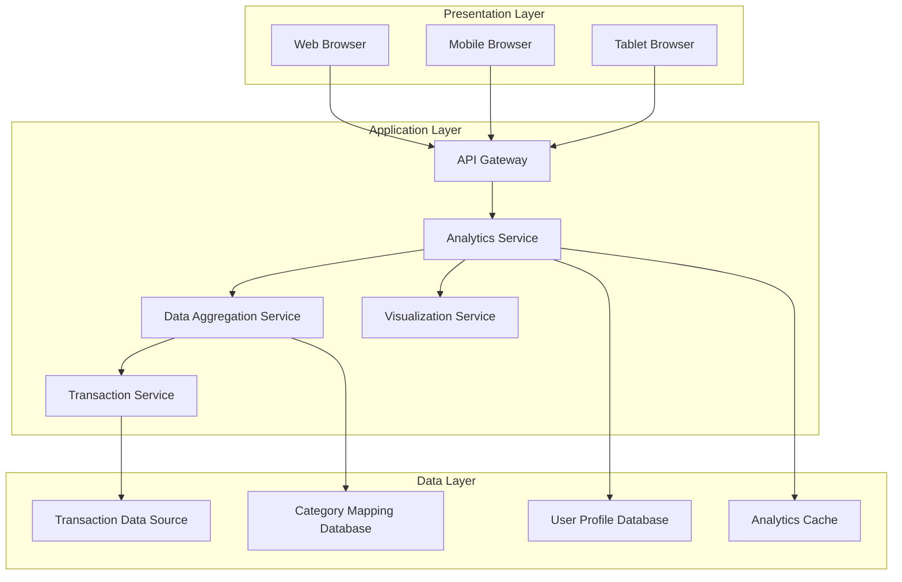
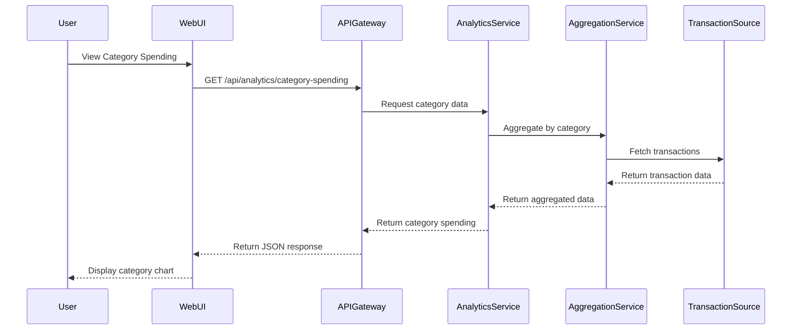
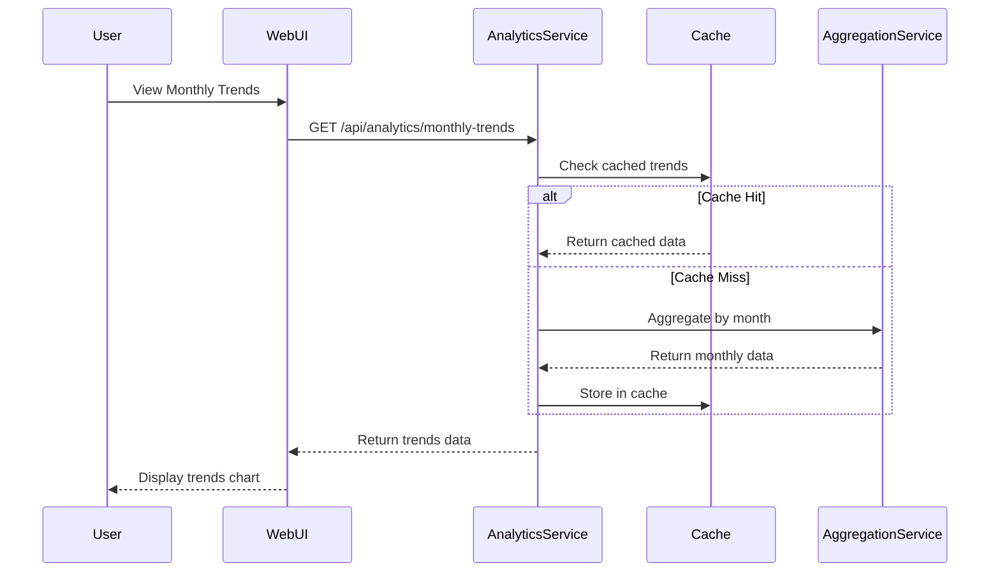
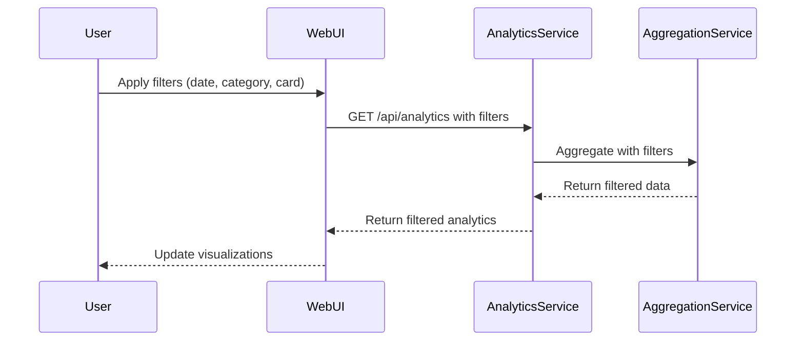

# High-Level Design Document

## Epic: PRD1-Spending Analytics and Visualization

**Project Key:** QE  
**Epic Type:** Epic  
**Label:** PRD1  

---

## 1. Epic Overview

### 1.1 Purpose
Develop interactive analytics and visualization capabilities that enable users to understand their spending patterns through category-wise analysis and monthly trends. The feature provides visual representations of spending across nine predefined categories: Food & Dining, Fuel, Shopping, Travel, Entertainment, Utilities, Healthcare, Education, and Miscellaneous. Users can analyze card-wise spending and track monthly spend trends to identify financial patterns.

### 1.2 User Value
Users gain actionable insights into their spending behavior through visual analytics, helping them identify category-wise spending patterns, control expenses, and make informed financial decisions based on historical trends.

### 1.3 Business Objectives
- Enable users to identify category-wise spending patterns
- Provide insights for expense control and financial decision-making
- Support historical trend analysis for spending behavior
- Deliver interactive and engaging visualizations

### 1.4 Target Users
Credit card users managing one or multiple credit cards who want to understand and optimize their spending patterns.

---

## 2. Requirements

### 2.1 Functional Requirements

| Requirement ID | Requirement Description | Priority | Source |
|----------------|------------------------|----------|--------|
| FR-001 | Display Category-wise Spending visualization | Should Have | Epic Description |
| FR-002 | Support nine spending categories: Food & Dining, Fuel, Shopping, Travel, Entertainment, Utilities, Healthcare, Education, Miscellaneous | Should Have | Epic Description |
| FR-003 | Display Monthly Spend Trends visualization | Should Have | Epic Description |
| FR-004 | Provide Card-wise Spend Analysis | Should Have | Epic Description |
| FR-005 | Implement Interactive visualizations | Should Have | Epic Description |
| FR-006 | Support Transaction analysis | Should Have | Epic Description |
| FR-007 | Allow users to filter and drill down into spending data | Should Have | Implied requirement |

### 2.2 Non-Functional Requirements (NFRs)

| NFR ID | Category | Requirement | Target Metric | Validation Method |
|--------|----------|-------------|---------------|-------------------|
| NFR-001 | Interactivity | Interactive and responsive visualizations | User interaction response < 500ms | Performance testing |
| NFR-002 | Performance | Optimize data aggregation and chart rendering | Chart render time < 2 seconds | Performance testing |
| NFR-003 | Usability | Intuitive visualization interface | User comprehension > 85% | Usability testing |
| NFR-004 | Responsiveness | Support multiple devices and screen sizes | Mobile, Tablet, Desktop breakpoints | Device testing |

### 2.3 In Scope
- Category-wise Spending visualization
- Monthly Spend Trends
- Card-wise Spend Analysis
- Interactive visualizations for nine spending categories
- Transaction analysis

### 2.4 Out of Scope
- Real Bank Integration
- Card Payments
- Fund Transfers
- Loans
- Payment Gateway Integration

---

## 3. Architecture Overview

### 3.1 High-Level Architecture

The Spending Analytics and Visualization feature extends the existing dashboard architecture with analytics-specific services and visualization components.



### 3.2 Architecture Principles
- **Data Aggregation:** Pre-aggregate data for common analytics queries
- **Caching Strategy:** Cache aggregated analytics data to improve performance
- **Responsive Visualizations:** Charts adapt to device screen size
- **Scalable Processing:** Support efficient processing of large transaction datasets

---

## 4. Component Design

### 4.1 Frontend Components

#### 4.1.1 Analytics Dashboard Component
- **Responsibility:** Main container for analytics visualizations
- **Key Functions:**
  - Orchestrate visualization components
  - Manage filter state
  - Handle data refresh

#### 4.1.2 Category Spending Chart Component
- **Responsibility:** Display category-wise spending visualization
- **Key Functions:**
  - Render pie chart or bar chart for category distribution
  - Support interactive category selection
  - Display spending amount and percentage per category
  - Handle nine categories: Food & Dining, Fuel, Shopping, Travel, Entertainment, Utilities, Healthcare, Education, Miscellaneous

#### 4.1.3 Monthly Trends Chart Component
- **Responsibility:** Display monthly spend trends
- **Key Functions:**
  - Render line chart or area chart for trends
  - Support time range selection
  - Display trend indicators (up/down)
  - Enable drill-down to specific months

#### 4.1.4 Card-wise Analysis Component
- **Responsibility:** Display spending analysis per credit card
- **Key Functions:**
  - Render comparative visualization across cards
  - Support card selection and filtering
  - Display card-specific spending patterns

#### 4.1.5 Transaction List Component
- **Responsibility:** Display detailed transaction data
- **Key Functions:**
  - Render transaction list with category tags
  - Support sorting and filtering
  - Enable transaction drill-down

#### 4.1.6 Filter Control Component
- **Responsibility:** Manage analytics filters
- **Key Functions:**
  - Date range selection
  - Category filter
  - Card filter
  - Apply and reset filters

### 4.2 Backend Services

#### 4.2.1 Analytics Service
- **Responsibility:** Orchestrate analytics data retrieval and processing
- **Key APIs:**
  - `GET /api/analytics/category-spending` - Get category-wise spending data
  - `GET /api/analytics/monthly-trends` - Get monthly spending trends
  - `GET /api/analytics/card-wise` - Get card-wise spending analysis

#### 4.2.2 Data Aggregation Service
- **Responsibility:** Aggregate transaction data for analytics
- **Key Functions:**
  - Aggregate transactions by category
  - Aggregate transactions by month
  - Aggregate transactions by card
  - Calculate spending statistics

#### 4.2.3 Transaction Service
- **Responsibility:** Retrieve and process transaction data
- **Key APIs:**
  - `GET /api/transactions` - Get transaction list with filters
  - `GET /api/transactions/{transactionId}` - Get transaction details

#### 4.2.4 Category Mapping Service
- **Responsibility:** Map transactions to spending categories
- **Key Functions:**
  - Categorize transactions based on merchant/description
  - Support manual category override
  - Maintain category mapping rules

---

## 5. Data Flow

### 5.1 Category Spending Visualization Flow



### 5.2 Monthly Trends Flow



### 5.3 Interactive Filter Flow



---

## 6. APIs and Integrations

### 6.1 External Integrations

| Integration | Type | Purpose | Status |
|-------------|------|---------|--------|
| Transaction Data Sources | External | Retrieve transaction data for analytics | Required |
| Dashboard Data Aggregation Services | Internal | Integrate with existing dashboard services | Required |

### 6.2 Internal APIs

#### 6.2.1 Analytics API

**Endpoint:** `GET /api/analytics/category-spending`

**Query Parameters:**
- `startDate` (optional): Start date for analysis (ISO 8601 format)
- `endDate` (optional): End date for analysis (ISO 8601 format)
- `cardId` (optional): Filter by specific card

**Response:**
```json
{
  "period": {
    "startDate": "2024-01-01",
    "endDate": "2024-01-31"
  },
  "totalSpending": 5420.50,
  "categories": [
    {
      "categoryName": "Food & Dining",
      "amount": 1250.00,
      "percentage": 23.05,
      "transactionCount": 45,
      "trend": "up",
      "changePercent": 15.2
    },
    {
      "categoryName": "Fuel",
      "amount": 850.00,
      "percentage": 15.68,
      "transactionCount": 12,
      "trend": "down",
      "changePercent": -5.3
    },
    {
      "categoryName": "Shopping",
      "amount": 1420.50,
      "percentage": 26.20,
      "transactionCount": 28,
      "trend": "up",
      "changePercent": 8.7
    },
    {
      "categoryName": "Travel",
      "amount": 650.00,
      "percentage": 11.99,
      "transactionCount": 5,
      "trend": "stable",
      "changePercent": 0.5
    },
    {
      "categoryName": "Entertainment",
      "amount": 450.00,
      "percentage": 8.30,
      "transactionCount": 8,
      "trend": "up",
      "changePercent": 12.5
    },
    {
      "categoryName": "Utilities",
      "amount": 320.00,
      "percentage": 5.90,
      "transactionCount": 6,
      "trend": "stable",
      "changePercent": 1.2
    },
    {
      "categoryName": "Healthcare",
      "amount": 180.00,
      "percentage": 3.32,
      "transactionCount": 3,
      "trend": "down",
      "changePercent": -10.0
    },
    {
      "categoryName": "Education",
      "amount": 150.00,
      "percentage": 2.77,
      "transactionCount": 2,
      "trend": "stable",
      "changePercent": 0.0
    },
    {
      "categoryName": "Miscellaneous",
      "amount": 150.00,
      "percentage": 2.77,
      "transactionCount": 10,
      "trend": "up",
      "changePercent": 25.0
    }
  ]
}
```

**Endpoint:** `GET /api/analytics/monthly-trends`

**Query Parameters:**
- `months` (optional): Number of months to retrieve (default: 12)
- `cardId` (optional): Filter by specific card

**Response:**
```json
{
  "trends": [
    {
      "month": "2024-01",
      "totalSpending": 5420.50,
      "transactionCount": 119,
      "averageTransaction": 45.55,
      "topCategory": "Shopping",
      "changeFromPrevious": 12.5
    },
    {
      "month": "2023-12",
      "totalSpending": 4820.00,
      "transactionCount": 105,
      "averageTransaction": 45.90,
      "topCategory": "Food & Dining",
      "changeFromPrevious": -3.2
    }
  ],
  "summary": {
    "averageMonthlySpending": 5120.25,
    "highestMonth": "2024-01",
    "lowestMonth": "2023-06",
    "overallTrend": "increasing"
  }
}
```

**Endpoint:** `GET /api/analytics/card-wise`

**Query Parameters:**
- `startDate` (optional): Start date for analysis
- `endDate` (optional): End date for analysis

**Response:**
```json
{
  "period": {
    "startDate": "2024-01-01",
    "endDate": "2024-01-31"
  },
  "cards": [
    {
      "cardId": "card-001",
      "cardNumber": "****1234",
      "cardType": "Visa",
      "totalSpending": 3250.00,
      "transactionCount": 75,
      "topCategory": "Shopping",
      "categoryBreakdown": [
        {
          "categoryName": "Shopping",
          "amount": 1200.00,
          "percentage": 36.92
        },
        {
          "categoryName": "Food & Dining",
          "amount": 950.00,
          "percentage": 29.23
        }
      ]
    },
    {
      "cardId": "card-002",
      "cardNumber": "****5678",
      "cardType": "Mastercard",
      "totalSpending": 2170.50,
      "transactionCount": 44,
      "topCategory": "Fuel",
      "categoryBreakdown": [
        {
          "categoryName": "Fuel",
          "amount": 850.00,
          "percentage": 39.16
        },
        {
          "categoryName": "Travel",
          "amount": 650.00,
          "percentage": 29.95
        }
      ]
    }
  ]
}
```

#### 6.2.2 Transaction API

**Endpoint:** `GET /api/transactions`

**Query Parameters:**
- `startDate` (optional): Start date filter
- `endDate` (optional): End date filter
- `category` (optional): Category filter
- `cardId` (optional): Card filter
- `page` (optional): Page number for pagination
- `pageSize` (optional): Number of items per page

**Response:**
```json
{
  "transactions": [
    {
      "transactionId": "txn-001",
      "cardId": "card-001",
      "date": "2024-01-15",
      "merchant": "Starbucks",
      "amount": 15.50,
      "category": "Food & Dining",
      "description": "Coffee purchase",
      "status": "completed"
    }
  ],
  "pagination": {
    "currentPage": 1,
    "pageSize": 50,
    "totalPages": 5,
    "totalItems": 235
  }
}
```

---

## 7. Security Considerations

### 7.1 Authentication & Authorization
- **Requirement:** Users must be authenticated to access analytics
- **Authorization:** Users can only view analytics for their own transactions
- **Assumption:** Authentication is handled by existing identity management system

### 7.2 Data Protection
- **Sensitive Data:** Transaction details must be protected
- **Encryption:** All data transmission must use HTTPS/TLS
- **Data Masking:** Credit card numbers must be masked in all visualizations

### 7.3 Data Privacy
- **Transaction Data:** Ensure transaction data is not exposed to unauthorized users
- **Analytics Data:** Aggregated analytics should not reveal individual transaction details to unauthorized parties
- **Data Retention:** Follow data retention policies for transaction data

### 7.4 API Security
- Input validation on all API endpoints
- Rate limiting to prevent abuse
- Audit logging for analytics access
- SQL injection prevention in query parameters

---

## 8. Scalability

### 8.1 Scalability Strategy
- **Data Aggregation:** Pre-aggregate common analytics queries during off-peak hours
- **Caching:** Implement multi-level caching for analytics data
- **Query Optimization:** Optimize database queries for large transaction datasets
- **Horizontal Scaling:** Scale analytics services independently

### 8.2 Performance Optimization
- **Frontend:**
  - Lazy loading of charts
  - Progressive rendering for large datasets
  - Optimized chart libraries (e.g., Chart.js, D3.js with performance tuning)
  - Debouncing for interactive filters
- **Backend:**
  - Analytics data caching (TTL: 1 hour for historical data, 15 minutes for current month)
  - Database indexing on transaction date, category, and card ID
  - Pagination for transaction lists
  - Asynchronous aggregation for complex queries

### 8.3 Data Volume Considerations
- **Assumption:** Average user has 100-500 transactions per month
- **Assumption:** System supports up to 10,000 concurrent users
- **Gap:** Need to validate expected transaction volume and user base
- **Recommendation:** Implement data archival strategy for old transactions

---

## 9. Availability and Reliability

### 9.1 Availability Targets
- **Target:** 99.5% uptime (consistent with dashboard availability)
- **Assumption:** Analytics service availability aligns with dashboard service

### 9.2 Reliability Measures
- **Graceful Degradation:** If analytics service is unavailable, show cached data with timestamp
- **Error Handling:** Display user-friendly error messages if data cannot be loaded
- **Retry Logic:** Implement retry mechanism for failed API calls
- **Circuit Breaker:** Prevent cascading failures from analytics service

### 9.3 Data Consistency
- **Eventual Consistency:** Analytics data may have slight delay compared to real-time transactions
- **Refresh Interval:** Analytics data refreshed every 15 minutes for current month, hourly for historical data
- **Data Validation:** Implement validation to ensure aggregated data matches transaction totals

---

## 10. Assumptions

| ID | Assumption | Impact | Validation Required |
|----|------------|--------|---------------------|
| A-001 | Transaction data source provides category information or merchant data for categorization | High | Confirm with integration team |
| A-002 | Historical transaction data is available for at least 12 months | Medium | Validate with data team |
| A-003 | Transaction categorization can be automated with acceptable accuracy (>90%) | High | Validate categorization algorithm |
| A-004 | Users access analytics primarily for current and previous months | Medium | Validate with product team |
| A-005 | Average user has 100-500 transactions per month | Medium | Validate with data analysis |
| A-006 | Visualization libraries support required chart types and interactivity | Low | Validate during technology selection |
| A-007 | Analytics data refresh interval of 15 minutes is acceptable | Medium | Confirm with business stakeholders |
| A-008 | Category mapping rules can be maintained and updated without code changes | Medium | Design category mapping service accordingly |

---

## 11. Dependencies

| Dependency ID | Dependency | Type | Impact | Mitigation |
|---------------|------------|------|--------|------------|
| DEP-001 | Transaction data sources | External | High | Implement caching and graceful degradation |
| DEP-002 | Dashboard data aggregation services | Internal | Medium | Coordinate with dashboard team for API contracts |
| DEP-003 | Visualization libraries | Technology | Medium | Evaluate and select library early; have backup option |
| DEP-004 | Category mapping rules and data | Internal | High | Establish category mapping service with configurable rules |
| DEP-005 | Analytics cache infrastructure (Redis) | Infrastructure | Medium | Ensure cache infrastructure is provisioned |
| DEP-006 | Dashboard KPI data (for integration) | Internal | Low | Leverage existing dashboard APIs |

---

## 12. Risks and Mitigation

| Risk ID | Risk Description | Probability | Impact | Mitigation Strategy |
|---------|------------------|-------------|--------|---------------------|
| RISK-001 | Transaction categorization accuracy below expectations | Medium | High | Implement manual category override; iteratively improve categorization algorithm |
| RISK-002 | Performance degradation with large transaction volumes | Medium | High | Implement data aggregation, caching, and pagination |
| RISK-003 | Chart rendering performance issues on mobile devices | Medium | Medium | Optimize chart libraries; implement progressive rendering |
| RISK-004 | Historical transaction data not available | Low | High | Validate data availability early; define minimum data requirements |
| RISK-005 | Visualization library limitations for required interactivity | Low | Medium | Evaluate multiple libraries; prototype key interactions early |
| RISK-006 | Data aggregation complexity for card-wise analysis | Medium | Medium | Design efficient aggregation queries; use database indexing |
| RISK-007 | User confusion with multiple visualization options | Low | Medium | Conduct UX research; implement intuitive navigation and help text |
| RISK-008 | Cache invalidation issues leading to stale data | Low | Medium | Implement proper cache invalidation strategy; display data timestamp |

---

## 13. Technology Stack (Recommendations)

### 13.1 Frontend
- **Framework:** React.js or Vue.js (consistent with dashboard)
- **Visualization Library:** 
  - **Option 1:** Chart.js (lightweight, good performance)
  - **Option 2:** Recharts (React-specific, responsive)
  - **Option 3:** D3.js (highly customizable, steeper learning curve)
- **State Management:** Redux or Vuex
- **Date Handling:** date-fns or Moment.js

### 13.2 Backend
- **API Framework:** Node.js (Express) or Java (Spring Boot)
- **Caching:** Redis (for analytics data caching)
- **Database:** 
  - **Transaction Storage:** PostgreSQL or MySQL with proper indexing
  - **Analytics Aggregation:** Consider time-series database or materialized views

### 13.3 Data Processing
- **Aggregation:** Background jobs for pre-aggregation (e.g., cron jobs, scheduled tasks)
- **Category Mapping:** Rule engine or machine learning model for transaction categorization

---

## 14. Visualization Design Recommendations

### 14.1 Category-wise Spending
- **Chart Type:** Donut chart or horizontal bar chart
- **Interactivity:** Click to drill down into category transactions
- **Features:** 
  - Show percentage and amount
  - Highlight top spending category
  - Compare with previous period

### 14.2 Monthly Spend Trends
- **Chart Type:** Line chart or area chart
- **Interactivity:** Hover to see monthly details, click to drill down
- **Features:**
  - Show trend line
  - Highlight highest and lowest months
  - Display month-over-month change

### 14.3 Card-wise Spend Analysis
- **Chart Type:** Grouped bar chart or stacked bar chart
- **Interactivity:** Click to filter by card
- **Features:**
  - Compare spending across cards
  - Show category breakdown per card
  - Display card utilization percentage

---

## 15. Implementation Phases

### Phase 1: Foundation (Weeks 1-2)
- Set up analytics service infrastructure
- Establish integration with transaction data source
- Design and implement category mapping service
- Create database schema for analytics aggregation

### Phase 2: Data Aggregation (Weeks 3-4)
- Implement data aggregation service
- Develop category-wise aggregation logic
- Develop monthly trend aggregation logic
- Develop card-wise aggregation logic
- Implement caching strategy

### Phase 3: Analytics APIs (Weeks 5-6)
- Develop analytics API endpoints
- Implement filtering and query parameters
- Integrate with aggregation service
- Implement pagination for transaction lists

### Phase 4: Visualizations (Weeks 7-9)
- Select and integrate visualization library
- Develop category spending chart component
- Develop monthly trends chart component
- Develop card-wise analysis component
- Implement interactive features

### Phase 5: Integration & Polish (Weeks 10-11)
- Integrate analytics with existing dashboard
- Implement filter controls
- Implement responsive design for charts
- Optimize performance

### Phase 6: Testing & Optimization (Weeks 12-13)
- Performance testing with large datasets
- Usability testing
- Cross-device testing
- Bug fixes and refinements

---

## 16. Open Questions

| Question ID | Question | Owner | Status |
|-------------|----------|-------|--------|
| Q-001 | What is the expected transaction volume per user per month? | Product Team | Open |
| Q-002 | How many months of historical data should be available? | Product Team | Open |
| Q-003 | What is the acceptable accuracy rate for automated transaction categorization? | Product Team | Open |
| Q-004 | Should users be able to manually recategorize transactions? | Product Team | Open |
| Q-005 | What is the acceptable data refresh interval for analytics? | Product Team | Open |
| Q-006 | Are there specific chart types or visualization styles preferred? | UX Team | Open |
| Q-007 | Should analytics support export functionality (PDF, CSV)? | Product Team | Open |
| Q-008 | What is the data retention policy for transaction data? | Data Governance | Open |
| Q-009 | Should the system support custom date ranges beyond predefined periods? | Product Team | Open |
| Q-010 | Are there accessibility requirements for visualizations (e.g., color blindness)? | UX Team | Open |

---

# Validation Report

## 1. Requirements Traceability Matrix

| Requirement ID | Requirement | Source | Design Component | Implementation Status | Validation Method |
|----------------|-------------|--------|------------------|----------------------|-------------------|
| FR-001 | Display Category-wise Spending visualization | Epic Description | Category Spending Chart Component, Analytics Service | Designed | UI testing, Visual validation |
| FR-002 | Support nine spending categories | Epic Description | Category Mapping Service, Category Spending Chart | Designed | Unit testing, Data validation |
| FR-003 | Display Monthly Spend Trends visualization | Epic Description | Monthly Trends Chart Component, Analytics Service | Designed | UI testing, Visual validation |
| FR-004 | Provide Card-wise Spend Analysis | Epic Description | Card-wise Analysis Component, Analytics Service | Designed | Integration testing, UI testing |
| FR-005 | Implement Interactive visualizations | Epic Description | All chart components with interactivity | Designed | Usability testing, Interaction testing |
| FR-006 | Support Transaction analysis | Epic Description | Transaction Service, Transaction List Component | Designed | Integration testing |
| FR-007 | Allow filtering and drill-down | Implied | Filter Control Component, Interactive charts | Designed | Usability testing |

## 2. Coverage Status

### 2.1 Functional Requirements Coverage
- **Total Requirements:** 7
- **Covered in Design:** 7 (100%)
- **Not Covered:** 0
- **Status:** ✅ All functional requirements are addressed in the design

### 2.2 Non-Functional Requirements Coverage
- **Total NFRs:** 4
- **Addressed in Design:** 4 (100%)
- **Status:** ✅ All NFRs are addressed with design considerations

## 3. NFR Validation Targets

| NFR ID | Requirement | Target Metric | Design Approach | Validation Status |
|--------|-------------|---------------|-----------------|-------------------|
| NFR-001 | Interactive visualizations | Response < 500ms | Optimized chart libraries, debouncing, efficient rendering | To be validated during performance testing |
| NFR-002 | Performance optimization | Chart render < 2 seconds | Caching, pre-aggregation, lazy loading, pagination | To be validated during performance testing |
| NFR-003 | Usability | User comprehension > 85% | Intuitive chart design, clear labels, help text | To be validated during usability testing |
| NFR-004 | Responsiveness | Multiple device support | Responsive chart components, adaptive layouts | To be validated during device testing |

## 4. Design Gaps and Assumptions

### 4.1 Critical Gaps

| Gap ID | Gap Description | Impact | Recommendation |
|--------|-----------------|--------|----------------|
| GAP-001 | Transaction categorization accuracy not defined | High | Define acceptable accuracy threshold; plan for manual override capability |
| GAP-002 | Expected transaction volume not specified | High | Conduct data analysis to determine typical and peak transaction volumes |
| GAP-003 | Historical data availability not confirmed | High | Validate with data team; define minimum historical data requirements |
| GAP-004 | Data refresh interval not confirmed | Medium | Validate acceptable refresh interval with business stakeholders |
| GAP-005 | Export functionality requirements not specified | Low | Clarify if users need to export analytics data |
| GAP-006 | Custom date range requirements not defined | Medium | Determine if predefined periods are sufficient or custom ranges needed |
| GAP-007 | Accessibility requirements not specified | Medium | Define accessibility standards (WCAG compliance level) |

### 4.2 Key Assumptions Requiring Validation

| Assumption ID | Assumption | Validation Required From | Priority |
|---------------|------------|--------------------------|----------|
| A-001 | Transaction data includes category or merchant data | Integration Team | High |
| A-003 | Automated categorization accuracy >90% | Data Science Team | High |
| A-002 | Historical data available for 12 months | Data Team | High |
| A-005 | Average 100-500 transactions per user per month | Data Analytics Team | Medium |
| A-007 | 15-minute refresh interval is acceptable | Product Team | Medium |

## 5. Dependency Analysis

### 5.1 External Dependencies
- **Transaction Data Sources:** Critical dependency with high impact
  - **Status:** Assumed available
  - **Risk:** Medium probability of data quality issues
  - **Mitigation:** Implemented in design (data validation, error handling)

### 5.2 Internal Dependencies
- **Dashboard Data Aggregation Services:** Required for integration
  - **Status:** Assumed existing
  - **Validation Required:** Confirm API contracts with dashboard team

- **Category Mapping Service:** New service to be developed
  - **Status:** To be implemented
  - **Risk:** Categorization accuracy may not meet expectations
  - **Mitigation:** Manual override capability, iterative improvement

### 5.3 Technology Dependencies
- **Visualization Library:** Critical for chart rendering
  - **Status:** To be selected
  - **Recommendation:** Evaluate Chart.js, Recharts, and D3.js early in project

## 6. Risk Assessment Summary

### 6.1 High-Impact Risks
- **RISK-001:** Transaction categorization accuracy - Requires algorithm validation and manual override
- **RISK-002:** Performance with large transaction volumes - Mitigated through design (caching, aggregation)
- **RISK-004:** Historical data not available - Requires early validation

### 6.2 Risk Mitigation Coverage
- **Total Risks Identified:** 8
- **Risks with Mitigation Strategy:** 8 (100%)
- **Status:** ✅ All identified risks have mitigation strategies

## 7. Recommendations

### 7.1 Immediate Actions
1. **Validate Transaction Data:** Confirm transaction data schema and availability of merchant/category information
2. **Data Volume Analysis:** Analyze expected transaction volumes to validate performance assumptions
3. **Historical Data Validation:** Confirm availability of historical transaction data (minimum 12 months)
4. **Categorization Strategy:** Define and validate transaction categorization approach and accuracy targets
5. **Technology Selection:** Evaluate and select visualization library based on requirements and performance

### 7.2 Design Enhancements
1. **Manual Categorization:** Implement ability for users to manually recategorize transactions
2. **Export Functionality:** Consider adding export capability for analytics data (PDF, CSV)
3. **Custom Date Ranges:** Support custom date range selection in addition to predefined periods
4. **Accessibility:** Ensure WCAG 2.1 AA compliance for all visualizations
5. **Comparison Features:** Add ability to compare spending across different time periods
6. **Budget Integration:** Consider integrating with budget/goal setting features (future enhancement)

### 7.3 Testing Strategy
1. **Unit Testing:** Comprehensive tests for aggregation logic and category mapping
2. **Integration Testing:** Validate integration with transaction data source and dashboard services
3. **Performance Testing:** 
   - Load testing with large transaction datasets
   - Chart rendering performance across devices
   - API response time validation
4. **Usability Testing:** Validate user comprehension of visualizations (target >85%)
5. **Visual Testing:** Validate chart accuracy and visual representation
6. **Device Testing:** Test responsive behavior across mobile, tablet, and desktop
7. **Accessibility Testing:** Validate WCAG compliance

### 7.4 Future Considerations
1. **Predictive Analytics:** Machine learning for spending predictions and anomaly detection
2. **Budget Alerts:** Notifications when spending exceeds category budgets
3. **Comparative Analytics:** Compare spending with similar user cohorts (anonymized)
4. **Advanced Filters:** Support for merchant-level filtering and custom category creation
5. **Spending Insights:** AI-generated insights and recommendations

## 8. Validation Summary

### 8.1 Design Completeness
- ✅ All functional requirements addressed
- ✅ All NFRs considered in design
- ✅ Architecture defined with clear component boundaries
- ✅ Data flow documented
- ✅ APIs specified with sample payloads
- ✅ Security considerations documented
- ✅ Visualization recommendations provided
- ⚠️ Some assumptions require validation
- ⚠️ Some gaps need to be addressed

### 8.2 Readiness Assessment
- **Design Readiness:** 85%
- **Requirements Clarity:** 85%
- **Technical Feasibility:** 90%
- **Risk Mitigation:** 100%

### 8.3 Overall Status
**Status:** ✅ **APPROVED WITH CONDITIONS**

The HLD is comprehensive and addresses all stated requirements for spending analytics and visualization. However, the following conditions must be met before implementation:
1. Validate transaction data schema and categorization approach
2. Confirm expected transaction volumes and historical data availability
3. Select and validate visualization library
4. Define acceptable data refresh interval
5. Validate key assumptions with respective teams

### 8.4 Integration with Dashboard Epic
This epic builds upon the "PRD1-Credit Card Dashboard and KPI Monitoring" epic and should be implemented after the core dashboard is in place. Key integration points:
- Leverage existing dashboard infrastructure and services
- Reuse authentication and authorization mechanisms
- Integrate with existing credit card and transaction data sources
- Maintain consistent UI/UX with dashboard

---

## Document Control

**Version:** 1.0  
**Date:** 2024  
**Status:** Draft  
**Author:** HLD Generation Agent  
**Reviewers:** [To be assigned]  

**Revision History:**

| Version | Date | Author | Changes |
|---------|------|--------|----------|
| 1.0 | 2024 | HLD Generation Agent | Initial version |

---

**End of Document**