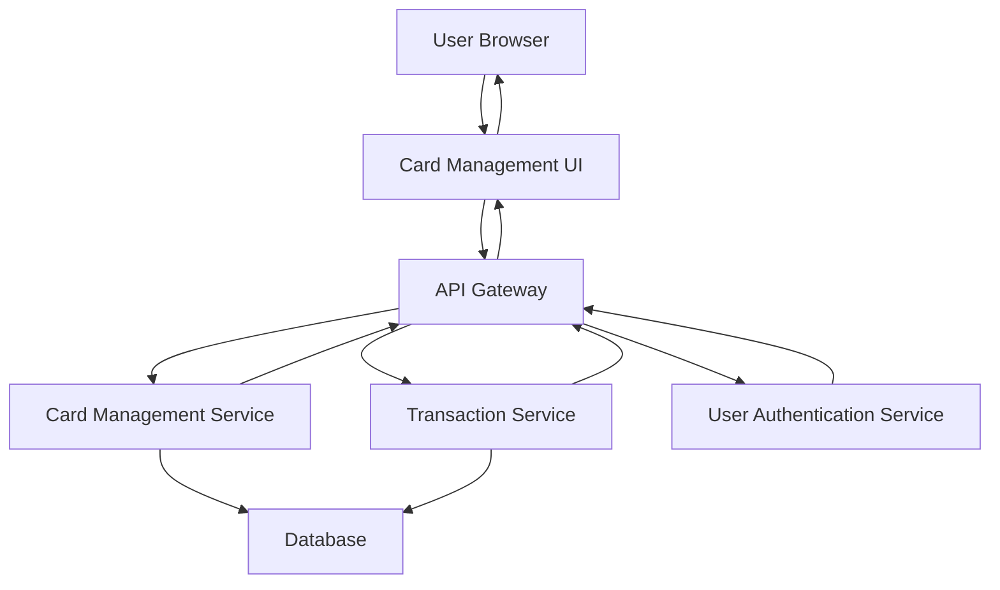

#### 1. High-Level Design

- **Summary**: This epic enables users to manage multiple credit cards (add, view, monitor) and access detailed transaction information for each card. Users can drill down into individual card details and transaction histories, supporting card-wise filtering and navigation for better financial tracking across their portfolio.

- **Component Flow**:

- **Integration Points**: 
  - **Upstream**: Transaction Service (transaction data retrieval), Card Management Service (card CRUD operations), User Authentication Service (secure access control)
  - **Downstream**: Card Management UI displays card list, details, and transaction history to user

- **Key Assumptions**: 
  - Card data includes card number (masked), issuer, credit limit, and status fields
  - Transactions are retrieved via paginated API calls to handle large volumes efficiently

- **NFR Highlights**: System must support at least 20 credit cards per user; transaction retrieval within 1 second for up to 500 transactions per card; secure storage and transmission with encryption

- **Data Flow**: User authenticates via User Authentication Service → User requests card list or specific card details → API Gateway routes to Card Management Service → Service retrieves card information from Database → User selects a card to view transactions → Transaction Service fetches transaction history from Database → Services return encrypted data → UI displays card details, status, and transaction listing with card-wise filtering → User navigates between cards and monitors individual card status

#### 2. Validation Report

- **Requirements Coverage**: The design comprehensively addresses all scope items including multiple credit card display and management, card details view, transaction listing per card, transaction history tracking, card-wise filtering and navigation, and individual card status monitoring. NFRs for supporting 20+ cards per user, 1-second transaction retrieval for 500 transactions, and encrypted data transmission are incorporated through the architecture. All integration dependencies (Transaction Service, Card Management Service, User Authentication Service) are properly mapped. Out-of-scope items (real bank integration, payments, fund transfers, loans, payment gateway) are excluded as specified.