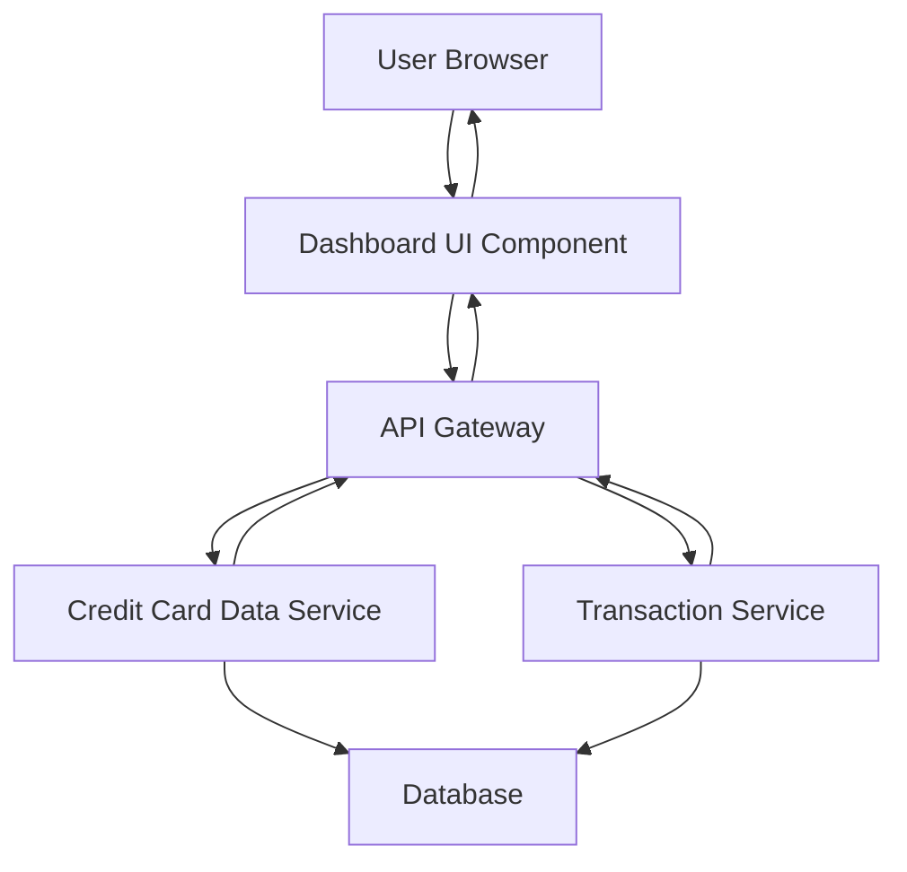

#### 1. High-Level Design

- **Summary**: This epic delivers a consolidated dashboard view displaying key performance indicators (KPIs) for all user credit cards, including monthly spend, total credit limit, available credit, and outstanding amounts. The dashboard serves as the central hub for credit card portfolio management with a responsive, modern interface.

- **Component Flow**:

- **Integration Points**: 
  - **Upstream**: Credit Card Data Service (for card details and balances), Transaction Service (for monthly spend calculations)
  - **Downstream**: Dashboard UI renders aggregated data to user browser

- **Key Assumptions**: 
  - Card and transaction data are provided in JSON format via RESTful APIs
  - KPI calculations (available credit, outstanding amounts) are performed server-side before rendering

- **NFR Highlights**: Dashboard must load within 2 seconds for up to 10 credit cards; responsive design across desktop, tablet, and mobile; real-time UI refresh on data changes

- **Data Flow**: User requests dashboard → API Gateway routes to Credit Card Data Service and Transaction Service → Services query Database for card details, balances, and transactions → Services return aggregated data → Dashboard UI calculates and displays KPIs (monthly spend, total credit limit, available credit, outstanding amounts) → User views consolidated multi-card overview in responsive layout

#### 2. Validation Report

- **Requirements Coverage**: The design fully covers the epic's stated scope including dashboard home page, KPI displays (monthly spend, total credit limit, available credit, outstanding amount), multi-card consolidated view, and responsive layout. All NFRs (2-second load time, responsive design, real-time refresh) are addressed through the architecture. Integration dependencies with Credit Card Data Service and Transaction Service are clearly mapped. Out-of-scope items (real bank integration, payments, fund transfers, loans) are explicitly excluded.