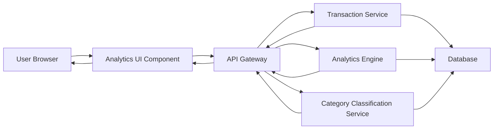

#### 1. High-Level Design

- **Summary**: This epic provides analytical capabilities for users to understand spending behavior through interactive visualizations, including monthly spend trends, category-wise analysis (Food & Dining, Fuel, Shopping, Travel, Entertainment, Utilities, Healthcare, Education, Miscellaneous), and card-wise spend comparisons. The feature enables data-driven decision-making through clear visual insights.

- **Component Flow**:

- **Integration Points**: 
  - **Upstream**: Transaction Service (raw transaction data), Analytics Engine (data aggregation and processing), Category Classification Service (transaction categorization into 9 categories)
  - **Downstream**: Analytics UI renders interactive charts and visualizations to user browser

- **Key Assumptions**: 
  - Transactions are pre-categorized or categorized in real-time by Category Classification Service using rule-based or ML models
  - Analytics Engine aggregates data monthly and caches results for performance optimization

- **NFR Highlights**: Visualizations must render within 3 seconds for up to 12 months of data; real-time aggregation for up to 10,000 transactions; interactive and responsive charts across all device types

- **Data Flow**: User requests spending analytics → API Gateway routes to Transaction Service for raw transaction data → Category Classification Service categorizes transactions into 9 categories (Food & Dining, Fuel, Shopping, Travel, Entertainment, Utilities, Healthcare, Education, Miscellaneous) → Analytics Engine aggregates data by category, month, and card → Processed data returned to Analytics UI → UI renders interactive visualizations including category-wise spending breakdown, monthly spend trend charts, and card-wise spend analysis → User explores patterns, compares spending across cards, and identifies optimization opportunities through responsive, interactive charts

#### 2. Validation Report

- **Requirements Coverage**: The design fully addresses all scope elements including category-wise spending visualization, monthly spend trend charts, card-wise spend analysis, interactive data visualizations, spending pattern identification, multi-category breakdown (9 categories as specified), time-based trend analysis, and comparative spend analytics. All NFRs (3-second rendering for 12 months of data, real-time aggregation for 10,000 transactions, responsive interactive charts) are incorporated. Integration dependencies (Transaction Service, Analytics Engine, Category Classification Service) are properly mapped. Out-of-scope items (real bank integration, payments, fund transfers, loans, payment gateway, predictive analytics, budget recommendations) are explicitly excluded as specified in the epic.