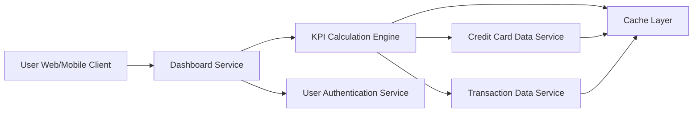

#### 1. High-Level Design

- **Summary:** This epic delivers a consolidated dashboard displaying key performance indicators (KPIs) for the user's credit card portfolio. The dashboard presents critical financial metrics including monthly spend, total credit limit, available credit, and outstanding amounts in a responsive interface. Users gain at-a-glance visibility into overall credit card health and financial status for informed decision-making.

- **Component Flow:**

- **Integration Points:**
  - **Upstream:** User Authentication Service (for secure access and session management)
  - **Downstream:** Credit Card Data Service (for retrieving card balances, limits, and outstanding amounts), Transaction Data Service (for monthly spend calculations and real-time transaction data)

- **Key Assumptions:**
  - KPI metrics are calculated in near real-time with a cache refresh interval of 5 minutes to balance performance and data freshness.
  - Monthly spend is calculated based on the current calendar month (1st to last day of month).

- **NFR Highlights:** Dashboard must load within 2 seconds; support responsive design across desktop and mobile devices; handle real-time data updates for KPI metrics with caching strategy.

- **Data Flow:** User accesses dashboard → Authentication Service validates user session → Dashboard Service requests KPI data from KPI Calculation Engine → Engine checks Cache Layer for recent data → If cache miss or stale, Engine fetches card balances from Credit Card Data Service and transaction data from Transaction Data Service → Engine calculates KPIs (monthly spend, total credit limit, available credit, outstanding amount) → Results cached and returned to Dashboard Service → UI renders KPI cards and widgets in responsive layout → Real-time updates pushed via cache refresh mechanism every 5 minutes.

#### 2. Validation Report

- **Requirements Coverage:** The design comprehensively addresses all stated requirements including monthly spend display, total credit limit calculation, available credit tracking, outstanding amount visualization, responsive dashboard layout, and KPI cards/widgets. The 2-second load time NFR is achievable through caching strategy and optimized data aggregation. Responsive design across desktop and mobile is supported through adaptive UI components. Real-time data updates are handled via cache refresh mechanism. Integration dependencies with Credit Card Data Service, Transaction Data Service, and User Authentication Service are properly mapped. Out-of-scope items (real bank integration, payment processing, fund transfers, payment gateway integration) are excluded as specified.