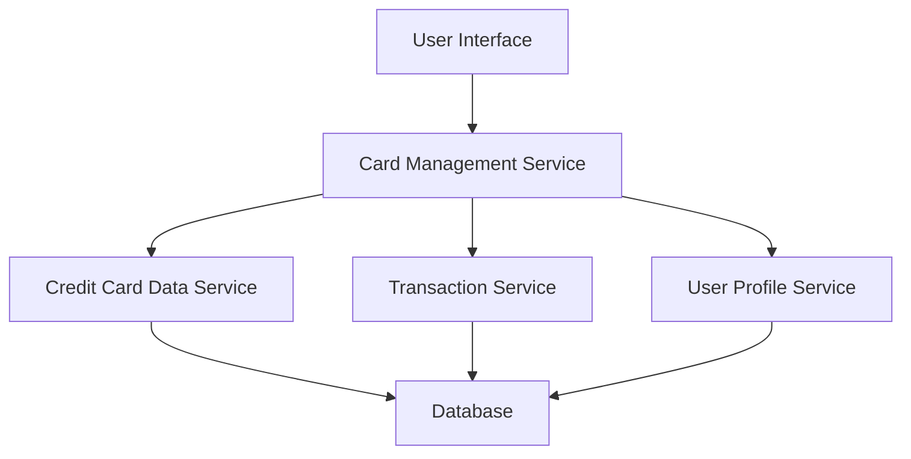

#### 1. High-Level Design

- **Summary:** This epic enables users to view and manage multiple credit cards (up to 10 per user) from a single consolidated interface. Users can access individual card details, perform card-wise spend analysis, view transaction history for each card, and compare performance across different cards. The system provides a unified view of card utilization, limits, and spending patterns.

- **Component Flow:**

- **Integration Points:**
  - **Upstream:** User Profile Service (for card ownership validation and user authentication)
  - **Downstream:** Credit Card Data Service (for retrieving card details, balances, and limits), Transaction Service (for card-specific transaction history)

- **Key Assumptions:**
  - Card data is retrieved via REST APIs from the Credit Card Data Service with JSON response format.
  - Transaction history is fetched on-demand when a user selects a specific card (lazy loading approach).

- **NFR Highlights:** System must support at least 10 credit cards per user; card switching and filtering must respond within 500ms; responsive layout required for desktop and mobile devices.

- **Data Flow:** User authenticates and requests card portfolio view → Card Management Service validates user via User Profile Service → Service fetches all card details from Credit Card Data Service → UI displays card list with summary information → User selects a specific card → Transaction Service retrieves card-specific transaction history → UI displays detailed card view with transactions and spend analysis → User can filter/switch between cards with sub-500ms response time.

#### 2. Validation Report

- **Requirements Coverage:** The design fully covers the epic's stated scope including multiple credit card display, card-wise spend analysis, individual card details view, transaction listing per card, and card selection/filtering. All NFRs (10 cards support, 500ms response time, responsive layout) are addressed through service-oriented architecture with optimized data retrieval. Integration dependencies with Credit Card Data Service, Transaction Service, and User Profile Service are clearly mapped. Out-of-scope items (card payments, real bank integration, adding new physical cards, card application process, loans) are explicitly excluded from this design.