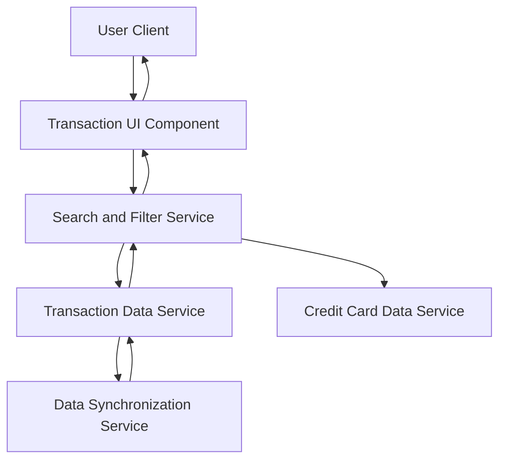

#### 1. High-Level Design

- **Summary:** This epic enables users to view, search, and analyze credit card transactions across all cards from a unified interface. Users can access detailed transaction histories, filter by date ranges, card types, and transaction amounts, providing granular visibility into spending activities for tracking, reconciliation, and fraud detection.

- **Component Flow:**

- **Integration Points:**
  - **Upstream:** Transaction Data Service (retrieves transaction records with details such as merchant name, amount, date, and transaction ID)
  - **Upstream:** Credit Card Data Service (provides card-specific metadata for filtering transactions by card)
  - **Internal:** Data Synchronization Service (ensures transaction data is up-to-date across the system)
  - **Internal:** Search and Filter Service (handles query processing, filtering, and pagination)

- **Key Assumptions:**
  - Transaction Data Service supports pagination and filtering APIs to handle large transaction volumes efficiently without loading all records at once.
  - Data Synchronization Service updates transaction data incrementally with a defined sync frequency to balance real-time accuracy and system load.

- **NFR Highlights:** System must handle and display up to 1000 transactions per user without performance degradation; transaction list loads within 3 seconds; search/filter operations complete within 1 second; 99.9% data accuracy.

- **Data Flow:** User navigates to transaction view → Transaction UI Component requests transaction list from Search and Filter Service → Service queries Transaction Data Service for records and Credit Card Data Service for card metadata → Data Synchronization Service ensures latest transaction updates are available → Filtered and paginated transaction list returned to UI → User applies search/filter criteria (date range, card, amount) → Search and Filter Service processes query and returns refined results within 1 second → User views detailed transaction information including merchant name, amount, date, and card.

#### 2. Validation Report

- **Requirements Coverage:** The design fully addresses the epic's scope including transaction list view, transaction details display, multi-card transaction aggregation, transaction search and filtering, date range selection, card-wise transaction filtering, transaction amount display, and merchant name display. All NFRs are met: handling 1000 transactions without performance degradation, 3-second list load time, 1-second search/filter response, and 99.9% data accuracy. Integration dependencies with Transaction Data Service, Credit Card Data Service, and Data Synchronization Service are explicitly mapped and support the required functionality for unified transaction management across multiple cards.