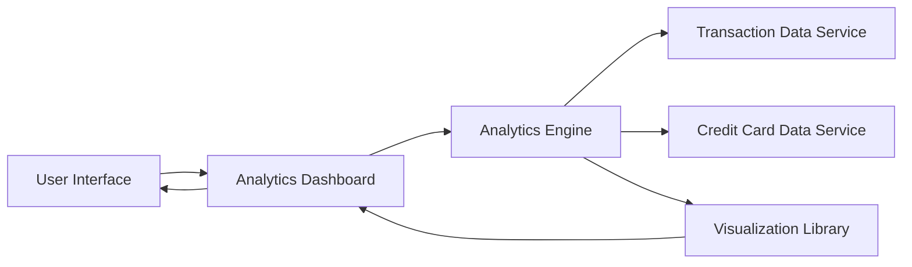

#### 1. High-Level Design

- **Summary:** This epic delivers analytical capabilities transforming raw transaction data into actionable insights through interactive visualizations. Users can analyze spending patterns across 9 predefined categories (Food & Dining, Fuel, Shopping, Travel, Entertainment, Utilities, Healthcare, Education, Miscellaneous), view monthly spend trends, and perform card-wise spend breakdowns using charts and graphs.

- **Component Flow:**

- **Integration Points:**
  - **Upstream:** Transaction Data Service (provides raw transaction records for analysis)
  - **Upstream:** Credit Card Data Service (supplies card-specific data for card-wise analysis)
  - **Internal:** Analytics Engine (processes, categorizes, and aggregates transaction data)
  - **Internal:** Visualization Library (renders interactive charts and graphs)

- **Key Assumptions:**
  - Transaction Data Service provides transactions with merchant names and amounts; category assignment is performed by the Analytics Engine using rule-based or ML-based categorization logic.
  - Analytics Engine maintains historical aggregated data for up to 12 months to support trend analysis without real-time recalculation.

- **NFR Highlights:** Analytics visualizations must render within 2 seconds for up to 12 months of data; interactive charts with smooth transitions; 95% categorization accuracy; support concurrent analysis of up to 10 credit cards.

- **Data Flow:** User selects analytics view (category/monthly trend/card-wise) → Analytics Dashboard requests data from Analytics Engine → Analytics Engine fetches raw transactions from Transaction Data Service and card details from Credit Card Data Service → Engine processes and categorizes transactions, calculates aggregations → Processed data passed to Visualization Library → Interactive charts/graphs rendered on Analytics Dashboard → User interacts with visualizations to explore spending insights.

#### 2. Validation Report

- **Requirements Coverage:** The design comprehensively addresses the epic's scope including category-wise spending analysis (9 categories), monthly spend trend visualization, card-wise spend analysis, interactive charts and graphs, spending pattern identification, multi-category breakdown, time-based trend analysis, and visual data representation. All NFRs are covered: 2-second rendering for 12 months of data, interactive charts with smooth animations, 95% categorization accuracy, and support for 10 concurrent credit cards. Integration dependencies with Transaction Data Service, Analytics Engine, Visualization Library, and Credit Card Data Service are clearly defined in the architecture.