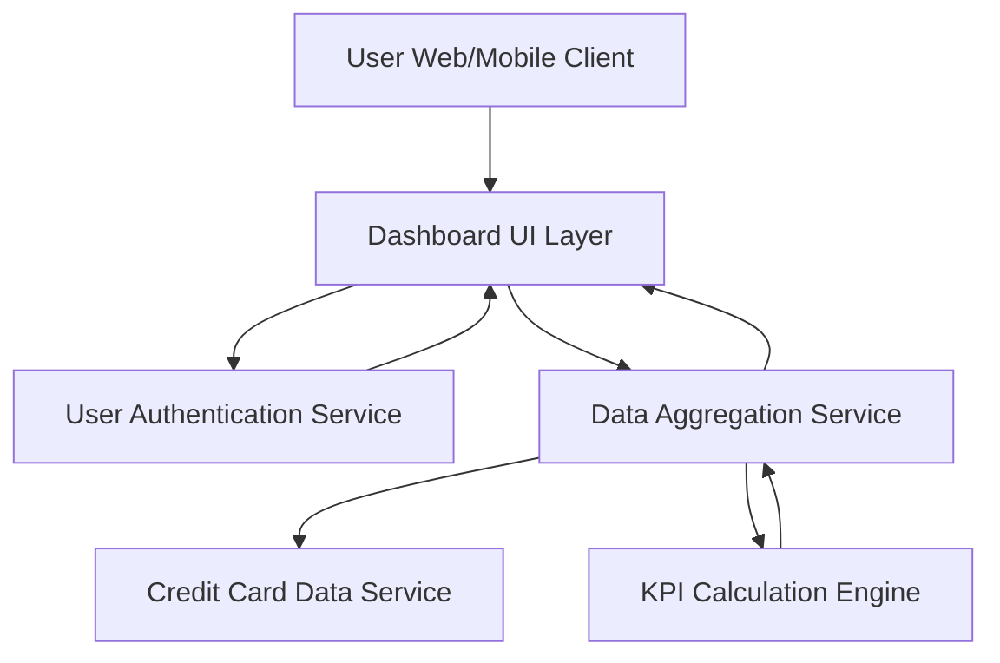

#### 1. High-Level Design

- **Summary:** This epic delivers a comprehensive dashboard providing users with a consolidated view of all credit cards and critical financial KPIs including monthly spend, total credit limit, available credit, and outstanding amounts. The solution enables real-time financial health monitoring through a modern, responsive interface accessible across all devices.

- **Component Flow:**

- **Integration Points:**
  - **Upstream:** User Authentication Service (secure user access and session management)
  - **Upstream:** Credit Card Data Service (retrieves card details, balances, and account information)
  - **Internal:** Data Aggregation Service (consolidates and calculates KPIs across multiple cards)

- **Key Assumptions:**
  - Credit Card Data Service provides REST/GraphQL APIs returning JSON formatted card and balance data with real-time or near-real-time updates.
  - User session management and token-based authentication are handled by the existing Authentication Service.

- **NFR Highlights:** Dashboard must load within 2 seconds for up to 10 credit cards; responsive design for mobile/tablet/desktop; near-real-time data refresh (max 5-min latency); WCAG 2.1 Level AA compliance.

- **Data Flow:** User authenticates via Authentication Service → Dashboard UI requests aggregated data → Data Aggregation Service fetches card details from Credit Card Data Service → KPI Calculation Engine computes monthly spend, total credit limit, available credit, and outstanding amounts → Aggregated KPIs returned to Dashboard UI → User views consolidated portfolio with real-time metrics.

#### 2. Validation Report

- **Requirements Coverage:** The design fully covers the epic's stated scope including dashboard KPIs display, monthly spend tracking, credit limit aggregation, available credit calculation, outstanding amount monitoring, multiple credit card view, responsive UI design, and real-time data refresh. All NFRs regarding performance (2-second load time), responsiveness, data refresh latency (5 minutes), and accessibility (WCAG 2.1 AA) are addressed through the component architecture. Integration dependencies with Credit Card Data Service, User Authentication Service, and Data Aggregation Service are explicitly mapped in the component flow.