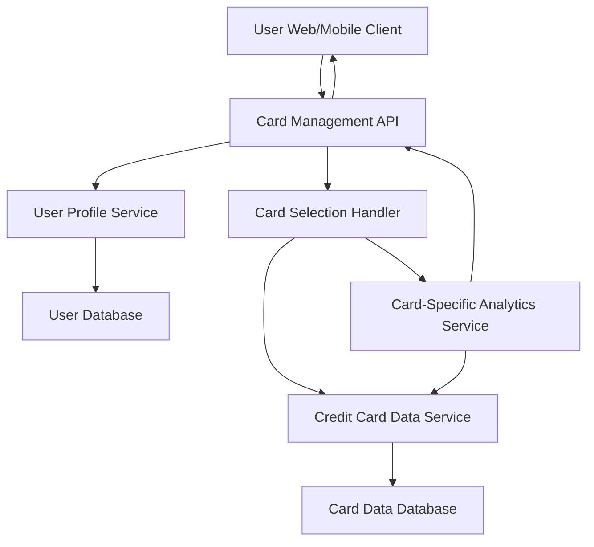

#### 1. High-Level Design

- **Summary:** This epic enables users to manage and view multiple credit cards (minimum 10 per user) within a single platform. Users can see all registered credit cards with individual details, perform card-wise analysis, switch between cards instantaneously, and view card-specific spending patterns, limits, and utilization.

- **Component Flow:**

- **Integration Points:**
  - **Internal:** Credit card data service for multi-card information retrieval (card details, balances, limits)
  - **Internal:** User profile service for card association with user accounts and user-card relationship management
  - **Internal:** Data storage service for persisting card information with data isolation between cards
  - **Internal:** Card-Specific Analytics Service for individual card spending analysis

- **Key Assumptions:**
  - Each user can have up to 10 or more credit cards associated with their profile, with unique identifiers for each card.
  - Card switching is handled client-side with cached card data to ensure instantaneous transitions without server round-trips.

- **NFR Highlights:** System must support minimum 10 credit cards per user; card switching must be instantaneous with no lag; UI must clearly distinguish between different cards; data isolation must be maintained between cards for security.

- **Data Flow:** User logs in → User Profile Service retrieves list of associated credit cards → Credit Card Data Service fetches details for all cards (limits, balances, spending) → Card list displayed on user's client with visual distinction → User selects a specific card → Card Selection Handler loads card-specific data → Card-Specific Analytics Service provides spending patterns and utilization for selected card → Card details and analytics displayed to user with instant switching capability.

#### 2. Validation Report

- **Requirements Coverage:** The design fully addresses the epic's scope including multiple credit card display, card-wise spend analysis, individual card details view, card selection and switching functionality, and card-specific credit limit and balance tracking. All NFRs (support for 10+ cards, instantaneous switching, clear UI distinction, data isolation for security) are incorporated through appropriate architectural patterns (User Profile Service for card association, Card Selection Handler for switching, data isolation at database level). All dependencies (Credit card data service, User profile service, Data storage service) are integrated into the component flow.