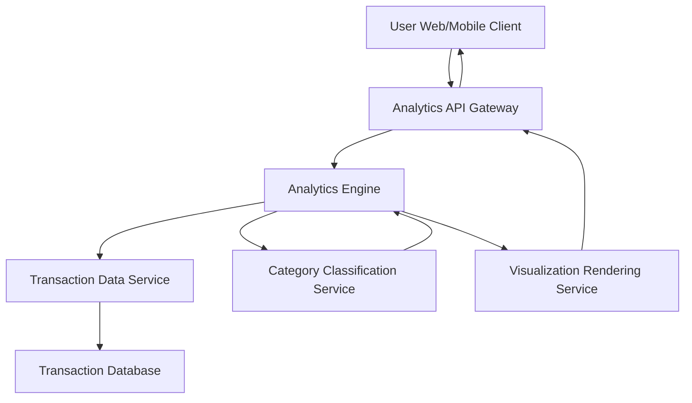

#### 1. High-Level Design

- **Summary:** This epic provides interactive visualizations and analytics capabilities to help users understand spending behavior across nine predefined categories (Food & Dining, Fuel, Shopping, Travel, Entertainment, Utilities, Healthcare, Education, Miscellaneous) and time periods. Users can view monthly spend trends, analyze category-wise patterns, and gain actionable insights through charts and graphs.

- **Component Flow:**

- **Integration Points:**
  - **Internal:** Transaction data service for retrieving spending records and transaction history (minimum 12 months)
  - **Internal:** Analytics engine for data processing, aggregation, and trend analysis
  - **Internal:** Category classification service for transaction categorization into nine predefined categories
  - **Frontend:** Visualization library for rendering interactive charts and graphs with drill-down capabilities

- **Key Assumptions:**
  - Transactions are pre-classified into one of the nine categories by the Category Classification Service (automated or rule-based).
  - Historical transaction data for at least 12 months is available and stored in the Transaction Database for trend analysis.

- **NFR Highlights:** Analytics queries must execute within 3 seconds; visualizations must render smoothly on all devices; system must handle minimum 12 months of historical data; charts must be interactive with drill-down capabilities.

- **Data Flow:** User selects analytics view (monthly trends, category breakdown, etc.) → Analytics API Gateway receives request → Analytics Engine queries Transaction Data Service for relevant transaction records → Category Classification Service provides category mappings → Analytics Engine aggregates and processes data (monthly trends, category totals, comparisons) → Visualization Rendering Service formats data for charts/graphs → Interactive visualizations returned to user's client for display.

#### 2. Validation Report

- **Requirements Coverage:** The design comprehensively covers the epic's scope including monthly spend trend visualization, category-wise spending analysis across nine categories, interactive charts and graphs, transaction-based analytics, and historical spending comparison. All NFRs (3-second query execution, smooth rendering, 12-month historical data, interactive drill-down) are addressed through dedicated components (Analytics Engine, Visualization Rendering Service, optimized data queries). All dependencies (Transaction data service, Analytics engine, Visualization library, Category classification service) are integrated into the architecture.