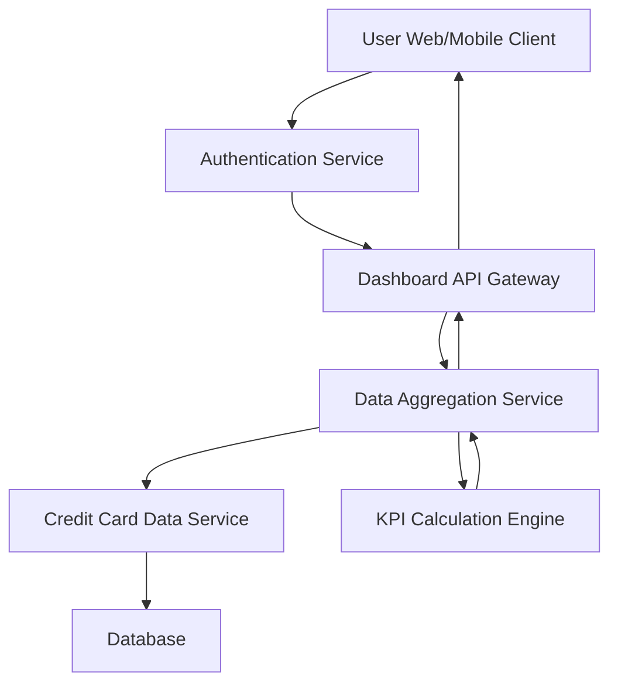

#### 1. High-Level Design

- **Summary:** This epic delivers a consolidated dashboard that displays key performance indicators (KPIs) for the user's credit card portfolio, including monthly spend, total credit limit, available credit, and outstanding amounts. The dashboard provides real-time visibility into financial health across all credit cards through a unified, responsive interface.

- **Component Flow:**

- **Integration Points:**
  - **Upstream:** User authentication service for secure access and user identity verification
  - **Internal:** Credit card data service for retrieving card details, balances, and transaction data
  - **Internal:** Data aggregation service for consolidating multi-card information into unified KPIs
  - **Data Store:** Database for persisting credit card information and transaction history

- **Key Assumptions:**
  - Credit card data is assumed to be refreshed in near real-time (within 5-10 seconds) from the credit card data service.
  - KPI calculations (total credit limit, available credit, outstanding amounts) are performed server-side to ensure accuracy and consistency.

- **NFR Highlights:** Dashboard must load within 2 seconds; real-time data refresh support; responsive design for desktop, tablet, and mobile; 100% data accuracy for financial calculations.

- **Data Flow:** User authenticates → Dashboard API fetches user's credit card list from Credit Card Data Service → Data Aggregation Service consolidates data from multiple cards → KPI Calculation Engine computes monthly spend, total credit limit, available credit, and outstanding amounts → Aggregated KPIs returned to Dashboard API → Rendered on user's client with responsive layout.

#### 2. Validation Report

- **Requirements Coverage:** The design fully covers the epic's stated scope including monthly spend display, total credit limit calculation, available credit tracking, outstanding amount visibility, multi-card consolidated view, and responsive dashboard layout. All NFRs (2-second load time, real-time refresh, responsive design, 100% accuracy) are addressed through appropriate architectural components (caching, aggregation service, calculation engine). All identified dependencies (credit card data service, authentication service, data aggregation service) are integrated into the component flow.