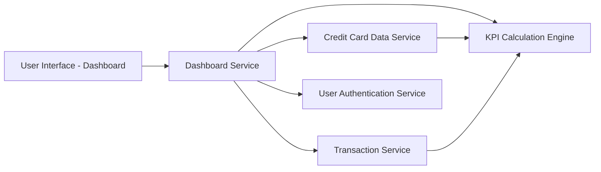

#### 1. High-Level Design

- **Summary:** This epic enables users to view a consolidated dashboard displaying critical financial metrics across all their credit cards. The dashboard provides real-time visibility into monthly spending, total credit limit, available credit, and outstanding amounts through an intuitive and responsive interface, enabling users to quickly assess their overall financial position and credit utilization.

- **Component Flow:**

- **Integration Points:**
  - **Upstream:** Credit Card Data Service (retrieves card balances and limits)
  - **Upstream:** Transaction Service (calculates monthly spend)
  - **Upstream:** User Authentication Service (provides secure access control)
  - **Internal:** KPI Calculation Engine (aggregates and calculates metrics: total credit limit, available credit, outstanding amounts)
  - **Downstream:** User Interface (renders dashboard with KPI visualization widgets)

- **Key Assumptions:**
  - "Real-time" data refresh is implemented via periodic polling or event-driven updates with acceptable latency (within 2-second load requirement).
  - Monthly spend is calculated for the current calendar month or rolling 30-day period.

- **NFR Highlights:** Dashboard must load within 2 seconds; System must support responsive design across desktop, tablet, and mobile devices; Real-time data refresh capability; Support for concurrent user sessions.

- **Data Flow:** User accesses dashboard → User Authentication Service validates user session → Dashboard Service requests data from Credit Card Data Service (balances, limits) and Transaction Service (monthly spend) → KPI Calculation Engine aggregates data to compute total credit limit, available credit, and outstanding amounts → Dashboard Service formats data for visualization → UI renders responsive dashboard with KPI widgets displaying all key metrics → Dashboard supports real-time refresh for updated data.

#### 2. Validation Report

- **Requirements Coverage:** The design fully addresses the epic's scope including monthly spend display, total credit limit aggregation, available credit calculation, outstanding amount tracking, responsive dashboard layout, and KPI visualization widgets. All NFRs are covered: 2-second load time requirement is supported by efficient data retrieval and aggregation; responsive design across desktop, tablet, and mobile is incorporated; real-time data refresh capability is enabled through the Dashboard Service; concurrent user session support is addressed through scalable service architecture. Integration dependencies with Credit Card Data Service, Transaction Service, and User Authentication Service are properly mapped and implemented.