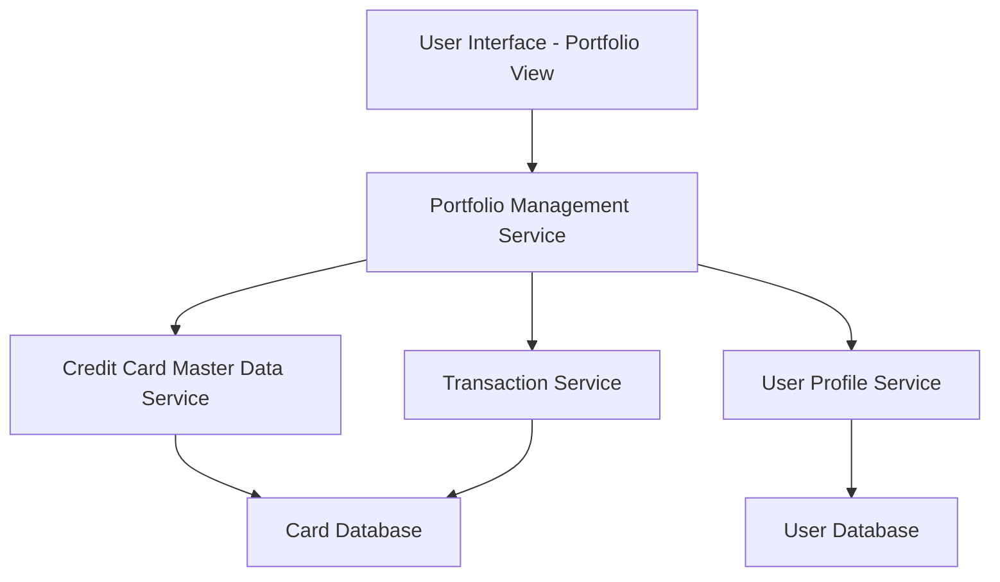

#### 1. High-Level Design

- **Summary:** This epic enables users to manage and monitor multiple credit cards from a unified interface. Users can view all their credit cards with associated details including card type, credit limits, balances, and card-specific spending information. The feature provides card-wise spend analysis to help users optimize card usage and track individual card performance against respective limits.

- **Component Flow:**

- **Integration Points:**
  - **Upstream:** Credit Card Master Data Service (provides card information including type, limits, balances)
  - **Upstream:** User Profile Service (links credit cards to user accounts)
  - **Upstream:** Transaction Service (provides card-specific transaction data for spend analysis)
  - **Downstream:** User Interface (displays consolidated portfolio view with card details and filtering)

- **Key Assumptions:**
  - Card numbers are masked using standard PCI-DSS compliant masking (e.g., showing only last 4 digits).
  - Card-wise spend is calculated in real-time or near real-time based on transaction data availability.

- **NFR Highlights:** System must support minimum 10 credit cards per user; Card data retrieval must complete within 1 second; Secure storage and display of card information with masked card numbers; Data encryption for card details at rest and in transit.

- **Data Flow:** User accesses portfolio management interface → Portfolio Management Service retrieves user profile from User Profile Service → Credit Card Master Data Service provides card details (type, limits, balances) → Transaction Service provides card-specific spending data → Portfolio Management Service aggregates and processes data → UI displays consolidated view with all cards, individual card details, and card-wise spend analysis → User can filter and select specific cards for detailed view.

#### 2. Validation Report

- **Requirements Coverage:** The design comprehensively covers all stated requirements including multiple credit card display, card details view, card-wise spend analysis, individual card credit limit tracking, card-specific balance information, and card selection/filtering. The architecture supports the NFR for minimum 10 cards per user, 1-second data retrieval, secure storage with masked card numbers, and encryption at rest and in transit. All integration dependencies (Credit Card Master Data Service, User Profile Service, Transaction Service) are properly addressed. Security requirements for PCI-DSS compliance are incorporated through data masking and encryption.