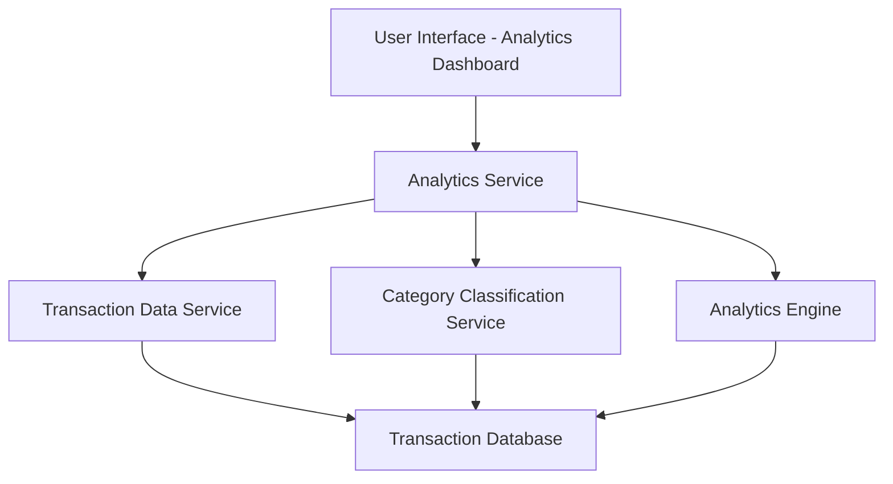

#### 1. High-Level Design

- **Summary:** This epic delivers comprehensive spending analytics through interactive visualizations that enable users to understand their spending behavior across 9 predefined categories (Food & Dining, Fuel, Shopping, Travel, Entertainment, Utilities, Healthcare, Education, Miscellaneous). Users can analyze monthly spend trends over time to identify patterns and make data-driven financial decisions.

- **Component Flow:**

- **Integration Points:**
  - **Upstream:** Transaction Data Service (provides historical transaction records)
  - **Upstream:** Category Classification Service (categorizes transactions into 9 predefined categories)
  - **Upstream:** Analytics Engine (performs trend calculation and aggregation)
  - **Downstream:** User Interface (renders interactive charts and visualizations)

- **Key Assumptions:**
  - Transactions are pre-categorized by the Category Classification Service; manual re-categorization is not required in this epic.
  - Monthly trends are calculated on a rolling 12-month basis with data aggregated at the daily or monthly granularity.

- **NFR Highlights:** Analytics queries must return results within 3 seconds; Support for at least 12 months of historical transaction data; Interactive visualizations must render smoothly with up to 1000 transactions; Charts must be responsive and mobile-optimized.

- **Data Flow:** User requests spending analytics via the dashboard → Analytics Service retrieves historical transactions from Transaction Data Service → Category Classification Service provides category mappings → Analytics Engine aggregates and calculates trends → Processed data (category-wise breakdowns, monthly trends) is returned to UI → Interactive visualizations (charts/graphs) are rendered for user interaction and analysis.

#### 2. Validation Report

- **Requirements Coverage:** The design fully covers the epic's stated scope including category-wise spending visualization, monthly spend trend analysis, interactive charts, spending pattern identification, multi-category comparison, and time-based filtering. All 9 spending categories are supported. The architecture accommodates the NFRs for query performance (3 seconds), historical data retention (12 months), transaction volume (1000 transactions), and responsive design. Integration dependencies with Transaction Data Service, Category Classification Service, and Analytics Engine are clearly mapped.