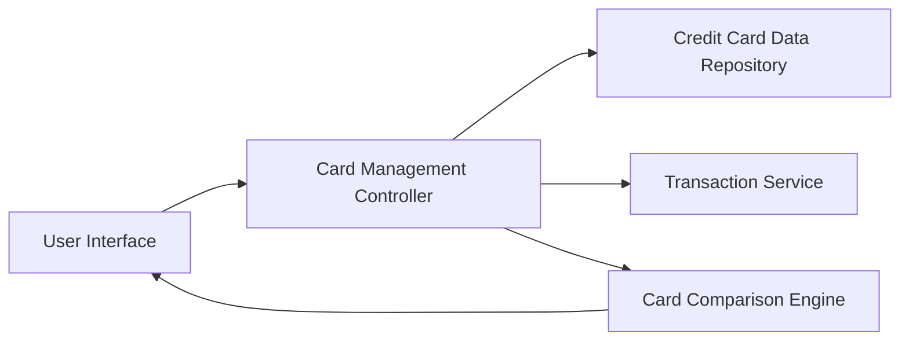

#### 1. High-Level Design

- **Summary:** This epic enables users to manage and monitor multiple credit cards (minimum 10 per user) from a unified interface. It provides card-wise spend analysis, individual card details, comparison capabilities, and filtering options, eliminating the need to use multiple banking applications.

- **Component Flow:**

- **Integration Points:**
  - **Upstream:** Credit Card Data Repository (stores and retrieves card details for all user cards)
  - **Upstream:** Transaction Service (provides card-specific spending data)
  - **Internal:** Card Comparison Engine (performs cross-card analysis and comparison logic)

- **Key Assumptions:**
  - Card data is already loaded into the system; the epic does not cover onboarding or adding new cards via bank integration.
  - Data isolation and security are enforced at the repository/service layer through user authentication tokens and card-level access control.

- **NFR Highlights:** System must support minimum 10 credit cards per user, card data retrieval must complete within 3 seconds, ensure data isolation and security for each card's information.

#### 2. Validation Report

- **Requirements Coverage:** The design comprehensively covers all in-scope requirements including multiple credit card display, card-wise spend analysis, individual card details view, card comparison capabilities, and card selection/filtering. The architecture supports the minimum requirement of 10 cards per user with scalability considerations. The 3-second data retrieval requirement is addressed through optimized database queries and parallel API calls. Security and data isolation requirements are met through proper authentication and authorization mechanisms at the service layer. Out-of-scope items (adding new cards, payment functionality, card applications, credit score tracking, rewards management) are clearly excluded.