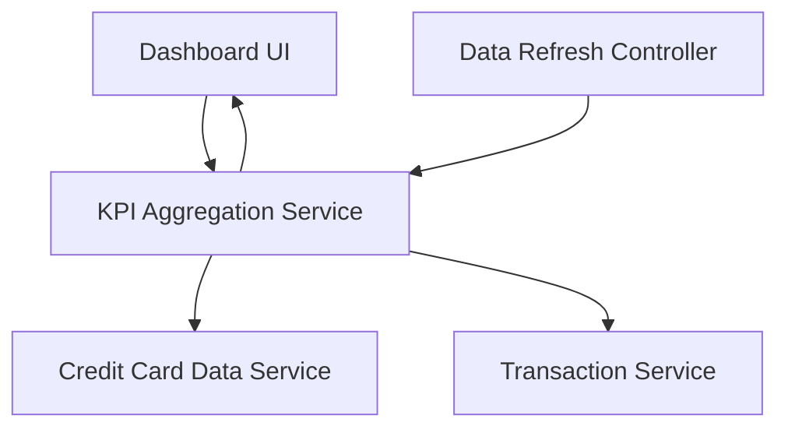

#### 1. High-Level Design

- **Summary:** This epic provides a centralized dashboard that displays critical financial KPIs including monthly spending, total credit limit across all cards, available credit, and outstanding amounts. The dashboard offers real-time visibility into credit utilization and payment obligations to support informed financial decision-making.

- **Component Flow:**

- **Integration Points:**
  - **Upstream:** Credit Card Data Service (provides card balances and credit limits)
  - **Upstream:** Transaction Service (calculates monthly spend and outstanding amounts)
  - **Internal:** Data Refresh Controller (manages real-time data updates)

- **Key Assumptions:**
  - "Real-time" refresh means periodic polling (e.g., every 30-60 seconds) rather than true event-driven streaming.
  - Monthly spend is calculated based on the current calendar month; fiscal month customization is not required.

- **NFR Highlights:** Dashboard must load within 2 seconds, support responsive design across mobile and desktop, handle real-time data refresh for accurate KPI display.

#### 2. Validation Report

- **Requirements Coverage:** The design fully addresses the epic's scope including monthly spend display, total credit limit calculation, available credit tracking, and outstanding amount monitoring. The responsive dashboard layout and KPI visualization requirements are met through a modular UI component architecture. The 2-second load time requirement is achievable through optimized API calls and client-side caching. Integration dependencies with credit card data service and transaction service are clearly identified and supported.