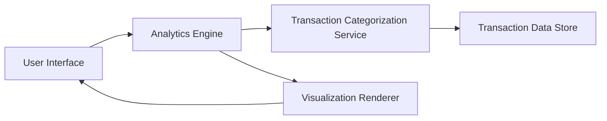

#### 1. High-Level Design

- **Summary:** This epic delivers an analytics and visualization module that enables users to understand spending patterns across 9 predefined categories (Food & Dining, Fuel, Shopping, Travel, Entertainment, Utilities, Healthcare, Education, Miscellaneous). It provides category-wise breakdowns and monthly trend analysis to support data-driven financial decisions.

- **Component Flow:**

- **Integration Points:**
  - **Upstream:** Transaction Categorization Service (assigns categories to transactions)
  - **Upstream:** Analytics Engine (performs trend calculations and aggregations)
  - **Data Source:** Transaction Data Store (minimum 12 months of historical transaction data)

- **Key Assumptions:**
  - Transactions are pre-categorized by an upstream service; manual re-categorization by users is out of scope.
  - Monthly trends are calculated using aggregated transaction data; real-time streaming analytics is not required.

- **NFR Highlights:** Visualizations must render within 2 seconds, support interactive filtering and drill-down, handle minimum 12 months of transaction history.

#### 2. Validation Report

- **Requirements Coverage:** The design covers all stated requirements including category-wise visualization, monthly trend analysis, and interactive charts. The architecture supports the 9 specified spending categories and integrates with the transaction categorization service and analytics engine as specified. The 2-second rendering requirement and 12-month history support are addressed through optimized data retrieval and caching strategies.