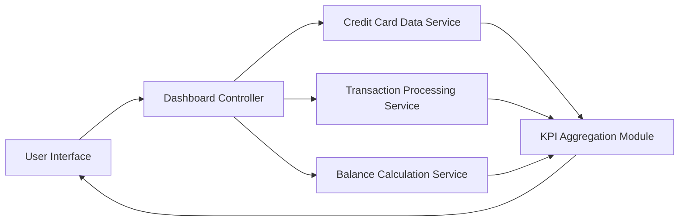

#### 1. High-Level Design

- **Summary:** This epic delivers a centralized dashboard displaying key performance indicators (KPIs) for credit card management. The dashboard provides real-time visibility into critical financial metrics: Monthly Spend, Total Credit Limit, Available Credit, and Outstanding Amount. The interface is modern, responsive, and optimized for multiple device sizes (mobile, tablet, desktop) to ensure accessibility and quick financial decision-making.

- **Component Flow:**

- **Integration Points:**
  - **Upstream:** Credit card data service (retrieves card information), Transaction processing service (calculates monthly spend), Balance calculation service (computes outstanding amounts)
  - **Downstream:** KPI Aggregation Module (consolidates metrics for display), User Interface (renders responsive dashboard)

- **Key Assumptions:**
  - KPI data sources (credit card data, transactions, balances) are available via APIs with real-time or near-real-time refresh capability.
  - Responsive design framework supports mobile, tablet, and desktop viewports with consistent user experience.

- **NFR Highlights:** Dashboard must load within 2 seconds; System must support responsive design for mobile, tablet, and desktop viewports; Real-time data refresh capability; UI must be accessible and comply with WCAG 2.1 standards.

- **Data Flow:** User accesses dashboard → Dashboard Controller initiates parallel requests to Credit Card Data Service, Transaction Processing Service, and Balance Calculation Service → Each service retrieves and processes relevant data → KPI Aggregation Module consolidates Monthly Spend, Total Credit Limit, Available Credit, and Outstanding Amount → Aggregated KPIs are formatted for visualization → Responsive User Interface renders KPI components optimized for user's device viewport → Dashboard displays with real-time refresh capability.

#### 2. Validation Report

- **Requirements Coverage:** The design fully addresses the epic's scope including Monthly Spend display, Total Credit Limit display, Available Credit calculation and display, Outstanding Amount display, Responsive dashboard layout, and KPI visualization components. All NFRs are met: 2-second load time through parallel data retrieval, responsive design for mobile/tablet/desktop, real-time data refresh capability, and WCAG 2.1 accessibility compliance. The component architecture supports quick decision-making through consolidated KPI visibility. The design explicitly excludes out-of-scope items (Real Bank Integration, Card Payments, Fund Transfers, Loans, Payment Gateway Integration) as specified.