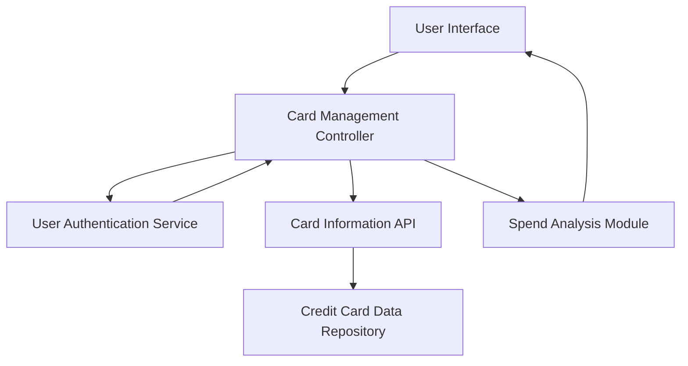

#### 1. High-Level Design

- **Summary:** This epic enables users to manage and monitor multiple credit cards within a unified interface. The system provides a consolidated view of all credit cards, card-specific details, individual card status (credit limits, available credit, outstanding balances), and card-wise spend analysis. This eliminates the need for users to access multiple banking portals for multi-card management.

- **Component Flow:**

- **Integration Points:**
  - **Upstream:** User authentication service (secures card access), Credit card data repository (stores card information), Card information API (retrieves card details)
  - **Downstream:** Spend Analysis Module (provides card-wise spending analytics)

- **Key Assumptions:**
  - Card information is synchronized and up-to-date in the Credit Card Data Repository with acceptable data freshness (near real-time or periodic sync).
  - Card numbers are stored in encrypted format and masking logic is applied at the presentation layer.

- **NFR Highlights:** System must support minimum 10 credit cards per user; Card data retrieval must complete within 3 seconds; Secure storage and display with masked card numbers; Data encryption for card details at rest and in transit.

- **Data Flow:** User authenticates via User Authentication Service → Card Management Controller requests card list from Card Information API → Card Information API retrieves encrypted card data from Credit Card Data Repository → Card data is decrypted and masked for display → User selects specific card → Spend Analysis Module fetches and processes card-specific transaction data → Consolidated multi-card view or individual card details displayed with status indicators (credit limit, available credit, outstanding balance).

#### 2. Validation Report

- **Requirements Coverage:** The design comprehensively covers all scope items including multiple credit card display, card-wise spend analysis, individual card details view, card selection and filtering, card status indicators, and consolidated multi-card view. All NFRs are addressed: support for minimum 10 cards per user, 3-second data retrieval, secure storage with masked card numbers, and encryption at rest and in transit. The authentication service ensures secure card access. The design explicitly excludes out-of-scope items (Real Bank Integration, Card Payments, Fund Transfers, Loans, Payment Gateway Integration) as specified.