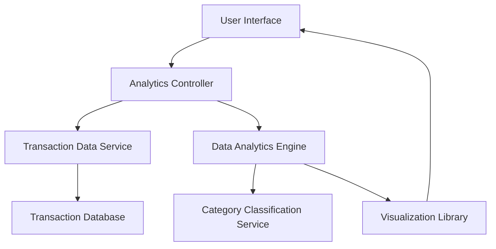

#### 1. High-Level Design

- **Summary:** This epic delivers a comprehensive transaction analytics system that enables users to visualize and analyze their credit card spending patterns across multiple categories (Food & Dining, Fuel, Shopping, Travel, Entertainment, Utilities, Healthcare, Education, Miscellaneous). The system provides monthly trend analysis, category-wise breakdowns, transaction history, and interactive visualizations to support data-driven financial decision-making.

- **Component Flow:**

- **Integration Points:**
  - **Upstream:** Transaction data service (provides raw transaction data), Category classification service (categorizes transactions)
  - **Downstream:** Visualization library (renders charts and graphs), Data analytics engine (processes spending patterns and trends)

- **Key Assumptions:**
  - Transaction data is pre-categorized or the category classification service provides real-time categorization with high accuracy.
  - Historical transaction data for up to 12 months is readily available and accessible with acceptable query performance.

- **NFR Highlights:** Analytics processing must complete within 5 seconds for up to 12 months of transaction data; Visualization must support minimum 1000 transactions; Charts must be interactive and responsive; Data aggregation accurate to 2 decimal places.

- **Data Flow:** User requests spending analytics → Analytics Controller fetches transaction data from Transaction Data Service → Data Analytics Engine processes and aggregates transactions by category and time period → Category Classification Service validates/enriches categorization → Processed data is formatted for visualization → Visualization Library renders interactive charts/graphs → Results displayed to user with filtering and search capabilities.

#### 2. Validation Report

- **Requirements Coverage:** The design fully covers the epic's stated scope including category-wise spending visualization, monthly spend trends analysis, transaction history display, interactive charts, spending pattern identification, multi-category breakdown, and transaction filtering/search. All NFRs regarding processing time (5 seconds), transaction volume (1000+), interactivity, responsiveness, and data accuracy (2 decimal places) are addressed through the component architecture. The design explicitly excludes out-of-scope items (Real Bank Integration, Card Payments, Fund Transfers, Loans, Payment Gateway Integration) as specified.