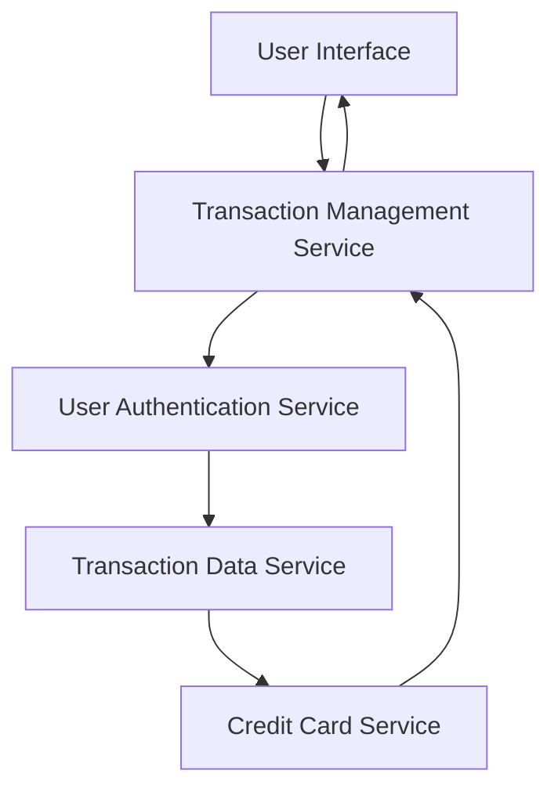

#### 1. High-Level Design

- **Summary:** This epic provides users with comprehensive transaction viewing capabilities across all credit cards. Users can access detailed transaction histories, view transaction details, and track spending activities from a centralized location to understand spending behavior and improve financial transparency.

- **Component Flow:**

- **Integration Points:** 
  - **Upstream:** Transaction data service (for retrieving transaction records), Credit card service (for linking transactions to specific cards), User authentication service (for secure data access)
  - **Downstream:** Transaction UI components for displaying transaction lists and details

- **Key Assumptions:** 
  - Transaction history depth (e.g., last 12 months, all-time) is determined by the Transaction Data Service; retention policy is not specified in the epic.
  - Transaction details include standard fields (date, amount, merchant, category); additional fields like merchant location or transaction ID format are service-dependent.

- **NFR Highlights:** System must handle transaction data for users with high transaction volumes; Transaction retrieval must be optimized for performance; Data must be displayed accurately and securely.

- **Data Flow:** User accesses transaction view → User Authentication Service validates access → Transaction Management Service requests transaction data from Transaction Data Service → Transaction Data Service queries transactions and links them to specific cards via Credit Card Service → Transaction records (with card associations) are returned → Transaction Management Service formats and paginates data → User Interface displays transaction listing with drill-down capability for transaction details.

#### 2. Validation Report

- **Requirements Coverage:** The design covers all stated scope elements including transaction listing, transaction details view, multi-card transaction support, transaction history access, and responsive transaction interface. The architecture supports NFRs for handling high transaction volumes through pagination and optimized queries, performance optimization via caching and indexing strategies, and secure/accurate data display through authentication and data validation layers. Integration with Transaction Data Service, Credit Card Service, and User Authentication Service aligns with stated dependencies. Out-of-scope items (real bank integration, payments, fund transfers, loans) are explicitly excluded from this design.