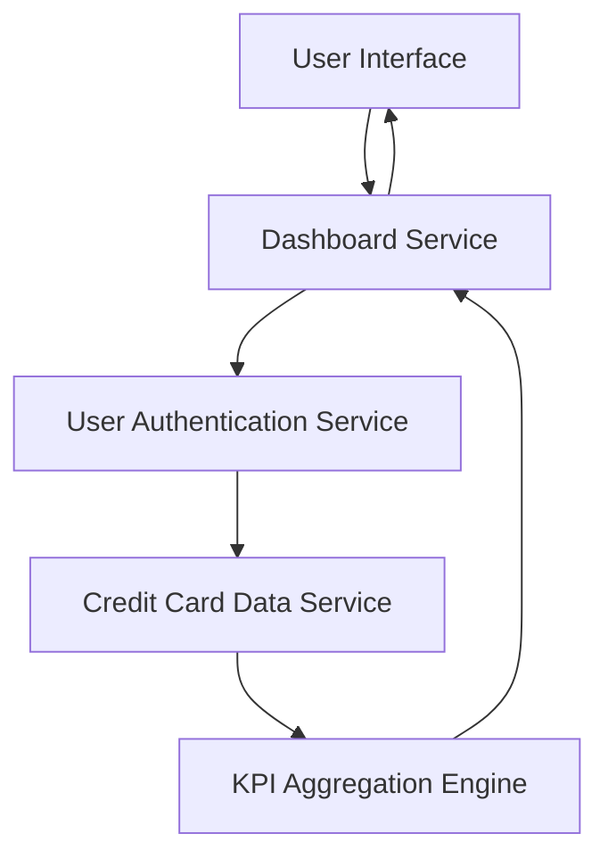

#### 1. High-Level Design

- **Summary:** This epic enables users to view and manage multiple credit cards from a single consolidated interface with real-time KPIs. Users can monitor Monthly Spend, Total Credit Limit, Available Credit, and Outstanding Amount across all credit cards to make informed financial decisions and maintain better control over their credit card portfolio.

- **Component Flow:**

- **Integration Points:** 
  - **Upstream:** Credit card data service (for retrieving card details and balances), User authentication service (for secure access to personal financial data)
  - **Downstream:** Dashboard rendering layer for displaying consolidated KPIs

- **Key Assumptions:** 
  - "Real-time or near real-time" data refresh is interpreted as data updates within 5-10 seconds of source system changes; refresh mechanism (polling vs. push) is not specified.
  - Available Credit is calculated as (Total Credit Limit - Outstanding Amount); no grace periods or pending transactions are factored in unless specified by the data service.

- **NFR Highlights:** System must provide real-time or near real-time data refresh for KPIs; Dashboard must be responsive across desktop, tablet, and mobile devices; Page load time must be under 2 seconds for optimal user experience.

- **Data Flow:** User logs in → User Authentication Service validates credentials → Dashboard Service requests credit card data from Credit Card Data Service → Raw card details (balances, limits, outstanding amounts) are retrieved → KPI Aggregation Engine calculates Monthly Spend, Total Credit Limit, Available Credit, Outstanding Amount across all cards → Aggregated KPIs are sent to Dashboard Service → Dashboard UI displays consolidated view with real-time refresh capability.

#### 2. Validation Report

- **Requirements Coverage:** The design addresses all scope elements including Dashboard KPIs display, multiple credit card view, monthly spend tracking, total credit limit aggregation, available credit calculation, outstanding amount display, and responsive dashboard layout. The architecture supports NFRs for real-time data refresh, responsive design across devices, and <2s page load time through optimized service calls and caching strategies. Integration with Credit Card Data Service and User Authentication Service aligns with stated dependencies. Out-of-scope items (real bank integration, payments, fund transfers, loans) are explicitly excluded.