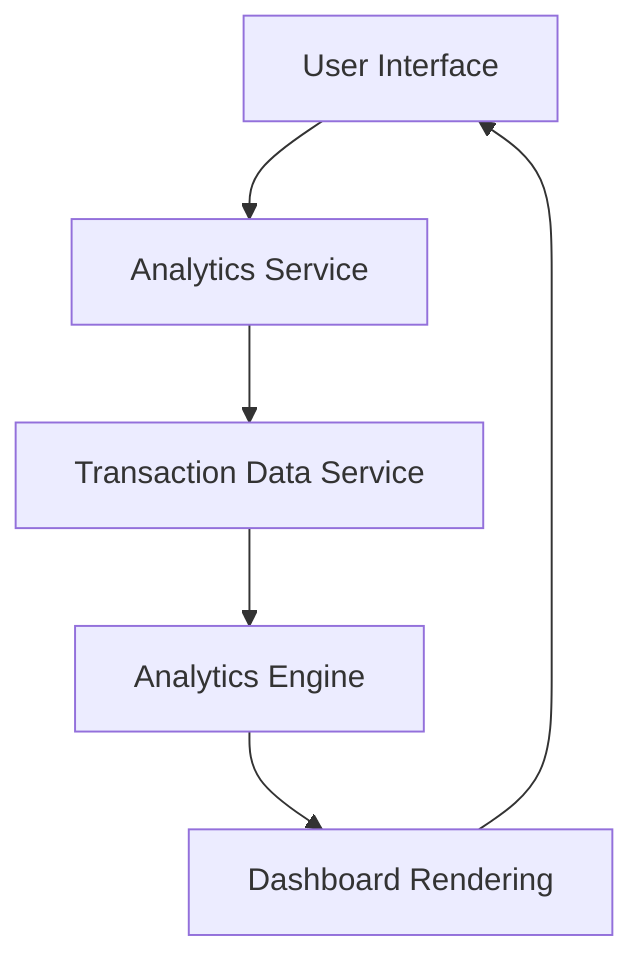

#### 1. High-Level Design

- **Summary:** This epic delivers interactive visualizations and analytical capabilities enabling users to understand spending patterns across multiple categories (Food & Dining, Fuel, Shopping, Travel, Entertainment, Utilities, Healthcare, Education, Miscellaneous). It includes Monthly Spend Trends and Card-wise Spend Analysis to provide actionable insights for financial optimization.

- **Component Flow:**

- **Integration Points:** 
  - **Upstream:** Transaction data service (for aggregating spending data), Analytics engine (for processing and categorizing transactions)
  - **Downstream:** Dashboard service (for rendering visualizations)

- **Key Assumptions:** 
  - Transaction categorization is performed by the Analytics Engine using predefined rules or ML models; categories are standardized across all cards.
  - Monthly trends are calculated based on transaction date timestamps; fiscal month vs. calendar month is not specified.

- **NFR Highlights:** Analytics visualizations must load within 3 seconds; System must support interactive filtering and drill-down capabilities; Charts must be responsive and render correctly on all device types.

- **Data Flow:** User requests spending analytics → Analytics Service queries Transaction Data Service → Raw transaction data is sent to Analytics Engine for categorization and aggregation → Processed data (category totals, monthly trends, card-wise breakdowns) is returned to Dashboard Rendering → Interactive charts and visualizations are displayed to the user with filtering capabilities.

#### 2. Validation Report

- **Requirements Coverage:** The design covers all stated scope elements including category-wise visualization, monthly trends, card-wise analysis, interactive charts, multi-category breakdown, and spending pattern identification. The architecture supports the NFRs for load time (<3s), interactive filtering, and responsive rendering. Integration with Transaction Data Service, Analytics Engine, and Dashboard Service aligns with stated dependencies. Out-of-scope items (real bank integration, payments, predictive analytics) are explicitly excluded from this design.