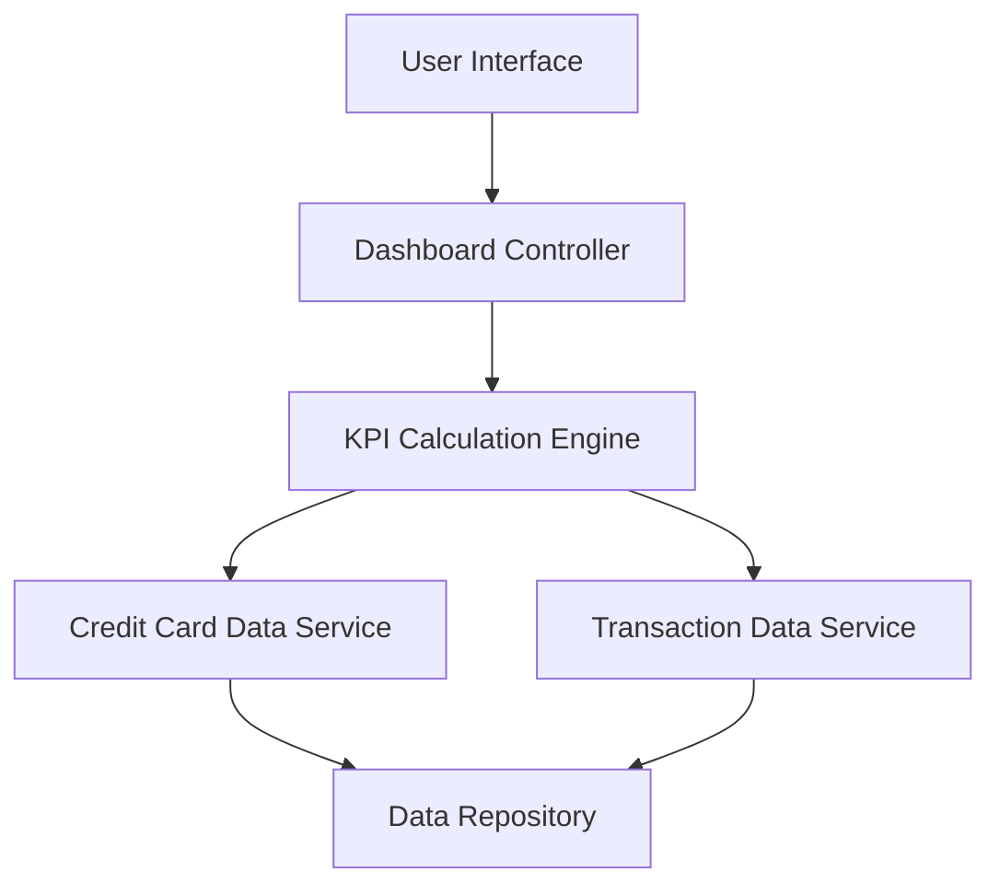

### 1. High-Level Design

- **Summary:** This epic delivers a consolidated dashboard that displays key performance indicators (KPIs) for a user's credit card portfolio, including monthly spend, total credit limit, available credit, and outstanding amounts. The dashboard provides at-a-glance visibility into overall credit card financial health through a modern, responsive interface accessible across multiple devices.

- **Component Flow:**

- **Integration Points:**
  - **Upstream:** Credit Card Data Service (for card information retrieval), Transaction Data Service (for transaction data), User Authentication Service (for secure access)
  - **Downstream:** User Interface layer (web/mobile responsive clients)

- **Key Assumptions:**
  - KPI calculations aggregate data from all active credit cards in real-time; card data is assumed to be pre-validated and stored in a consistent format in the data repository.
  - User session management and authentication tokens are handled by an existing authentication service.

- **NFR Highlights:** Dashboard must be responsive across desktop, tablet, and mobile devices; KPI calculations must refresh in real-time; UI must support concurrent viewing by multiple users.

### 2. Validation Report

- **Requirements Coverage:** The design fully covers the epic's stated scope by incorporating all required KPIs (monthly spend, total credit limit, available credit, outstanding amounts), ensuring responsive layout across devices, and supporting multi-card consolidated views. The component flow addresses real-time KPI calculation and data retrieval from the credit card and transaction services as specified in dependencies.