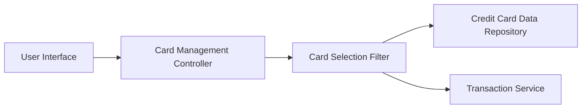

### 1. High-Level Design

- **Summary:** This epic enables users to manage and monitor multiple credit cards from a single interface, providing individual card details, card-specific spending, credit limits, and outstanding balances. Users can perform card-wise spend analysis to understand utilization patterns and compare spending across their credit card portfolio.

- **Component Flow:**

- **Integration Points:**
  - **Upstream:** Credit Card Data Repository (for storing and retrieving card information), Transaction Service (for card-specific spending data)
  - **Downstream:** User Interface (for displaying card list, details, and filtering options)

- **Key Assumptions:**
  - Each credit card record contains standardized fields (card number, limit, balance, issuer) stored in the data repository; transaction data is tagged with card identifiers for filtering.
  - The system assumes a maximum of 10 cards per user for performance optimization as specified in NFRs.

- **NFR Highlights:** System must support display of at least 10 credit cards per user; Card data retrieval must complete within 2 seconds; Interface must maintain performance with multiple cards loaded.

### 2. Validation Report

- **Requirements Coverage:** The design addresses all scope elements including multiple card display, individual card details, card-wise spend analysis, per-card credit limit and outstanding balance tracking, and card selection/filtering. The architecture ensures performance requirements are met through efficient data retrieval from the card repository and transaction service within the 2-second NFR constraint.