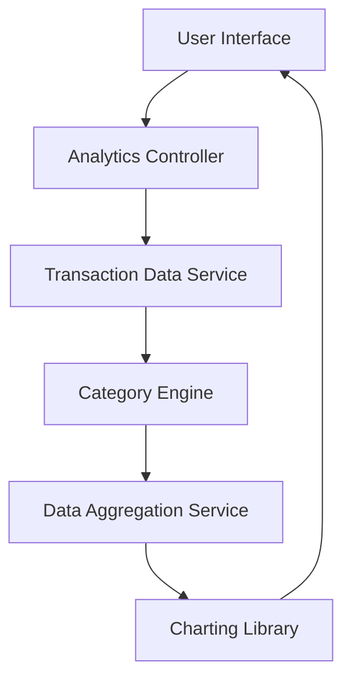

### 1. High-Level Design

- **Summary:** This epic provides interactive visualizations and analytics to help users understand spending patterns through category-wise analysis and monthly trend tracking. Users can explore spending across 9 predefined categories (Food & Dining, Fuel, Shopping, Travel, Entertainment, Utilities, Healthcare, Education, Miscellaneous) and analyze monthly trends to make informed financial decisions.

- **Component Flow:**

- **Integration Points:**
  - **Upstream:** Transaction Data Service (with categorized transaction information), Data Aggregation Service (for trend calculations), Analytics Engine/Charting Library (for visualization rendering)
  - **Downstream:** User Interface (for displaying interactive charts, graphs, and spending breakdowns)

- **Key Assumptions:**
  - Transactions are pre-categorized into one of the 9 predefined categories at the time of ingestion; historical transaction data is retained for at least 12 months as per NFR.
  - Monthly aggregation is performed server-side to optimize visualization load times and meet the 3-second rendering requirement.

- **NFR Highlights:** Analytics visualizations must load within 3 seconds; System must handle historical data for at least 12 months; Charts must be interactive and responsive across all device types.

### 2. Validation Report

- **Requirements Coverage:** The design comprehensively covers all scope requirements including category-wise spending visualization, monthly trend analysis, interactive charts/graphs, spending breakdown by category, time-based comparison, and transaction categorization across 9 categories. The architecture integrates the necessary services (transaction data, aggregation, charting) and ensures NFRs are met through server-side aggregation and optimized rendering within the 3-second load time constraint.